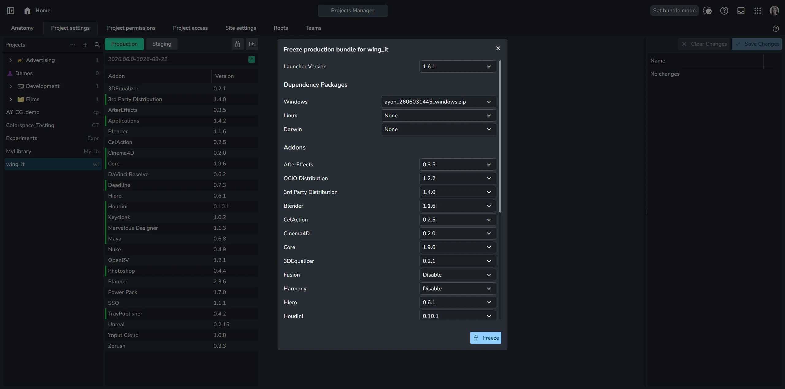
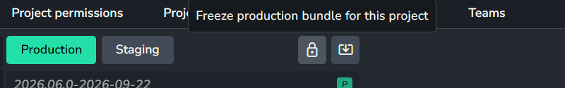
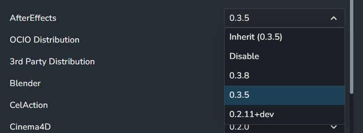
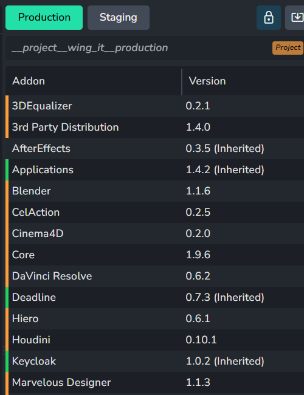
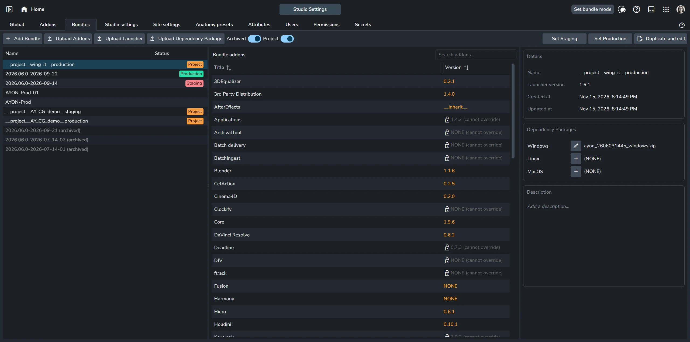
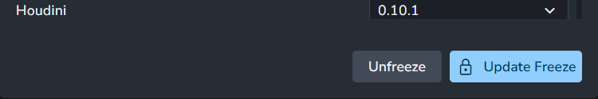

# Project bundle

<PageInfo />

A project bundle locks a bundle for one production. It sets the launcher version, the dependency packages and the addon versions that one project uses, so the project keeps working the same way while the studio's Production or Staging bundle moves on. A project bundle is frozen, not locked: single addon versions can still be changed later, after checking that they work with the project. It is created in the freeze dialog of [Project settings](project-settings.md). How bundles and project bundles are used by the server and the launcher is explained in [Bundles](../../how-ayon-works/bundles.md#project-bundles).

## Freeze dialog

### Opening the dialog

<Columns widths="55 45">
<Column>

The lock button in the addon list toolbar of Project settings opens the dialog for the selected project and variant. Its tooltip reads **Freeze production bundle for this project** (or staging), and it is highlighted when the project already has a project bundle for that variant. A project can have one project bundle for production and one for staging. For any other variant, including Dev, the button is disabled with the tooltip **Variant must be production or staging to freeze.**

</Column>
<Column>

</Column>
</Columns>

### What the dialog sets

The dialog is titled **Freeze &lt;variant&gt; bundle for &lt;project&gt;**.

| Section | Options |
|---|---|
| **Launcher Version** | The launcher versions uploaded to the server. |
| **Dependency Packages** | One dropdown per platform (**Windows**, **Linux**, **Darwin**) with **None** and the packages uploaded for it. |
| **Addons** | One dropdown per addon that allows project-level version overrides. |

<Columns widths="55 45">
<Column>

Each addon offers:

- **Inherit (&lt;version&gt;)**: follows the studio bundle of the variant, also when its version changes. The label shows the current studio version, or `DISABLED`.
- **Disable**: the addon is turned off for the project.
- An explicit version: stays at that version whatever the studio bundle does. Versions that cannot be used in project bundles are listed but disabled, with **This version cannot be used in project bundles.**

Without a project bundle, the dialog starts from the studio bundle of the variant: its launcher, its dependency packages and each addon at the studio version. An addon whose studio version cannot be used in project bundles starts at **Inherit**, and an addon missing from the studio bundle at **Disable**.

</Column>
<Column>

</Column>
</Columns>

Addons that do not allow project-level version overrides are not in the dialog and cannot be disabled there. They always follow the studio bundle of the same variant.

## The frozen project

The project bundle is named `__project__<project name>__<variant>`, for example `__project__wing_it__production`.

<Columns widths="55 45">
<Column>

In **Project settings**, the bundle field above the addon list shows the project bundle's name with a **Project** badge, and the lock button is highlighted. Addons that follow the studio bundle show **(Inherited)** after their version. The addons with an explicit version get project overrides when the project is frozen (see the table below), so the addon list marks them as overridden.

</Column>
<Column>

</Column>
</Columns>

On the [Bundles](../studio/bundles.md) page, admins see project bundles when the **Project** switch is on, with a **Project** badge. The addon list of a project bundle shows:

| Shown as | Meaning |
|---|---|
| A version or `NONE` in orange | The addon is set to that version, or disabled, for the project. |
| `__inherit__` in orange | The addon follows the studio bundle (**Inherit**). |
| A lock, the studio's Production version and **(cannot override)** | The addon does not allow project-level version overrides and follows the studio bundle. |

What freezing and unfreezing change:

| Topic | Behavior |
|---|---|
| Freeze or update | For every addon with an explicit version, the project's complete settings (studio values plus project overrides) are written as project overrides for that version. Later changes to the studio settings of those fields no longer reach the project. |
| Unfreeze | The project bundle is deleted. For the addons that had explicit versions, fields that are not project-scoped are removed from the project overrides, and the overrides move to the version the studio bundle uses. Project overrides are not lost. |
| State | A project bundle cannot be set to Production, Staging or Dev. |
| Compatibility check | Not run when a project bundle is created or updated. Inherited addons and addons that cannot override their version follow the studio bundle, so check their compatibility when the studio bundle changes. |

A project keeps its own settings overrides whether it uses a studio bundle or a project bundle; the project bundle locks the code. See [Project bundles and settings](../../how-ayon-works/settings.md#project-bundles-and-settings).

## Controls and interactions

<Columns widths="55 45">
<Column>

| Button | Shown | What it does |
|---|---|---|
| **Freeze** | The project has no project bundle for the variant | Creates the project bundle. |
| **Update Freeze** | A project bundle exists | Saves the dialog values to it. |
| **Unfreeze** | A project bundle exists | Deletes it. |

The close button at the top right closes the dialog without changes. Errors from the server appear at the bottom of the dialog.

</Column>
<Column>

</Column>
</Columns>

## Related

- [Bundles](../../how-ayon-works/bundles.md#project-bundles)
- [Project settings](project-settings.md)
- [Bundles page](../studio/bundles.md)
- [Settings](../../how-ayon-works/settings.md#project-bundles-and-settings)
