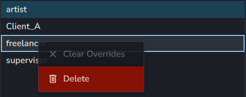

# Project permissions

<PageInfo />

The **Project permissions** tab of the [Projects Manager](index.md) overrides the settings of the studio [access groups](../studio/permissions.md) for the selected project. A project override replaces the whole definition of the group in that project; it is not merged with the studio definition. Groups without an override keep following the studio definition. Which users have which group in a project is set on the [Project access](project-access.md) tab. How overrides fit into permission checks is explained in [Permissions](../../how-ayon-works/permissions.md#studio-definition-and-project-overrides).

The tab is shown to managers and admins only. Other users who open its URL are sent to the first tab they can open.

## Access groups

The page has the [project list](../project-list.md) on the left, the list of access groups in the middle and the settings of the selected group on the right. **No access group selected** is shown until a group is selected.

### Access group list

The list has one column, **Access group**, with every group defined at the studio level. A group that has an override in the selected project is highlighted. Groups are created on the studio [Permissions](../studio/permissions.md) page; this tab has no button to create one.

### Group settings

| Control | What it does |
|---|---|
| **Clear project overrides** | Deletes the group's override in the selected project after a confirmation (**Clear project overrides**, button **Clear**). Disabled when the group has no override in the project. |
| **Save Changes** | Saves the edited settings as the group's override in the selected project and shows **Project access group settings saved**. Active when something changed. |
| Settings editor | For a group without an override it shows the studio definition; for a group with an override it shows the override. |

The settings are the same as on the studio level and are described on the [Permissions](../studio/permissions.md#permission-settings) page, except that **Studio permissions** (**Create projects**, **List all users**) are not shown: they are studio-scoped and are read from the groups in the user's **Default projects access**.

### How overrides are stored

| Topic | Behavior |
|---|---|
| Storage | The complete group definition is stored in the project's own `access_groups` table under the group name. The studio definition stays in the server-wide table. |
| Saving | Saving writes the whole definition shown in the editor, so the first save of a group in a project copies the studio definition with the edits. From then on, later changes to the studio definition do not reach that group in this project. |
| Use | When a user's permissions in the project are combined, each assigned group is read from the project override when one exists, and from the studio definition otherwise. |
| Clearing | Deleting the override returns the group in this project to the studio definition at once. |
| Events | Saving emits `access_group.updated`, clearing emits `access_group.deleted`, both with the project name. |
| Deleting the project | The overrides are deleted with the project. |

The server lets managers, admins and users with **Read & Write** on **Project access** in the project save and clear project overrides, through `/api/accessGroups/<group>/<project>`. The web app shows this tab only to managers and admins, so other users can do it only through the API. Deleting an access group always needs the manager or admin role.

## Controls and interactions

### Group menu

<Columns widths="60 40">
<Column>

Right-clicking a group in the list offers:

| Entry | What it does |
|---|---|
| **Clear Overrides** | Same as **Clear project overrides**. Disabled when the group has no override in the project. |
| **Delete** | Deletes the access group itself at the studio level, for every project, after a confirmation. The group is removed from all users' assignments and default access lists. |

</Column>
<Column>

</Column>
</Columns>

### Field menu

Right-clicking a field of the settings offers **Copy** and **Paste** of its value as JSON. A pasted value must have the same structure as the field.

## Related

- [Permissions](../studio/permissions.md)
- [Project access](project-access.md)
- [Permissions (how AYON works)](../../how-ayon-works/permissions.md)
- [Project configuration](index.md)
