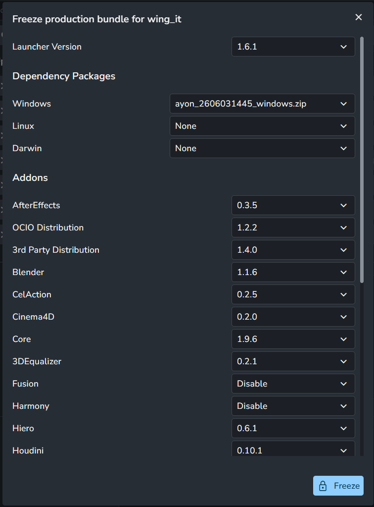

# Project settings

<PageInfo />

The **Project settings** tab of the [Projects Manager](index.md) edits the addon settings of the selected project. Values set here are project overrides: they apply to this project only and are stored on top of the studio settings of the same addon version and variant. Fields without a project override keep following the [Studio settings](../studio/studio-settings.md), and [Site settings](site-settings.md) can override some fields again per workstation. Scopes, override layers and storage are explained in [Settings scopes and storage](../../backend/settings/index.md).

## Settings editor

The page has four columns: the [project list](../project-list.md), the addon list with its toolbar, the settings of the selected addons, and the list of unsaved changes with the save buttons.

### Addon list

The toolbar above the list chooses which settings are edited:

| Control | What it does |
|---|---|
| **Production**, **Staging**, **Dev** | The variant. The active one is highlighted. **Dev** is shown in developer mode only and selects the user's own dev bundle; without one the message **No dev bundle found for your user. Please create one first.** appears. The choice is kept for the browser tab and shared with the **Studio settings** page. |
| Lock button | Opens the project bundle dialog for the selected variant, see [Project bundles](#project-bundles). |
| Copy button (tooltip **Copy settings from another bundle**) | Opens the copy dialog with every addon of the list, to load values from another bundle, variant or project into the editor. Disabled while there are unsaved changes. See [Copy settings](../dialogs/copy-settings.md#settings-copy-dialog). |
| Bundle | The bundle the project uses for the selected variant: the studio bundle of that variant, or the project bundle when one exists. Read-only here. |

The list has the columns **Addon** and **Version** and shows the addons of that bundle that have at least one project-scoped field. Several addons can be selected at once; each gets its own panel in the editor.

| Marker | Meaning |
|---|---|
| Coloured bar on the left of a row | The addon has overrides at the studio, project or site level, or unsaved changes. The colours follow the [override states](../../backend/settings/index.md#override-states-in-the-editor). |
| **(Inherited)** after the version | The project has a project bundle and the addon follows the studio bundle. |
| **WARNING: No bundle set to &lt;variant&gt;** | No bundle has the selected variant. |

### Editor

| Control | What it does |
|---|---|
| **Search and filter settings** | Filters the addon panels to the matching fields. **No settings found for the current search** when nothing matches. |
| Help button (tooltip **Show help descriptions**) | Shows or hides the field descriptions. |
| Addon panels | One per selected addon. The header shows the addon name and version with badges for the project and the variant. Fields show their override state with colours. |

When the project has a project bundle and the addon has an explicit version in it, the panel shows **The addon settings for this project are frozen to the project bundle. Studio settings are also displayed alongside project-scoped settings.** and also shows the studio-scope fields of the addon.

Without view rights for the selected project, the page shows **You don't have permission to view the addon settings for this project**.

### Changes and saving

<Columns widths="60 40">
<Column>

| Control | What it does |
|---|---|
| Changes list | One row per changed field, grouped by addon, with badges for the variant and the project. The delete button of a row, or **Clear Selected** in its right-click menu, reverts those changes. **No changes** when nothing is pending. |
| **Clear Changes** | Discards all unsaved changes. |
| **Save Changes** | Saves the changed fields of every addon as project overrides and shows **Settings saved**. |

</Column>
<Column>

</Column>
</Columns>

Managers and admins can view and save the settings of every project. Users need **Read only** (view) or **Read & Write** (view and save) on **Project addon settings** in the project; without write rights **Save Changes** is disabled with the tooltip **You don't have edit permissions**. The full list of who may change which scope is in [Settings scopes and storage](../../backend/settings/index.md#permissions).

### Project bundles

A project bundle is a bundle assigned to one project. It lets the project run on its own launcher version, dependency packages and addon versions while the studio Production or Staging bundle moves on, which protects long-running projects from changes to the studio bundles. A project bundle is frozen, not locked: single addon versions can be changed later.

The lock button in the addon list toolbar opens the dialog. Its tooltip reads **Freeze production bundle for this project** (or staging), and it is highlighted when the project already uses a project bundle for the selected variant. It works for the Production and Staging variants only; for any other variant, including Dev, it is disabled with the tooltip **Variant must be production or staging to freeze.** Opening the dialog, freezing, updating and unfreezing need the manager or admin role.

<Columns widths="55 45">
<Column>

The dialog is titled **Freeze &lt;variant&gt; bundle for &lt;project&gt;**.

| Section | Options |
|---|---|
| **Launcher Version** | The launcher versions uploaded to the server |
| **Dependency Packages** | One dropdown per platform (**Windows**, **Linux**, **Darwin**) with **None** and the packages uploaded for it |
| **Addons** | One dropdown per addon that allows project-level version overrides |

Each addon offers:

- **Inherit (&lt;version&gt;)**: follows the studio bundle of the variant, also when its version changes. The label shows the current studio version, or `DISABLED`.
- **Disable**: the addon is turned off for the project.
- An explicit version: stays at that version whatever the studio bundle does. Versions that cannot be used in project bundles are listed but disabled, with **This version cannot be used in project bundles.**

Without a project bundle, the dialog starts from the studio bundle of the variant: its launcher, dependency packages and each addon at the studio version. An addon whose studio version cannot be used in project bundles starts at **Inherit**, and an addon missing from the studio bundle at **Disable**.

| Button | Shown | What it does |
|---|---|---|
| **Freeze** | No project bundle yet | Creates the project bundle |
| **Update Freeze** | A project bundle exists | Saves the dialog values to it |
| **Unfreeze** | A project bundle exists | Removes it |

Errors from the server appear at the bottom of the dialog.

</Column>
<Column>

</Column>
</Columns>

Addons that do not allow project-level version overrides are not in the dialog and cannot be disabled there. They always follow the studio bundle of the same variant, and appear in the project bundle on the [Bundles](../studio/bundles.md) page with a lock icon, the studio version and **(cannot override)**.

| Topic | Behavior |
|---|---|
| Name | `__project__<project name>__<variant>`, where the variant is `production` or `staging`. |
| Bundle field | Shows the project bundle name when the project uses one. |
| Bundles page | Project bundles are listed when the **Project** switch is on, with a **Project** badge, for admins. Overridable addons come first; overrides are shown in orange and inherited values with a lock. |
| Freeze or update | For every addon with an explicit version, the project's complete settings (studio values plus project overrides) are written as project overrides for that version. Later changes to the studio settings of those fields no longer reach the project. |
| Unfreeze | The project bundle is deleted. For the addons that had explicit versions, fields that are not project-scoped are removed from the project overrides, and the overrides move to the version the studio bundle uses. Project overrides are not lost. |
| State | A project bundle cannot be set to Production, Staging or Dev. |
| Compatibility check | Not run when a project bundle is created or updated. Inherited and non-overridable addons follow the studio bundle, so check their compatibility when it changes. |

A project keeps its own overrides whether it uses a studio bundle or a project bundle; the project bundle fixes the code. See [Project bundles and settings](../../backend/settings/index.md#project-bundles-and-settings).

## Controls and interactions

### Field menu

Right-clicking a field or a group offers:

| Entry | What it does |
|---|---|
| **Add current &lt;field&gt; value as project override** | Pins the current value as a project override, after a confirmation (**Pin override**). Takes effect at once. |
| **Remove project override from &lt;field&gt;** | Removes the project override after a confirmation, so the field follows the studio value again. Takes effect at once. |
| **Remove all project overrides** | On the root of an addon panel: removes all project overrides of the addon for this project and variant, after a confirmation. |
| **Copy**, **Paste** | Copy the value as JSON, or paste JSON into it as an unsaved change. A pasted value must have the same structure. |

See also [Right-click menu on fields](../../backend/settings/index.md#right-click-menu-on-fields).

### Addon menu

Right-clicking an addon in the list offers **Copy settings from...**, which loads values from another addon version, variant or project into the editor (see [Copy settings](../dialogs/copy-settings.md#settings-copy-dialog)). Admins also get **Low-level editor**, which edits the stored project overrides of one addon directly.

## Related

- [Settings scopes and storage](../../backend/settings/index.md)
- [Studio settings](../studio/studio-settings.md)
- [Site settings (project)](site-settings.md)
- [Copy settings](../dialogs/copy-settings.md)
- [Bundles](../studio/bundles.md)
- [Project configuration](index.md)
- [Artist workstation setup](../../workstation-setup.md)
