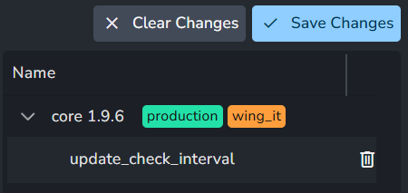

# Project settings

<PageInfo />

The **Project settings** tab of the [Projects Manager](index.md) edits the addon settings of the selected project. Values set here are project overrides: they apply to this project only and are stored on top of the studio settings of the same addon version and variant. Fields without a project override keep following the [Studio settings](../studio/studio-settings.md), and [Site settings](site-settings.md) can override some fields again per workstation. Scopes, override layers and storage are explained in [Settings](../../how-ayon-works/settings.md).

## Settings editor

The page has four columns: the [project list](../project-list.md), the addon list with its toolbar, the settings of the selected addons, and the list of unsaved changes with the save buttons.

### Addon list

The toolbar above the list chooses which settings are edited:

| Control | What it does |
|---|---|
| **Production**, **Staging**, **Dev** | The variant. The active one is highlighted. **Dev** is shown in developer mode only and selects the user's own dev bundle; without one the message **No dev bundle found for your user. Please create one first.** appears. The choice is kept for the browser tab and shared with the **Studio settings** page. |
| Lock button | Opens the project bundle dialog for the selected variant, see [Project bundles](#project-bundles). |
| Copy button (tooltip **Copy settings from another bundle**) | Opens the copy dialog with every addon of the list, to load values from another bundle, variant or project into the editor. Disabled while there are unsaved changes. See [Copy settings](../dialogs/copy-settings.md#settings-copy-dialog). |
| Bundle | The bundle the project uses for the selected variant: the studio bundle of that variant, or the project bundle when one exists. Read-only here. |

The list has the columns **Addon** and **Version** and shows the addons of that bundle that have at least one project-scoped field. Several addons can be selected at once; each gets its own panel in the editor.

| Marker | Meaning |
|---|---|
| Coloured bar on the left of a row | The addon has overrides at the studio, project or site level, or unsaved changes. The colours follow the [override states](../../how-ayon-works/settings.md#override-states-in-the-editor). |
| **(Inherited)** after the version | The project has a project bundle and the addon follows the studio bundle. |
| **WARNING: No bundle set to &lt;variant&gt;** | No bundle has the selected variant. |

### Editor

| Control | What it does |
|---|---|
| **Search and filter settings** | Filters the addon panels to the matching fields. **No settings found for the current search** when nothing matches. |
| Help button (tooltip **Show help descriptions**) | Shows or hides the field descriptions. |
| Addon panels | One per selected addon. The header shows the addon name and version with badges for the project and the variant. Fields show their override state with colours. |

When the project has a project bundle and the addon has an explicit version in it, the panel shows **The addon settings for this project are frozen to the project bundle. Studio settings are also displayed alongside project-scoped settings.** and also shows the studio-scope fields of the addon.

Without view rights for the selected project, the page shows **You don't have permission to view the addon settings for this project**.

### Changes and saving

<Columns widths="60 40">
<Column>

| Control | What it does |
|---|---|
| Changes list | One row per changed field, grouped by addon, with badges for the variant and the project. The delete button of a row, or **Clear Selected** in its right-click menu, reverts those changes. **No changes** when nothing is pending. |
| **Clear Changes** | Discards all unsaved changes. |
| **Save Changes** | Saves the changed fields of every addon as project overrides and shows **Settings saved**. |

</Column>
<Column>

</Column>
</Columns>

Managers and admins can view and save the settings of every project. Users need **Read only** (view) or **Read & Write** (view and save) on **Project addon settings** in the project; without write rights **Save Changes** is disabled with the tooltip **You don't have edit permissions**. Who may change which scope is listed in [Settings](../../how-ayon-works/settings.md#the-four-scopes).

### Project bundles

The lock button in the addon list toolbar opens the freeze dialog, which locks the launcher version, the dependency packages and the addon versions of the project in a project bundle. Its tooltip reads **Freeze production bundle for this project** (or staging), and it is highlighted when the project already has one. When the project uses a project bundle, the bundle field shows its name with a **Project** badge, and addons that follow the studio bundle show **(Inherited)** after their version. See [Project bundle](project-bundle.md).

## Controls and interactions

### Field menu

Right-clicking a field or a group offers:

| Entry | What it does |
|---|---|
| **Add current &lt;field&gt; value as project override** | Pins the current value as a project override, after a confirmation (**Pin override**). Takes effect at once. |
| **Remove project override from &lt;field&gt;** | Removes the project override after a confirmation, so the field follows the studio value again. Takes effect at once. |
| **Remove all project overrides** | On the root of an addon panel: removes all project overrides of the addon for this project and variant, after a confirmation. |
| **Copy**, **Paste** | Copy the value as JSON, or paste JSON into it as an unsaved change. A pasted value must have the same structure. |

### Addon menu

Right-clicking an addon in the list offers **Copy settings from...**, which loads values from another addon version, variant or project into the editor (see [Copy settings](../dialogs/copy-settings.md#settings-copy-dialog)). Admins also get **Low-level editor**, which edits the stored project overrides of one addon directly.

## Related

- [Settings](../../how-ayon-works/settings.md)
- [Studio settings](../studio/studio-settings.md)
- [Site settings (project)](site-settings.md)
- [Copy settings](../dialogs/copy-settings.md)
- [Bundles](../studio/bundles.md)
- [Project configuration](index.md)
- [Artist workstation setup](../../workstation-setup.md)
