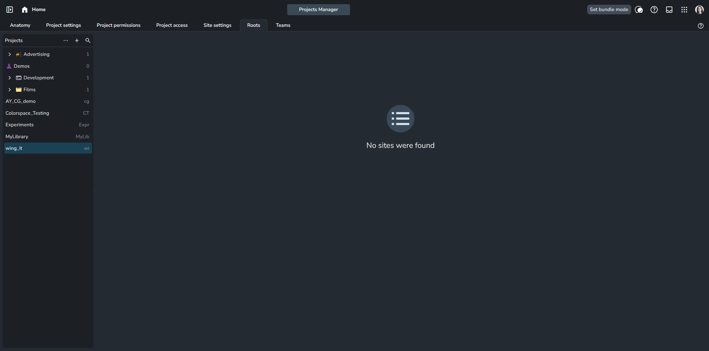

# Roots

<PageInfo />

The **Roots** tab of the [Projects Manager](index.md) sets root paths for the selected project per site. A path saved here replaces the root path of the project anatomy for the signed-in user on that workstation, for example when the storage is mounted under another drive letter or mount point. The anatomy roots themselves are edited on the [Anatomy](anatomy.md) tab. The order in which root paths are resolved, including Site Sync, is described in [Pipeline storage](../../how-ayon-works/pipeline-storage.md#roots).

## Site roots

The page has the [project list](../project-list.md) on the left and one panel per site on the right. The panels list the sites registered to the signed-in user, that is, the workstations where the user has used the AYON launcher (see [Site IDs](../../backend/settings/index.md#site-ids)). **No sites were found** is shown when there is none, as in the screenshot above.

| Element | Content |
|---|---|
| Panel header | The host name of the site, with the site ID on the right. |
| One field per root | Labelled with the root name. The placeholder shows the path from the project anatomy for the platform of that site. An empty field means the anatomy path is used. |
| **Save** | Saves the root paths of that site and shows **Roots saved**. Active when a field differs from the saved value. |

### Storage

| Topic | Behavior |
|---|---|
| Key | The values are stored in the project, per site ID and user name. Two users on the same workstation have separate values, and the web app always reads and saves the values of the signed-in user. |
| Platform | A site has one platform, so each panel holds one path per root, for that platform. |
| Empty values | Empty fields are not stored. Saving a site with every field empty deletes its entry. |
| Unknown roots | Only roots that exist in the project anatomy are shown. |
| Use | The launcher and pipeline tools ask the server for the roots of the project for the current site; the server combines the anatomy roots with the values saved here. |

Deleting a site through the server API removes its custom roots.

## Controls and interactions

Everyone can open the tab. Managers and admins can view and save the roots of every project; other users only of the projects they are assigned to through an access group, and the project list puts those projects first. For other projects the page shows **You don't have permission to view this project's roots**.

## Related

- [Pipeline storage](../../how-ayon-works/pipeline-storage.md)
- [Anatomy](anatomy.md)
- [Site settings (project)](site-settings.md)
- [Settings scopes and storage](../../backend/settings/index.md)
- [Project configuration](index.md)
