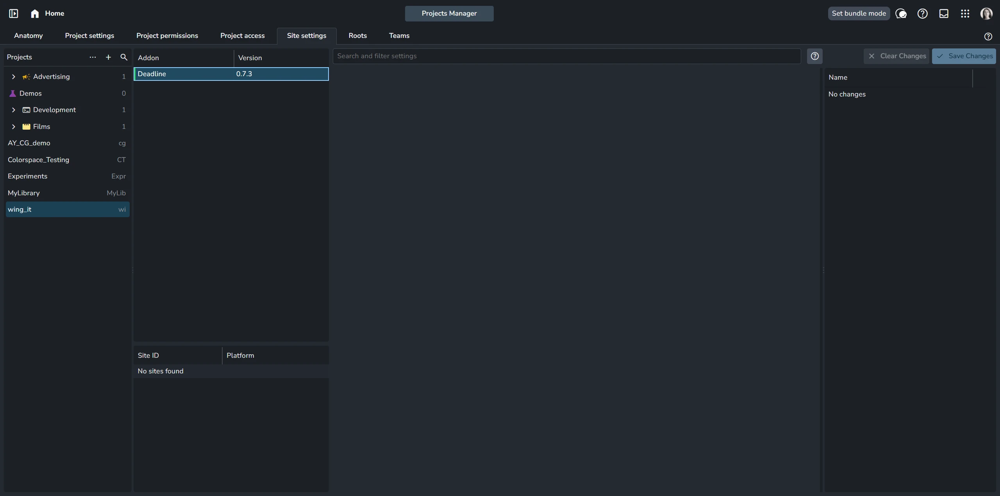

# Site settings (project)

<PageInfo />

The **Site settings** tab of the [Projects Manager](index.md) edits project site settings: overrides of an addon's settings for one workstation (site), one user and one project. Only fields the addon marks as site-capable appear, and their values apply on top of the studio and [project](project-settings.md) values. This tab is not the same as the studio-level [Site settings](../studio/site-settings.md) page, which edits a separate set of fields for every project; neither reads the other. Root paths per workstation are set on the [Roots](roots.md) tab. See [Settings](../../how-ayon-works/settings.md#the-four-scopes) and [Site IDs](../../how-ayon-works/site-ids.md).

## Site settings editor

The page has the [project list](../project-list.md) on the left, the addon list and the site list in the next column, the settings editor in the middle and the changes list with the save buttons on the right.

| Area | Content |
|---|---|
| Addon list | Columns **Addon** and **Version**: the addons that have project site settings. There is no variant selector, bundle field or copy button on this tab. A coloured bar marks addons with overrides (see [override states](../../how-ayon-works/settings.md#override-states-in-the-editor)). |
| Site list | Columns **Site ID** and **Platform**: the sites registered to the signed-in user. Several sites can be selected. **No sites found** when the user has no registered site. |
| Editor | One panel per selected addon and selected site, with badges for the project, the site ID and the variant. Nothing is shown until a site is selected. |
| Changes list | Unsaved changes with **Clear Changes** and **Save Changes**, as on the [Project settings](project-settings.md#changes-and-saving) tab. |

A site appears in the list after the AYON launcher has connected from that workstation with the user signed in. A site cannot be added on this page.

### Storage

| Topic | Behavior |
|---|---|
| User | The values are stored under the user's name, so two users on the same workstation have separate values. No user can edit another user's site settings in the web app. |
| Variant | Site settings are stored per variant. The tab uses the variant last chosen on the **Project settings** or **Studio settings** page in the same browser tab (Production by default); the variant badge of each panel shows which one is edited. |
| Access | Every signed-in user can open this tab for the projects in their project list and edit the site settings of their own sites. Access groups do not limit it. |

## Controls and interactions

The editor has the same search field, help button and right-click menus as the [Project settings](project-settings.md#editor) tab; overrides here are site overrides. **Remove all site overrides** on the root of a panel deletes every site override of the addon for that site, project and variant.

The first selected site is remembered in the browser and selected again the next time the tab opens.

## Related

- [Settings](../../how-ayon-works/settings.md)
- [Site settings (studio)](../studio/site-settings.md)
- [Project settings](project-settings.md)
- [Roots](roots.md)
- [Project configuration](index.md)
