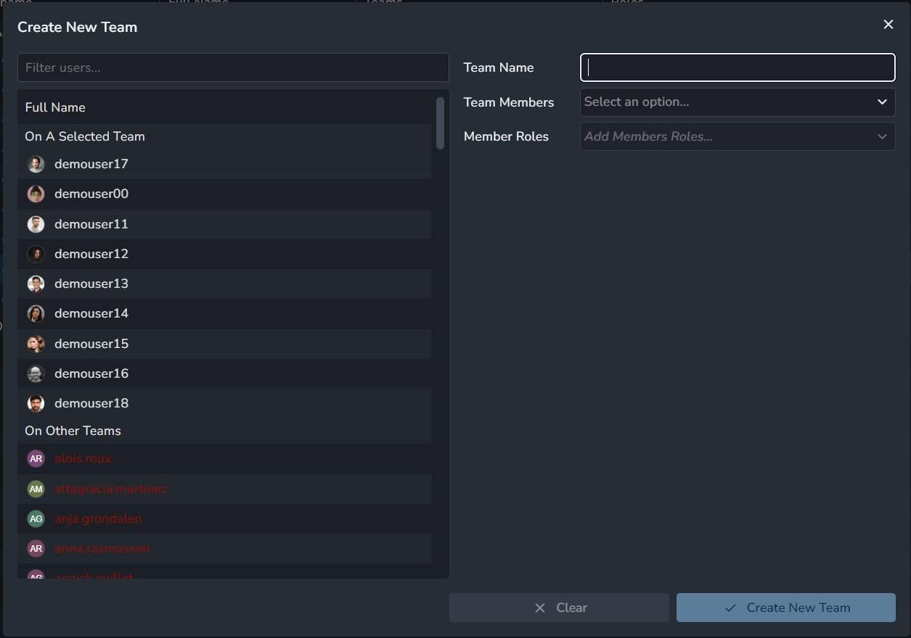
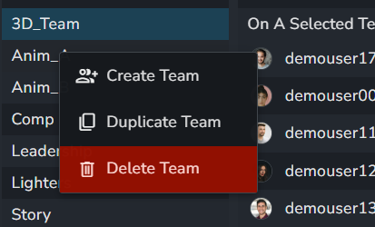
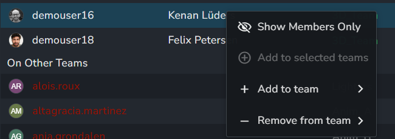

# Teams

<PageInfo />

The **Teams** tab of the [Projects Manager](index.md) groups the users of the selected project into named teams. A team has members, and each member has any number of roles and can be a leader; a team can have several leaders and a user can be on several teams. Teams are stored with the project. Roles and leader flags describe people; they grant no permissions. Teams are offered as mention targets in comments (see [Activity feed](../details-panel.md#activity-feed)) and as entries in the access lists of the [Power Pack](../../../addons/production-tracking/power-pack/index.md), such as comment categories. Which users can work in the project is set on the [Project access](project-access.md) tab.

The tab is shown to managers and admins, and the server allows only them to create, change and delete teams.

## Teams and members

The page has the [project list](../project-list.md) on the left, then the team list, the members table, and **Member Settings** and **Team Settings** on the right.

### Team list

One row per team, with multiple selection. The selected teams are kept in the `teams` query parameter. Selecting teams changes what the members table and the settings show.

### Members table

The table lists admins, managers and every user with at least one access group in the project. Team members who are no longer listed are shown too, in red, so they can be removed: hovering their name shows **User has no access to this project** or **User does not exist**.

| Column | Content |
|---|---|
| **Username** | User name with avatar |
| **Full Name** | Full name |
| **Teams** | The teams of the user. Teams where the user is a leader are shown in green; teams that are not selected are dimmed. |
| **Roles** | The roles of the user across teams. Roles on unselected teams are dimmed. |

The rows are grouped, with the users on selected teams first:

| Group | Meaning |
|---|---|
| **On A Selected Team** | The user is on at least one selected team. |
| **On Other Teams** | The user is only on teams that are not selected (when a team is selected). |
| **On Teams** | The user is on a team (when no team is selected). |
| **On No Teams** | The user is on no team. |

### Member Settings

The settings of the users selected in the table. The header shows the selected user, or the number of selected users.

| Field | What it does |
|---|---|
| **On Teams** | The teams the selected users belong to. Adding or removing a team here adds them to it or removes them from it. |
| **Roles** | The roles of the selected users on the selected team (**Setting On Team: &lt;team&gt;**). A role that does not exist yet is created. |
| **Leader** | Makes the selected users leaders of the selected team. |

### Team Settings

The settings of the selected teams. The header shows the team name, or the number and names of the selected teams, and the counts as **&lt;n&gt; Members - &lt;n&gt; Leaders**, where members are counted without the leaders.

| Field | What it does |
|---|---|
| **Team Name** | Renames the team with the edit button next to it, when one team is selected. Renaming creates a team with the new name and the same members, then deletes the old one. |
| **Roles** | The roles used on the selected teams. A role can be renamed or deleted with the buttons next to it, which changes it for every member of every team that has it. |

Changes in both panels are saved at once.

### Team names

- New team names are formatted to lowercase without spaces, and must be 2 to 64 characters long.
- Names are unique within a project, ignoring upper and lower case. A name already in use shows **Team name already taken**.

## Controls and interactions

### Toolbar

| Control | What it does |
|---|---|
| **Add New Team** | Opens the **Create New Team** dialog. |
| **Filter users...** | Shows only the users whose name, full name, teams, roles or leader flag match the text. |
| **Hide Other Team Members** | Hides the users who are not on a selected team. |

### Create New Team

<Columns widths="45 55">
<Column>

The dialog has a user table with its own **Filter users...** field on the left, and **Team Name**, **Team Members** and **Member Roles** on the right. Users can be picked in the table or in **Team Members**. The roles entered apply to every member entered.

| Key or button | What it does |
|---|---|
| **Create New Team**, `Enter` | Creates the team and closes the dialog |
| `Shift` + `Enter` | Creates the team and keeps the dialog open for the next one |
| **Clear** | Empties the form |
| `Escape` | Closes the dialog |

</Column>
<Column>

</Column>
</Columns>

### Right-click menus

<Gallery columns={2} rows={1} more="show-all">

</Gallery>

| Where | Entry | What it does |
|---|---|---|
| Team list | **Create Team** | Opens the **Create New Team** dialog. |
| Team list | **Duplicate Team** | One team selected: asks for a new name (**Duplicate Team - &lt;team&gt;**, button **Create**) and copies the members, roles and leader flags. |
| Team list | **Delete Team**, **Delete Teams** | Deletes the selected teams after a confirmation. |
| Members table | **Show Members Only**, **Show All Users** | Turns **Hide Other Team Members** on or off. |
| Members table | **Add to &lt;team&gt;**, **Add to selected teams** | Adds the users to the selected teams. |
| Members table | **Add to team**, **Remove from team** | Submenus listing the teams the users can be added to or removed from. |

A right-clicked user outside the selection is acted on alone, without changing the selection.

## Related

- [Activity feed](../details-panel.md#activity-feed)
- [Project access](project-access.md)
- [Users](../studio/users.md)
- [Power Pack](../../../addons/production-tracking/power-pack/index.md)
- [Project configuration](index.md)
