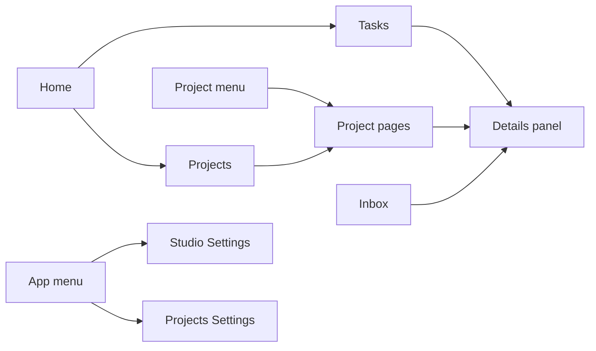

# Quick navigation and server layout

The AYON web app has a handful of areas that people return to every day: their own tasks, the pages of a project, the inbox, and the settings. This page is a map of those areas for someone new to AYON. It explains which area is for what, lists every keyboard shortcut, and shows how to reach a single project, task, product or version quickly. The pages of the Web UI section follow the layout of the web app: one page per tab, grouped as the app groups them. The top bar and its menus are described on the [Navigation bar](navigation-bar.md) page.

## The main areas

| Area | What happens there | Who uses it most | How to get there |
|---|---|---|---|
| **Home**, **Tasks** tab | The landing page after sign-in. The user's assigned tasks across projects, as a status board or a list. Statuses change by dragging cards between columns. See [Home tasks](home/tasks.md). | Artists, supervisors | **Home** button, `h+h` |
| **Home**, **Projects** tab | The list of projects with their details, and **Create new project** for managers, administrators and users with the permission to create projects. | Producers, managers | **Home**, then the **Projects** tab |
| **Home**, **Plan** and **Resources** tabs | Studio-level resource planning, when the [Planner addon](../../addons/production-tracking/planner/index.md) is installed. Without it a **Planner** tab shows an overview of the feature. | Producers, resource managers | **Home**, then the tab |
| Project pages | Everything about one project, in tabs: **Overview**, **Task progress**, **Products**, **Lists**, **Review**, **Schedule**, **Reports**, **Workfiles**, plus tabs added by addons. See the table below. | Everyone except guests | Project menu (`1`), or a double click on a project in **Projects** |
| **Inbox** | Mentions, assignments, comments and publishes that concern the user, split into **Important**, **Other** and **Cleared**. See [Inbox and notifications](inbox/index.md). | Everyone | Inbox icon, `i+i` |
| **Studio Settings** | Server-wide configuration: addons, bundles, studio settings of the addons, anatomy presets, attributes, users, permissions, secrets. Users without the manager role get **Site Settings** in its place. | Administrators, managers, pipeline TDs | **App** menu, `s+s` |
| **Projects Settings** | Per-project configuration: anatomy, addon settings for the project, project permissions, project access, roots, teams. | Managers, pipeline TDs | **App** menu, `p+p` |
| **App** menu | Settings entries, **Event Viewer**, **Services**, **Market** and server maintenance, filtered by role. | Administrators, managers | Grid icon, `9` |
| **User** menu | **Account**, **Download Launcher**, **Sign out**. | Everyone | Avatar, `0` |
| **Help** menu | Help center, latest changes, feedback, community links, and the server's REST API and GraphQL documentation. | Everyone | Question mark icon, `8` |

### Project tabs

| Tab | Use it to |
|---|---|
| **Overview** | See and edit folders and tasks in a spreadsheet: create the hierarchy, set assignees, statuses and dates. See [Project overview](production-tracking/overview.md). |
| **Task progress** | See how far each folder is, task type by task type. See [Task progress](production-tracking/task-progress.md). |
| **Products** | Browse everything published in the project, version by version. See [Products and versions](production-tracking/products.md). |
| **Lists** | Work with hand-picked sets of folders, tasks or versions. See [Lists](production-tracking/lists.md). |
| **Review** | Review sessions, with the [Review addon](../../addons/production-tracking/review/index.md). |
| **Schedule** | Task dates on a timeline, with the [Planner addon](../../addons/production-tracking/planner/index.md). |
| **Reports** | Dashboards of counts and charts, with the [Reports addon](../../addons/production-tracking/reports/index.md). |
| **Workfiles** | The workfiles saved for the project's tasks. |

**Review**, **Schedule** and **Reports** are always in the tab row. Without their addon in the production bundle, they show an overview of what the addon provides. A deprecated **Browser** tab appears only when the server enables it.



The diagram in words:

1. **Home** holds the **Tasks** and **Projects** tabs.
2. A project opens from **Projects** or from the project menu, and its pages share one tab row.
3. Tasks home, the project pages and the inbox all open the selected entity in the same details panel.
4. The **App** menu leads to **Studio Settings** and **Projects Settings**.

## Keyboard shortcuts

The web app has keyboard shortcuts for moving between pages, toggling menus and working in tables and lists. Shortcuts that switch pages are the same key pressed twice (`h+h`); other shortcuts are a single key or a key with a modifier.

### How shortcuts work

- A two-key shortcut is entered by pressing the key twice within 400 milliseconds. Holding a key does not repeat the shortcut.
- Key matching is case-sensitive for shifted keys. `shift+C` is a different shortcut from `c`.
- **Ctrl** on Windows and Linux is **Cmd** on macOS.
- Shortcuts are ignored while the cursor is in a text input, a text area or a rich text editor, in dialogs and panels that block shortcuts (for example the markdown editor, comment input and entity picker), and while the viewer is open.
- While the project menu is open only `1`, `8`, `9` and `0` are active.
- Shortcuts with a hover condition (marked "hover" below) act on the item under the mouse pointer.
- A shortcut is shown next to the matching entry in menus, context menus and tooltips.

### Navigation

| Shortcut | Opens | Route |
|---|---|---|
| `h+h` | Home, on the **Tasks** tab | `/dashboard/tasks` |
| `s+s` | Studio settings (site settings for users) | `/settings/studio` |
| `p+p` | Project settings | `/manageProjects/projectSettings` |
| `a+a` | Project anatomy | `/manageProjects/anatomy` |
| `b+b` | Bundles | `/settings/bundles` |
| `u+u` | Users | `/settings/users` |
| `e+e` | Event viewer | `/events` |
| `v+v` | Services | `/services` |
| `m+m` | Market | `/market` |
| `i+i` | Inbox | `/inbox/important` |

`p+p` and `a+a` keep the current query parameters, so the selected project stays selected. Pages are subject to the user's role: a user who cannot open a page is redirected. See [Navigation bar](navigation-bar.md).

### Menus

| Shortcut | Action |
|---|---|
| `1` | Toggle the project menu |
| `8` | Toggle the Help menu |
| `9` | Toggle the App menu |
| `0` | Toggle the User menu |
| `0+0` | Sign out |

### Tables and the project overview

These apply to the tree table on the **Overview** page and to the same table component elsewhere.

| Shortcut | Action |
|---|---|
| `n` | New folder |
| `m` | New folder sequence (several folders at once) |
| `t` | New task. Requires a selected folder to create the task in. |
| `r` | Rename the focused folder or task, or the selected item in lists and hierarchy tables |
| Arrow keys | Move the focused cell |
| `Shift` + arrow keys | Extend the selection |
| `Tab` / `Shift+Tab` | Next or previous cell, wrapping across rows |
| `Enter` | On the name column of a folder or task, open the details panel. On other columns, edit the cell (toggles checkboxes) |
| `Esc` | Clear the selection, stop editing, drop the focused cell |
| `Space` | Open the selected item in the viewer |
| Double click | Show the details panel for the selected item |
| `Ctrl+C` | Copy selected cells |
| `Ctrl+V` | Paste into selected cells |
| `Ctrl+Z` | Undo the last cell change |
| `Ctrl+Y` or `Ctrl+Shift+Z` | Redo |
| `Backspace` or `Delete` | Clear the selected editable cells |
| `Ctrl+click` | Add or remove a single row from the selection |
| `Shift+click` | Select a continuous range |
| `Alt+click` on the expand arrow | Expand or collapse all children |
| `Shift+Ctrl+0` | Reset the working view to its default (clears filters and column settings) |
| `Shift+R` | Sync the table with server updates (where a sync button is shown) |

In cell editors: `Enter` confirms, `Esc` cancels. In markdown cells `Ctrl+Enter` also confirms.

### Table and grid switches

| Shortcut | Where | Action |
|---|---|---|
| `t` | Products | Table view |
| `g` | Products | Grid view |
| `t` | Lists | Table view |
| `g` | Lists | Card (grid) view |
| `p` | Lists | Playlist view |

### Lists

| Shortcut | Action |
|---|---|
| `n` | New list |
| `f` | New list folder |
| `Shift+F` | Remove the selected lists or folders from their parent folder. Not available to users with the user role. |
| `Ctrl+Backspace` | Remove selected items from the list |
| `Ctrl+C` | Copy selected cells |
| Double click | Show the details panel |

### Home and task progress

| Shortcut | Where | Action |
|---|---|---|
| `c` (hover) | Home task list | Collapse or expand the hovered group |
| `Space` | Home, task progress | Open the reviewables of the selected task in the viewer |
| `Ctrl+click`, `Shift+click` | Home | Add tasks to the selection |
| Arrow keys | Home | Move across the board or list |
| Double click | Home, task progress | Show the details panel |
| `Esc` | Home, task progress | Close the details panel |
| `Shift+E` | Task progress | Expand or collapse all folders |

### Products

| Shortcut | Action |
|---|---|
| `c` (hover) | Collapse or expand the hovered product group (grid view) |
| `Space` | Open the selected item in the viewer |

### Inbox

| Shortcut | Action |
|---|---|
| `r` | Refresh the current tab |
| `c` (hover) | Clear the hovered message |
| `Shift+C` | Clear all messages in the current tab |
| `x` (hover) | Mark the hovered message as read. Not available on the **Cleared** tab. |
| `Esc` | Close the details panel |

### Viewer

| Shortcut | Action |
|---|---|
| `Esc` | Close the viewer, or the slide-out panel when one is open. Does nothing in fullscreen. |
| `w` / `s` | Previous or next reviewable of the selected version |
| `a` / `d` | Previous or next version |
| `r` | Latest version |
| `e` | Approved version |
| `h` | Hero version |
| `f` | Cycle the view mode |

See [Web viewer](web-viewer.md) for the whole web viewer.

### Video player

| Shortcut | Action |
|---|---|
| `Space` or `k` | Play or pause |
| `ArrowLeft` or `3` | Back one frame |
| `ArrowRight` or `4` | Forward one frame |
| `j`, `1` or `Shift+ArrowLeft` | Back five frames |
| `l`, `2` or `Shift+ArrowRight` | Forward five frames |
| `Shift+A` | Go to the first frame |
| `Shift+D` | Go to the last frame |
| `m` | Mute or unmute |
| `b` | Brush tool (when annotations are available) |
| `e` | Eraser tool (when annotations are available) |

### Bundles

| Shortcut | Action |
|---|---|
| `n` | New bundle |
| `a` | Install addon (opens the addon upload dialog) |
| `l` | Install launcher (opens the installer upload dialog) |
| `p` | Install dependency package (opens the package upload dialog) |
| `Shift+D` | Duplicate the selected bundle. Requires exactly one selected bundle, or an open new-bundle form. |
| `Shift+A` | In the new-bundle form, select all addons in the filtered list, or clear the selection when all are selected |

### Addons

| Shortcut | Action |
|---|---|
| `a` | Install addon (opens the addon upload dialog) |

### Users and project access

| Shortcut | Where | Action |
|---|---|---|
| `n` | Users | New user |
| `a` | Project access | Assign access groups to the selected users |
| `r` | Project access | Remove the selected access group from the selected users |
| `Ctrl+Enter` | Project access assign dialog | Save |
| `Ctrl+A` | Project access assign dialog | Select or clear all access groups |

### Projects page

| Shortcut | Action |
|---|---|
| `Esc` | Clear the selection |

### Text editors

The markdown editor, used for descriptions and comments, supports these shortcuts. `Mod` is `Ctrl` or `Cmd`.

| Shortcut | Action |
|---|---|
| `Mod+B` | Bold |
| `Mod+I` | Italic |
| `Mod+E` | Inline code |
| `Mod+K` | Link |
| `#`, `##`, `###` at line start | Heading 1 to 3 |
| `>` at line start | Quote |
| `-` or `1.` at line start | Bullet or numbered list |
| `[]` at line start | Checklist |
| ` ``` ` | Code block |

## Search

There is no single search across the whole server. Searching happens where the things are:

| Looking for | Where to search |
|---|---|
| A project | The project menu (`1`). Typing a letter starts the search, `Enter` opens the top result. The Projects tab has its own filter. |
| A folder or task | The search and filter bar of the **Overview** or **Task progress** page, which matches names and paths, or the hierarchy slicer on the left. |
| One of the user's own tasks | The **Filter tasks...** field on Tasks home. |
| A product or version | The filter bar and slicer of the **Products** page. Filters can combine folder, product, version and task fields. |
| A message | The filter bar of the inbox, in project mode. |
| An activity on an entity | The search bar at the top of the activity feed in the details panel. |

## Reaching things quickly

| To reach | Fastest way |
|---|---|
| A project | `1`, type part of the name, `Enter`. Pinned projects stay at the top of the project menu. A project opens on the tab used last (the **Overview** the first time), and switching projects while on a project page keeps the current tab. |
| My next task | `h+h`. The task's card opens the details panel with a double click, and `Ctrl` or `Cmd` with a double click opens it on the project **Overview**. |
| Any task or folder | The **Overview** of the project, narrowed with the hierarchy slicer or the search bar. |
| The latest version of a task | `Space` on the task, on Tasks home or Task progress, plays its reviewables in the viewer. |
| A product or version | The **Products** page, with the hierarchy slicer on the folder and **Group by** set to **Product**. |
| Something a colleague pointed to | A link from **Share** in the details panel's **More actions** menu, or a link in an inbox message. Opening it shows the entity in the details panel. |
| The web page of a launcher context | **Show in AYON** in the desktop [Launcher](../../pipeline/launcher.md) opens the project overview on the selected folder or task. |

The center of the top bar shows the current location as breadcrumbs. On project pages with a selected entity it holds the entity's AYON URI, in the form `ayon+entity://project/folder/path?task=name`, and a copy button next to it copies the URI.

## The details panel

Every page that lists folders, tasks, versions or representations opens them in the same side panel, the [details panel](details-panel.md). Learning it once covers most of the web app.

| In the panel | What it gives |
|---|---|
| Header | Thumbnail, name, status, assignees, priority, and web actions such as launching an application through the desktop launcher. |
| Activity feed | Comments, status changes and published versions on the entity. See [Activity feed](details-panel.md#activity-feed). |
| Version files | For versions, the reviewables and representations. See [Reviewables](../../production-tracking/reviewables.md). |
| Details | Description and all attributes, editable where permissions allow. |
| **More actions** | **Open in viewer**, **Picture in picture** (keeps the panel floating while moving to other pages), **Upload version**, **Add to list**, **Share** and more. |

| Gesture | Effect |
|---|---|
| Double click on a row or card | Opens the details panel. |
| `Escape` | Closes it. |
| `Space` | Opens the selected entity in the viewer. |
| A mention or linked version inside the panel | Opens a second panel next to the first. |

## What depends on the role

| Role | What they see |
|---|---|
| Administrator | Every area and menu entry. |
| Manager | Everything except **Market**, server restart and pipeline update entries, and the **Global** studio settings tab. |
| User | Home, project pages of the projects their access groups allow, the inbox, **Site Settings** and the project settings tabs their permissions allow. |
| Guest | **Home** and the **User** menu only. Guests reach review sessions they are invited to. |

Which projects and which folders a user sees follows the access groups assigned in **Project access**. See [Users](studio/users.md).

## Related

- [Navigation bar](navigation-bar.md)
- [Home tasks](home/tasks.md)
- [Project overview](production-tracking/overview.md)
- [Details panel](details-panel.md)
- [Inbox and notifications](inbox/index.md)
- [Artist workflow](../how-ayon-works/artist-workflow.md)
- [Production workflow](../how-ayon-works/production-workflow.md)
