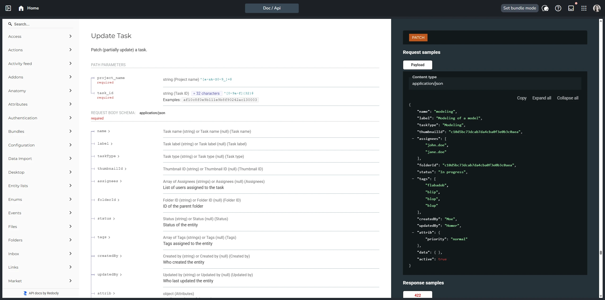

# REST API reference

<PageInfo />

The REST API page shows the reference of the server's REST API: every endpoint with its method, path, parameters, request body and responses. It is generated from the OpenAPI specification of the running server, so it always matches the server version in use. It is a reference to read; requests are made from scripts and tools. How to authenticate and call the API, with examples, is in the developer guide [REST API](../../developer/api/rest.md). Reading data is often simpler with the [GraphQL Explorer](graphql-explorer.md).

## Reference

The page keeps the [App header](app-header.md); the [URI bar](app-header.md#uri-bar) reads **Doc / Api** and the browser tab **API Docs • AYON**. The reference is served by the server at `/docs` and rendered with Redoc in a frame.

### Layout

| Part | What it shows |
|---|---|
| Left column | **Search...** and the endpoints grouped by tag, such as **Access**, **Actions**, **Activity feed**, **Addons**, **Bundles**, **Folders** or **Tasks**. |
| Top | The title with the server version, for example **Ayon server (1.17.4)**, and **Download** for the OpenAPI specification. |
| Middle column | For the selected endpoint: its description, path and query parameters, request body fields and responses. |
| Right column | The method and path, request samples and response samples, with **Copy**, **Expand all** and **Collapse all**. |

### What it includes

| Endpoints | Included |
|---|---|
| Core server endpoints under `/api` | Yes. |
| GraphQL (`/graphql`) and internal routes | No. GraphQL has the [GraphQL Explorer](graphql-explorer.md). |
| Endpoints of server addons (`/api/addons/<addon name>/<version>/...`) | Not by default. With the server setting `AYON_OPENAPI_INCLUDE_ADDON_ENDPOINTS` set to `true`, they are included, tagged with the addon name and version. |

### Addon references

Each addon version that has endpoints has its own reference at `/api/addons/<addon name>/<version>/api-docs`. On the [Addons](studio/addons.md) page, **API Docs** in the right-click menu of a version opens it in a dialog, with **Open in new tab**; a version without endpoints shows **This addon version has no API documentation**.

This documentation site has a REST API reference at [/api](/api) as well. It is built from Ynput's public playground server, so its version and addon endpoints can differ from a studio's server.

### Environment variables

Two environment variables of the server decide who can load the reference and the specification (see [On-premise deployment](../deployment/on-premise.md#configuration) for how to set them):

| Variable | Default | Effect |
|---|---|---|
| `AYON_OPENAPI_REQUIRE_AUTHENTICATION` | `true` | Only signed-in managers and admins can load them; other users see the error **You are not allowed to access API documentation** in the page. With `false`, anyone who can reach the server can load them, without signing in. |
| `AYON_DISABLE_REST_DOCS` | `false` | With `true`, nobody can load them. |

These variables only hide the documentation. Access to the endpoints themselves always follows the user's permissions.

## Controls and interactions

- **Search...** finds endpoints by their name or path.
- Clicking a group or an endpoint in the left column scrolls to it. The address of the frame changes to the endpoint, for example `#tag/Tasks/operation/update_task`.
- A response code such as **200** or **422** opens its schema; the arrow next to a field opens its details.
- **Download** saves the specification as JSON. The same file is served at `/openapi.json`.

### Use the specification in other tools

The JSON from **Download** or `/openapi.json` can be imported into API tools or used to generate a client. It describes the server it came from, including its version.

## Related

- [REST API](../../developer/api/rest.md)
- [GraphQL Explorer](graphql-explorer.md)
- [Addons](studio/addons.md)
- [App header](app-header.md#help-menu)
