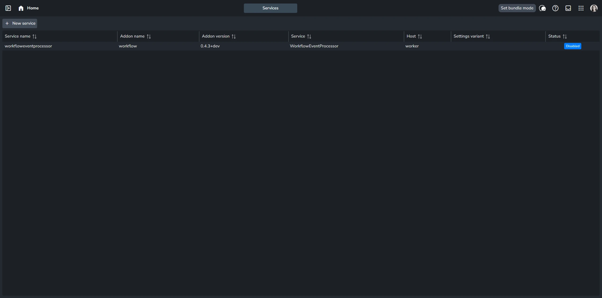
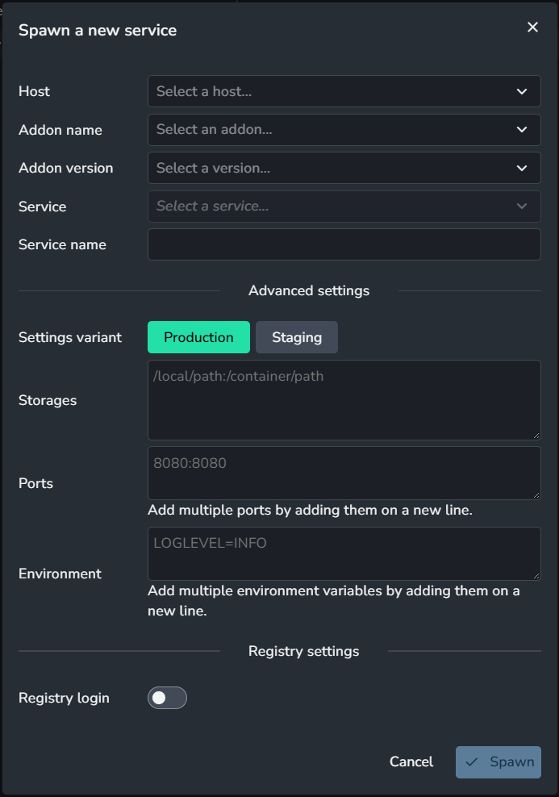

# Services

<PageInfo />

The **Services** page lists the addon services registered on the AYON server and manages them. An addon service is a program in a container that an addon runs next to the server, for example a processor that syncs with a production tracker. The page only records which services should run and how; an AYON Service Host (ASH) worker starts and stops the containers. How services work is described in [Addon services](../how-ayon-works/services.md), and how to run ASH in [AYON Service Host](../deployment/ash.md). The jobs that services process show up in the [Event Viewer](event-viewer.md). The page is shown to managers and admins, but the server lists services only to admins, so a manager sees an empty table, and only admins can create, start, stop, edit or delete services. An ASH worker connects with the API key of a service user.

## Services table

The table has one row per service and refreshes every 2 seconds. All columns can be sorted, and several rows can be selected.

| Column | Content |
|---|---|
| **Service name** | The name of this service, unique on the server. |
| **Addon name**, **Addon version** | The addon that provides the service, and its version. |
| **Service** | The name of the service as the addon defines it. An addon can define several. |
| **Host** | The ASH worker that runs the service. |
| **Settings variant** | The settings variant the service reads its addon settings from. Empty for `production`. |
| **Status** | See [Statuses](#statuses). |

The browser tab reads **Services • AYON**, or **Services • &lt;addon name&gt; • AYON** while a service is selected.

### Statuses

| Status | Meaning |
|---|---|
| **Running** | The service should run and its container is running. |
| **Not running** | The service should run but its container is not running (yet). |
| **Stopping** | The service should stop but its container is still running. |
| **Disabled** | The service should not run and its container is not running. |
| **Error** | The service has an error message, shown when hovering the badge. The server sets one, for example, when the addon version, the service or its image no longer exists, and then stops the service. |
| **Worker unreachable** | The worker last reported the service more than 10,000 seconds (about 2.8 hours) ago. |
| **Unknown** | No worker has reported the service yet. |

### Service details

Selecting a service opens its details on the right: **Host**, **Addon**, **Addon Version**, **Service Type**, **Should Run** and **Is Running** (`Yes` or `No`), **Last Seen** (the last report from the worker), and **Service Data**, the stored configuration as JSON: image, volumes, ports, environment, memory limit, user, registry login and error. The pencil button edits the service; the close button clears the selection.

:::caution Registry password in clear text
**Service Data** shows the registry user name and password of a service as plain text. Keep this in mind before sharing a screenshot of the panel.
:::

## Controls and interactions

### Right-click menu

Right-clicking a row opens the menu. When the row is part of the selection, the entries act on all selected services; otherwise the row alone is selected.

| Entry | What it does |
|---|---|
| **Start selected** | Marks the services to run. The worker starts them. |
| **Stop selected** | Marks the services to stop. |
| **Edit service** | Opens the [Edit service](#edit-service) dialog. Only with one service selected. |
| **Delete selected** | Deletes the services after a confirmation. |

### Spawn a new service

**New service** in the toolbar opens the **Spawn a new service** dialog. **Spawn** creates the service; it is enabled once the first five fields are set (and the user name and password while **Registry login** is on). `Enter` in a field does the same as **Spawn**, and `Escape` closes the dialog.

<Columns widths="55 45">
<Column>

| Field | Description |
|---|---|
| **Host** | The ASH worker. A worker appears here after it first connects to the server. |
| **Addon name** | The installed addons that define services. Changing it clears the fields below. |
| **Addon version** | The versions of the addon that define at least one service, newest first. |
| **Service** | The services of that version. Choosing one fills **Service name**. |
| **Service name** | 3 to 63 characters: lowercase letters, digits, dots and hyphens, starting and ending with a letter or digit, without two dots in a row and not shaped like an IP address. Other characters are removed while typing. |

</Column>
<Column>

</Column>
</Columns>

**Advanced settings**:

| Field | Description |
|---|---|
| **Settings variant** | **Production** (default) or **Staging**: which addon settings the service reads. For staging, the service gets the environment variable `AYON_DEFAULT_SETTINGS_VARIANT`. |
| **Storages** | Folders mounted into the container, one per line, as `/local/path:/container/path`. |
| **Ports** | Ports published by the container, one per line, as `8080:8080`. |
| **Environment** | Environment variables, one `KEY=value` per line. |

### Registry settings

**Registry login** turns on **Registry username** and **Registry password**, the login for an image registry. It is needed only for services whose image is private.

### Edit service

**Edit service** opens the same dialog, titled **Edit service**, with **Update** instead of **Spawn**. The addon, version and service cannot be changed, and the service name is read-only. A service must be stopped to be edited: for a running service, **Stop Service** asks first (**Yes, stop service** or **No, cancel**). After the update of a stopped service, **Start Service** asks whether to start it now (**Yes, start service** or **No, keep stopped**).

## Related

- [AYON Service Host (ASH)](../deployment/ash.md)
- [Addon services](../how-ayon-works/services.md)
- [Event Viewer](event-viewer.md)
- [Bundles](studio/bundles.md)
- [App header](app-header.md)
- [Keyboard shortcuts](quick-navigation.md#keyboard-shortcuts)
- [Addons](../../addons/index.md)
