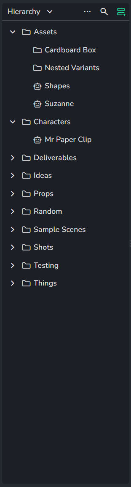

# Slicer

The slicer is the panel on the left of several project pages. It filters what the page shows: selecting a folder shows only the entities inside that folder, and selecting an assignee or a status shows only the matching ones.

It looks like the [project list](project-list.md), which selects projects. The slicer is the one whose header is a slice type such as **Hierarchy**.

## Where it appears

| Page | Slice types |
|---|---|
| [Overview](production-tracking/overview.md) | Hierarchy, Assignee, Status, Folder Type, Task Type, attributes, Lists |
| [Task progress](production-tracking/task-progress.md) | Hierarchy, Assignee, Status, Task Type |
| [Products](production-tracking/products.md) | Hierarchy, Task assignee, Version status, Version author, Product Type, Task Type, Lists |

The [Reports](../../addons/production-tracking/reports/index.md) addon has a slicer of its own.

## Slice types

The dropdown in the header chooses what the slicer lists.

| Slice type | Lists |
|---|---|
| **Hierarchy** | The folder tree of the project |
| **Assignee** | The users assigned to tasks |
| **Status** | The statuses of the project |
| **Folder Type**, **Task Type**, **Product Type** | The types of the project |
| Attributes | The values of an attribute with a fixed list of options, one slice type per attribute |
| **Lists** | The [lists](production-tracking/lists.md) of the project |
| **Author** | The users who published versions |

Without the [Power Pack](../../addons/production-tracking/power-pack/index.md), only **Hierarchy** is available. The other slice types are marked with a lightning icon and open the Power Pack dialog.

## Controls

| Control | What it does |
|---|---|
| Slice type dropdown | Chooses the slice type |
| `...` (**More**) | Search, sort and, with the Power Pack, **Split slicer** |
| **Search** | Shows only the rows that match the typed text. A row also matches through the names of its parent folders, so a shot can be found by its sequence. The page is then filtered as if all the matching rows were selected; selecting rows among the results narrows it further |
| **Split slicer** | Adds a second panel with another slice type, for example Hierarchy above Assignee. Both selections apply together. Power Pack feature |
| **Remove panel** | Removes an added panel |
| Click a row | Filters the page by it. `Ctrl`/`Cmd` + click or `Shift` + click selects several |

With **Hierarchy**, right-clicking a folder offers **Show details**, **Rename label**, **Open in viewer**, **Expand all children**, **Collapse all children**, **Upload version**, **Move** and **Delete**, depending on the page and the user's permissions. Addons can add entries of their own to the right-click menu of a slice type.

## Related

- [Project list](project-list.md)
- [Overview](production-tracking/overview.md)
- [Task progress](production-tracking/task-progress.md)
- [Products](production-tracking/products.md)
- [Power Pack](../../addons/production-tracking/power-pack/index.md)
