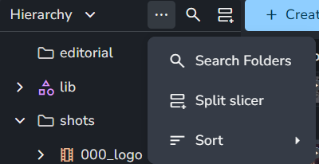
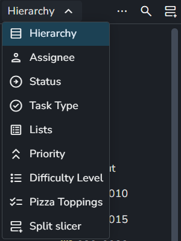

# Slicer

<PageInfo />

The slicer is the panel on the left of the Overview, Task progress and Products pages. It filters what the page shows: selecting a folder shows only the entities inside it, and selecting an assignee or a status shows only the matching ones. It looks like the [project list](project-list.md) of Home and the Inbox, which selects projects instead; the slicer is the one whose header is a slice type such as **Hierarchy**. The slice type is kept in the page's [view](views.md).

## Slice types and panels

### Slice types

The dropdown in the header chooses what the slicer lists. Without the Power Pack, only **Hierarchy**, the folder tree of the project, is available; the other slice types are marked with a lightning icon and open the Power Pack dialog, see [More slice types](#more-slice-types). The [Reports](../../addons/production-tracking/reports/index.md) addon has a slicer of its own.

## Controls and interactions

<Columns widths="65 35">
<Column>

| Control | What it does |
|---|---|
| Slice type dropdown | Chooses the slice type. Its last entry, **Split slicer**, adds a panel. |
| `...` | Opens **Search Folders** (or the search of the slice type), **Split slicer** and **Sort**. |
| Search button (tooltip **Search** and the subject, such as **Search Folders**) | Opens a search field. A row also matches through the names of its parent folders, so a shot can be found by its sequence. The page is then filtered as if all matching rows were selected; selecting rows among them narrows it further. |
| Split button (tooltip **Split slicer**) | Adds a panel, see [Split panels](#split-panels). Without the Power Pack, its tooltip reads **Power feature - Slicer** and it opens the Power Pack dialog. |
| Click a row | Filters the page by it. `Ctrl`/`Cmd` + click or `Shift` + click selects several. |
| Arrow of a folder | Expands or collapses it. |

</Column>
<Column>

</Column>
</Columns>

### Right-click menu

With **Hierarchy**, right-clicking a folder or task offers, depending on the page and the user's permissions:

| Entry | What it does |
|---|---|
| **Show details** (`Alt` + click) | Opens the [details panel](details-panel.md) of the row. |
| **Rename label** (`R`) | Edits the label in place. |
| **Open in viewer** | Opens the [web viewer](web-viewer.md). |
| **Expand all children**, **Collapse all children** | Opens or closes the whole branch. |
| Add to list | Adds the selection to a [list](production-tracking/lists.md). |
| **Upload version** | Opens the [Upload version](dialogs/upload-version.md) dialog. |
| **Move** | Moves the selected folders or tasks to another folder. |
| **Create folder**, **Create task** | Creates a folder or task inside the selected folders. |
| **Delete** | Deletes the selection after a confirmation. |

Addons can add entries of their own to the right-click menu and to the `...` menu.

## Power features

These features need the [Power Pack](../../addons/production-tracking/power-pack/index.md) and a license.

### More slice types

With the Power Pack, the dropdown offers more slice types than **Hierarchy**:

| Page | Slice types |
|---|---|
| [Overview](production-tracking/overview.md) | **Hierarchy**, **Assignee**, **Status**, **Task Type**, **Lists**, and one entry per attribute with a fixed list of values |
| [Task progress](production-tracking/task-progress.md) | **Hierarchy**, **Assignee**, **Status**, **Task Type** |
| [Products](production-tracking/products.md) | **Hierarchy**, **Task assignee**, **Version status**, **Version author**, **Product Type**, **Task Type**, **Lists** |

<Columns widths="65 35">
<Column>

| Slice type | Lists |
|---|---|
| **Hierarchy** | The folder tree of the project |
| **Assignee**, **Task assignee** | **No assignees**, **Some assignees**, and the users of the project |
| **Status**, **Version status** | The statuses of the project |
| **Task Type**, **Product Type** | The types used in the project |
| **Version author** | The users who published versions |
| **Lists** | The [lists](production-tracking/lists.md) of the project |
| Attributes | The values of the attribute, for example **Priority** |

</Column>
<Column>

</Column>
</Columns>

The rows of these slice types show how many entities on the page match each value, within the selection of the other panels. In the screenshot at the top of the page, Akshitha Singh has 10 tasks in 020_tryout.

### Split panels

**Split slicer** adds a second panel below the first, with its own slice type, for example **Hierarchy** above **Assignee**. The selections of all panels apply together. Each added panel has a collapse arrow on the left of its header (**Collapse panel**) and a close button (**Remove panel**).

## Related

- [Project list](project-list.md)
- [Overview](production-tracking/overview.md)
- [Task progress](production-tracking/task-progress.md)
- [Products](production-tracking/products.md)
- [Views](views.md)
- [Power Pack](../../addons/production-tracking/power-pack/index.md)
