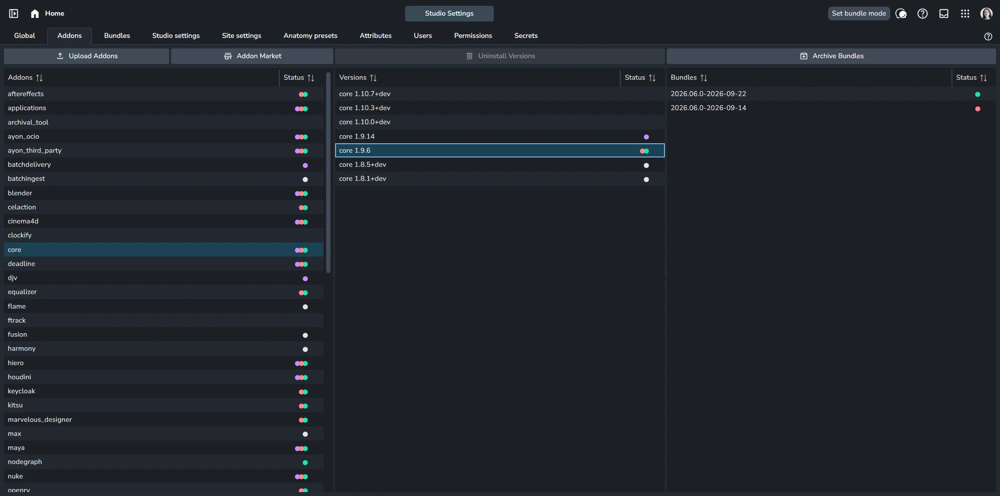
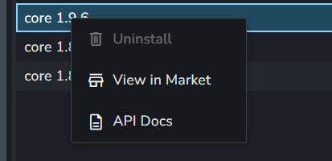

# Addons

<PageInfo />

An addon is a package of code and settings that extends the AYON server and the pipeline. The **Addons** tab shows which addon versions are installed on the server and which bundles use them. Installing an addon only places it on the server: a version is used once it is part of a bundle that has a state, which is set on the [Bundles](bundles.md) tab. How bundles put addons into use, and the steps to roll out a new addon version, are explained in [Adding an addon to production](../../how-ayon-works/bundles.md#adding-an-addon-to-production).

## Addons, versions and bundles

The tab has three tables side by side. Selecting rows in one table fills the next one, so the tables answer "which versions of this addon are installed" and "which bundles use this version".

| Table | Rows | Selecting rows |
|---|---|---|
| **Addons** | Every installed addon, by name. | Lists the versions of the selected addons. |
| **Versions** | `<addon> <version>` for the selected addons, newest first. | Lists the bundles that contain the selected versions. |
| **Bundles** | The bundles that contain the selected versions. Archived bundles are not listed. | Nothing. |

Several rows can be selected in each table. Each table can be sorted by its name or by **Status**.

### Status dots

The **Status** column shows one colored dot per state. Hovering a dot lists the states by name.

| State | Meaning |
|---|---|
| `production`, `staging`, `dev` | The addon or version is part of a bundle with that state; for the Bundles table, the bundle has that state. |
| `active` | The addon or version is part of a bundle without a state. Not used in the Bundles table. |
| `error` | The version could not be loaded and shows `(broken)` (hover it for **Addon failed to load. Check logs for details**), or it was uninstalled and shows `(deleted)` until the server restarts. |

An addon or version without a dot is installed but not part of any bundle.

## Controls and interactions

### Toolbar

| Control | What it does |
|---|---|
| **Upload Addons** (`a`) | Opens the upload dialog for addon `.zip` packages, the same as on the [Bundles](bundles.md#launchers-and-dependency-package-uploads) tab. |
| **Addon Market** | Opens the [Market](../market.md). |
| **Uninstall Versions** | Removes the selected versions from the server after a confirmation, then offers to restart the server. Disabled while a selected version is part of any bundle. |
| **Archive Bundles** | Archives the selected bundles after a confirmation. Disabled while a selected bundle has a state. |

To clean up old versions, select the versions without a status dot and uninstall them. Archived bundles are ignored here, so a version that only old bundles use can be freed by archiving those bundles first with **Archive Bundles**; the archived bundles then refer to a version that is no longer installed.

### Right-click menus

<Columns widths="60 40">
<Column>

Right-clicking a row acts on the selected rows, or only on the clicked row when it is not selected.

| Table | Entries |
|---|---|
| **Addons** | **View in Market** |
| **Versions** | **Uninstall**, **View in Market**, **API Docs** |
| **Bundles** | **Archive**, **View bundle** |

- **View in Market** opens the [Market](../market.md) on the addon.
- **API Docs** shows the REST API documentation of the addon version in a dialog, with **Open in new tab**. A version without its own API shows **This addon version has no API documentation**.
- **View bundle** opens the [Bundles](bundles.md) tab with that bundle selected.

</Column>
<Column>

</Column>
</Columns>

## Related

- [Bundles](bundles.md)
- [Market](../market.md)
- [Services](../services.md)
- [Bundles in How AYON works](../../how-ayon-works/bundles.md)
- [Addons catalogue](../../../addons/index.md)
