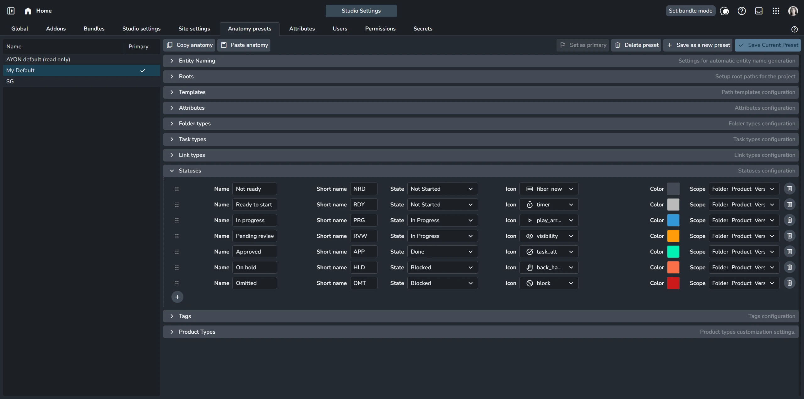
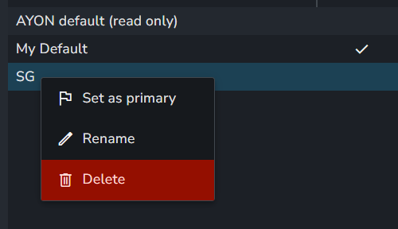

# Anatomy presets

<PageInfo />

An anatomy preset is a stored template of a project anatomy: roots, path templates, entity naming, project attributes, and the lists of folder types, task types, link types, statuses, tags and product type appearance. The **Anatomy presets** tab manages these templates. A new project copies a preset into its own anatomy; after that, the project and the preset are independent (see [Creating a project](../../how-ayon-works/creating-a-project.md#the-anatomy-preset-becomes-the-projects-own-anatomy)). Each project then edits its own copy on its [Anatomy](../project/anatomy.md) tab. The bare path `/settings` also opens this tab.

## Presets and editor

### Preset list

The list on the left has the columns **Name** and **Primary**. The first row is the built-in anatomy, **AYON default (read only)**, followed by the stored presets in alphabetical order. A check mark in **Primary** marks the primary preset; when no stored preset is primary, **AYON default (read only)** has it. On opening, the primary preset is selected.

### Anatomy editor

The editor shows the anatomy of the selected preset in collapsible sections, in the settings editor used across the web app.

| Section | Content |
|---|---|
| **Entity Naming** | Capitalization and separator used to suggest folder and task names from labels. |
| **Roots** | Named storage locations, with one path each for **Windows**, **Linux** and **Darwin**. |
| **Templates** | Version and frame padding, and the template groups **Work**, **Publish**, **Hero**, **Delivery**, **Staging directories** and **Others**. |
| **Attributes** | The project attributes (every attribute whose scope includes projects), with the defaults of their definitions. They become the attribute values of a new project. |
| **Folder types**, **Task types** | Types with short name, color and icon. |
| **Link types** | Link types with input and output entity type, color and line style. |
| **Statuses** | Statuses with short name, state, icon, color and the entity types they apply to. |
| **Tags** | Tags with their colors. |
| **Product Types** | **Default appearance** (color and icon) and **Appearance overrides** of product base types in the web app. |

Names in **Roots**, **Folder types**, **Task types**, **Statuses** and **Tags** must be unique within their list; saving a preset with duplicates fails. Roots, templates and entity naming are described in [Naming conventions](../../../pipeline/naming-conventions.md#project-anatomy) and [Pipeline storage](../../how-ayon-works/pipeline-storage.md); types, statuses and tags in [AYON entities](../../how-ayon-works/entities.md#statuses-types-and-tags).

### The primary preset

At most one stored preset is primary. When none is, the built-in anatomy takes its place.

| Where | How the primary preset is used |
|---|---|
| **Create a new project** dialog | Preselected in the preset dropdown, labelled `<name> (primary)`. The dropdown also lists **AYON default** and every stored preset. |
| Project creation through the API | Used when the request sends no anatomy and names no preset. |
| Studio-level addon settings | Settings that offer anatomy template names or link types as choices list those of the primary preset. Project-level settings list those of the project's own anatomy. |

Changing the primary preset, or editing a preset, does not change existing projects.

## Controls and interactions

### Toolbar

| Control | What it does |
|---|---|
| **Copy anatomy** | Copies the anatomy shown in the editor as JSON. |
| **Paste anatomy** | Replaces the anatomy in the editor with JSON from the clipboard, as an unsaved change. Messages: **No content to paste**, **Invalid JSON**. |
| **Set as primary** | Makes the selected preset primary. With **AYON default (read only)** selected, it removes the primary flag, so the built-in anatomy becomes the default again. Disabled when the selected preset is already primary. |
| **Delete preset** | Deletes the selected preset after a confirmation. Disabled for **AYON default (read only)**. |
| **Save as a new preset** | Opens **Create New Preset** with **Preset name**, and saves the anatomy in the editor under that name. Highlighted when **AYON default (read only)** is selected. A name that already exists is overwritten. |
| **Save Current Preset** | Saves the editor content to the selected preset. Active when the anatomy was changed and a stored preset is selected. |

The built-in anatomy can be edited in the editor, but only saved as a new preset. Selecting another preset discards unsaved edits without a warning.

### Right-click menus

<Columns widths="55 45">
<Column>

Right-clicking a stored preset offers **Set as primary**, **Rename** (opens **Rename Preset** with **New preset name**) and **Delete** (after a confirmation). All three are disabled on **AYON default (read only)**, and **Set as primary** on the primary preset.

Right-clicking a field or a section in the editor offers **Copy** and **Paste** for that part of the anatomy; a pasted value must have the same structure.

</Column>
<Column>

</Column>
</Columns>

### Move an anatomy between servers

**Copy anatomy** and **Paste anatomy** work with plain JSON, so an anatomy can be copied from one server and pasted on another, then saved with **Save as a new preset**. Right-click **Copy** and **Paste** do the same for one section, for example to reuse the **Statuses** of one preset in another.

## Related

- [Creating a project](../../how-ayon-works/creating-a-project.md)
- [Project anatomy](../project/anatomy.md)
- [Pipeline storage](../../how-ayon-works/pipeline-storage.md)
- [Naming conventions](../../../pipeline/naming-conventions.md)
- [AYON entities](../../how-ayon-works/entities.md)
- [Attributes](attributes.md)
- [Studio configuration](index.md)
