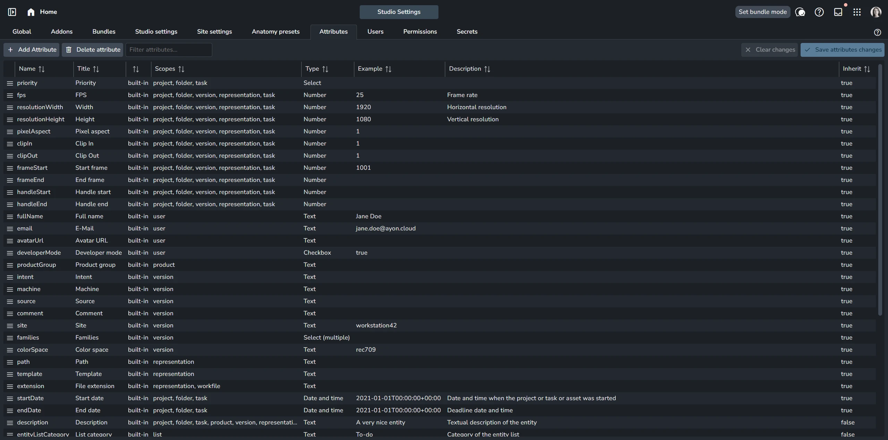
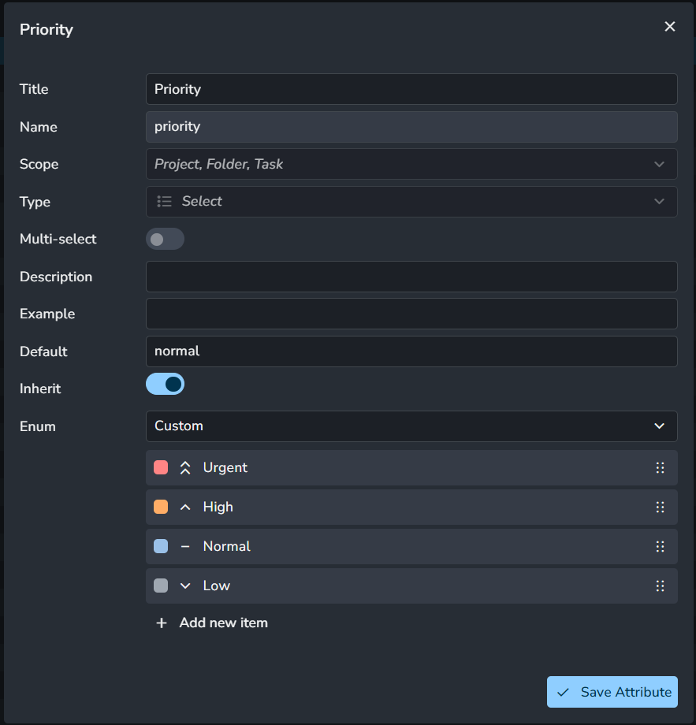

# Attributes

<PageInfo />

Attributes are the named, typed properties of AYON entities, such as `frameStart`, `fps` or `priority`. An attribute is defined once for the whole server (its name, the entity types it exists on, its type and its rules) and then exists on every entity of those types. The **Attributes** tab lists all definitions and edits them. The values themselves belong to the entities and are edited elsewhere, for example in the [details panel](../details-panel.md). There are no per-project attribute definitions.

## Attribute table

| Column | Content |
|---|---|
| Drag handle | Drag a row to reorder the attributes. The order is saved as the position of each attribute. |
| **Name** | Internal name. |
| **Title** | Label shown in the web app. |
| (no title) | `built-in` for built-in attributes. |
| **Scopes** | The entity types the attribute exists on. |
| **Type** | **Text**, **Select**, **Select (multiple)**, **Number**, **Checkbox** or **Date and time**. Other stored types show their raw name. |
| **Example**, **Description** | Example value and description. |
| **Inherit** | Whether child entities take the value of their parent. |

Every column can be sorted.

Which attribute values a user with the **User** level may read or change is set per access group, with **Restrict attribute read** and **Restrict attribute update** on the [Permissions](permissions.md#restrictions) tab. Admins and managers are never restricted.

### Where attributes come from

| Source | Description |
|---|---|
| Built-in | Defined by the server and needed by it, such as `priority`, `fps`, `resolutionWidth`, `frameStart`, `frameEnd`, `fullName`, `email`, `startDate` and `description`. Marked `built-in` and cannot be deleted. Their scope, type, widget and multi-select setting are locked; other settings can be changed, which can break features that depend on them. |
| Custom | Created on this tab by an admin. |
| Addon | Added by an addon, for example the identifiers of production tracker addons such as `ftrackId`. Changing them can break the addon. |

An attribute has to exist on the server before pipeline code, publish plugins or sync tools can read or store it.

### Scopes

The scope of an attribute lists the entity types it exists on: **Project**, **Folder**, **Task**, **Product**, **Version**, **Representation**, **User** and **List** (entity lists). Some built-in attributes also exist on workfiles, which cannot be chosen in the editor.

## Attribute editor

The editor is a dialog titled with the attribute title, or **New attribute**. **Create Attribute** (new) or **Save Attribute** (existing) applies the change to the table only; `Ctrl`/`Cmd` + `Enter` does the same. The table is sent to the server with **Save attributes changes**.

### Fields

| Field | What it does |
|---|---|
| **Title** | Label of the attribute. For a new attribute, **Name** is filled in from it in camel case. |
| **Name** | Internal name: 2 to 64 letters and digits, unique. Fixed once the attribute exists. |
| **Scope** | The [entity types](#scopes) the attribute exists on. |
| **Type** | The data type, see below. Fixed once the attribute exists. |
| **Description**, **Example** | Description and example value. **Example** is not offered for **Checkbox**. |
| **Default** | Default value. Offered when the scope contains Project. |
| **Inherit** | A child entity takes the value of its parent when it has none of its own. Offered when the scope contains any entity type other than List. |

### Types

| Type | Stored as | Extra fields |
|---|---|---|
| **Text** | `string` | **MinLength**, **MaxLength**, **Regex** (the value must match). A second dropdown chooses **Short text** (one line) or **Long text** (several lines with Markdown). |
| **Select** | `string`, or `list_of_strings` with **Multi-select** | **Multi-select** and **Enum**. **Multi-select** is fixed once the attribute exists. |
| **Number** | `integer`, or `float` with **Decimal** | **Decimal**, **Min**, **Max**. For decimal numbers, a button next to each limit switches between inclusive (`≥`, `≤`) and strict (`>`, `<`). **Decimal** is fixed once the attribute exists. |
| **Checkbox** | `boolean` | None. |
| **Date and time** | `datetime` | None. |

### Enum

The **Enum** field of a **Select** attribute chooses where the options come from.

- **Custom**: a list defined in the editor. Each item has a label, value, icon and color. **Add new item** adds one; items can be reordered by dragging.
- A dynamic enum: options generated from AYON data each time the attribute is used, so the list stays current.

| Dynamic enum | Options | Settings |
|---|---|---|
| **Actions** | Actions of the installed addons. | |
| **Folder Types**, **Task Types**, **Statuses**, **Tags**, **Link Types** | The entries of the project anatomy, so they depend on the project. | |
| **Projects** | The projects the user has access to. | **Include inactive projects**, **Include library projects**, **Include skeleton projects** |
| **Users and teams** | Users, teams or both. | **Hide inactive users**, **Mode** (**Users**, **Teams**, **Users and teams**) |
| **Attribute enumerator** | The options of another attribute. | The attribute |

Addons can add more dynamic enums to the same list. With a dynamic enum chosen, the editor shows its description, a note when the options depend on the project or the current user, its settings, a preview of the first five options with a **+N more** button, and a **Debug** button. **Debug** opens a dialog that resolves the options for a chosen project and user and lists them with a search.

## Controls and interactions

| Control | What it does |
|---|---|
| **Add Attribute** | Opens the editor for a new attribute. |
| **Delete attribute** | Removes the selected attribute from the table. Disabled for built-in attributes. |
| **Filter attributes...** | Shows only the attributes whose name, title, scope or type matches. |
| **Unsaved Changes** | Shown while the table differs from the saved definitions. |
| **Clear changes** | Discards all unsaved changes. |
| **Save attributes changes** | Sends the table to the server. Custom attributes removed from the table are deleted at this point. |

- Double-click a row to open it in the editor.
- Right-click a row for **Edit** and **Delete**; **Delete** is disabled for built-in attributes.

Saved changes take effect at once, without a server restart. Only admins can save; managers can open the tab, and through the API they can change only the descriptive parts of an attribute, such as its title and description.

## Related

- [Permissions](permissions.md)
- [Users](users.md)
- [Anatomy presets](anatomy-presets.md)
- [Details panel](../details-panel.md)
- [AYON entities](../../how-ayon-works/entities.md)
