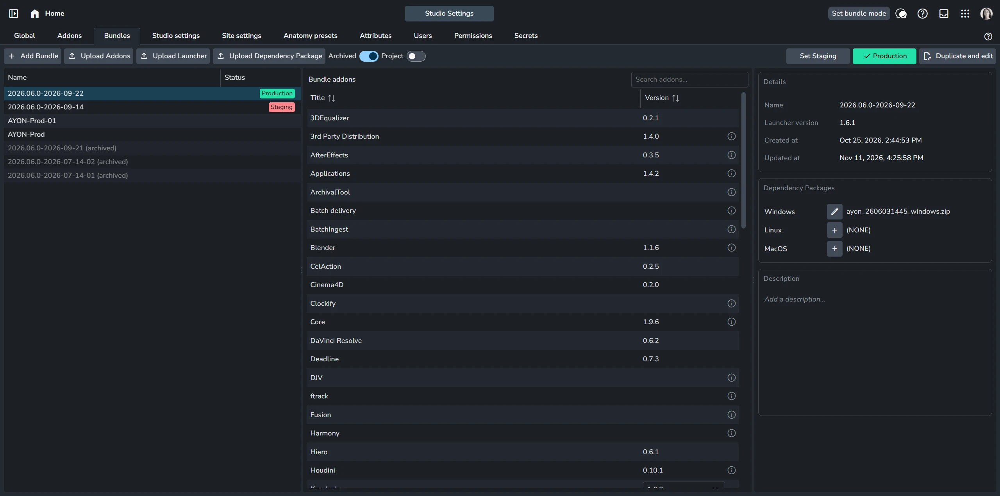
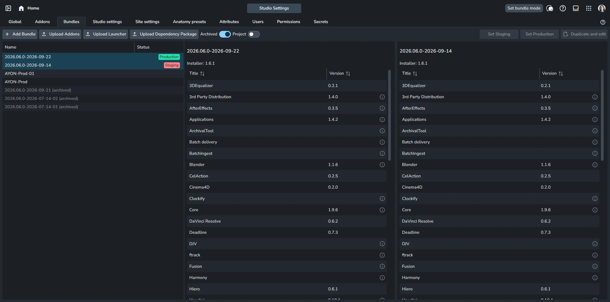
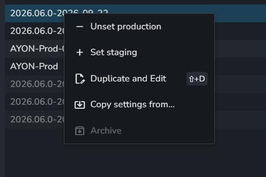
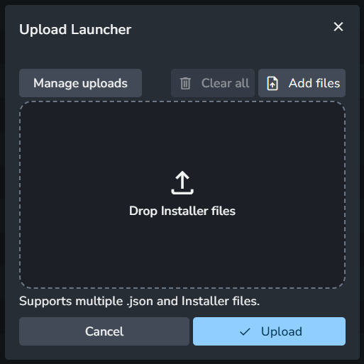

# Bundles

<PageInfo />

A bundle is a named set of addon versions, together with a launcher version and one dependency package per platform. The bundle with the Production state is what the server and the launchers use by default; the Staging and Dev bundles are used on request. The **Bundles** tab creates and manages bundles and uploads launcher installers and dependency packages. Which addon versions are installed is shown on the [Addons](addons.md) tab. What a bundle holds and which machines use which bundle is explained in [Bundles in How AYON works](../../how-ayon-works/bundles.md).

## Bundle list and details

### Bundle list

The list on the left has one row per bundle, with **Name** and **Status**. The status shows the badges **Production**, **Staging**, **Dev** (with the assigned developer's name) and **Project**. Archived bundles are listed last, dimmed and marked `(archived)`.

- **Archived** in the toolbar shows or hides archived bundles. It is on by default.
- **Project** shows or hides [project bundles](../project/project-bundle.md). It is off by default.
- Dev bundles are listed only when the user's **Developer** mode is on.

On opening, the Production bundle is selected.

### Bundle details

Selecting one bundle shows it in two columns:

| Part | Content |
|---|---|
| **Bundle addons** | Every installed addon with its version in this bundle, sortable by **Title** or **Version**, with **Search addons...**. An empty version means the addon is not in the bundle. An info icon next to a version shows the latest installed version when it is newer. |
| **Details** | **Name**, **Launcher version**, **Created at** and **Updated at**. |
| **Dependency Packages** | One row per platform (**Windows**, **Linux**, **MacOS**) with the package file name, or `(NONE)`, and a button that opens **Update Dependency Package** to choose another uploaded package. The change is saved at once. |
| **Description** | A formatted text for notes about the bundle, such as what changed. Click it to edit, then **Save** or **Cancel**; `Escape` also cancels. |

The name, the launcher version and the versions of pipeline addons cannot change once a bundle exists; duplicate the bundle instead. Only the version of a server addon can be changed in place: choosing another version saves it at once. Doing that in the Production bundle migrates that addon's settings to the new version.

For a project bundle, the addons that the project cannot override are shown with the versions of the Production bundle, which they inherit.

### Bundle states

The **Set Staging** and **Set Production** buttons above the details set or unset the state of the selected bundle. A set state shows a check mark and reads **Staging** or **Production**.

- Setting a state moves it from the bundle that had it. One bundle can hold both Production and Staging.
- Setting a state opens a dialog that can copy the settings of another bundle into this one, see [Copying settings](#copying-settings). Unsetting a state happens at once.
- A Dev bundle cannot be set to Production or Staging, and a Production or Staging bundle cannot be set to Dev.
- A bundle that holds Production or Staging cannot be archived or deleted.

### Compare bundles

Selecting two to four bundles (`Ctrl`/`Cmd` + click or `Shift` + click) shows their addon lists side by side, each with its launcher version, instead of the details. Addons whose versions differ between the selected bundles are marked.

### Dependency packages

A dependency package holds the Python modules that the client code of a bundle's addons needs, built for one platform. A bundle holds at most one package per platform. Packages come with a [pipeline release](#pipeline-releases), or are built for one bundle with the AYON dependencies tool and uploaded with **Upload Dependency Package**; a package built for one bundle fits only that bundle.

### Pipeline releases

A pipeline release is a tested set of addons, launchers and dependency packages published by Ynput. The **Install pipeline release** dialog, opened from **Update Pipeline** in the App menu, from **Setup pipeline** in the App header or from the [Market](../market.md), downloads a release and creates a new bundle from it without changing the current Production or Staging bundle. See [Install pipeline release](../dialogs/install-pipeline-release.md).

### Copying settings

Addon settings are stored per addon version, so a new bundle with new versions starts from their defaults. Setting a state on a bundle, or **Copy settings from...**, opens a dialog that copies all studio, project and project site settings from another bundle into this one, or sets the state without copying. See [Copy settings](../dialogs/copy-settings.md#bundle-state-dialog).

### Dev bundles

With **Developer** mode on, the new bundle form has a **Dev bundle** switch and **Assigned dev** with **Assign to me**; each developer can have one Dev bundle. A Dev bundle stays editable after creation (addons, launcher version, dependency packages, developer) and adds an **Addon directory** column: per addon, a switch and the path of the addon's client folder, so its client code runs from source. Changes are saved with **Save dev bundle** or discarded with **Cancel**. See [Developer mode](../../../developer/developer-mode.md).

## Controls and interactions

### Toolbar

| Control | What it does |
|---|---|
| **Add Bundle** (`n`) | Opens the form for a new bundle, see [New bundle](#new-bundle). |
| **Upload Addons** (`a`) | Opens the upload dialog for addon `.zip` packages. |
| **Upload Launcher** (`l`) | Opens the upload dialog for launcher installers. |
| **Upload Dependency Package** (`p`) | Opens the upload dialog for dependency packages. |
| **Archived**, **Project** | Show or hide archived and project bundles. |
| **Duplicate and edit** (`Shift+D`) | Opens the new bundle form filled with the selected bundle, see [Duplicate a bundle](#duplicate-a-bundle). |

The splitter position and the **Archived** and **Project** switches are remembered in the browser.

### Right-click menu

<Columns widths="55 45">
<Column>

Right-clicking a bundle acts on the selected bundles, or only on the clicked bundle when it is not selected.

| Entry | What it does |
|---|---|
| **Set production** / **Unset production** | Sets or unsets the state, as the buttons do. One bundle at a time. |
| **Set staging** / **Unset staging** | The same for Staging. |
| **Set dev** / **Unset dev** | Shown in developer mode. |
| **Duplicate and Edit** | Opens the new bundle form filled with this bundle. |
| **Copy settings from...** | Copies the addon settings of another bundle into this one, see [Copying settings](#copying-settings). Disabled for bundles without a state, and for a bundle that holds both Production and Staging. |
| **Archive** / **Unarchive** | Moves the bundles out of the list or back. Disabled for Production and Staging bundles. |
| **Delete** | Deletes the bundles for good, after a confirmation. Shown for archived bundles, or for any bundle when `Ctrl`/`Cmd` is held while right-clicking. Disabled for Production and Staging bundles. |

The state entries are not shown on archived bundles.

</Column>
<Column>

</Column>
</Columns>

### New bundle

**Add Bundle** opens the form with a suggested name, `<studio name>-<YYYY>-<MM>-<DD>-<nn>` (or `Bundle-...` when the Core addon has no studio name), and the latest installed version of every addon.

| Part | What it does |
|---|---|
| **Bundle name** | Required, without spaces. |
| **Launcher version** | One of the uploaded launcher versions, with tags for the platforms it was uploaded for. |
| Addon list | A version dropdown for every addon. `NONE` leaves the addon out of the bundle. A version chosen while several rows are selected applies to all of them. Right-click an addon for **View in Market**. |
| **Select all** / **Deselect all** (`Shift+A`), **Select activated**, **Version latest** | Select all addons, or those that have a version, and set the selected addons to their latest version. |
| **Dependency Packages**, **Description** | As in the bundle details. |
| **Checks** | The [compatibility check](#compatibility-check). |
| **Create new bundle** | Creates the bundle without a state. Disabled while the check reports errors. |

Selecting a bundle in the list closes the form without creating anything.

### Compatibility check

The **Checks** section checks the chosen addon versions, launcher version and dependency packages against each other while the form is edited. Its first line reads **Checking bundle compatibility...**, **Checks complete: Bundle is compatible**, **Bundle has compatibility warnings**, **Bundle has unresolved compatibility errors** or **Error checking bundle compatibility**. Below it, each warning or error names the addon and the problem, errors first; clicking an entry selects the addon it refers to. **Create new bundle** stays disabled while there are errors, except for Dev bundles.

### Duplicate a bundle

**Duplicate and edit** opens the new bundle form filled with the launcher version, dependency packages, description and addon versions of the selected bundle. Addons that are no longer installed are left out. The name gets the next number, for example `-01` becomes `-02`, or `-01` is added. This is how a new version of a pipeline addon gets into a bundle.

### Launchers and dependency package uploads

<Columns widths="55 45">
<Column>

The three upload buttons open the same dialog, titled **Upload Addons**, **Upload Launcher** or **Upload Dependency Package**. Files are dropped on it or chosen with **Add files**, then sent with **Upload**.

| Type | Files |
|---|---|
| Addons | One or more addon `.zip` packages. |
| Launcher | The installer files and their `.json` files. |
| Dependency package | The package files and their `.json` files. |

A progress bar shows the upload. Closing the dialog during an upload asks for confirmation and cancels it. After an addon upload, the server needs a restart; the [App menu](../app-header.md#app-menu) then shows **Restart Required**.

For launchers and dependency packages, **Manage uploads** lists the uploaded files with **File name**, **Installer version**, **Platform**, **Size** and **Status**, with **Delete selected** (after a confirmation) and **Upload files** to go back.

</Column>
<Column>

</Column>
</Columns>

### Links to a bundle

The query parameter `?bundle=<name>` selects a bundle when the page opens; `latest` selects the newest and `prod` the Production bundle. `?duplicate=<name>` opens the new bundle form as a duplicate of that bundle.

## Related

- [Addons](addons.md)
- [Bundles in How AYON works](../../how-ayon-works/bundles.md)
- [Project bundles](../project/project-bundle.md)
- [Copy settings](../dialogs/copy-settings.md)
- [Install pipeline release](../dialogs/install-pipeline-release.md)
- [Market](../market.md)
- [Artist workstation setup](../../workstation-setup.md)
