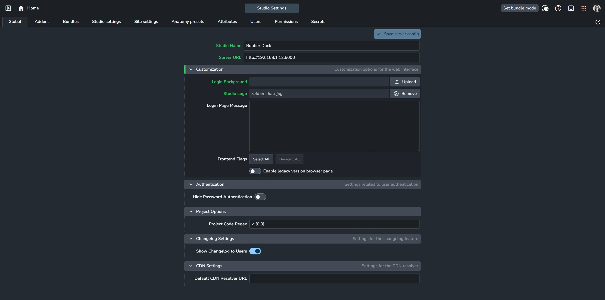

# Global

<PageInfo />

The **Global** tab edits the server configuration: values that belong to the AYON server itself rather than to an addon or a project. It covers the studio name, the public address of the server, the login page, password login, the rule that suggests project codes, who sees the changelog, and the CDN resolver for project files. Addon settings are edited on the [Studio settings](studio-settings.md) tab instead.

## Server configuration

The form is one centered column. **Studio Name** and **Server URL** stand on their own; the other fields are grouped in collapsible panels. The server stores only the values that differ from the defaults, and those fields carry the green studio override marker (see [Override states in the editor](../../how-ayon-works/settings.md#override-states-in-the-editor)).

### Studio name and server URL

| Field | Default | What it does |
|---|---|---|
| **Studio Name** | empty | The name of the studio. Used in the invitation email sent from the [Users](users.md) tab: the subject reads "You have been invited to join &lt;studio name&gt; Ayon server". Any signed-in user can read it. |
| **Server URL** | empty | The public address of the server, used in links sent by email, such as invitations and password resets. It is filled in automatically the first time an admin opens the web app. On a server managed by [Ynput Cloud](../../../ynput-cloud/index.md), Ynput Cloud sets it and the field cannot be edited. |

### Customization

Options for the login page and the web app.

| Field | Default | What it does |
|---|---|---|
| **Login Background** | empty | Image shown as the background of the login page. |
| **Studio Logo** | empty | Image shown on the login page, in a panel above the login message. |
| **Login Page Message** | empty | Text shown on the login page, in the same panel as the studio logo. Markdown is supported. |
| **Frontend Flags** | none | Switches that turn web app features on or off, with **Select All** and **Deselect All**. The only flag is **Enable legacy version browser page**, which adds the deprecated **Browser** tab to the project pages. |

**Login Background** and **Studio Logo** are not typed in. Each shows the stored file name with an **Upload** button, or a **Remove** button once a file is set.

- **Upload** opens a file picker. The file is uploaded and stored at once, without **Save server config**. Only JPEG and PNG images are accepted. Characters other than letters, digits and `.` in the file name are replaced with `_`.
- **Remove** clears the field and saves the configuration at once.

When **Login Page Message**, **Login Background** or **Studio Logo** is empty, the login page falls back to the older server environment variables `AYON_MOTD` (or the file `/storage/motd.md`), `AYON_LOGIN_PAGE_BACKGROUND` and `AYON_LOGIN_PAGE_BRAND`, which are deprecated.

### Authentication

| Field | Default | What it does |
|---|---|---|
| **Hide Password Authentication** | off | Hides the username and password form on the login page, so that users sign in with another login option such as a single sign-on addon. The form remains reachable through **Show all login options**. Invitation emails then link to the server address instead of the page that sets a password. |

### Project options

| Field | Default | What it does |
|---|---|---|
| **Project Code Regex** | `^.{0,3}` | Regular expression that creates the suggested project code from the project name in the **Create a new project** dialog. The default takes the first three characters. Any signed-in user can read it. See [Creating a project](../../how-ayon-works/creating-a-project.md#name-code-and-label). |

### Changelog settings

| Field | Default | What it does |
|---|---|---|
| **Show Changelog to Users** | on | When on, users who are not admins see the changelog widget with the highlights. Admins always see the server, addon and pipeline entries instead. For users who are not admins, the changelog also stays hidden when the server runs in offline mode or with feedback disabled. |

### CDN settings

| Field | Default | What it does |
|---|---|---|
| **Default CDN Resolver URL** | empty | Address of the service that returns CDN links for project files kept in the server's default project storage. Takes precedence over the environment variable `AYON_DEFAULT_PROJECT_STORAGE_CDN_RESOLVER`, whose value is shown as the placeholder. When neither is set, CDN links are not available for the default storage. |

## Controls and interactions

- **Save server config** at the top right saves the form. It is active once a field has been changed. On failure, **Failed to save server config** appears.
- Click the arrow of a panel, or double-click its header, to expand or collapse it. Expanded panels stay open for the browser session.
- The logo and background uploads, and **Remove**, are saved at once and do not wait for **Save server config**.

## Related

- [Studio configuration](index.md)
- [Users](users.md)
- [Creating a project](../../how-ayon-works/creating-a-project.md)
- [Settings](../../how-ayon-works/settings.md)
