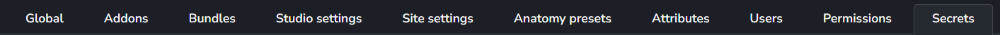

# Studio configuration

<PageInfo />

The studio configuration, called **Studio Settings** in the web app, configures the whole AYON server rather than one project. Its pages share one row of tabs below the [App header](../app-header.md) and live under `/settings/`. Per-project configuration is in [Project settings](../project/index.md) instead.

**Studio Settings** in the [App menu](../app-header.md#app-menu) and the `s+s` shortcut open the **Studio settings** tab. Users without the manager role see **Site Settings** in the App menu instead, and only the **Site settings** tab. The bare path `/settings` opens **Anatomy presets**.

## Tabs

The tab row shows only the tabs the signed-in user may open. Opening the URL of a hidden tab sends the user to the first tab they may open; managers who open **Addons** or **Bundles** are sent to the start page.

| Tab | What it does | URL path | Shown to |
|---|---|---|---|
| [Global](global.md) | The configuration of the server itself: studio name, server URL, login page, password login. | `/settings/server` | Admins |
| [Addons](addons.md) | The installed addon versions and the bundles that use them. | `/settings/addons` | Admins |
| [Bundles](bundles.md) | Bundles, launcher installers and dependency packages. Shortcut `b+b`. | `/settings/bundles` | Admins |
| [Studio settings](studio-settings.md) | The addon settings for the whole studio. | `/settings/studio` | Managers and admins |
| [Site settings](site-settings.md) | The addon settings of the signed-in user's workstations. | `/settings/site` | Everyone |
| [Anatomy presets](anatomy-presets.md) | The anatomy templates that new projects copy. | `/settings/anatomyPresets` | Managers and admins |
| [Attributes](attributes.md) | The attribute definitions of the server. | `/settings/attributes` | Managers and admins |
| [Users](users.md) | User accounts and their access levels. Shortcut `u+u`. | `/settings/users` | Managers and admins |
| [Permissions](permissions.md) | The access groups of the server. | `/settings/accessGroups` | Managers and admins |
| [Secrets](secrets.md) | API keys and passwords that addon settings refer to by name. | `/settings/secrets` | Managers and admins |
| Addon tabs | Pages that addons add, labelled with the addon title. | `/settings/addon/<addon name>` | Managers and admins |

The help button at the right end of the tab row (tooltip **Get help for this page**) opens the help article for the open tab, or a new support message when there is none. The browser tab title is the name of the open tab followed by `• Studio settings`.

### Addon tabs

An addon can add its own tab by shipping a web page for the studio settings. Its tab follows **Secrets**. Only addon versions in the Production bundle add a tab. These pages are separate from the addon's settings, which are edited on the [Studio settings](studio-settings.md) tab, and are described with each addon.

## Related

- [App header](../app-header.md)
- [Project settings](../project/index.md)
- [Settings scopes and storage](../../backend/settings/index.md)
- [Keyboard shortcuts](../quick-navigation.md#keyboard-shortcuts)
