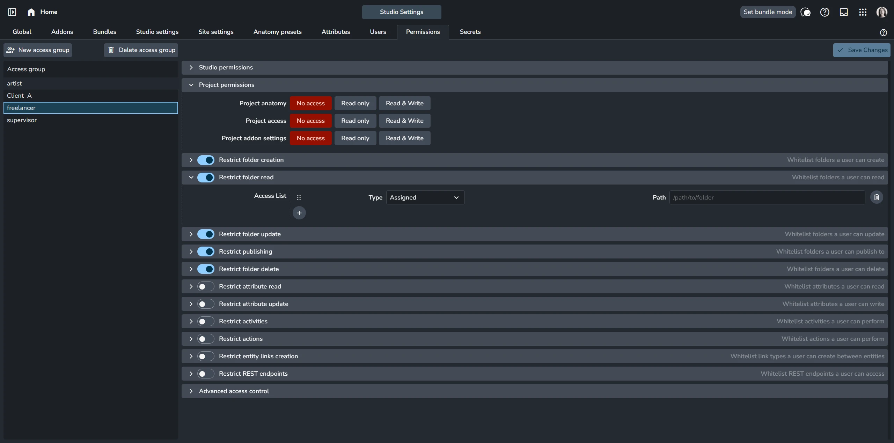

# Permissions

<PageInfo />

An access group is a named set of permission settings. The **Permissions** tab defines the access groups of the server. Groups are assigned to users per project on the [Project access](../project/project-access.md) tab, and a project can override a group's settings on the [Project permissions](../project/project-permissions.md) tab. Access groups apply only to users with the **User** level; managers and admins are never restricted (see [Access levels](users.md#access-levels)). How several groups combine and how a request is checked is explained in [Permissions in How AYON works](../../how-ayon-works/permissions.md).

## Access groups

The list on the left shows the access groups of the server; selecting one shows its settings on the right. On a new server, three groups are created:

| Group | Default setup |
|---|---|
| `supervisor` | No restrictions. |
| `artist` | Folder creation and deletion restricted with empty lists, so folders cannot be created or deleted. |
| `freelancer` | Folder creation, update and deletion restricted; reading and publishing limited to folders with tasks assigned to the user. |

These groups can be changed or deleted like any other.

## Permission settings

The settings are grouped in collapsible sections.

### Studio permissions

These act outside of projects, so they are read from the access groups in the user's **Default projects access** (set on the [Users](users.md) tab), not from the groups of a project.

| Setting | Allows |
|---|---|
| **Create projects** | Creating new projects. |
| **List all users** | Listing all users of the server, needed for example by a user who manages project access. |

### Project permissions

Each has three levels: **No access**, **Read only** and **Read & Write**.

| Setting | Allows |
|---|---|
| **Project anatomy** | Viewing or editing the project anatomy. |
| **Project access** | Viewing or assigning the access groups of the project's users, on the **Project access** tab, and with **Read & Write** the project overrides of the groups. |
| **Project addon settings** | Viewing or editing the project's addon settings. |

### Restrictions

A restriction works as an allow list. It does nothing until its switch is on; then only the listed items are allowed. When a user has several groups in a project, a restriction applies only if it is on in every one of them, and the allowed items of the groups are added together.

| Setting | Allows, when on |
|---|---|
| **Restrict folder creation** | Creating folders and entities in the listed folders. |
| **Restrict folder read** | Reading the listed folders, with their parent folders, tasks and the entities below them. |
| **Restrict folder update** | Editing the listed folders and their contents. |
| **Restrict publishing** | Publishing to the listed folders. |
| **Restrict folder delete** | Deleting in the listed folders. |
| **Restrict attribute read** | Reading only the listed attributes (**Readable attributes**). |
| **Restrict attribute update** | Changing only the listed attributes (**Writable attributes**) and the listed fields: entity name, label, status, tags, enabling or disabling an entity, moving a folder, folder type, moving a task, task type, task assignees, product base type, product type and additional data. The thumbnail can always be changed. Because it limits fields that are not visible in the web app, it can also affect automated pipeline operations. |
| **Restrict activities** | Only the listed activities: **Comment**, **Upload reviewables**. |
| **Restrict actions** | Running only the listed actions. |
| **Restrict entity links creation** | Creating links of only the listed link types. |
| **Restrict REST endpoints** | Calling only the listed REST endpoints. |

### Folder access lists

The five folder restrictions hold an **Access List** of items, each with a **Type** and a **Path**.

| Type | Means |
|---|---|
| **Assigned** | Folders that contain at least one task assigned to the user. The path is not used. |
| **Hierarchy** | The folder at the path and everything below it, such as `/assets/props` with its subfolders and tasks. |
| **Children** | Everything below the folder at the path, without the folder itself. |

Read access to a path includes its parent folders, so the tree stays navigable. **Hierarchy** and **Children** differ only for changes to the folder itself: **Hierarchy** allows editing the folder, **Children** only its contents.

### Advanced access control

| Setting | What it does |
|---|---|
| **Show sibling tasks** | On by default. When access comes from **Assigned**, the other tasks in the same folders stay visible. When off, only the assigned tasks are visible. |

## Controls and interactions

| Control | What it does |
|---|---|
| **New access group** | Opens **New access group** with **Access group name** and **Create access group**. Names use letters, digits, `_`, `.` and `-`, and start and end with a letter, digit or `_`. The new group starts without restrictions. |
| **Delete access group** | Deletes the selected group after a confirmation. It is also removed from the users it was assigned to. |
| **Save Changes** | Saves the settings of the selected group. Active once a setting has changed. |

- Right-click a group for **Clear Overrides** (removes a project's overrides of the group; used on the [Project permissions](../project/project-permissions.md) tab) and **Delete**.
- Right-click a setting for **Copy** and **Paste** of its value as JSON; a pasted value must have the same structure.
- Click the arrow of a section, or double-click its header, to expand or collapse it.

## Related

- [Users](users.md)
- [Project permissions](../project/project-permissions.md)
- [Project access](../project/project-access.md)
- [Attributes](attributes.md)
- [Permissions in How AYON works](../../how-ayon-works/permissions.md)
