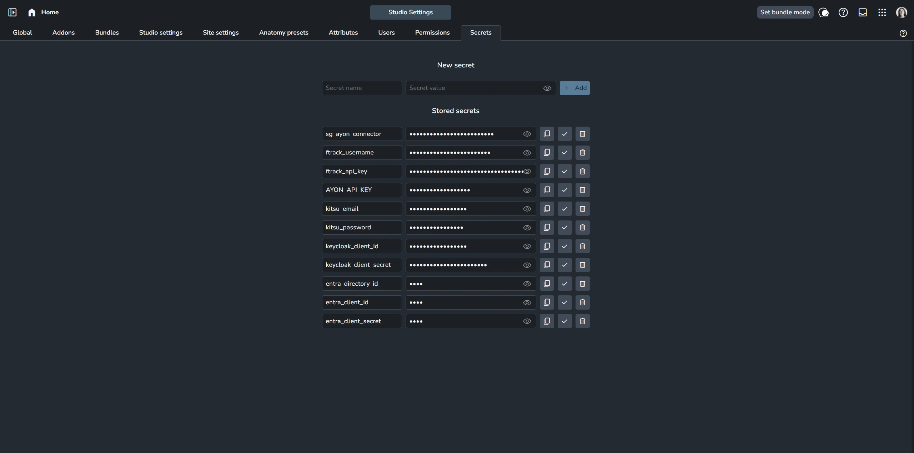

# Secrets

<PageInfo />

A secret is a named value stored on the AYON server, typically an API key or a password that an addon needs, such as the credentials of a production tracker. Addon settings on the [Studio settings](studio-settings.md) tab refer to a secret by its name, so the value itself is not written into the settings and the people who edit settings, including managers, never see it.

## Secrets

The tab is one centered column with two parts:

- **New secret**: one row with **Secret name**, **Secret value** and **Add**.
- **Stored secrets**: one row per stored secret, with its name, its value masked, and buttons to copy, save and delete.

A name has no spaces, uses letters, digits, `_`, `.` and `-`, and starts and ends with a letter, digit or `_`. The secret `ynput_cloud_key`, which holds the [Ynput Cloud](../../../ynput-cloud/index.md) connection, and secrets whose names start with `_` are internal and not listed.

Managers see the names only, with empty values, and cannot change anything. Users without the manager role cannot open the tab.

## Controls and interactions

| Control | What it does |
|---|---|
| **Add** | Saves the new secret. Active when both name and value are filled. A name that already exists has its value replaced. |
| Eye button | Shows or hides the value in the field. |
| Copy button | Copies the value to the clipboard. |
| Check button | Saves a changed value. Stored names cannot be changed. |
| Delete button | Deletes the secret after a confirmation. |

`Enter` in a row does the same as its **Add** or check button.

## Related

- [Studio settings](studio-settings.md)
- [Users](users.md)
- [Services](../services.md)
