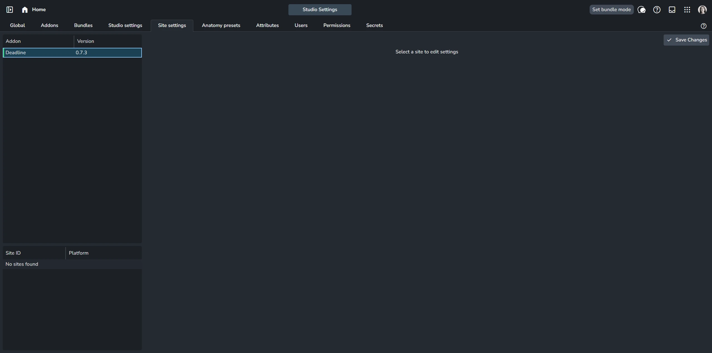

# Site settings

<PageInfo />

The **Site settings** tab edits the studio-level site settings: values for one workstation (site) of one user, in every project. They are a separate set of fields that each addon defines, with no variant and no inheritance from the studio or project settings. For users without the manager role, it is the only tab of the Studio Settings: **Site Settings** replaces **Studio Settings** in the [App menu](../app-header.md#app-menu), and `s+s` opens it. What a site ID is and how the site levels differ is explained in [Settings](../../how-ayon-works/site-ids.md).

## Addons, sites and editor

The tab has the addon list and the site list on the left and the editor on the right.

| Part | Content |
|---|---|
| Addon list | **Addon** and **Version** of the addons in the Production bundle that define site settings, sorted by title. Several can be selected. **No addons found** when none does; **WARNING: No bundle set to production** without a Production bundle. |
| Site list | **Site ID** and **Platform** of the signed-in user's sites: the workstations where the user has started the AYON launcher. Several can be selected. **No sites found** until the user has started a launcher. |
| Editor | One panel for each selected addon and site, titled with the addon title and the site ID in parentheses. **Select a site to edit settings** while no site is selected. |

Each panel shows the complete site settings of the addon for that site: the stored values, with the addon defaults for fields never saved. There are no override marks and no variant badge, because site settings are stored as one complete document.

Site settings are read and saved for the signed-in user only. Two users on the same workstation have separate values, and the web app cannot edit the site settings of another user. The values are stored per addon version, so a new addon version in the Production bundle starts from its defaults.

## Controls and interactions

- **Save Changes** is always enabled. It saves each changed panel as a whole document, one addon and site at a time. **Site settings saved** confirms it. If one fails, **Unable to save &lt;addon&gt; settings** lists the validation errors and the remaining panels are not saved.
- The first selected site is remembered in the browser and selected again next time.

The project-level counterpart, overrides of the normal addon settings for one site in one project, is the [Site settings](../project/site-settings.md) tab of the project settings. The two do not read each other.

## Related

- [Settings](../../how-ayon-works/settings.md)
- [Studio settings](studio-settings.md)
- [Project site settings](../project/site-settings.md)
- [Pipeline storage](../../how-ayon-works/pipeline-storage.md)
- [Studio configuration](index.md)
