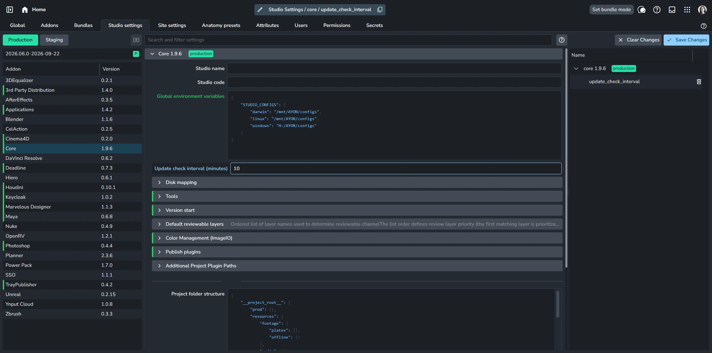
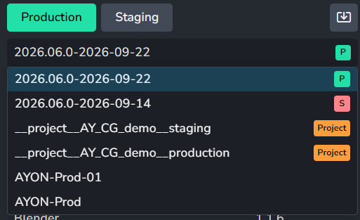
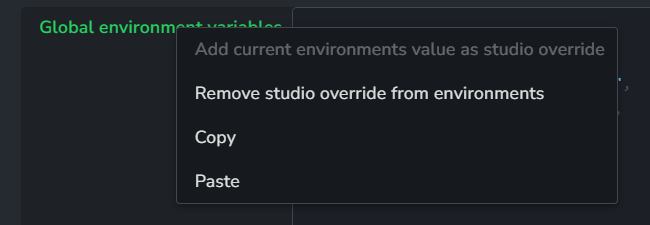
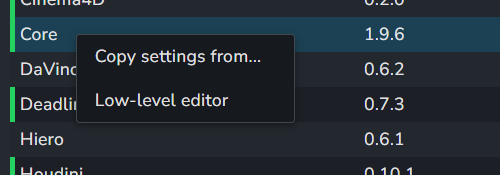

# Studio settings

<PageInfo />

The **Studio settings** tab edits the settings of the server's addons at studio level. The values saved here apply to every project and every workstation unless a project or a site overrides them. Values are stored per addon version and per variant (production, staging or a Dev bundle), not per bundle. How levels, overrides and variants work is explained in [Settings](../../how-ayon-works/settings.md); this page describes the controls. Project-level values are edited in [Project settings](../project/project-settings.md), workstation values in [Site settings](site-settings.md).

## Settings editor

The tab has three columns: the addon list on the left, the editor in the middle and the unsaved changes on the right. A splitter separates the changes column from the rest.

### Addon list

| Control | What it does |
|---|---|
| **Production**, **Staging** | Choose the variant whose values are edited. The active button has the color of the variant. |
| **Dev** | Shown when the user's **Developer** mode is on. Chooses the variant of the user's own Dev bundle. Without one, **No dev bundle found for your user. Please create one first.** appears. |
| Copy button (tooltip **Copy settings from another bundle**) | Opens the [copy settings dialog](#copy-settings-dialog) for all listed addons. Disabled while there are unsaved changes. |
| Bundle dropdown | Chooses the bundle whose addon versions are listed, see [Bundle dropdown](#bundle-dropdown). By default, the bundle that holds the state of the chosen variant. |
| Addon list | **Addon** and **Version**, sorted by title. Lists the addons of the bundle that have studio settings, plus broken addons. Several addons can be selected; each selected addon opens a panel in the editor. |

A mark on the left of a row shows that the addon has studio overrides or unsaved changes. A broken addon (its version is in the bundle but cannot be loaded) is marked too and opens no panel. When there is no bundle for the variant, the list shows **WARNING: No bundle set to &lt;variant&gt;**; when the bundle has no addon with settings, **No addons found**.

The chosen variant and bundle are kept for the browser tab. Turning developer mode on switches to **Dev**; turning it off switches back to **Production**.

### Bundle dropdown

<Columns widths="55 45">
<Column>

The dropdown lists the bundles that are not archived, in this order, newest first within each group:

1. The Production bundle, badge **P**.
2. The Staging bundle, badge **S**.
3. Dev bundles, badge **Dev**, the user's own first with **(me)**. Listed only in developer mode.
4. Project bundles, badge **Project**.
5. Other bundles, without a badge.

Choosing a bundle lists its addon versions and keeps the chosen variant, so the values of that variant are edited for those addon versions. Choosing a Dev bundle also switches to its variant.

</Column>
<Column>

</Column>
</Columns>

### Editor

| Control | What it does |
|---|---|
| **Search and filter settings** | Shows only the fields that match the text, as a case-insensitive regular expression. When nothing matches, the panel shows **No settings found for the current search**. |
| Help button (tooltip **Show help descriptions**) | Shows or hides the descriptions of the fields. |
| Addon panels | One panel per selected addon, titled with the addon title, version and a badge with the variant. Fields show their override state with colored marks, see [Override states in the editor](../../how-ayon-works/settings.md#override-states-in-the-editor). |

Clicking a field selects it, and the [URI bar](../app-header.md#uri-bar) shows its path, such as `Studio Settings / core / update_check_interval`. The copy button there copies it as an `ayon+settings://` URI.

### Changes

| Control | What it does |
|---|---|
| **Clear Changes** | Discards all unsaved changes. Disabled when there are none. |
| **Save Changes** | Saves the unsaved changes of every addon. Disabled when there are none. |
| Changes list | One row per changed addon with its name, version and variant badge, and under it one row per changed field, marked `(unpin)` when a copied value removes an override. **No changes** when empty. |
| Delete button on a field row | Reverts that change. |

Changes are kept while switching between addons, variants and bundles. Each changed addon is saved separately. **Settings saved** appears when all succeed. A failed addon shows **Unable to save &lt;variant&gt; settings** with the addon, version and the validation errors, and its changes stay in the list. Every save is recorded as a `settings.changed` event in the [Event Viewer](../event-viewer.md).

## Controls and interactions

### Field right-click menu

<Columns widths="55 45">
<Column>

Right-clicking a field or a group offers:

| Entry | What it does |
|---|---|
| **Add current &lt;field&gt; value as studio override** | After a confirmation, stores the current value as a studio override at once, even when it equals the default. Disabled when the field already has one. |
| **Remove studio override from &lt;field&gt;** | After a confirmation, deletes the studio override at once. The field falls back to the addon default. Disabled when the field has none. |
| **Remove all studio overrides** | Only on the addon panel itself. After a confirmation, deletes every studio override of the addon version for the chosen variant. |
| **Copy** | Copies the value as JSON. |
| **Paste** | Puts JSON from the clipboard into the field as an unsaved change. The structure must match: otherwise **Invalid JSON** or **Incompatible data structure**. |

For a field that belongs to a group, the override entries act on the whole group. The menu names the field by its key, such as `environments`.

</Column>
<Column>

</Column>
</Columns>

### Addon right-click menu

<Columns widths="55 45">
<Column>

Right-clicking addons in the list acts on the selected addons, or on the clicked addon when it is not selected.

- **Copy settings from...** opens the [copy settings dialog](#copy-settings-dialog) for these addons.
- **Low-level editor** opens the [low-level editor](#low-level-editor). Shown to admins, for one addon at a time.

</Column>
<Column>

</Column>
</Columns>

### Copy settings dialog

The dialog loads values from another bundle, variant or addon version into the editor as unsaved changes, with the current and new value of every field side by side. Nothing is stored until **Save Changes**. It opens from the copy button (all listed addons, source chosen by bundle) or from **Copy settings from...** in the addon list (the selected addons, any source version). See [Copy settings](../dialogs/copy-settings.md#settings-copy-dialog).

Copying all settings of a bundle at once, including the project settings, is done on the [Bundles](bundles.md#copying-settings) tab instead.

### Low-level editor

The low-level editor shows the stored studio overrides of one addon version and variant as JSON, without the defaults. It is titled **&lt;addon&gt; &lt;version&gt; &lt;variant&gt; raw settings**.

- At first a warning covers the editor: **This interface is intended for advanced users only.** Clicking it (**Click here to continue**) shows the editor.
- **Copy** copies the JSON.
- **Save** stores the JSON as the override document, without validation, and reloads the addon panel. Invalid JSON gives **Invalid JSON**.

## Related

- [Settings](../../how-ayon-works/settings.md)
- [Project settings](../project/project-settings.md)
- [Site settings](site-settings.md)
- [Bundles](bundles.md)
- [Copy settings](../dialogs/copy-settings.md)
- [Studio configuration](index.md)
