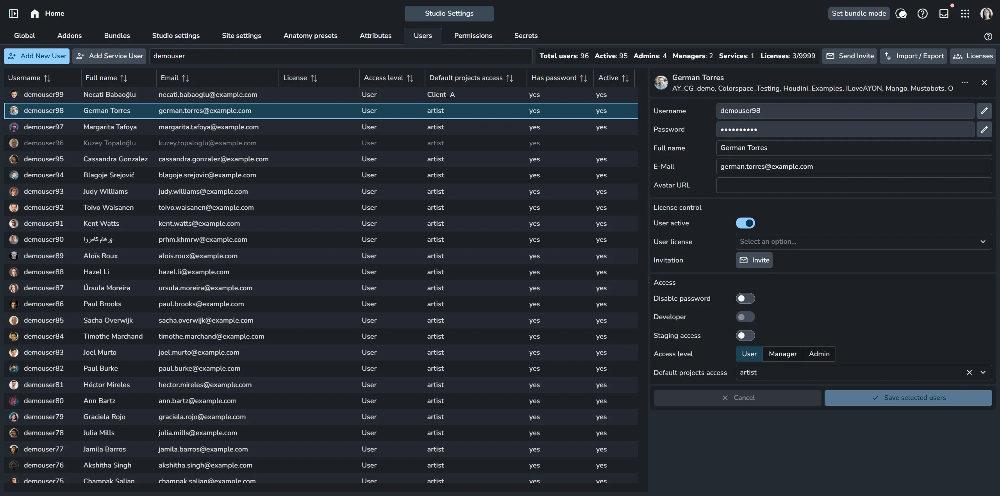
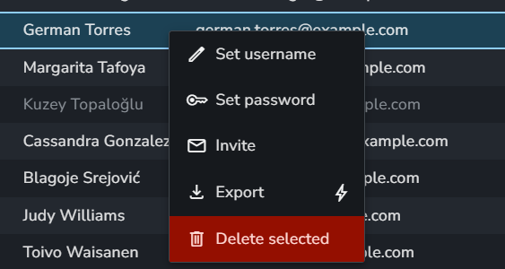
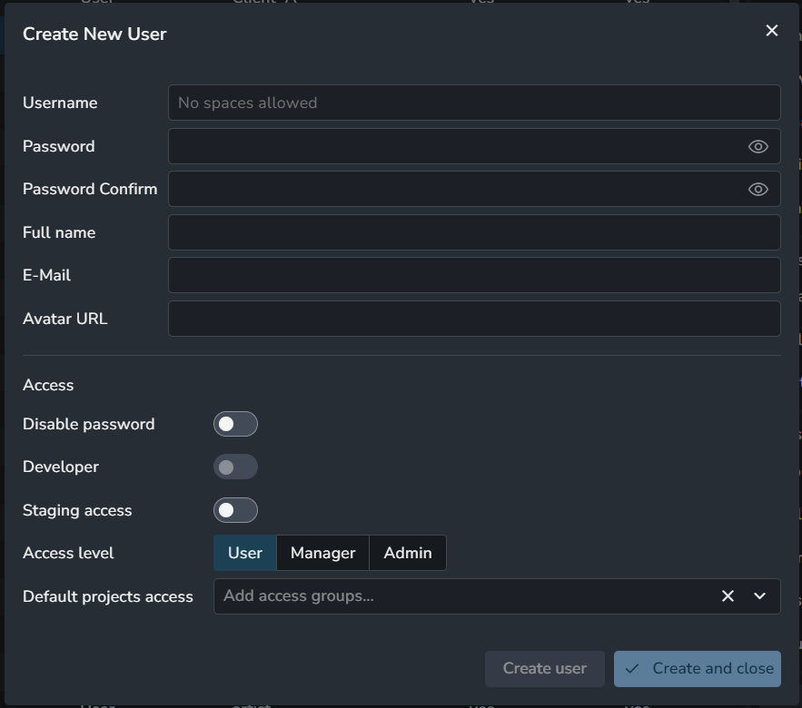

# Users

<PageInfo />

The **Users** tab lists all user accounts of the server and edits them. The **access level** of a user (user, manager, admin or service) sets what they can do on the server. For users with the **User** level, access groups then decide what they can see and change in each project: the groups are defined on the [Permissions](permissions.md) tab and assigned per project on the [Project access](../project/project-access.md) tab. How the two layers work together is explained in [Permissions in How AYON works](../../how-ayon-works/permissions.md). AYON permissions apply to AYON data only, not to file permissions on storage.

## User table and details

### User table

| Column | Content |
|---|---|
| **Username** | Login name, with the avatar. |
| **Full name**, **Email** | User attributes. |
| **License** | The license pool of the user. Shown when the server has license pools; `Invalid` marks a pool that no longer exists. |
| **Access level** | `User`, `Manager`, `Admin` or `Service`. |
| **Default projects access** | The access groups the user receives in every new project. |
| **Has password** | `yes` or `no`. |
| **Active** | `yes` for active users. Inactive users are dimmed. |
| **Invitation** | `Pending`, `Accepted` or `Expired`, with the time. An invitation expires 7 days after it was sent. |

Columns can be sorted, resized and reordered; the layout is remembered in the browser. The totals in the toolbar count **Total users** (without services), **Active**, **Admins**, **Managers** and **Services**, and with license pools **Licenses** (used and maximum seats; the tooltip splits them into base and metered pools).

### User details

Selecting users opens the details panel on the right. Its header shows the avatar, the name, and the projects where the user has access groups, or the access level for managers, admins and services. The **...** menu has **Delete user**; addons can add entries there.

| Section | Fields |
|---|---|
| Account (one user only) | **Username** and **Password**, each with an edit button that opens **Set username** or **Set password**. The user attributes **Full name**, **E-Mail**, **Avatar URL** and any custom attribute with the User scope (see [Attributes](attributes.md)). |
| **License control** | **User active**: inactive users cannot sign in and do not use a license seat. **User license**: the license pool, listed with used and maximum seats; full or invalid pools cannot be chosen. **Invitation**: **Invite** or **Resend**, and the invitation state. |
| **Access** | The access fields below. |

| Access field | What it does |
|---|---|
| **Disable password** | The user cannot sign in with a password and has to use another login option, such as a Ynput Cloud account or a single sign-on addon. |
| **Developer** | Turns on developer mode, with Dev bundles and the **Dev** variant of the settings. Only admins can set it, only for active admins. |
| **Staging access** | Shows the staging mode switch in the web app, to test staging bundles and actions. |
| **Access level** | **User**, **Manager** or **Admin**. **Admin** is offered to admins only. |
| **Default projects access** | The access groups the user receives automatically in every new project. They are also used for the studio permissions, see [Permissions](permissions.md#studio-permissions). |

**Save selected users** saves only the changed fields; **Cancel** (one user only) discards them. Several selected users are edited together. A user cannot change their own access level, license or activity, and managers cannot change admin accounts.

### Access levels

| Level | What it allows |
|---|---|
| **User** | No project access by default. Sees only the projects where they have an access group, and works within its permissions. |
| **Manager** | All projects, and the studio and project settings, attributes, permissions and users. Not the **Global**, **Addons** and **Bundles** tabs, the [Market](../market.md), restarting the server or reading secret values. Cannot change admin accounts or grant the **Admin** level. |
| **Admin** | Everything, including other admins. An admin cannot lower their own level. |
| **Service** | An account for scripts and services that signs in with an API key. It has admin rights and can act on behalf of another user. Created with **Add Service User**. |
| **Guest (legacy)** | Shown only on old accounts that still carry it, with a **Remove Guest flag** button that turns the account into a regular user. |

## Controls and interactions

### Toolbar

| Control | What it does |
|---|---|
| **Add New User** (`n`) | Opens **Create New User**. |
| **Add Service User** | Opens **Create Service User**. |
| **Filter users...** | Shows only the users whose username, full name, email or access groups contain the text. Terms separated by a comma match any of them. |
| **Send Invite** | Opens the invitation dialog for the selected users. |
| **Import / Export** | **Import** opens [Import CSV](../dialogs/import-csv.md) to create or update users from a file. **Export** needs the Power Pack, see [Export](#export). |
| **Licenses** | Opens the license dialog. |

### Find users quickly

The filter text is kept in the `search-users` query parameter, so a filtered list can be shared as a link. A term that starts with `!` excludes the users that match it (at least three characters after the `!`), and `haspassword` matches the users who have a password. For example, `artist, freelancer` lists the users of either group, and `!haspassword` the users without a password.

### Right-click menu

<Columns widths="55 45">
<Column>

Right-clicking a user acts on the selected users, or only on the clicked user when it is not selected.

| Entry | What it does |
|---|---|
| **Set username** | Renames the user, after a warning that renaming can have unintended consequences. One user at a time. |
| **Set password** | Sets a new password, typed twice. One user at a time. |
| **Invite** / **Resend** | Opens the invitation dialog. |
| **Export** | Exports the selected users, see [Export](#export). |
| **Delete selected** | Opens the delete dialog. A user cannot delete their own account. |

</Column>
<Column>

</Column>
</Columns>

### Create New User

<Columns widths="55 45">
<Column>

| Field | Notes |
|---|---|
| **Username** | Required, no spaces. |
| **Password**, **Password Confirm** | Optional; they must match. Passwords set by managers must be complex enough; passwords set by admins are not checked. |
| **Full name**, **E-Mail**, **Avatar URL**, custom attributes | User attributes. An email address must be unique. |
| **Access** | As in the details panel. A new user is active, with the **User** level. |

**Create and close** (`Enter`) creates the user and closes the dialog. **Create user** (`Shift+Enter`) creates the user and keeps the dialog open for the next one.

</Column>
<Column>

</Column>
</Columns>

### Service users and API keys

**Create Service User** asks for a **Username** and a **Service user key**: **Generate new key...** creates an API key and copies it to the clipboard. The key is shown only once, and the user is created only once a key exists. A service user's details show its username and API key preview, with a button to revoke the key or **Generate new key...** when there is none. The key is used as `AYON_API_KEY` by the Python API, command-line tools and service hosts such as ASH.

### Invite and delete

- **Invite users to AYON by email** lists the users who will receive an invitation (active users with an email address) and the skipped ones, with **Send**.
- The delete dialog asks to type the user name, or `delete selected` for several users, before **Delete** is enabled. **Disable user** deactivates the users instead. Deleting removes the user from all task assignments and signs them out.

### Active and inactive users

An active user can sign in and, with license pools, uses a seat. Any number of inactive users can exist, and deactivating a user frees their seat. This allows preparing users, for example freelancers, and assigning them to projects before they need a seat. Activating a user can be refused when the license has no free seat. Users are also created by addons that sync users from production trackers, by single sign-on addons and through the API.

## Power features

These features need the [Power Pack](../../../addons/production-tracking/power-pack/index.md) and a license.

### Export

**Export**, in **Import / Export** and in the right-click menu, saves the table or the selected users as an Excel or CSV file, the same way as on the [Overview](../production-tracking/overview.md#export). The users export needs Power Pack 1.7.1 or later; an older version shows **Update to Power Pack 1.7.1 to export this table**. Without the Power Pack, **Export** opens the Power Pack dialog.

## Related

- [Permissions](permissions.md)
- [Project access](../project/project-access.md)
- [Attributes](attributes.md)
- [Import CSV](../dialogs/import-csv.md)
- [Permissions in How AYON works](../../how-ayon-works/permissions.md)
