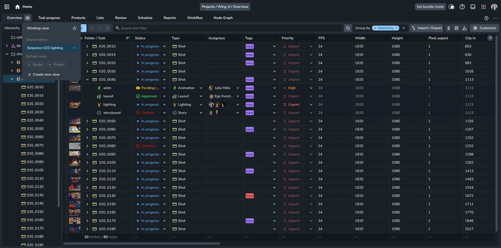
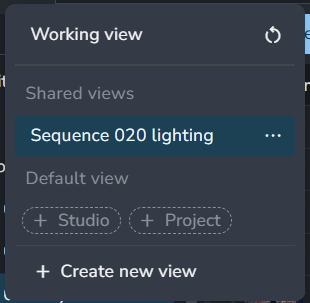
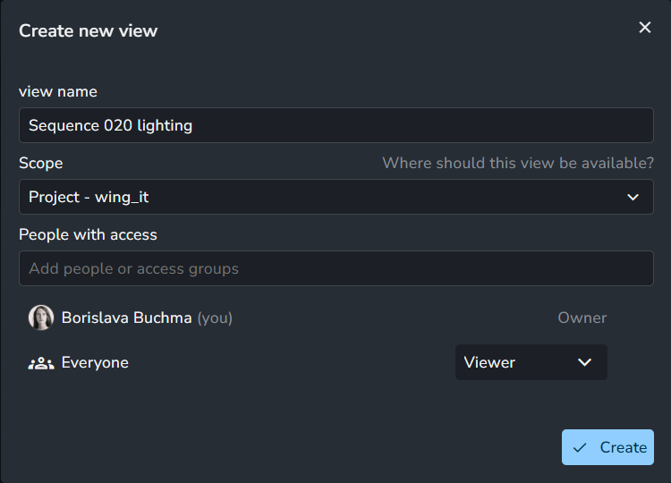

# Views

<PageInfo />

A view stores the layout of a page: its filters, sorting, grouping, columns and other display settings. Every user has a private **Working view** on each page that records the current layout. Saved views keep a layout under a name, can be shared with other users, and can be made the default layout of a project or of the whole studio. Views are stored on the server, so they follow the user to other computers. Each page has its own views: a view saved on the Overview is not offered on Task progress.

## Views menu

### Pages with views

On the project pages, the views button is the small layout icon on the tab of the open page, next to its name. Its tooltip names the loaded view: **Working view**, or `view:` and the name of a saved view.

| Page | Notes |
|---|---|
| [Overview](production-tracking/overview.md), [Task progress](production-tracking/task-progress.md), [Products](production-tracking/products.md), [Lists](production-tracking/lists.md) | One set of views per page |
| **Review**, **Schedule** and **Reports** tabs | Pages of the [Review](../../addons/production-tracking/review/index.md), [Planner](../../addons/production-tracking/planner/index.md) and [Reports](../../addons/production-tracking/reports/index.md) addons |
| [Projects](home/projects.md) on Home | Not project specific |
| [Inbox](inbox/index.md) | One set per tab: Important, Other, Cleared |
| [Event Viewer](event-viewer.md) | A **Views** button in the toolbar |
| [Import CSV](dialogs/import-csv.md) dialog | Called **Mapping presets**; stores the column mapping |

[Home tasks](home/tasks.md) has no views. Addon pages can have views of their own.

### Menu

<Columns widths="60 40">
<Column>

| Entry | Description |
|---|---|
| **Working view** | The user's own working layout. Without the Power Pack it is called **Personal view** and is the only entry. The reset button (tooltip **Reset to Default**) replaces it with the project default view, otherwise the studio default view, otherwise an empty layout. |
| **My views** | Saved views the user owns that are shared with nobody. |
| **Shared views** | Saved views shared with the user, including the user's own views that are shared with others. |
| **Default view** | The **Studio** and **Project** buttons, see [Default views](#default-views). Shown to admins. |
| **Create new view** | Opens the **Create new view** dialog with the current layout, see [View dialog](#view-dialog). Needs the Power Pack. |

Sections without views are hidden and can be collapsed. A saved view row shows two buttons on hover: a save button (tooltip **Save view settings from current view**) that overwrites the view with the layout on screen after a **Confirm save** dialog, and `...` (tooltip **Edit view**) that opens the view dialog. They are shown to users who may edit the view.

</Column>
<Column>

</Column>
</Columns>

### Working view

Changes to filters, sorting, grouping or columns always go to the Working view. A saved view never changes by itself: changing the layout while a saved view is loaded switches the page back to the Working view, which carries the changed layout. A saved view changes only when it is saved or edited on purpose.

The Working view is private and belongs to one page and one project. Pages that are not about one project, such as the Inbox, have one Working view for the whole studio.

### Default views

A default view is the standard layout of a page. The **Default view** section of the menu is shown to admins.

| Scope | Description |
|---|---|
| **Studio** | For all projects and users. A user who has no Working view on a page yet starts with it. |
| **Project** | For one project. Used by **Reset to Default** before the studio default. Needs the Power Pack. |

| Button state | Click |
|---|---|
| Plus icon: no default yet | Saves the current layout as the default view of that scope. |
| Close icon: a default exists | The button loads the default layout into the Working view. The close icon removes the default after a confirmation (**Remove Default View**). |

## Controls and interactions

| Control | Action |
|---|---|
| Click a view | Loads it. |
| Reset button of **Working view**, or `Shift` + `Ctrl`/`Cmd` + `0` | Resets the Working view to the default layout, see [Menu](#menu). |
| Save button of a view row | Overwrites the view with the current layout. |
| `...` of a view row | Opens **Edit view**. |

### Settings stored per page

| Page | Stored in a view |
|---|---|
| Overview | Hierarchy, row height, grouping, empty groups, sorting, filters, folder filter, slicer type, columns |
| Task progress | Filters, slicer type, columns |
| Products | Products shown, row height, grid display and height, featured version order, slicer type, grouping, empty groups, latest per folder, sorting, filters, columns |
| Lists | Row height, sorting, filters, columns |
| Review | Row height, sorting, filters, columns, grid height, display style (cards, table, playlist) |
| Projects on Home | Filters, columns, grouping, sorting |
| Inbox | Filter, unread only |
| Event Viewer | Filters, layout (table or timeline) |

Columns are stored with their visibility, pinning and width.

## Power features

These features need the [Power Pack](../../addons/production-tracking/power-pack/index.md) and a license, see [Power features](../../production-tracking/power-features.md).

Saved views, sharing and project default views need the Power Pack. Without it, only the **Personal view** and the studio default view are available, and **Create new view** and the **Project** button show a lightning icon and open the Power Pack dialog.

### View dialog

<Columns widths="55 45">
<Column>

**Create new view** and **Edit view** open the same dialog. A new view takes the layout currently on screen.

| Field | Description |
|---|---|
| **view name** | The name shown in the menu. Required. |
| **Scope** | **Project -** and the project name: only in this project. **All projects**: in every project. Cannot be changed later. Not shown on pages that are not project specific. |
| **People with access** | **Add people or access groups** adds users, access groups and teams. The owner is listed with **Owner**. **Everyone** stands for all users with access to the project. Each entry gets an access level. |

**Create** (or **Save** when editing) saves the view; `Ctrl`/`Cmd` + `Enter` does the same. When editing, **Delete** removes the view.

</Column>
<Column>

</Column>
</Columns>

### Access levels

| Level | Can |
|---|---|
| **No access** | Nothing. A view that gives nobody access is private. |
| **Viewer** | Load and use the view. |
| **Editor** | Also change its name and layout. |
| **Admin** | Also see the **Delete** button. |

Only the owner of a view and admins of the server can change who has access, delete a view, or change its owner. Managers have full access to every shared view.

## Related

- [Slicer](slicer.md)
- [Power features](../../production-tracking/power-features.md)
- [Power Pack](../../addons/production-tracking/power-pack/index.md)
- [Overview](production-tracking/overview.md)
