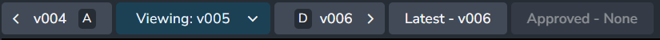
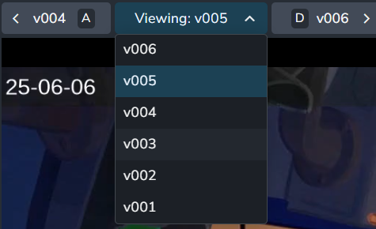
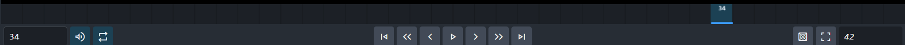
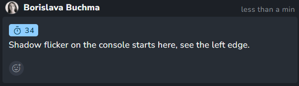
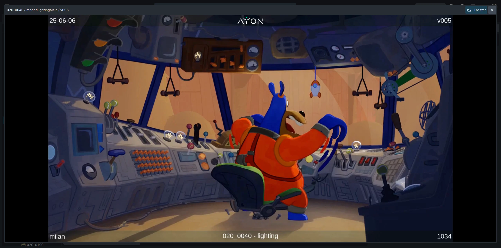
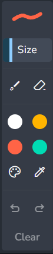

# AYON web viewer

<PageInfo />

The web viewer, also called the player or review player, plays the [reviewables](../../production-tracking/reviewables.md) of a version: videos with a frame-accurate player, and images. It opens over the current page, with the [details panel](details-panel.md) of the version next to the player, so a version can be watched, compared with other versions and commented on in one place. Closing it returns to the page it was opened from. It is not related to [views](views.md), the saved layouts of the table pages.

## Player and versions

### Layout

| Region | Content |
|---|---|
| Version toolbar (top left) | Moves between the versions of the product, see [Version toolbar](#version-toolbar). |
| Top right | The **Theater** button and the close button. |
| Player | The selected reviewable: the [video player](#video-player), an image, or a message. |
| Reviewables column | One card per playable reviewable of the version. The **+** button opens the **Version files** tab of the details panel and a file picker to upload more reviewables. Below the cards: the [annotation tools](#annotations). |
| Details panel (right) | The [details panel](details-panel.md) of the selected version, with its feed, files and details. It has no close button here. |

Messages in the player area:

| Message | Meaning |
|---|---|
| **This task has published no versions.** | Nothing to show for the task or folder. The details panel is hidden. |
| **This version has no online reviewables.** | The version has no reviewables. The area takes dropped files (**Drop or click to upload**) and uploads them to the version. |
| **File not supported and needs conversion** | The browser cannot play the reviewables of the version; see [Supported formats](../../production-tracking/reviewables.md#supported-formats). |

### Version toolbar

| Control | Shortcut | Description |
|---|---|---|
| Previous version (left arrow and version name) | `a` | The version before the selected one. |
| **Viewing:** dropdown | none | All versions of the product, newest first. |
| Next version (version name and right arrow) | `d` | The version after the selected one. |
| **Latest -** | `r` | The latest version. |
| **Approved -** | `e` | The latest version with a done status. Reads **Approved - None** and is disabled when there is none. |
| Hero version | `h` | Shown when the product has a hero version. |
| **Product:** dropdown | none | Shown when the folder or task has reviewables in several products. Switches the product. |

When the version changes, the viewer keeps the current frame and picks the reviewable with the same label in the new version. So the same shot of two versions can be compared at the same frame.

<Columns widths="60 40">
<Column>

Opened for a folder or task, the viewer shows the versions of the product with the most recent reviewable; opened for a product or a version, the versions of that product. It selects the given version, otherwise the latest one, and its first playable reviewable. Opened with `Spacebar`, or with **Open in viewer** on the **Overview**, **Products**, **Lists** and **Task progress** pages or in the details panel, a video starts playing right away.

</Column>
<Column>

</Column>
</Columns>

### Video player

| Control | Shortcut | Description |
|---|---|---|
| Timeline | Drag | Scrubs through the frames. Shows the loaded part of the video, frames with annotations and frames that comments are linked to. |
| Current frame field | none | The frame number (from 1). Typing a number jumps to that frame. |
| Mute | `m` | Mutes or unmutes the sound. |
| Loop playback | none | Plays the video in a loop. On by default. |
| **Go to Start** | `Shift+A` | First frame. |
| **Back 5 frames** | `j`, `1` or `Shift+ArrowLeft` | |
| **Back 1 frame** | `ArrowLeft` or `3` | |
| **Play** / **Pause** | `Spacebar` or `k` | |
| **Forward 1 frame** | `ArrowRight` or `4` | |
| **Forward 5 frames** | `l`, `2` or `Shift+ArrowRight` | |
| **Go to End** | `Shift+D` | Last frame. |
| Grid overlay | none | Shows or hides a grid over the video. |
| **Fullscreen** | none | Switches full screen on or off. |
| Total frames | none | The number of frames of the video. |

Mute, loop and the grid overlay are remembered for the browser session. Images are fitted to the player area, without the player controls.

### Comments and frames

<Columns widths="55 45">
<Column>

Comments are written in the activity feed of the details panel, see [Activity feed](details-panel.md#activity-feed). While a video is shown, the timer button below the comment editor links the comment to the current frame; its value can be edited to a frame range. The posted comment shows the frame as a chip, and clicking it jumps to that frame.

</Column>
<Column>

</Column>
</Columns>

## Controls and interactions

### Where it opens

| Opens from | Control | Shortcut |
|---|---|---|
| [Overview](production-tracking/overview.md), folder and task rows | Right-click **Open in viewer** (name or thumbnail column) | `Spacebar` |
| [Slicer](slicer.md) hierarchy on the project pages | Right-click **Open in viewer** | none |
| [Products](production-tracking/products.md), table and grid | Right-click **Open in viewer**, on a version or a product with a featured version | `Spacebar` |
| [Lists](production-tracking/lists.md), list items | Right-click **Open in viewer** (name or thumbnail column) | `Spacebar` |
| [Task progress](production-tracking/task-progress.md) | Right-click **Open in viewer** on a task | `Spacebar` |
| [Home tasks](home/tasks.md) | Selected task | `Spacebar` |
| [Browser](production-tracking/browser.md) and [Workfiles](production-tracking/workfiles.md) | Right-click **Open in viewer** | `Spacebar` |
| [Details panel](details-panel.md) | **More actions** > **Open in viewer**, or a click on the thumbnail | none |
| Details panel, **Version files** tab | A click on a reviewable card | none |

The open viewer is kept in the URL (`viewer_product`, `viewer_task`, `viewer_folder`, `viewer_version`, `reviewable_id` and others), so reloading the page or opening a copied link shows the same version and reviewable.

### View modes

<Columns widths="50 50">
<Column>

| Mode | How | Description |
|---|---|---|
| Default | | Version toolbar, player, reviewables column and details panel. |
| Theater | **Theater** button, or `f` | Hides the version toolbar, the reviewables column and the details panel, and shows the path of the version (folder / product / version) at the top. The version and reviewable shortcuts keep working. Remembered for the browser session. |
| Full screen | **Fullscreen** button of the player, or `f` in theater mode | The player fills the screen. |

`f` cycles through the modes: default, theater, full screen, and back to default.

</Column>
<Column>

</Column>
</Columns>

### Keyboard shortcuts

Shortcuts are ignored while typing in a text field or a comment. The shortcuts of the page below are off while the viewer is open; see [Keyboard shortcuts](quick-navigation.md#keyboard-shortcuts) for them.

| Shortcut | Action |
|---|---|
| `Esc` | Closes the viewer, or the slide-out panel when one is open. Does nothing in full screen. |
| `f` | Cycles the view mode |
| `w` / `s` | Previous or next reviewable of the version, wrapping around |
| `a` / `d` | Previous or next version |
| `r` / `e` / `h` | Latest, approved or hero version |
| `Spacebar` or `k` | Play or pause |
| `ArrowLeft` or `3` / `ArrowRight` or `4` | Back or forward one frame |
| `j`, `1` or `Shift+ArrowLeft` / `l`, `2` or `Shift+ArrowRight` | Back or forward five frames |
| `Shift+A` / `Shift+D` | First or last frame |
| `m` | Mute or unmute |
| `b` / `e` | Brush or eraser (with annotations) |

### Closing the viewer

The close button at the top right, or `Esc`, closes the viewer and returns to the page it was opened from. Clicking outside the viewer does not close it.

### Uploading reviewables

The **+** button below the reviewable cards, or dropping files on a version without reviewables, uploads more reviewables to the version. It needs the **Upload reviewables** activity permission of the user's access group (see [Users](studio/users.md)). To add a new version instead, use [Upload version](dialogs/upload-version.md).

## Power features

These features need the [Power Pack](../../addons/production-tracking/power-pack/index.md) and a license, see [Power features](../../production-tracking/power-features.md).

### Annotations

<Columns widths="70 30">
<Column>

Annotations are drawings over a frame of a video or over an image. The tools sit below the reviewables column: brush (`b`) and eraser (`e`), the stroke size, colour swatches with a colour picker, undo, redo and **Clear**. A drawing is attached to the comment being written, as an image of the frame with the frame number, and is saved with it. Annotations are hidden while a video plays.

Without the Power Pack, the tools are shown disabled with a Power Pack button.

</Column>
<Column>

</Column>
</Columns>

## Related

- [Details panel](details-panel.md)
- [Reviewables](../../production-tracking/reviewables.md)
- [Upload version](dialogs/upload-version.md)
- [Keyboard shortcuts](quick-navigation.md#keyboard-shortcuts)
- [Power features](../../production-tracking/power-features.md)
