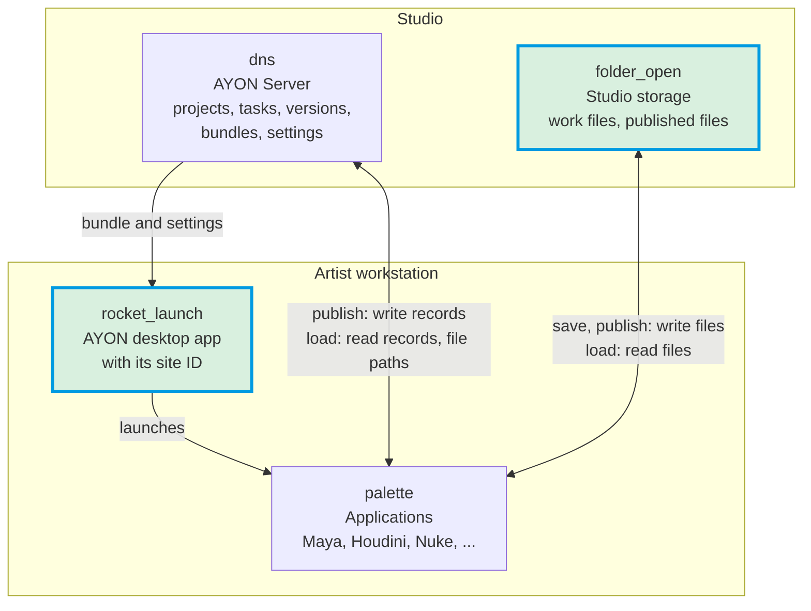
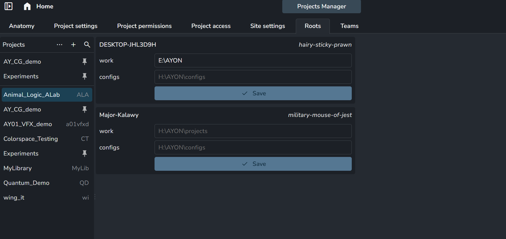

# Artist workstation setup

Each workstation needs four things: the applications, the AYON Launcher, access to the studio storage, and access to the AYON server. The server is how the launcher is downloaded and how every AYON tool reaches the studio's data, so remote workstations need it just like the ones in the studio. To go straight to what has to be done, see [Setup steps](#setup-steps).



The studio side has the AYON Server, which holds the project data such as projects, tasks and versions, along with the bundles and settings, and the studio storage with the work files and published files. On the artist workstation, the AYON desktop app downloads the addons and the dependency package of the bundle from the server and reads the studio, project and site settings. It launches the applications, which work with both sides:

- **Saving and publishing:** the files are written to the studio storage, and their records to the AYON Server.
- **Loading:** the record and its file path are read from the AYON Server, the path is resolved, and the file is opened from the studio storage.

## Setup steps

1. **Reach the AYON Server.** The workstation needs network access to the studio's AYON Server, also when it works remotely: the launcher is downloaded from it, and every AYON tool reads and writes the studio's data through it.
2. **Install the DCC applications** in their default install location, or in a location agreed across the studio, so that the studio-wide application settings find them. See [DCC applications](#dcc-applications).
3. **Install the AYON Launcher,** usually downloaded from the AYON Server, and log in. At its first start it creates the machine's site ID. See [AYON Launcher](#ayon-launcher) and [Site ID](#site-id).
4. **Reach the studio storage** at the paths set in the project anatomy roots. When the workstation reaches it at another path, for example under another drive letter, set a root override for the workstation's site ID on the [Roots](web-ui/project/roots.md) tab. See [Studio storage](#studio-storage), and [Remote artists](#remote-artists) for workstations outside the studio network.

The rest of this page explains each step.

## Site ID

Every machine that runs the AYON Launcher, an artist workstation or a render node, gets a **site ID**: three random words such as `military-mouse-of-jest`, created at the first start. Its purpose is to match settings that differ per machine, the *site settings*, such as root paths, to the machine they belong to.

The site ID is stored in the launcher's local folder, which belongs to the operating system user. Two operating system users on one machine therefore get two site IDs, while AYON users who log in under the same operating system user share one. The `AYON_SITE_ID` environment variable overrides the stored value. See [Site IDs](backend/settings/index.md#site-ids) and the [launcher](../pipeline/launcher.md#site-id).

## Studio storage

The project anatomy sets the root paths of the studio storage for each operating system. When a machine reaches the storage at another path, for example under another drive letter or mount point, the path is set for that machine on the [Roots](web-ui/project/roots.md) tab of the Projects Manager: one panel per site ID, with one field per root. An empty field uses the path of the anatomy.



When files must exist in more than one storage location, see [Remote artists](#remote-artists).

## DCC applications

The application settings hold one list of executable paths per application and operating system, for the whole studio. There is no override per machine. A studio therefore keeps applications in their **default install location**, or in a **location agreed across the studio**, so that the same settings fit every machine. Several paths can be listed for one application. At launch, they are checked in the order of the list, and the application starts from the first path that exists on the machine.

Read more: [Applications and tools](https://help.ayon.app/en/help/articles/3945756-applications-and-tools).

## AYON Launcher

The launcher is downloaded from the studio's AYON Server and can be installed in different ways:

- **For all users** of a machine. This needs administrative privileges.
- **For one user only.**
- In a **shared location**, so that machines use the same installation.

:::note Supported platforms

The official AYON launcher releases are made for:

- **Windows:** `win-setup.exe`
- **macOS:** `.dmg`
- **Linux:** `.tar.gz` for Ubuntu 20.04, Debian 11, Rocky Linux 8 and Rocky Linux 9. Rocky Linux is the choice for RHEL-compatible distributions.

:::

The launcher keeps its files in two folders, the **launcher storage** and the **launcher local folder**, set with `AYON_LAUNCHER_STORAGE_DIR` and `AYON_LAUNCHER_LOCAL_DIR`. By default both are the same folder: `%LOCALAPPDATA%\Ynput\AYON` on Windows, `~/.local/share/AYON` on Linux and `~/Library/Application Support/AYON` on macOS.

A simplified layout:

```
AYON
├── addons/                 launcher storage
├── addons_resources/       launcher storage
├── dependency_packages/    launcher storage
├── app/                    launcher versions installed for one user (Windows)
├── site_id                 launcher local folder: a file with the site ID
└── ...                     launcher local folder: tool settings, thumbnails, logs
```

The **launcher storage** can be shared between machines of the same operating system. The **launcher local folder** is never shared: each user on each machine has their own.

The launcher updates itself to the version the studio's bundle specifies every time it starts. The environment variables are described in the [launcher developer docs](../developer/launcher/index.md#environment-variables).

Read more: [installing the launcher](https://help.ayon.app/en/help/articles/4678978-installing-ayon-launcher-on-user-machine), [launcher admin notes](https://help.ayon.app/en/help/articles/2308428-launcher-admin-notes) and the community guide [Use a shared location for the launcher and addons](https://community.ynput.io/t/use-shared-location-for-ayon-launcher-and-addons/1175).

## Render nodes

Render nodes run the launcher too, for example for publishing jobs on the farm, and each gets its own site ID like any other machine.

:::tip

### Share one site ID across render nodes

Dedicated render nodes can be given the **same site ID** by setting the `AYON_SITE_ID` environment variable to one value on all of them. This speeds up their communication with the server and reduces the load of requests on it during publishing jobs. It is meant for dedicated farm machines of the same operating system only, never for artist workstations.

:::

## Remote artists

An artist who works outside the studio network, without access to the studio storage, still needs a way to reach the project files. Two known ways are below, and the admin can pick either of them:

- **Mounted storage:** the studio storage, or a cloud storage, is mounted on the artist's machine with a third-party storage client, usually as a drive or a mount point. When the mounted path differs from the anatomy roots, the root override is set for the artist's site ID on the [Roots](web-ui/project/roots.md) tab, as described in [Studio storage](#studio-storage).
- **Local storage with Site Sync:** the artist works on their own disk. The project's roots are mapped to local folders for the artist's site, and the [Site Sync](../addons/pipeline-features/sitesync/index.md) addon downloads published files on demand and uploads what the artist publishes.

## Related

- [Introduction](introduction.md#studio-setups)
- [AYON Launcher](../pipeline/launcher.md)
- [Roots](web-ui/project/roots.md)
- [Creating a project](how-ayon-works/creating-a-project.md)
- [Site Sync addon](../addons/pipeline-features/sitesync/index.md)
