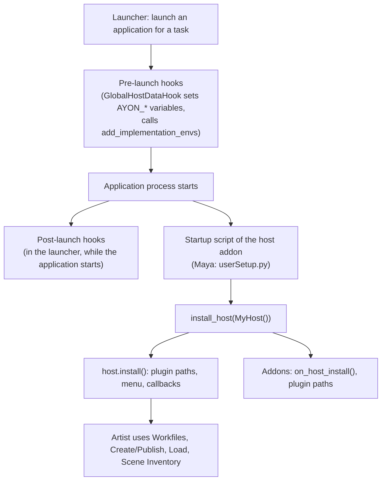
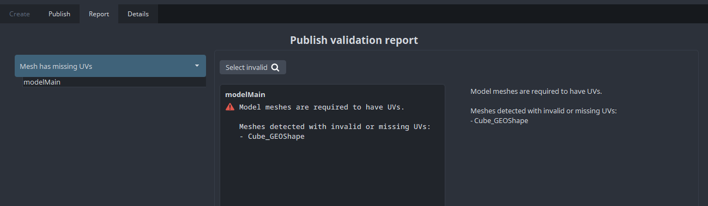

# Host integration and pipeline plugins

A host is an application that AYON integrates, such as Maya, Nuke or Photoshop. A host integration is an addon whose client code prepares the launch of the application, runs inside it, and provides pipeline plugins: creators, publish plugins and loaders. This page describes the developer side. The artist side of publishing is described in [Publishing](../../pipeline/publishing.md); addon classes and interfaces in general are described in [Client side](client.md).

## How a host starts



## The host addon

A host addon is an `AYONAddon` that also inherits `IHostAddon` from `ayon_core.addon`. Shortened from the Maya addon ([addon.py](https://github.com/ynput/ayon-maya/blob/develop/client/ayon_maya/addon.py)):

```python
class MayaAddon(AYONAddon, IHostAddon):
    name = "maya"
    version = __version__
    host_name = "maya"

    def add_implementation_envs(self, env, _app):
        ...  # put the 'startup' folder (userSetup.py) on PYTHONPATH

    def get_launch_hook_paths(self, app):
        if app.host_name != self.host_name:
            return []
        return [os.path.join(MAYA_ROOT_DIR, "hooks")]

    def get_workfile_extensions(self):
        return [".ma", ".mb"]
```

| Member | Required | Used by |
|---|---|---|
| `host_name` | Yes | The name of the integration. It must match the **Host name** of the application group in the [Applications addon settings](../../addons/essentials/applications/settings.md) and `app_host_name` in [package.py](overview.md#packagepy). |
| `get_workfile_extensions()` | No | The Applications addon, to find the last workfile of the task at launch. The first extension is used for a new workfile name. |
| `add_implementation_envs(env, app)` | No | The Applications addon, while it prepares the environment of the application. It changes `env` in place. Typical use: add the startup folder to `PYTHONPATH`. |
| `get_launch_hook_paths(app)` | No | The Applications addon collects it from every enabled addon, not only host addons. Returns folders with launch hooks. |

### Launch hooks

Launch hooks run in the launcher process around the start of the application. The base classes are in `ayon_applications`: `PreLaunchHook` and `PostLaunchHook`, both subclasses of `LaunchHook`. A hook implements `execute()`.

| Class attribute | Effect |
|---|---|
| `order` | Hooks with an order run sorted by it; hooks with `None` run after them. |
| `hosts`, `app_groups`, `app_names`, `platforms` | Filters. An empty set means no filter. |
| `launch_types` | Launch types the hook runs for. The default is `{LaunchTypes.local}`. An empty set means all types. |

| Hook type | Runs | On an exception |
|---|---|---|
| `PreLaunchHook` | Before the process starts. Can change `self.launch_context.env`, the launch arguments and `self.data`. | The application is not launched. |
| `PostLaunchHook` | After the process started, without waiting for the application to open. Runs outside the application, for example to start the task's timer. | Logged as a warning; the other hooks still run. |

The core hook `GlobalHostDataHook` (order `-100`) fills `self.data` with the project, folder and task entities, the anatomy and the project settings, and sets the context environment variables. Hooks that need this data use a higher order or no order. Maya's [hooks folder](https://github.com/ynput/ayon-maya/tree/develop/client/ayon_maya/hooks) has examples, such as `PreCopyMel`, which copies `workspace.mel` to `AYON_WORKDIR`.

### Client folder layout

The layout of the Maya client code is the usual one. Only `addon.py` (or `__init__.py`) with the addon class is required; the other names are conventions.

```text
client/ayon_maya/
├── __init__.py         exports the addon class
├── addon.py            MayaAddon (IHostAddon)
├── version.py          written by create_package.py
├── api/                code that runs inside the application
│   ├── pipeline.py     the host class, containerise(), ls()
│   ├── plugin.py       base classes for the host's creators, loaders, publish plugins
│   ├── menu.py         the AYON menu
│   └── lib.py          helpers
├── hooks/              launch hooks
├── plugins/
│   ├── create/         creators
│   ├── publish/        publish plugins (with help/ for XML messages)
│   ├── load/           loaders
│   └── inventory/      Scene Inventory actions
└── startup/
    └── userSetup.py    runs install_host() when Maya starts
```

Code in `addon.py` runs in the launcher, where the application's Python modules (`maya.cmds`) do not exist. Imports of the application go into `api/`, `plugins/` and `startup/` only.

## The host class

The host class represents the integration inside the running application. It inherits `HostBase` from `ayon_core.host` and the interfaces of the workflows it supports. The Maya host is `MayaHost(HostBase, IWorkfileHost, ILoadHost, IPublishHost)` in [api/pipeline.py](https://github.com/ynput/ayon-maya/blob/develop/client/ayon_maya/api/pipeline.py).

| Class | Required methods | Optional methods | Enables |
|---|---|---|---|
| `HostBase` | `name` (class attribute, for example `"maya"`) | `install()`, `get_app_information()`, `get_context_title()`, `maintained_selection()`, `get_current_context()` and `set_current_context()` (the defaults use the `AYON_*` environment variables) | Registration of the host. |
| `IWorkfileHost` | `open_workfile(filepath)`, `save_workfile(dst_path=None)`, `get_current_workfile()` | `workfile_has_unsaved_changes()`, `get_workfile_extensions()` | The [Workfiles](../../pipeline/workfiles.md) tool. |
| `ILoadHost` | `get_containers()` | | The [Scene Inventory](../../pipeline/scene-inventory.md), and update, switch and remove of loaded content. |
| `IPublishHost` | `get_context_data()`, `update_context_data(data, changes)` | | The [Publisher](../../pipeline/publisher.md). Context data holds values that belong to no instance, such as the toggles of optional context plugins. |

The older method names (`open_file`, `save_file`, `current_file`, `has_unsaved_changes`, `file_extensions`, `ls`) still work but are deprecated.

### install_host

`install_host(host)` from `ayon_core.pipeline` starts the integration. The application's startup script calls it; for Maya this is [startup/userSetup.py](https://github.com/ynput/ayon-maya/blob/develop/client/ayon_maya/startup/userSetup.py), which Maya runs because `add_implementation_envs` puts its folder on `PYTHONPATH`:

```python
from ayon_core.pipeline import install_host
from ayon_maya.api import MayaHost

host = MayaHost()
install_host(host)
```

`install_host` then:

1. calls `host.install()`;
2. registers the host, so `registered_host()` returns it;
3. registers the pyblish target `local` (or `remote` when `AYON_REMOTE_PUBLISH` is set);
4. calls `on_host_install(host, host_name, project_name)` on every enabled addon;
5. registers the core publish plugins and the create, load, publish and inventory plugin paths that addons return for the host name (see `IPluginPaths` in [Client side](client.md)).

A host can register its own plugin paths in `install()` instead. Maya does so with `pyblish.api.register_plugin_path`, `register_creator_plugin_path`, `register_loader_plugin_path` and `register_inventory_action_path`, and registers the pyblish hosts `maya`, `mayabatch` and `mayapy`.

Applications without an embedded Python run `install_host` in a separate AYON process that talks to the application. Photoshop, for example, starts a Qt process that installs `PhotoshopHost` and communicates with a Photoshop extension through a websocket.

### Menu and tools

The host gives artists access to the AYON tools, usually through a menu built in `install()`. The functions in `ayon_core.tools.utils.host_tools` open them: `show_workfiles()`, `show_publisher()`, `show_loader()`, `show_scene_inventory()` and others. See Maya's [menu.py](https://github.com/ynput/ayon-maya/blob/develop/client/ayon_maya/api/menu.py).

## The AYON context

The context is the project, folder and task the artist works in. The Applications addon sets it as environment variables at launch:

| Variable | Value |
|---|---|
| `AYON_PROJECT_NAME` | Project name. |
| `AYON_FOLDER_PATH` | Folder path, for example `/assets/characters/hero`. |
| `AYON_TASK_NAME` | Task name. |
| `AYON_HOST_NAME` | Host name of the application. |
| `AYON_APP_NAME` | Full application name, for example `maya/2026`. |
| `AYON_WORKDIR` | Work directory of the task. |
| `AYON_LAST_WORKFILE` | Path of the last workfile of the task (it may not exist yet). |

Code inside the application reads the context with `get_current_context()`, not from the environment. It asks the registered host, which may keep the context elsewhere (for example in the workfile). `HostBase.set_current_context()` changes the context and emits the `taskChanged` event.

<details>
<summary>Snippets to run inside an application</summary>

Print the current context:

```python
from ayon_core.pipeline import get_current_context

context = get_current_context()
print(
    "Project: {project_name}\n"
    "Folder path: {folder_path}\n"
    "Task: {task_name}".format(**context)
)
```

List the publish instances and change them:

```python
from ayon_core.pipeline import registered_host
from ayon_core.pipeline.create import CreateContext

host = registered_host()
create_context = CreateContext(host)
for instance in create_context.instances:
    print(instance["productName"], instance["productType"], instance["active"])
    # instance["active"] = False

# Store the changes in the scene
create_context.save_changes()
```

List the loaded containers:

```python
from ayon_core.pipeline import registered_host

host = registered_host()
for container in host.get_containers():
    print(container["name"], container["loader"], container["representation"])
```

</details>

## Creators

Creators define what is published: they make publish instances and store them in the scene. Each host decides how; Maya stores an instance as an object set with attributes, see [Where instances live](../../pipeline/publishing.md#where-instances-live).

### CreateContext and CreatedInstance

`CreateContext(host)` from `ayon_core.pipeline.create` discovers the creators, collects the existing instances, runs the auto creators and holds the instances. The Publisher uses one. On a reset it:

1. reads the current context from the host;
2. discovers creators (and publish plugins) and applies settings to them;
3. reads the context data with `host.get_context_data()`;
4. calls `collect_instances()` on each creator;
5. calls `create()` on each auto creator.

`save_changes()` writes changed context data with `host.update_context_data()` and passes changed instances to `update_instances()` of their creator.

`CreatedInstance` is the instance object, used like a dictionary. Some keys cannot be changed after creation:

| Key | Meaning |
|---|---|
| `id` | Marks the data as an instance (`ayon.create.instance`). |
| `instance_id` | Unique id, generated on creation. |
| `productType`, `productBaseType` | See [Product types](../../pipeline/product-types.md#product-type-variant-and-product-name). |
| `creator_identifier` | Identifier of the creator that owns the instance. |
| `creator_attributes` | Values of the creator's instance attribute definitions. |
| `publish_attributes` | Values of publish plugin attribute definitions, per plugin class name. |

Editable keys include `productName`, `variant`, `folderPath`, `task`, `active` and any host data. `instance.data_to_store()` returns JSON-serializable data to save in the scene; `CreatedInstance.from_existing(data, creator)` creates the instance again from it.

### Creator classes

All creators derive from `BaseCreator`. A plugin uses one of its three subclasses.

| Class | For | `create()` arguments | Shown in the Create tab |
|---|---|---|---|
| `Creator` | Instances the artist creates. | `product_name`, `instance_data`, `pre_create_data` | Yes |
| `AutoCreator` | Instances that always exist, created on every reset, such as `workfile`. Its `remove_instances()` does nothing. | None | No |
| `HiddenCreator` | Instances created by code, for example by another creator or a loader. | Not fixed; the base declares `instance_data`, `source_data` | No |

Each creator implements `create()`, `collect_instances()`, `update_instances(update_list)` and `remove_instances(instances)`. A host usually puts the last three in a shared base class, as Maya does with `MayaCreator` in [api/plugin.py](https://github.com/ynput/ayon-maya/blob/develop/client/ayon_maya/api/plugin.py). Maya's `CreateAnimation` is a hidden creator, triggered with `create_context.create(...)` when a rig is loaded.

| Attribute or method | Meaning |
|---|---|
| `identifier` | Unique id. Defaults to the product base type. |
| `product_base_type`, `product_type` | The type the creator makes. |
| `label`, `icon`, `description`, `detailed_description` | Shown in the Publisher. |
| `default_variants`, `default_variant` | Variants offered in the Create tab. |
| `get_instance_attr_defs()` | Per-instance options, stored in `creator_attributes`. |
| `get_pre_create_attr_defs()` | Options shown before creation, passed as `pre_create_data`. |
| `create_allow_context_change` | `False` hides the folder and task selection in the Create tab. |
| `host_name` | When set, the creator is used only in this host. |
| `settings_category` | Settings root key; see [Settings applied to plugins](#settings-applied-to-plugins). |

Attribute definitions (`BoolDef`, `NumberDef`, `TextDef`, `EnumDef` and others) come from `ayon_core.lib`. A creator raises `CreatorError` for errors the artist can fix; it is reported with its message and without a traceback.

<details>
<summary>Example creator for a host that stores instances on nodes</summary>

The module `lib` stands for the host's own helpers.

```python
from ayon_core.lib import BoolDef
from ayon_core.pipeline.create import Creator, CreatedInstance, CreatorError

from ayon_myhost.api import lib


class CreateModel(Creator):
    identifier = "myhost.model"
    label = "Model"
    product_base_type = "model"
    product_type = product_base_type
    icon = "cube"
    default_variants = ["Main", "Proxy"]
    settings_category = "myhost"

    def get_pre_create_attr_defs(self):
        return [BoolDef("use_selection", label="Use selection", default=True)]

    def create(self, product_name, instance_data, pre_create_data):
        members = lib.get_selection() if pre_create_data["use_selection"] else []
        if not members:
            raise CreatorError("Select the objects to publish.")

        node = lib.create_set(product_name, members)
        instance_data["instance_node"] = node
        instance = CreatedInstance(
            product_type=self.product_type,
            product_name=product_name,
            data=instance_data,
            creator=self,
            product_base_type=self.product_base_type,
        )
        self._add_instance_to_context(instance)
        lib.imprint(node, instance.data_to_store())
        return instance

    def collect_instances(self):
        for data in lib.read_instances():
            if data.get("creator_identifier") == self.identifier:
                instance = CreatedInstance.from_existing(data, self)
                self._add_instance_to_context(instance)

    def update_instances(self, update_list):
        for instance, _changes in update_list:
            lib.imprint(instance["instance_node"], instance.data_to_store())

    def remove_instances(self, instances):
        for instance in instances:
            lib.delete(instance["instance_node"])
            self._remove_instance_from_context(instance)
```

</details>

## Publish plugins

Publish plugins are [pyblish](https://github.com/pyblish/pyblish-base) plugins. At the start of a publish, `CollectFromCreateContext` turns each active `CreatedInstance` into a pyblish instance. Its `family` is the product base type, and its `families` list holds the product base type plus the `families` the creator added.

### Order and filters

| Attribute | Meaning |
|---|---|
| `order` | Plugins run sorted by order. Stages: `pyblish.api.CollectorOrder` (0), `ValidatorOrder` (1), `ExtractorOrder` (2), `IntegratorOrder` (3). Offsets such as `ExtractorOrder + 0.1` place a plugin inside a stage. `ayon_core.pipeline.publish` adds `ValidatePipelineOrder`, `ValidateContentsOrder`, `ValidateSceneOrder` and `ValidateMeshOrder`. |
| `families` | The plugin runs for instances that have at least one of these families. `["*"]` matches all. |
| `hosts` | The plugin runs only when one of these hosts is registered with pyblish. |
| `targets` | The plugin runs only for these targets, for example `local` or `farm`. |
| `label` | Shown in the Publisher. |
| `enabled`, `active`, `optional` | See [Skipping and partial publishes](../../pipeline/publishing.md#skipping-and-partial-publishes). |

A `pyblish.api.InstancePlugin` runs `process(self, instance)` once per matching instance. A `pyblish.api.ContextPlugin` runs `process(self, context)` once per publish. Extractors usually inherit `ayon_core.pipeline.publish.Extractor`, whose `staging_dir(instance)` returns the staging directory. An extractor adds its files to `instance.data["representations"]` as dictionaries with `name`, `ext`, `files` and `stagingDir`; the integrator publishes them.

### Errors

| Exception (from `ayon_core.pipeline.publish`) | When |
|---|---|
| `PublishValidationError(message, title=None, description=None, detail=None)` | In a validator, for problems the artist can fix. The publish continues to the end of validation and then stops. The Report tab groups errors by `title` and shows `description` (Markdown) or, without it, `message`. |
| `PublishXmlValidationError(plugin, message, key=None, formatting_data=None, help_filename=None)` | Same, with title, description and detail read from an XML file. |
| `PublishError(message, title=None, description=None, detail=None)` | A known error the artist cannot fix in the scene; the message is shown in the Publisher. Replaces the deprecated `KnownPublishError`. |
| Any other exception | Stops the publish as a crash. |

The XML file for `PublishXmlValidationError` is `help/<plugin file name>.xml` next to the plugin, unless `help_filename` names another file. Each `<error id="...">` holds a `<title>`, a `<description>` and an optional `<detail>`; `key` selects the error (default `main`) and `formatting_data` fills `{placeholders}` in the description and detail.

An example is [validate_containers.xml](https://github.com/ynput/ayon-core/blob/develop/client/ayon_core/plugins/publish/help/validate_containers.xml) in ayon-core.

### Example: Mesh Has UVs

The Maya validator [validate_mesh_has_uv.py](https://github.com/ynput/ayon-maya/blob/develop/client/ayon_maya/plugins/publish/validate_mesh_has_uv.py) checks that every mesh of a `model` instance has UVs. Shortened:

```python
from ayon_core.pipeline.publish import (
    OptionalPyblishPluginMixin,
    PublishValidationError,
    ValidateMeshOrder,
)
from ayon_maya.api import plugin
import ayon_maya.api.action


class ValidateMeshHasUVs(plugin.MayaInstancePlugin,
                         OptionalPyblishPluginMixin):
    order = ValidateMeshOrder
    families = ["model"]
    label = "Mesh Has UVs"
    actions = [ayon_maya.api.action.SelectInvalidAction]
    optional = True

    @classmethod
    def get_invalid(cls, instance):
        ...  # meshes of the instance without UVs

    def process(self, instance):
        if not self.is_active(instance.data):
            return

        invalid = self.get_invalid(instance)
        if invalid:
            names = "\n".join(" - {}".format(node) for node in invalid)
            raise PublishValidationError(
                title="Mesh has missing UVs",
                message="Model meshes are required to have UVs.\n\n"
                        "Meshes detected with invalid or missing UVs:\n"
                        "{0}".format(names)
            )
```

`plugin.MayaInstancePlugin` is a `pyblish.api.InstancePlugin` with `hosts = ["maya"]` and `settings_category = "maya"`. A model without UVs fails with this report:



### Actions and repair

`actions` lists pyblish actions shown on the plugin in the Report tab. `RepairAction` (for instance plugins) and `RepairContextAction` (for context plugins) from `ayon_core.pipeline.publish` call the plugin's class method `repair(instance)` or `repair(context)`. Both appear only when the plugin failed.

```python
class ValidateSomething(pyblish.api.InstancePlugin):
    actions = [RepairAction]

    @classmethod
    def repair(cls, instance):
        ...  # fix the scene
```

### Optional plugins and attribute definitions

A plugin that inherits `AYONPyblishPluginMixin` can show options in the Publisher. `get_attribute_defs()` returns attribute definitions; they are shown for instances that match the plugin's `families` (instance plugins) or in the context options (context plugins). The values are stored in `publish_attributes` under the plugin class name; `self.get_attr_values_from_data(instance.data)` reads them. `get_attr_defs_for_instance(create_context, instance)` and `get_attr_defs_for_context(create_context)` can be overridden for options that depend on the instance.

`OptionalPyblishPluginMixin` builds on it. When the plugin has `optional = True`, it adds an `active` checkbox labeled with the plugin label, defaulting to the plugin's `active` attribute. The plugin checks it with `self.is_active(instance.data)` (or `context.data`) at the start of `process()`, as in the example above.

### Settings applied to plugins

Settings set class attributes of plugins, so a studio can change them per project. The addon defines the values in its settings model (see [Server side](server.md)). Discovery applies them:

| Plugin kind | Settings path | Notes |
|---|---|---|
| Publish plugin | `<settings_category>` > `publish` > `<class name>` | Without `settings_category`, the host name and then the folder name of the addon in the plugin path are tried, with a deprecation warning. |
| Creator | `<settings_category>` > `create` > `<settings_name or class name>` | Nothing is applied without `settings_category`. |
| Loader | `<host name>` > `load` > `<class name>`, then `core` > `load` > `<class name>` | Default of `LoaderPlugin.apply_settings`. |

Each key of the settings becomes a class attribute, for example `enabled`, `optional`, `active` or `families`. A plugin with `enabled` set to `False` is not used. A plugin can override the class method `apply_settings(cls, project_settings)` to read other settings; `get_plugin_settings()` and `apply_plugin_settings_automatically()` in `ayon_core.pipeline.publish` help with that.

### Color-managed extractors

An extractor that writes images or video inherits `ColormanagedPyblishPluginMixin` and calls `self.set_representation_colorspace(representation, context, colorspace=None)` on each representation. It adds `colorspaceData` with the colorspace and the OCIO config of the publish context. Without a `colorspace` argument, the file rules decide. Example from the Houdini addon:

```python
from ayon_core.pipeline import publish


class ExtractComposite(ExtractROP, publish.ColormanagedPyblishPluginMixin):
    families = ["imagesequence"]

    def update_representation_data(self, instance, representation):
        if representation["ext"].lower() == "exr":
            self.set_representation_colorspace(
                representation, instance.context, colorspace="scene_linear"
            )
```

What happens with `colorspaceData` afterwards, and where the config comes from, is described in [Color management in publishing](../../pipeline/color-management-in-publishing.md) and [Color management on launch](../../pipeline/color-management-on-launch.md#data-the-host-integration-reads).

## Loaders

A loader brings a published representation into the scene. It subclasses `LoaderPlugin` from `ayon_core.pipeline`.

| Attribute or method | Meaning |
|---|---|
| `product_base_types`, `product_types` | Product types the loader accepts. `product_base_types` is used when set. `{"*"}` accepts all. |
| `representations` | Representation names, for example `{"abc"}`. `{"*"}` accepts all. Empty means none. |
| `extensions` | File extensions. The default `{"*"}` accepts all. |
| `label`, `icon`, `color`, `order` | Shown in the Loader actions. |
| `options` or `get_options(contexts)` | Attribute definitions shown before loading, passed as `options`. |
| `load(context, name=None, namespace=None, options=None)` | Loads the representation. |
| `update(container, context)` | Changes a loaded container to another version. |
| `remove(container)` | Removes a container from the scene. |
| `switch(container, context)` | Optional. Changes a container to another product or representation. Without it, the Scene Inventory cannot switch the container. |
| `get_representation_name_aliases(name)` | Representation names to fall back to on update when the new version lacks the current one. |

`context` is a dictionary with the `project`, `folder`, `product`, `version` and `representation` entities. `self.filepath_from_context(context)` returns the path of the representation's file.

### Containers

A loader marks what it loaded as a container: an object in the scene with metadata. `host.get_containers()` returns one dictionary per container, and the [Scene Inventory](../../pipeline/scene-inventory.md) builds its list from them.

| Key | Meaning |
|---|---|
| `representation` | Id of the loaded representation. Used to find its version and whether it is outdated. |
| `loader` | Class name of the loader. Used to find the loader for update, switch and remove. |
| `name`, `namespace` | Name and namespace of the loaded content. |
| `objectName` | Name of the container object in the scene. |
| `project_name` | Project of the representation, when it is not the current one. |
| `id` | Marks the data as a container (`ayon.load.container`; older hosts use `pyblish.avalon.container`). |

Writing the container is host-specific. Maya's `containerise()` in [api/pipeline.py](https://github.com/ynput/ayon-maya/blob/develop/client/ayon_maya/api/pipeline.py) puts the loaded nodes into an object set with these keys as attributes, and its `ls()` (returned by `MayaHost.get_containers()`) reads them back and adds `objectName`.

### Load workflow

1. The [Loader](../../pipeline/loader.md) (or [Browser](../../pipeline/browser.md)) discovers the loader plugins and offers those compatible with the selected representation: matching product type, representation name and extension.
2. The chosen loader's `load()` receives the representation context. The product name is used as `name` when none is given.
3. The loader adds the content to the scene and writes the container metadata.
4. The Scene Inventory lists `host.get_containers()` and compares each container's representation with the latest version.
5. On update, `update_container()` finds the loader by the container's `loader` key, builds the context of the new version and calls `update()`. Switch calls `switch()`; remove calls `remove()`.

Scene Inventory actions are separate plugins: subclasses of `InventoryAction` with `is_compatible(container)` and `process(containers)`, in the host's `plugins/inventory` folder.

<details>
<summary>Example loader</summary>

The module `lib` and `containerise()` stand for the host's own helpers.

```python
from ayon_core.pipeline import LoaderPlugin

from ayon_myhost.api import lib
from ayon_myhost.api.pipeline import containerise


class AlembicLoader(LoaderPlugin):
    product_base_types = {"pointcache", "animation"}
    product_types = product_base_types
    representations = {"abc"}
    label = "Load Alembic"
    icon = "code-fork"
    color = "orange"

    def load(self, context, name=None, namespace=None, options=None):
        path = self.filepath_from_context(context)
        nodes = lib.import_alembic(path, namespace)
        return containerise(
            name=name,
            namespace=namespace,
            nodes=nodes,
            context=context,
            loader=self.__class__.__name__,
        )

    def update(self, container, context):
        node = container["objectName"]
        lib.set_alembic_path(node, self.filepath_from_context(context))
        lib.imprint(node, {"representation": context["representation"]["id"]})

    def switch(self, container, context):
        self.update(container, context)

    def remove(self, container):
        lib.delete(container["objectName"])
```

</details>

## Related

- [Addon overview and packaging](overview.md)
- [Client side](client.md)
- [Server side](server.md)
- [Publishing](../../pipeline/publishing.md)
- [Publisher](../../pipeline/publisher.md)
- [Product types](../../pipeline/product-types.md)
- [Applications addon](../../addons/essentials/applications/index.md)
- [Maya addon](../../addons/3d-applications/maya/index.md)
