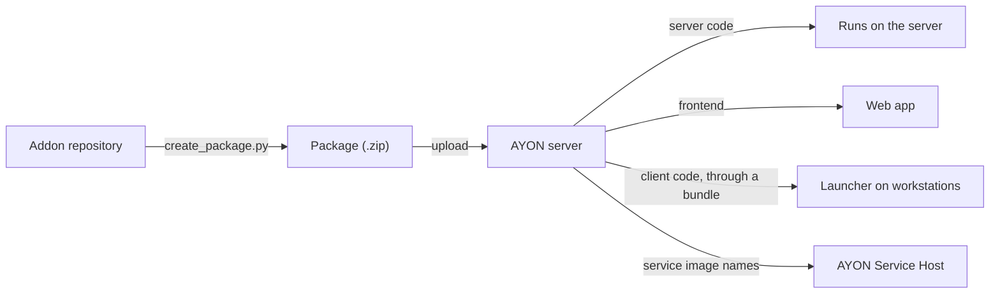

# Addon overview and packaging

An addon extends AYON. Every integration, such as Maya or Deadline, and most features are addons. This page describes what an addon is made of, the `package.py` file that describes it, and how it is packaged and installed. The [server side](server.md), [client side](client.md), [host integration](host-integration.md), [frontend](frontend.md), [services](services.md) and [private and public files](files.md) pages cover each part in detail.

## Parts of an addon

An addon has up to five parts. Only the server code is required.

| Part | Folder in the repository | Runs | Described in |
|---|---|---|---|
| Server code | `server/` | On the AYON server: settings, endpoints, actions, events | [Server side](server.md) |
| Client code | `client/` | On workstations, in the launcher and in applications: tools, pipeline plugins, host integrations | [Client side](client.md), [Host integration](host-integration.md) |
| Frontend | `frontend/` | In the web app, as a page of its own | [Frontend](frontend.md) |
| Services | `services/`, by convention | In Docker, run by the [AYON Service Host](../../ayon/deployment/ash.md), for background work such as syncing with another tracker | [Services](services.md) |
| Files | `private/`, `public/` | Served by the server: `private` to signed-in users, `public` to anyone | [Private and public files](files.md) |

How the parts reach the places they run:



The server only uses an addon version that a [bundle](../../ayon/how-ayon-works/bundles.md) names. The launcher downloads the client code of the bundle's addon versions.

## Repository layout

New addons start from the [addon template](https://github.com/ynput/ayon-addon-template). An addon with every part looks like this:

```text
my-addon/
├── package.py          the addon's name, version and requirements
├── create_package.py   builds the package
├── pyproject.toml      development tools, such as ruff
├── server/
│   ├── __init__.py     the server addon class
│   └── settings.py     the settings model
├── client/
│   ├── pyproject.toml  the client code's Python dependencies
│   └── my_addon/       the client code, named as client_dir in package.py
├── frontend/           the frontend source, built into frontend/dist
├── services/           the services, for example one folder per service
├── private/            files for signed-in users
└── public/             files for anyone
```

## package.py

`package.py` describes the addon. The server reads it when it loads the addon, and `create_package.py` reads it to build the package.

```python
name = "my_addon"
title = "My Addon"
version = "1.0.0"
client_dir = "my_addon"

ayon_server_version = ">=1.0.7"
ayon_launcher_version = ">=1.0.2"
ayon_required_addons = {"core": ">=1.0.0"}
ayon_compatible_addons = {}
```

| Key | Required | What it does | Read by |
|---|---|---|---|
| `name` | Yes | The addon's name: lower case, used in settings, bundles and URLs. | Server |
| `version` | Yes | A [semantic version](https://semver.org/), for example `1.0.0`. | Server |
| `title` | No | The name shown in the web app. Defaults to `name`. | Server |
| `client_dir` | With client code | The folder inside `client/` with the client code. | `create_package.py` |
| `services` | With services | The Docker image of each service, for example `{"processor": {"image": "ynput/my-addon-processor:1.0.0"}}`. | Server, AYON Service Host |
| `app_host_name` | Host integrations | The host name of the application the addon integrates, for example `maya`, the same as `host_name` of its [host addon](host-integration.md#the-host-addon) in the client code. When an application is launched, the Applications addon finds its host addon by that `host_name`. | Server |
| `project_can_override_addon_version` | No | `True` lets a [project bundle](../../ayon/how-ayon-works/bundles.md) use another version of the addon. | Server |
| `ayon_server_version` | No | The server versions the addon works with, for example `">=1.0.7"`. | Bundle check |
| `ayon_launcher_version` | No | The launcher versions the addon works with. | Bundle check |
| `ayon_required_addons` | No | Addons that must be in the same bundle, with a version range. A range of `None` means the addon must not be in the bundle. | Bundle check |
| `ayon_soft_required_addons` | No | Addons that may be missing, but must match the range when they are in the bundle. | Bundle check |
| `ayon_compatible_addons` | No | Addons that should match the range when they are in the bundle. A mismatch is a warning, not an error. | Bundle check |

The bundle check runs on the Bundles page while a bundle is created or changed, and lists its errors and warnings there. A production or staging bundle with errors cannot be created; a dev bundle can still be saved, with the errors shown. See also [Dependencies](../requirements.md#dependencies).

## Build a package

`create_package.py` in the repository root builds the package:

```shell
python create_package.py
```

It writes `package/<name>-<version>.zip`, and before that:

- writes the version from `package.py` into `client/<client_dir>/version.py` and the root `pyproject.toml`;
- builds the frontend with Yarn, when there is a `frontend` folder;
- zips the client code into `private/client.zip`, next to the client's `pyproject.toml`, where the launcher and the dependency package builder find them.

| Option | Effect |
|---|---|
| `-o`, `--output <folder>` | Writes the package to another folder. The folder is emptied first. |
| `--skip-zip` | Writes the package as a folder, `<name>/<version>/`, instead of a zip. |
| `--only-client` | Copies only the client code to the output folder. Needs `-o`. |
| `--debug` | Shows debug messages. |

The package contains `package.py`, `server/`, `frontend/dist/`, `private/` (with `client.zip`), `public/` and the license.

## Install a package

| Way | How |
|---|---|
| Web app | **Upload Addons** on the [Addons](../../ayon/web-ui/studio/addons.md) or [Bundles](../../ayon/web-ui/studio/bundles.md) tab of Studio settings. |
| Script | `ayon_api.upload_addon_zip(<path to the zip>)` with the [Python API](../api/python.md), then `ayon_api.trigger_server_restart()`. |

The server installs the package into its `addons` folder as `<name>/<version>/` and needs a restart to load it: after an upload, the app menu shows **Restart Required**, see [Navigation bar](../../ayon/web-ui/navigation-bar.md). A bundle then puts the new version into use.

## Develop an addon

Uploading a package after every change is slow. Two shortcuts:

- **Client code:** a [dev bundle](../developer-mode.md) points the launcher to the client code in the repository, so changes are live without a new package.
- **Server code and settings:** on a development server, a clone of the repository in the server's `addons` folder is read directly, see [Addon code inside the server](../developer-mode.md#addon-code-inside-the-server).

The tools for developing an addon are listed in [Requirements](../requirements.md), and the code style in [Code style](../requirements.md#code-style).

## Related

- [Server side](server.md)
- [Client side](client.md)
- [Host integration](host-integration.md)
- [Frontend](frontend.md)
- [Services](services.md)
- [Private and public files](files.md)
- [Developer mode](../developer-mode.md)
- [Requirements](../requirements.md)
- [Bundles](../../ayon/how-ayon-works/bundles.md)
- [Addons catalogue](../../addons/index.md)
