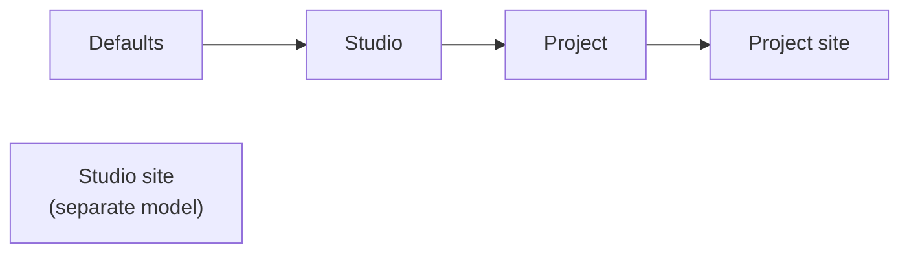

# Addon server side

The server code of an addon runs inside the AYON server. It defines the addon's settings, and can add REST endpoints, web actions and event handlers, which this page describes. The [frontend](frontend.md), [services](services.md) and [files](files.md) have pages of their own. The repository layout and `package.py` are described in [Overview and packaging](overview.md).

## The server addon class

`server/__init__.py` defines one subclass of `BaseServerAddon`. The server finds it by type, so the class name is free.

```python title="server/__init__.py"
from ayon_server.addons import BaseServerAddon

from .settings import MySettings


class MyAddon(BaseServerAddon):
    settings_model = MySettings
```

The server sets `name`, `version`, `title`, `services`, `app_host_name` and `project_can_override_addon_version` on the class from [`package.py`](overview.md#packagepy). Other class attributes:

| Attribute | Default | Description |
|---|---|---|
| `settings_model` | `None` | Model of the studio, project and project site settings. See [Settings](#settings). |
| `site_settings_model` | `None` | Model of the studio site settings. |
| `frontend_scopes` | `{}` | Where the addon's frontend shows in the web app. See [Frontend](frontend.md). |
| `addon_type` | `"pipeline"` | With `"server"`, the addon's version can be changed in an existing production or staging bundle, and its settings are migrated automatically when that happens. The versions of `"pipeline"` addons can only be changed in dev bundles. |
| `system` | `False` | `True` hides the addon's settings from non-admins and adds the addon to every new bundle. |

### Lifecycle hooks

The server loads every installed version of every addon, not only the versions in bundles. Each loaded version gets these calls:

| Method | When | Use |
|---|---|---|
| `initialize()` | When the class is created. Cannot be async. | Register endpoints with `add_endpoint`, subscribe to events. |
| `pre_setup()` | After all addons are initialized. May be async. | First step of setup that needs other addons or the database. |
| `setup()` | After `pre_setup` ran for all addons. May be async. | Setup that needs other addons or the database. |

A version whose `pre_setup` or `setup` raises an error is unloaded. Calling `self.request_server_restart()` from any of these hooks restarts the server once all addons are set up, for example after the addon changed the server configuration.

## Settings

Settings are [Pydantic](https://docs.pydantic.dev/) models built from `BaseSettingsModel` and `SettingsField`. The server builds the settings forms of the web app from them. What the scopes are and how overrides and variants work is described in [Settings scopes and storage](../../ayon/backend/settings/index.md).

```python title="server/settings.py"
from ayon_server.settings import BaseSettingsModel, SettingsField, task_types_enum


def colorspace_enum():
    return [
        {"value": "aces", "label": "ACES"},
        {"value": "srgb", "label": "sRGB"},
    ]


class PublishModel(BaseSettingsModel):
    _isGroup = True
    enabled: bool = SettingsField(True, title="Enabled")
    task_types: list[str] = SettingsField(
        default_factory=list, title="Task types", enum_resolver=task_types_enum
    )


class MySettings(BaseSettingsModel):
    colorspace: str = SettingsField(
        "aces", title="Colorspace", enum_resolver=colorspace_enum
    )
    local_cache: str = SettingsField("", title="Local cache", scope=["site"])
    publish: PublishModel = SettingsField(
        default_factory=PublishModel, title="Publish"
    )
```

The addon class uses the model with `settings_model = MySettings`, see [The server addon class](#the-server-addon-class).

### Scopes

A field shows in the scopes listed in `scope`. A top-level field without `scope` is in `["studio", "project"]`; nested fields take the scope of their parent.

Each level overrides the one before it. Studio site settings are outside this chain:



| Scope | Model | Field `scope` value |
|---|---|---|
| Studio settings | `settings_model` | `"studio"` |
| Project settings | `settings_model` | `"project"` |
| Project site settings | `settings_model` | `"site"` |
| Studio site settings | `site_settings_model` | not used: a separate model |

Project site settings are overrides of the project settings for one site. Studio site settings are a separate model: they are stored per user and site, start from the model's defaults, and do not inherit studio, project or project site settings. The [Deadline addon](https://github.com/ynput/ayon-deadline/tree/develop/server) uses them for each user's Deadline credentials.

### Useful SettingsField arguments

| Argument | Description |
|---|---|
| `title`, `description` | Label and help text in the form. |
| `scope` | See [Scopes](#scopes). |
| `enum_resolver` | A function, sync or async, that returns the choices: a list of strings or of `{"value": ..., "label": ...}` dicts. It is called when the form is built. It gets only the arguments it names, out of `addon`, `project_name`, `settings_variant`, `site_id` and `user_name`. `ayon_server.settings` has ready resolvers such as `task_types_enum`, `folder_types_enum`, `anatomy_presets_enum` and `secrets_enum`. |
| `conditional_enum` | Turns an enum field into a switch that shows the sub-model named by its value. |
| `section` | A section header above the field. |
| `widget`, `syntax` | Another editor for the field, for example `widget="textarea"`, with `syntax` for highlighting. |
| `placeholder`, `disabled` | Placeholder text; a read-only field. |

`BaseSettingsModel` subclasses accept private attributes that change the form: `_isGroup = True` makes the model one override group (overridden as a whole), `_layout = "compact"` and `_title` change how it is drawn. The [example addon settings](https://github.com/ynput/ayon-example-addon/blob/develop/server/settings.py) show every field type and option.

### Defaults and conversion between versions

The default values of the settings are kept in one of two ways:

- **In the model.** Each `SettingsField` has its default as the first argument, or as `default_factory`, as in the example above. Nothing else is needed: `get_default_settings()` creates the model with these defaults.
- **In a separate dictionary.** The addon overrides `get_default_settings()` and passes the dictionary to the model. Values in the dictionary replace the field defaults. This suits large or nested defaults, such as lists of profiles, and fields without a default. [ayon-core](https://github.com/ynput/ayon-core/blob/develop/server/__init__.py) and [ayon-applications](https://github.com/ynput/ayon-applications/blob/develop/server/addon.py) work this way.

:::note
With the defaults in a dictionary, the addon class must override `get_default_settings()` to use it. Without the override, the method of `BaseServerAddon` reads the defaults from the settings model.
:::

The dictionary is defined next to the model:

```python title="server/settings.py"
class MySettings(BaseSettingsModel):
    colorspace: str = SettingsField(title="Colorspace", enum_resolver=colorspace_enum)
    publish: PublishModel = SettingsField(default_factory=PublishModel, title="Publish")


DEFAULT_VALUES = {
    "colorspace": "aces",
    "publish": {
        "enabled": True,
        "task_types": ["modeling", "rigging"],
    },
}
```

`colorspace` has no default in the model, so it is required and must be in the dictionary. The dictionary is passed to the model in `get_default_settings()`:

```python title="server/__init__.py"
from .settings import MySettings, DEFAULT_VALUES


class MyAddon(BaseServerAddon):
    settings_model = MySettings

    async def get_default_settings(self):
        settings_model_cls = self.get_settings_model()
        return settings_model_cls(**DEFAULT_VALUES)
```

Overrides are stored per addon version. When overrides are read for another version, for example when settings are migrated to a new version or copied between versions, the target version's `convert_settings_overrides(source_version, overrides)` returns the converted overrides. The default implementation keeps every value that still fits the new model and drops the rest. Override it for renamed or retyped fields, then call `super()`, as [ayon-core](https://github.com/ynput/ayon-core/blob/develop/server/__init__.py) does.

### Reading settings in server code

| Method | Returns |
|---|---|
| `await self.get_studio_settings(variant="production")` | Defaults with studio overrides. |
| `await self.get_project_settings(project_name, variant="production")` | Studio settings with project overrides. |
| `await self.get_project_site_settings(project_name, user_name, site_id, variant="production")` | Project settings with project site overrides. |
| `await self.get_site_settings(user_name, site_id)` | Studio site settings as a dict, or `None`. |

The first three return an instance of `settings_model`, or `None` when the addon has no settings. The variant is `production`, `staging` or a dev bundle name.

### How the addon gets its settings

The settings are defined once, in the server code, and each part of the addon reads them in its own way:

| Part | How it gets the settings |
|---|---|
| Server code | The methods above, for example `await self.get_project_settings(project_name)`. |
| Client code | `initialize(settings)` receives the studio settings when the addon is created. `get_studio_settings()` and `get_project_settings(project_name)` from `ayon_core.settings` read them later. See [Client side](client.md#settings). |
| Services | `ayon_api.get_service_addon_settings()`, in the variant of the service. See [Services](services.md). |
| Other scripts | `ayon_api.get_addon_studio_settings(addon_name, addon_version)`, `ayon_api.get_addon_project_settings(addon_name, addon_version, project_name)` (with the project site overrides of the current site, unless `use_site=False`) and `ayon_api.get_addon_site_settings(addon_name, addon_version)`, or the REST endpoints `/api/addons/{addon name}/{addon version}/settings` and `/settings/{project name}`. |

```python
# client code
from ayon_core.settings import get_project_settings

project_settings = get_project_settings("my_project")
colorspace = project_settings["my_addon"]["colorspace"]
```

When settings change, the server dispatches a `settings.changed` event, see [Events](#events).

## Endpoints

`add_endpoint` adds a REST endpoint, usually from `initialize()`. The handler is a [FastAPI](https://fastapi.tiangolo.com/) path operation: path parameters, query parameters, request bodies and dependencies work as in FastAPI.

```python
from ayon_server.api.dependencies import CurrentUser


class MyAddon(BaseServerAddon):
    def initialize(self):
        self.add_endpoint("projects/{project_name}/info", self.get_info, method="GET")

    async def get_info(self, user: CurrentUser, project_name: str):
        """Return information about a project."""
        settings = await self.get_project_settings(project_name)
        return {"user": user.name, "colorspace": settings.colorspace}
```

- The endpoint is served at `/api/addons/{addon name}/{addon version}/{path}`, for every installed version of the addon.
- Paths starting with `settings`, `schema` or `overrides` are reserved and not registered.
- The server does not check access by itself. The `CurrentUser` dependency rejects requests without a valid token and requests from guest users. An endpoint without it is open to anyone who can reach the server.
- `add_endpoint` also takes `name` and `description` (the docstring by default). `add_router` adds a whole FastAPI `APIRouter` under the same prefix.
- The addon's endpoints are listed at `/api/addons/{addon name}/{addon version}/api-docs`.

Clients call these endpoints with the [Python API](../api/python.md), for example `ayon_api.get(f"addons/{name}/{version}/projects/{project}/info")`.

## Web actions

Web actions are the actions shown for selected entities in the web app, for example in the [details panel](../../ayon/web-ui/details-panel.md). The server collects them from the addons of the user's bundle: the production bundle, or the user's dev bundle in [developer mode](../developer-mode.md) (the web actions icon turns purple there).

An addon lists **simple actions** in `get_simple_actions(project_name, variant)` and runs them in `execute_action(executor)`:

```python
from ayon_server.actions import ActionExecutor, ExecuteResponseModel, SimpleActionManifest


class MyAddon(BaseServerAddon):
    async def get_simple_actions(self, project_name=None, variant="production"):
        return [
            SimpleActionManifest(
                identifier="my_addon.open_folder",
                label="Open folder",
                icon={"type": "material-symbols", "name": "folder_open"},
                entity_type="folder",
                allow_multiselection=False,
            )
        ]

    async def execute_action(self, executor: ActionExecutor) -> ExecuteResponseModel:
        if executor.identifier == "my_addon.open_folder":
            context = executor.context
            return await executor.get_launcher_response(
                args=[
                    "addon", "my_addon", "open-folder",
                    "--project", context.project_name,
                    "--folder-id", context.entity_ids[0],
                ]
            )
        return await super().execute_action(executor)
```

| Manifest field | Description |
|---|---|
| `identifier` | Unique ID, passed back to `execute_action`. |
| `label`, `description`, `group_label`, `category`, `order` | How the action is shown and sorted. |
| `icon` | `{"type": "material-symbols", "name": ...}` with an optional `color`, or `{"type": "url", "url": ...}`. In a URL, `{addon_url}` is replaced with `/addons/{name}/{version}`, so `"{addon_url}/public/icons/my.svg"` points to a [public file](files.md#private-and-public-files). |
| `entity_type` | `project`, `list`, `folder`, `task`, `product`, `version`, `representation` or `workfile`. `None` for actions outside a project. |
| `entity_subtypes` | Folder types, task types and so on that the action is limited to. |
| `allow_multiselection` | Show the action when several entities are selected. |
| `admin_only`, `manager_only` | Limit the action to admins or managers. |

Simple actions are cached per addon version, project and variant. The cache is cleared when the project or the addon settings change. Actions that depend on the selected entities themselves go to `get_dynamic_actions(context, variant)`, which returns `DynamicActionManifest` items and is called for each context.

`executor` holds `identifier`, `user`, `variant`, `addon_name`, `addon_version` and `context`. `context` has `project_name`, `entity_type`, `entity_ids`, `entity_subtypes` and `form_data`.

### Responses

`execute_action` returns one of these responses. Each takes an optional `message`.

| Method | Effect in the web app |
|---|---|
| `get_simple_response()` | Shows the message. |
| `get_launcher_response(args)` | Opens the AYON launcher on the workstation, which runs itself with `args` in the bundle of the action's variant. With `["addon", <addon name>, <command>, ...]` this calls a CLI command of the addon's client code, see [Client side](client.md). The launcher reports back through an `action.launcher` event. |
| `get_form_response(title, fields)` | Shows a form built with `ayon_server.forms.SimpleForm`. On submit, the same action runs again with the values in `executor.context.form_data`. |
| `get_navigate_response(uri)` | Moves to a page of the web app, for example `/projects/my_project/overview`. |
| `get_redirect_response(uri, new_tab=False)` | Opens another URL. |
| `get_query_response(query)` | Changes the query parameters of the current page. |

`get_simple_response` and the other non-launcher responses also take `extra_clipboard` (text to copy) and `extra_download` (a URL to download). A real form flow is in the [example addon](https://github.com/ynput/ayon-example-addon/blob/develop/server/actions/file_action.py).

## Events

Server code dispatches and reacts to events with `EventStream` from `ayon_server.events`. The arguments, statuses and well known topics are described in [Event system](../server/event-system.md#on-the-server).

```python
from ayon_server.events import EventModel, EventStream


class MyAddon(BaseServerAddon):
    def initialize(self):
        EventStream.subscribe("entity.task.status_changed", self.on_task_status)

    async def on_task_status(self, event: EventModel):
        await EventStream.dispatch(
            "my_addon.task_checked",
            project=event.project,
            description=f"Checked {event.summary}",
        )
```

A handler is an async function that takes the event. By default it runs on the server replica that dispatched the event, and a topic ending in `.*` matches every topic with that prefix. `subscribe(..., all_nodes=True)` runs the handler on every replica instead, for stored events with exactly that topic.

The older `on_settings_changed(old_settings, new_settings, ...)` hook is still called, but only on the replica that saved the settings. A handler of the `settings.changed` event with `all_nodes=True` runs on all replicas.

## Related

- [Overview and packaging](overview.md)
- [Client side](client.md)
- [Host integration](host-integration.md)
- [Frontend](frontend.md)
- [Services](services.md)
- [Files](files.md)
- [Settings scopes and storage](../../ayon/backend/settings/index.md)
- [Event system](../server/event-system.md)
- [Developer mode](../developer-mode.md)
- [Example addon](https://github.com/ynput/ayon-example-addon)
