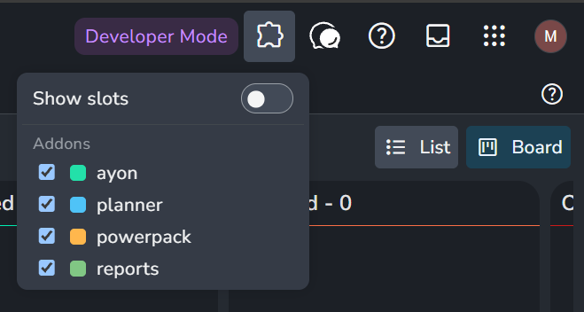
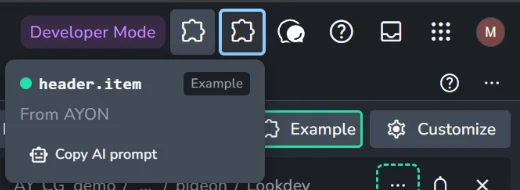

# Web app slots

An addon can add to the AYON web app's own screens, not only show a page of its own. The web app has named places, called **slots**, such as the App header, the tabs of the details panel or the right-click menu of the project table. An addon fills them with **contributions**: a button in the header, a tab in the details panel, a column in a table, an item in a menu. The contributions look and behave like the rest of the web app, because they use its components, its store and its router.


Slots work alongside the [iframe pages](frontend.md) of `frontend_scopes`, which still work. An iframe page is a page of its own; a contribution is a piece of AYON's own screens.

## Slots and contributions

A contribution has two parts:

- **The description**: the slot, an `id` and fields such as a label, an icon or where it shows. AYON reads it when the web app starts, without loading any of the addon's code.
- **The pieces**: the code, loaded only when the slot needs it. A piece is a `component` (drawn in the slot), `run` (a function, for menu items), `dialog`, `menu`, `popover`, `cell` or `fetchValues` (for table columns).

The `id` starts with a letter and holds letters, digits and `_`, unique within the slot. AYON keeps the contribution as `<addon name>.<id>`. An optional `minExposureLevel` (guest 100, user 500, manager 700, admin 900) hides it from lower roles; it only hides the interface and does not protect data.

Every slot passes a context: the `slot`, the `user` (name, full name, email, admin, manager, guest, service and developer flags), and the values of that place. A component gets the context as props, and components below it call `useSlot()`; a `run` or `menu` piece gets it as its argument.

## Slots of the web app

The helper in brackets is the manifest function for the slot.

| Slot | What a contribution adds | Context besides `slot` and `user` | Pieces |
|---|---|---|---|
| `project.page` (`projectPage`) | A tab on the project page, at `/projects/<project>/<id>` | `project`, `projectName`, `slicer`, `projectFolders`, `views` | component |
| `studio.page` (`studioPage`) | A tab on Home, at `/dashboard/<id>` | `selectedProjects`, `views` | component |
| `header.item` (`headerItem`) | A button in the [App header](../../ayon/web-ui/app-header.md), left (with its label) or right (an icon) | `projectName`, `navigate` | one of a link (`to`), run, dialog, menu, popover or component |
| `detailsPanel.tab` (`detailsPanelTab`) | A tab in the details panel, for chosen entity types | `scope` (overview, dashboard, inbox, …), `projectName`, `entityType`, `entities` | component |
| `detailsPanel.menuItem` (`detailsPanelMenuItem`) | An item in the details panel's more menu | `projectName`, `entityType`, `entities` | run |
| `listDetails.tab` (`listDetailsTab`) | A tab in the details panel of a list, in Lists, Reviews and the review session | `list`, `scope`, `projectName` | component |
| `projectList.menuItem` (`projectListMenuItem`) | An item in the project list's right-click or more menu | `projectNames`, `menu` | run |
| `slicer.menuItem` (`slicerMenuItem`) | An item in the slicer's menus | `sliceType`, `selected`, `entities`, `menu`, `projectName` | run |
| `entityMenuItem` (`entityMenuItem`) | An item in the right-click menu of the project table's cells | `page`, `entities`, `projectName`, `tableState` | run |
| `projectTable.toolbarItem` (`projectTableToolbarItem`) | A button in the project table's toolbar, before **Customize** | `page`, `list`, `projectName`, `navigate`, `tableState` | run, dialog, menu, popover or component |
| `projectTable.columnMenuItem` (`projectTableColumnMenuItem`) | An item in a column header's more menu | `page`, `columnId`, `columnLabel`, `groupField`, `projectName`, `tableState` | run or dialog |
| `projectTable.customizeSection` (`projectTableCustomizeSection`) | A section in the **Customize** panel | `page`, `projectName` | component |
| `tableColumn` (`tableColumn`) | A read-only column, hidden until the user shows it | `page`, `entity`, `value`, `projectName` | cell, and fetchValues to load the values |
| `table.shortcut` (`tableShortcut`) | A keyboard shortcut on table cells, such as `shift+mod+c` | `table`, `projectName`, `rows`, `entities`, `focused`, `cells`, `tableState` | run or dialog |
| `userDetails.section` (`userDetailsSection`) | A section in the details of the [Users](../../ayon/web-ui/studio/users.md) page | `readOnly`, `users` | component |
| `userDetails.menuItem` (`userDetailsMenuItem`) | An item in the user details' more menu | `readOnly`, `users` | run |
| `profile.section` (`profileSection`) | A section on the [Profile](../../ayon/web-ui/account/profile.md) page | none | component |
| `app.service` (`appService`) | A component mounted once for the whole web app, drawing nothing, for background work | `projectName` | component |

The full reference of every slot, with its fields and an example, is the `AGENTS.md` shipped in the `@ynput/ayon-addon` package, also listed by `ayon-addon slots`.

## Contributing to a slot

1. Install the packages in the addon's frontend folder:

   ```bash
   yarn add -D @ynput/ayon-addon @ynput/ayon-addon-dev
   ```

2. Write the manifest, `src/manifest.ts`, with one helper per contribution:

   ```ts
   import { defineAddon, entityMenuItem } from '@ynput/ayon-addon/manifest'

   export default defineAddon({
     contributes: [
       entityMenuItem({ id: 'copy_names', label: 'Copy names', icon: 'content_copy', run: () => import('./copyNames') }),
     ],
   })
   ```

   A piece is always `() => import('./File')`, and the file has a default export:

   ```ts
   // src/copyNames.ts
   import type { RunPiece } from '@ynput/ayon-addon'

   const copyNames: RunPiece<'entityMenuItem'> = ({ entities }) =>
     navigator.clipboard.writeText(entities.map((entity) => entity.name ?? entity.id).join('\n'))
   export default copyNames
   ```

3. Build with the Vite plugin of `@ynput/ayon-addon-dev`. Its `name` is the module the server announces:

   ```ts
   // vite.config.ts
   import react from '@vitejs/plugin-react'
   import { ayonAddon } from '@ynput/ayon-addon-dev/vite'

   export default defineConfig({ plugins: [react(), ayonAddon({ name: 'my_addon' })] })
   ```

   The build goes to `frontend/dist/modules/my_addon`. React, the store, the router, toasts and AYON's shared components are taken from the web app, so the addon does not bundle its own copies.

4. Declare the module in the [server addon class](server.md#the-server-addon-class):

   ```python
   class MyAddon(BaseServerAddon):
       frontend_modules = {"my_addon": ["manifest"]}
   ```

When the web app starts, it asks the server for the frontend modules of the user's bundle (`GET /api/frontendModules`), loads each addon's manifest from `/addons/<addon>/<version>/frontend/modules/<name>/remoteEntry.js`, and adds the contributions to their slots. A contribution with an unknown slot or invalid fields is skipped with a warning in the browser console; the rest of the addon still works. When the bundle changes, the web app offers to refresh.

## What a contribution can use

Everything below comes from `@ynput/ayon-addon`:

| Area | Exports |
|---|---|
| The slot | `useSlot` (the context of the slot the component is in), `useContributions`, `SlotOutlet` and `useSlotMenuItems` (to show a slot's contributions), `runContribution` |
| Navigation and panels | `navigate`, `entityUrl`, `navigateToEntity`, `openDetails`, `closeDetails`, `openViewer`, `openImport` (AYON's CSV and Excel import), the router's `Link`, `useLocation`, `useNavigate`, `useParams`, `useSearchParams` |
| Ready-made interface | `EntityTable` (the read-only project table), `EntityPicker`, `ListPicker`, `TabbedPanel` (AYON's panel with tabs), `PanelTabHeader`, `MoreMenu`, `useContextMenu`, `ProjectPageLayout`, `StudioPageLayout`, `Slicer`, `ProjectList` |
| Table columns | `refreshTableColumn`, `addonColumnId`, `cellValue` |
| App state | `dispatch` (AYON's store), `useUser`, `toast`, `useQueryParam` and `useQueryParams` |
| Types | `SlotProps`, `SlotContext`, `RunPiece`, `MenuPiece`, `EntityRef`, `ProjectTableState` and others |

Data comes from the API layer of `@ynput/ayon-frontend-shared`; an addon's own endpoints and tags start with the addon name. Form controls are those of `@ynput/ayon-react-components`. An older AYON skips slots it does not know and lacks newer exports, so a contribution that uses a new export checks that it exists.

## Slots of your own addon

An addon can declare slots of its own, named `<addon>.<name>`, so other addons can extend it. They are published as a contract package, `@ynput/ayon-addon-<addon>`, with the slot declarations, their types and helpers, and optional preview scenes for the dev shell. Slot declarations carry a version, so a contribution can require a newer one. The declaring addon shows the contributions with `SlotOutlet` or `useSlotMenuItems`.

## Checking and testing

`@ynput/ayon-addon-dev` adds the `ayon-addon` command, run in the addon's frontend folder. Every command takes `--json` for scripts and AI assistants.

| Command | What it does |
|---|---|
| `ayon-addon check` | Checks the manifest as AYON reads it, the piece files and the types (`tsc`) |
| `ayon-addon slots` | Lists the slots and their examples |
| `ayon-addon dev` | Starts the dev shell, on port 5174 by default |
| `ayon-addon dev --ayon` | Builds on every change and prints a link that opens your server with the addon's code from your machine (port 5173). Only for users with [developer mode](../developer-mode.md) on, or service users, and only from localhost. |
| `ayon-addon open <slot> <id>` | Opens one contribution headless with Playwright |
| `ayon-addon preview … --fixture <name>` | The same, from saved context, without a server |
| `ayon-addon generate-rest` | Generates RTK Query endpoints from the addon's OpenAPI |

The **dev shell** draws the addon in AYON's real panels (details panel, slicer, Customize, the project table, the project list) without a running web app, with hot reload. It lists every place the addon fills, shows the context each contribution receives, and can save that context for `preview`. It reads data from a server through `AYON_SERVER_URL` (default `http://localhost:5000`) and `AYON_API_KEY` from `.env` or `.env.local`; without a key it shows AYON's login page.

## Finding slots in the web app

With [developer mode](../developer-mode.md) on, the App header has an **Addon slots** button (puzzle icon). Its menu has:

- **Show slots**: every slot shows its example contribution after the real ones, and every contribution is outlined in its addon's colour (dashed for a button that opens a menu). AYON's own slots and examples are listed as `ayon`.
- **Addons**: a checkbox and a colour per addon, to hide an addon's outlines.

Both are kept for the browser session.




Pointing at an outlined element shows a card with the slot id (with a copy button), where the slot comes from (**From AYON**, or the addon that declared it), the contribution and its addon, and an **Example** badge on examples.



### Building with an AI assistant

**Copy AI prompt** on the card copies a one-line request for an AI coding assistant working in your addon's frontend folder:

- on an example or an empty slot: ``Add a contribution to the AYON slot `header.item` in this addon.``
- on a real contribution: ``Edit the <addon> addon's contribution `<key>` (in the AYON slot `<slot>`):``, ending with a colon so you add what to change.

The prompt names only the slot. The assistant finds the rest in the packages: `@ynput/ayon-addon` and `@ynput/ayon-addon-dev` ship an `AGENTS.md` with the slots, the rules and the commands, and a `slots.json`, and `ayon-addon check --json` lets it check its own work.

## Requirements

| Package | Version | Use |
|---|---|---|
| `@ynput/ayon-addon` | 2.1.1 | Slots, manifest helpers and the web app's exports |
| `@ynput/ayon-addon-dev` | 0.6.3 | Vite plugin, `ayon-addon` command, dev shell, ESLint preset |

Both use the Functional Source License (FSL-1.1-ALv2). An addon that uses newer slots or exports raises its minimum AYON server version accordingly.

## Related

- [Addon frontend](frontend.md): iframe pages with `frontend_scopes`
- [Server addon](server.md)
- [Developer mode](../developer-mode.md)
- [App header](../../ayon/web-ui/app-header.md)
