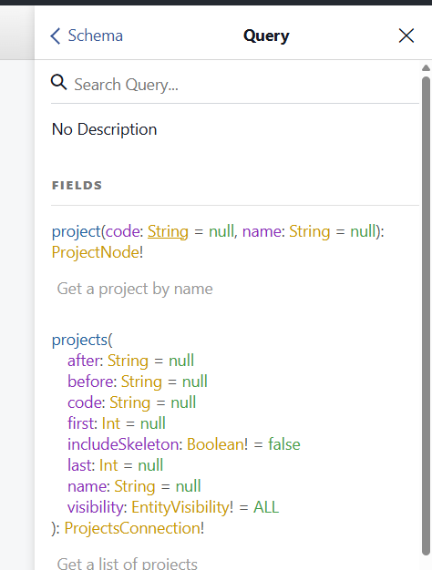
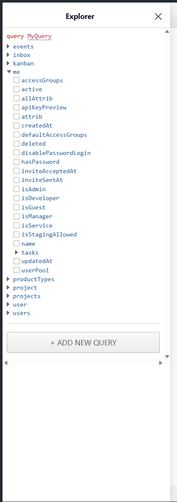
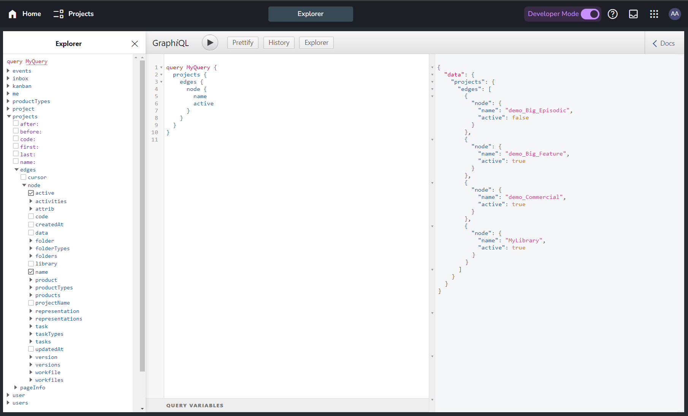

GraphQL is a query language for APIs: a request names exactly the fields it needs, and can follow related data, such as a project with its folders, tasks and versions, in one call.

The GraphQL API of the AYON server is read-only: it has queries only, no mutations. Changes go through the [REST API](rest.md). GraphQL suits reading related data in one request; the REST API suits changes and single resources.

## Reference

<Cards variant="compact">
<Card icon="hub" title="GraphQL API reference" href="/graphql/">
Every query, type, field and argument, also under GraphQL API in the top bar.
</Card>
<Card icon="description" title="schema.graphql" href="pathname:///schema.graphql">
The whole schema in one file, for tools and AI assistants.
</Card>
</Cards>

## Try it

<!--
  No live embed of the GraphQL explorer on this page, on purpose. The explorer (/graphiql on an AYON
  server) needs a signed-in user and reads its access token from the local storage of the server's
  own site, and the playground sign-in goes through the ynput.cloud login page, which cannot be shown
  in a frame. An embed would need a guest mode on the playground.
-->

The [GraphQL Explorer of the AYON playground](https://playground.ayon.app/explorer) runs queries against a demo server. Log in to the playground to try it. Every AYON server has the same explorer, under **GraphQL Explorer** in the Help menu of the web app; its controls are described in [GraphQL Explorer](../../ayon/web-ui/graphql-explorer.md).

Two panels of the explorer help with writing queries:

<Columns widths="50 50">
<Column>



</Column>
<Column>



</Column>
</Columns>

- **Docs**, at the top right: the reference of the schema, with every type, field and argument and its description, and a search.
- **Explorer**, in the toolbar: a query builder. Ticking fields and arguments in the tree writes the query.

## Your first query

This query lists the names of the projects and whether they are active:

```graphql
query MyQuery {
  projects {
    edges {
      node {
        name
        active
      }
    }
  }
}
```



Lists such as `projects` follow the connection pattern: the items are in `edges`, each with a `node`, and `first`, `after` and the other arguments page through them.
