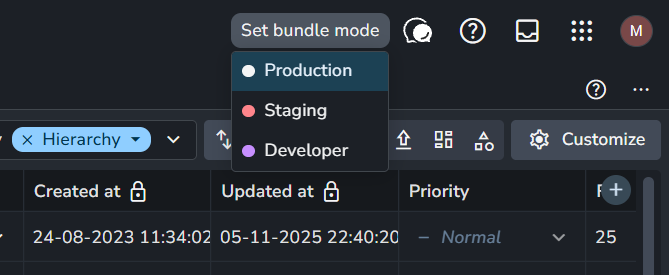
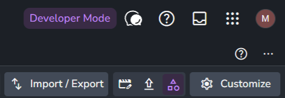
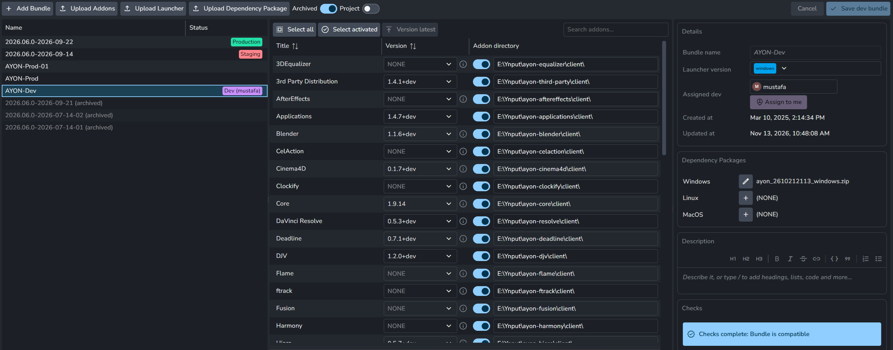

# Developer mode

A dev bundle is for testing the client code of addons, the pipeline code that runs on workstations, without packaging and uploading it to the server after every change. For each addon, a dev bundle can name a folder on the developer's machine, and the launcher reads the addon's client code from there instead of downloading it.

A dev bundle only changes where the client code comes from. The addon's settings still come from the addon installed on the server, so a change to the settings that the client code reads needs the addon updated on the server. Working on the rest of an addon is part of a full development environment, see [Addon development](addon-development/overview.md).

The steps:

1. [Enable developer mode](#enable-developer-mode-for-a-user) for the user.
2. [Create a dev bundle](#create-a-dev-bundle-and-assign-it) and assign it to the user.
3. [Point the addons to their client code](#addon-client-code) on the developer's machine.
4. Start the launcher with `--use-dev`.

## Enable developer mode for a user

1. An admin turns on **Developer** for the user on the [Users](../ayon/web-ui/studio/users.md) page. Only admins can set it, and only for users with the **Admin** access level.
2. The user picks **Developer** in **Set bundle mode** at the top right of the web app, see [Navigation bar](../ayon/web-ui/navigation-bar.md). Once switched, the selector reads **Developer Mode**, dev bundles are visible on the Bundles page and the web actions icon turns purple.

Developer mode only affects the user who turned it on. A user with **Staging access** can pick **Staging** in the same selector instead, to test staging bundles before they go to production.

<Gallery columns={2}>





</Gallery>

## Create a dev bundle and assign it

On the [Bundles](../ayon/web-ui/studio/bundles.md) page, in developer mode:

1. Create a bundle, or duplicate one, and turn on **Dev bundle**.
2. Assign a developer with **Assigned dev**, or **Assign to me**.
3. Choose the addons and their versions.



A dev bundle has one assigned developer, and a developer has one dev bundle: assigning a developer to a bundle takes them off the dev bundle they had. Unlike production and staging bundles, a dev bundle can change its addon versions after it is created.

The launcher uses the dev bundle of the logged-in user when it starts with `--use-dev`. Another dev bundle can be used with `--use-dev --bundle <bundle name>`. See [Launcher administration](../pipeline/launcher-administration.md#arguments).

## Addon client code

In a dev bundle, each addon has an addon directory: a switch and a path. With the switch on, the launcher reads the addon's client code from that path, for example the `client` folder of the addon's repository, instead of downloading it. The code is read live:

- **Python modules** that are already imported are not reloaded. A change takes effect after the launcher, or the application, is restarted, or after reloading the module manually.
- **Publish plugins** are loaded again each time the publisher is refreshed.

Addons whose package script prepares the client code in a more complex way can point the path to the folder that the script produces.

### Addon code outside the server

The usual setup: the addon's repository is anywhere on the developer's machine, and the addon is installed on the server as a package. The client code is live through the addon directory. A change to the server code or to the settings models needs a new package uploaded to the server. A task in the code editor that packages and uploads the addon makes that a single step.

### Addon code inside the server

:::danger Live addon code
The server reads an addon in this folder live, its settings and the other parts of the addon included. When the version in its `package.py` changes, the server sees the old version as uninstalled and the new one as installed. Every bundle that used the addon, dev, staging or production, breaks: the addon's version shows empty until the bundle is set to the new version. The settings overrides stay with the old version and have to be copied to the new one with **Copy settings from**. This is why it is not meant for a production server.
:::

On a self-hosted development server, an addon can also live in the server's `addons` folder, without packaging and uploading. It is the folder where the server installs addons, one folder per addon with one folder per version. In [ayon-docker](https://github.com/ynput/ayon-docker), it is the `addons` folder of the repository, mounted into the server container.

```text
addons/
├── core/
│   ├── 1.10.7/     installed by the server, named after the version in package.py
│   └── dev/        a clone of ayon-core, shown as 1.10.7+git
└── maya/
    └── 0.5.2/
```

The server reads the version of each folder from its `package.py`, so a clone for development can have any folder name. When the folder contains `.git`, the server replaces any suffix of the version with `+git`, so the clone shows in bundles as, for example, `1.10.7+git` (`AYON_USE_GIT_SUFFIX_FOR_ADDONS` turns the suffix off). The addon's folder usually exists already, created when the addon was installed:

```shell
cd <ayon-docker>/addons/core
git clone https://github.com/ynput/ayon-core dev
```

After a server restart, the server code and the settings of the clone are live, and the client code still comes through the addon directory of a dev bundle.

## Related

- [Bundles](../ayon/how-ayon-works/bundles.md)
- [Launcher administration](../pipeline/launcher-administration.md)
- [Addon development](addon-development/overview.md)
