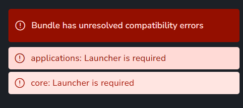

# Development requirements

What a development environment needs depends on the part of AYON being worked on.

- **An AYON server** to develop against: a local one, with the prerequisites in [On-premise deployment](../ayon/deployment/on-premise.md#host-machine-specs-and-prerequisites), or the dev server of a cloud subscription, included with Studio and optional with Pro, see [Cloud deployment](../ayon/deployment/cloud.md#what-it-includes).
- **The frontend running live (`yarn dev`):** [Node.js](https://nodejs.org/en/download) 20.19 or newer, [Yarn](https://classic.yarnpkg.com/en/docs/install) 1, and a running AYON server.
- **Pipeline (the AYON launcher and addons):** git, [Python](https://www.python.org/downloads/) `3.11.9` and [uv](https://docs.astral.sh/uv/getting-started/installation/), plus Bash on Linux and macOS or [PowerShell](https://learn.microsoft.com/powershell/scripting/overview) 7 or newer on Windows to run the scripts of the repositories.
- **Building the AYON launcher:** the pipeline tools, plus [Rust](https://rust-lang.org/tools/install/). The build page of each platform lists the rest: [Windows](launcher/build-windows.md), [macOS](launcher/build-macos.md), [Linux](launcher/build-linux.md).

:::caution Python version of the applications

The client code of an addon runs inside the applications, so it has to work with the Python version of each application the addon supports.

:::

:::note Backend

Backend code is worked on by mounting it into the server container: the compose file of [ayon-docker](https://github.com/ynput/ayon-docker) has a commented line for it. The code then runs with the dependencies shipped in the container, unless the server image is built from scratch.

:::

## Code style

The pipeline repositories, the AYON launcher and the addons, come with their code style configuration:

- [**ruff**](https://docs.astral.sh/ruff/) is a Python linter: it finds errors, unused code and style issues. Its rules are in the `ruff.toml` at the root of each repository, and it runs in the checks of their pull requests. Some repositories, such as ayon-core, also set the ruff version for the checks in their `pyproject.toml`; running that version locally gives the same results.
- [**codespell**](https://github.com/codespell-project/codespell) finds common spelling mistakes in code and comments. Repositories that run it in their pre-commit hooks, such as ayon-core, configure it in the `[tool.codespell]` section of their `pyproject.toml`, and a commit only goes through when it passes.

Following this style matters beyond pull requests: an addon shared with the community, or proposed for the [Market](../ayon/web-ui/market.md), is easier to read and review when it uses the same style as the official addons. Both tools can run in the code editor, which shows the issues while typing.

## Dependencies

### Server frontend

The web app's dependencies are listed in the [`package.json` of ayon-frontend](https://github.com/ynput/ayon-frontend/blob/develop/package.json), with the exact versions in `yarn.lock`. The server image builds the frontend with Yarn and ships the result, so nothing is installed on the server at run time.

An addon with a frontend of its own has a `frontend/package.json`. Its `create_package.py` builds it with Yarn into `frontend/dist` and puts the result in the addon package, so packaging such an addon also needs Node.js and Yarn.

### Server backend

The AYON server ships its dependencies in its Docker image. They are listed in the [`pyproject.toml` of ayon-backend](https://github.com/ynput/ayon-backend/blob/develop/pyproject.toml). The server code of an addon uses these libraries: adding libraries of its own is not supported. Heavier work goes to an addon service, a Docker image whose Dockerfile sets its dependencies.

### Launcher

The launcher's dependencies are listed in the [`pyproject.toml` of ayon-launcher](https://github.com/ynput/ayon-launcher/blob/develop/pyproject.toml) and frozen into the installer. The Qt binding is PySide6 6.8.3 by default, or PySide2 5.15.2 when `install-runtime-dependencies` gets `--use-pyside2`.

### Addons and pipeline

An addon has a `pyproject.toml` in two places:

- **The repository root:** the tools for developing the addon and for its checks, such as ruff.
- **`client/pyproject.toml`:** the dependencies of the client code, picked up by the AYON dependencies tool:
  - `[tool.poetry.dependencies]`: available to the launcher and to the applications.
  - `[ayon.runtimeDependencies]`: available only to the launcher process, with sections per platform such as `[ayon.runtimeDependencies.darwin]`.

<Columns widths="55 45">
<Column>

An addon's `package.py` also sets the versions it works with: `ayon_server_version`, `ayon_launcher_version`, `ayon_required_addons` and `ayon_compatible_addons`. They are checked when a bundle is created.

</Column>
<Column>

</Column>
</Columns>

:::tip Shipping AYON Addons Python Dependencies

The client dependencies of a bundle's addons are resolved into one dependency package per platform, which the [bundle](../ayon/how-ayon-works/bundles.md) uses. A custom package is built with the [AYON dependencies tool](https://github.com/ynput/ayon-dependencies-tool), see [Bundles](../ayon/web-ui/studio/bundles.md).

For more info and step by step guide see [What are dependency package and how to update them?](https://community.ynput.io/t/what-are-dependency-package-and-how-to-update-them/1991)  
:::

