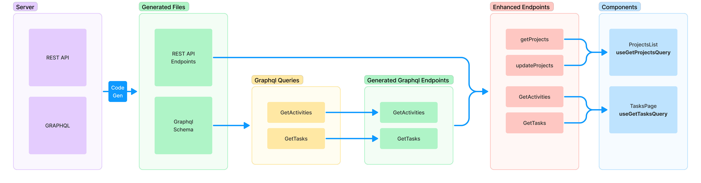
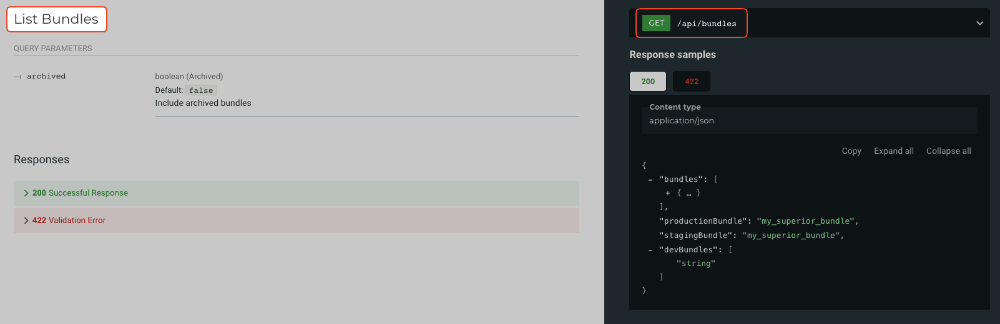

The server has two APIs, [REST](../api/rest.md) and [GraphQL](../api/graphql.md). The frontend calls both through one RTK Query API, `api`, defined in `shared/src/api/base` and imported as `@shared/api/base`.

Endpoints are generated from the server schemas. Hand-written query files then enhance the generated endpoints and export React hooks.



## Where the code lives

| Path | Content |
| --- | --- |
| `gen/` | Code generation config and scripts. |
| `shared/src/api/base/` | The base `api` and the store helpers. |
| `shared/src/api/generated/` | Generated code. Never edited by hand. |
| `shared/src/api/queries/<area>/` | Query files that enhance or inject endpoints, and the `.graphql` files of the area in `gql/`. |
| `src/services/` | Legacy query code. |

:::note Legacy code
Many files in `src/services` inject hand-written endpoints instead of enhancing generated ones. New query code goes to `shared/src/api/queries/<area>/`.
:::

## Code generation

The generated files are committed. They are regenerated when the server API changes or a `.graphql` file is added or changed.

| Script | What it does |
| --- | --- |
| `yarn generate-token` | Signs in with `NAME` and `PASSWORD` from `.env.local` and writes `TOKEN` to `gen/.env`. |
| `yarn download-openapi` | Downloads `<SERVER_URL>/openapi.json` to `gen/openapi.json`. |
| `yarn generate-rest` | Runs `download-openapi`, then generates the REST endpoints. |
| `yarn generate-rest-all` | Same as `generate-rest`, then post-processes the generated types (`gen/process-api-types.js`). |
| `yarn generate-gql` | Generates GraphQL types and endpoints from the server schema and the `.graphql` files. |

`SERVER_URL` is read from `.env.local` and defaults to `http://localhost:5000`. Both the schema download and the GraphQL schema loader send `TOKEN` as a bearer token. `TOKEN` comes from `gen/.env` (written by `generate-token`) or from `.env.local`.

### REST

`gen/openapi-config.ts` configures [RTK Query OpenAPI codegen](https://redux-toolkit.js.org/rtk-query/usage/code-generation#openapi):

- Every operation in `gen/openapi.json` is generated. Endpoints are not listed by hand.
- Endpoints are grouped by the first OpenAPI tag of each operation, converted to camelCase. Operations without a tag go to `misc`.
- Each group is written to `shared/src/api/generated/<tag>.ts`, for example `bundles.ts`. Each file injects its endpoints into `@shared/api/base`.
- Addon endpoints (tags with a version number) are skipped unless named explicitly.

Tag names passed after the config file limit generation to those groups:

```shell
yarn generate-rest bundles folders
```

`shared/src/api/generated/index.ts` re-exports each group as `<tag>Api`, for example `bundlesApi` or `projectsApi`. Endpoint names match the `operationId`, as shown on the API docs page of the server (`/doc/api`), for example **List Bundles** is `listBundles`.



### GraphQL

`gen/codegen.yml` configures [GraphQL Code Generator](https://the-guild.dev/graphql/codegen/plugins/typescript/typescript-rtk-query) with the `typescript-rtk-query` plugin:

| Output | Source documents | Exported as |
| --- | --- | --- |
| `shared/src/api/generated/graphql.ts` | All `.graphql` files except `shared/src/api/queries/links/` | `gqlApi` |
| `shared/src/api/generated/graphqlLinks.ts` | `.graphql` files in `shared/src/api/queries/links/` | `gqlLinksApi` |
| `gen/graphql.schema.json` | The server schema (introspection) | - |

All operations of a file end up in the same generated file, with their types, for example `GetActivitiesQuery`.

## Adding a REST query

1. Search the code for the endpoint name. The endpoint may already be enhanced and exported.
2. Check that the endpoint is in `shared/src/api/generated/`. If not, run `yarn generate-rest`.
3. In `shared/src/api/queries/<area>/`, enhance the endpoint on its group API and export the hooks:

```typescript title="shared/src/api/queries/bundles/getBundles.ts"
import { bundlesApi } from '@shared/api/generated'

const getBundles = bundlesApi.enhanceEndpoints({
  endpoints: {
    listBundles: {
      providesTags: () => [{ type: 'bundleList' }],
    },
    checkBundleCompatibility: {},
  },
})

export const { useListBundlesQuery, useLazyListBundlesQuery, useCheckBundleCompatibilityQuery } =
  getBundles
```

4. Export the file from the area's `index.ts`.

The generated files already inject the endpoints into `api`. Enhancing adds config such as `providesTags`, `invalidatesTags` and `transformResponse`.

## Adding a GraphQL query

1. Write the operation in a `.graphql` file in `shared/src/api/queries/<area>/gql/`, for example `GetActivitiesById.graphql`. The file and operation names use PascalCase.
2. Run `yarn generate-gql`.
3. Enhance the generated endpoint on `gqlApi` (`gqlLinksApi` for links) and export the hooks, the same way as for REST.

## Custom endpoints

Endpoints that the generated code cannot express, such as infinite queries or queries that combine several requests, are added with `injectEndpoints` on the enhanced API. `getActivities.ts` enhances `gqlApi` and then injects its own endpoints into the result.

## Overriding result types

The generated types describe the raw server response. A `transformResponse` changes the data, so the result type of the endpoint is overridden to match. `getActivities.ts` does this with `OverrideResultType` from `@reduxjs/toolkit/query`:

```typescript
import { gqlApi } from '@shared/api/generated'
import { DefinitionsFromApi, OverrideResultType, TagTypesFromApi } from '@reduxjs/toolkit/query'

type Definitions = DefinitionsFromApi<typeof gqlApi>
type TagTypes = TagTypesFromApi<typeof gqlApi>

type UpdatedDefinitions = Omit<Definitions, 'GetActivitiesById'> & {
  GetActivitiesById: OverrideResultType<Definitions['GetActivitiesById'], ActivitiesResult>
}

const enhancedApi = gqlApi.enhanceEndpoints<TagTypes, UpdatedDefinitions>({
  endpoints: {
    GetActivitiesById: {
      transformResponse: (res: GetActivitiesByIdQuery) =>
        transformActivityData(res.project.activities.edges, res.project.activities.pageInfo),
    },
  },
})
```

The hooks of `enhancedApi` then return `ActivitiesResult` as `data`.

:::info Error handling
The frontend [AGENTS.md](https://github.com/ynput/ayon-frontend/blob/develop/AGENTS.md#errors) sets the rules for request errors: no `transformErrorResponse`, and `getRequestErrorString` for user-facing messages.
:::
