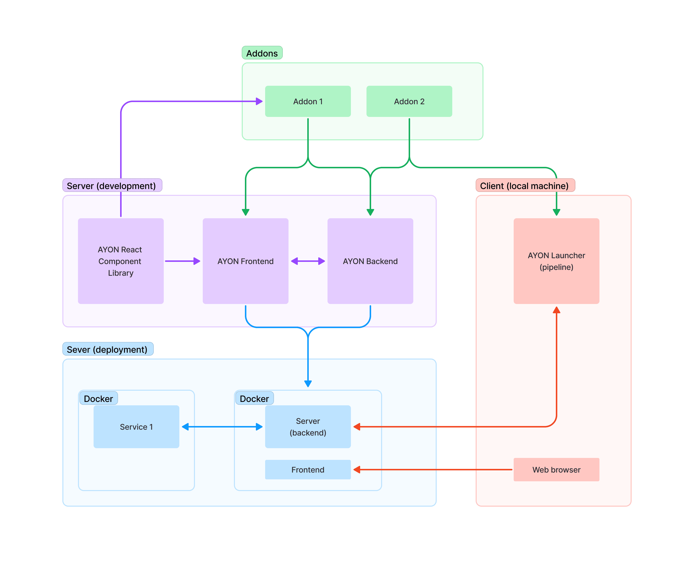

# AYON server repositories and stack

The AYON server is made of two code bases, [ayon-backend](https://github.com/ynput/ayon-backend) and [ayon-frontend](https://github.com/ynput/ayon-frontend). They are deployed together as one Docker image, built by [ayon-docker](https://github.com/ynput/ayon-docker), which the AYON launcher and the web app connect to. The tools each part needs are listed in [Requirements](../requirements.md).

## Backend

| Part | Used for |
|---|---|
| FastAPI | The REST API |
| Strawberry | The GraphQL API |
| PostgreSQL, through asyncpg | The database |
| Redis | Caching and messaging |
| gunicorn, or granian | The web server, chosen with `AYON_SERVER_TYPE` (gunicorn by default) |

For backend development, ayon-docker's `docker-compose.yml` has a commented line that mounts a local `./backend` folder into the server container. The backend's own tests are in its `tests` folder (`api`, `unit` and `integration`).

## Frontend

| Part | Used for |
|---|---|
| React, TypeScript | The web app. Part of the code is still JavaScript |
| Vite | Development server and build |
| Redux Toolkit with RTK Query | State and API calls, see [Frontend API layer](api-architecture.md) |
| AYON React Component Library (ARC) | Shared components and theme, see below |
| styled-components | Component styles |

The `shared` folder is a package of its own (`@ynput/ayon-frontend-shared`) with the generated API code, queries and containers used by the web app and by addon frontends.

`yarn dev` starts the frontend on port 3000 against a running server, `http://localhost:5000` by default. A different server is set with `SERVER_URL` in a `.env.local` file in the repository root.

### Recommended VS Code extensions

- CSS Variable Autocomplete
- GitHub Pull Requests
- vscode-styled-components
- GraphQL: Language Feature Support
- GraphQL: Syntax Highlighting

## AYON React Component Library (ARC)

The frontend uses its own component library, [ayon-react-components](https://github.com/ynput/ayon-react-components), for colors, fonts and reusable React components. The components are kept separate so that addon frontends can use them too: a component that could be useful to an addon, and is not too specific, belongs in ARC. See [Frontend React components](../api/react-components.md) and [AYON frontend theme](theme.md).
