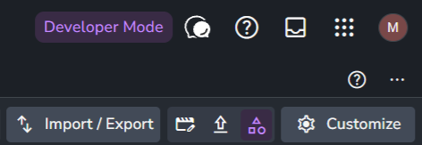
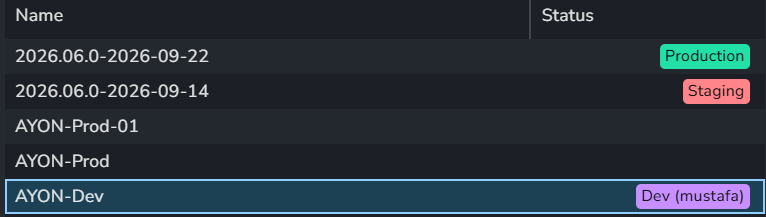
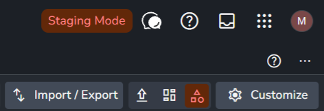
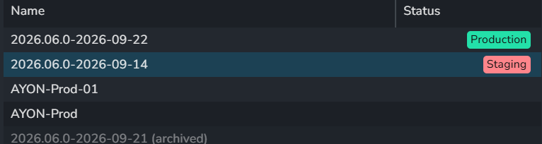

The AYON theme is based on [Material Design 3](https://m3.material.io/).

Every color has a theme variable that starts with `--md-sys-color-`.

## Colors

### Surface Containers

Surfaces go highest to lowest, elements with a higher z level should use higher surface levels.

<Swatches colors={[
    { name: "--md-sys-color-surface-container-highest", hex: "#424A57", note: "Highest: buttons" },
    { name: "--md-sys-color-surface-container-high", hex: "#353B46", note: "High: cards" },
    { name: "--md-sys-color-surface-container", hex: "#272D35", note: "Neutral: cards" },
    { name: "--md-sys-color-surface-container-low", hex: "#1C2026", note: "Low: backgrounds" },
    { name: "--md-sys-color-surface-container-lowest", hex: "#16191D", note: "Lowest: backgrounds" },
]} />


### Primary Color

The primary color is a bright blue and is used in areas to draw attention, like save buttons. When using a color, ensure any content on top uses the inverse to ensure sufficient contrast ratios.

There are other colors like secondary and tertiary, but they are rarely used.

<Swatches colors={[
    { name: "--md-sys-color-primary", hex: "#8FCEFF", note: "Important actions" },
    { name: "--md-sys-color-on-primary", hex: "#00344F", note: "Content on primary" },
    { name: "--md-sys-color-primary-container", hex: "#1C4154", note: "Less important selections" },
    { name: "--md-sys-color-on-primary-container", hex: "#EBF5FF", note: "Content on primary container" },
    { name: "--md-sys-color-secondary", hex: "#B7C9D9" },
    { name: "--md-sys-color-tertiary", hex: "#23E0A9", note: "Also the production color" },
    { name: "--md-sys-color-error", hex: "#FFB6AD", source: "hsl(6, 100%, 84%)" },
    { name: "--md-sys-color-error-container", hex: "#940F00", source: "hsl(6, 100%, 29%)" },
]} />

**Primary - important stuff **

```CSS
background-color: var(--md-sys-color-primary);
color: var(--md-sys-color-on-primary);
```

**Primary container - less important selections**

```CSS
background-color: var(--md-sys-color-primary-container);
color: var(--md-sys-color-on-primary-container);
```

### Text and border colors

Mostly uses `--md-sys-color-on-surface` but can use the inverse of a color like `--md-sys-color-on-primary` .

For a more fade text use `--md-sys-color-outline` or even more faded `--md-sys-color-outline-variant`.

These are also used for borders (try to avoid outlines).

<Swatches colors={[
    { name: "--md-sys-color-on-surface", hex: "#F4F5F5", note: "Text" },
    { name: "--md-sys-color-outline", hex: "#8B9198", note: "Faded text, borders" },
    { name: "--md-sys-color-outline-variant", hex: "#41474D", note: "More faded text, borders" },
    { name: "--md-sys-color-surface", hex: "#252B32", note: "Base surface" },
]} />

### Developer Mode

Developer mode actions and UI use a specific purple color to make them standout and to signal they are for developers only. Outside developer mode, the color is rarely used.

This color is a custom color outside of the theme color.

<Swatches colors={[
    { name: "--color-hl-developer", hex: "#C78FFF" },
    { name: "--color-hl-developer-hover", hex: "#D6AAFD", source: "hsl(272, 96%, 83%)" },
    { name: "--color-hl-developer-container", hex: "#392B45", source: "hsl(272, 23%, 22%)" },
    { name: "--color-hl-developer-surface", hex: "#B49CC9", source: "hsl(272, 30%, 70%)" },
    { name: "--color-hl-developer-surface-hover", hex: "#C1ACD2", source: "hsl(272, 30%, 75%)" },
]} />

In developer mode, the bundle mode selector at the top right reads **Developer Mode** in this color, and dev bundles carry a purple badge on the Bundles page. See [Developer mode](../developer-mode.md).

<Gallery columns={2}>





</Gallery>

```CSS
  var(--color-hl-developer);
  var(--color-hl-developer-container);
  var(--color-hl-developer-hover);
  var(--color-hl-developer-surface);
  var(--color-hl-developer-surface-hover)
```

### Production and Staging

Two specific colors are used to specify the difference between "production" and "staging". These color are outside of the theme color.

<Swatches colors={[
    { name: "--color-hl-production", hex: "#23E0A9", note: "The tertiary color" },
    { name: "--color-hl-staging", hex: "#FF858B", source: "hsl(357, 100%, 76%)" },
    { name: "--color-hl-staging-hover", hex: "#FF757C", source: "hsl(357, 100%, 73%)" },
    { name: "--color-hl-staging-active", hex: "#FF666E", source: "hsl(357, 100%, 70%)" },
    { name: "--color-hl-staging-container", hex: "#622809", source: "hsl(21, 83%, 21%)" },
]} />

Production and staging bundles carry badges in these colors on the Bundles page. Besides developer mode, there is a staging mode: a user with staging access can pick **Staging** in the bundle mode selector at the top right, which then reads **Staging Mode** in the staging color. See [Navigation bar](../../ayon/web-ui/navigation-bar.md).

<Gallery columns={2}>





</Gallery>

```CSS
  var(--color-hl-production)
  var(--color-hl-production-hover)
  var(--color-hl-production-active)

  var(--color-hl-staging)
  var(--color-hl-staging-hover)
  var(--color-hl-staging-active)
```

:::note
Text on top of these colors should always be dark.
:::

## Useful Variables

-   **Padding**: `--padding-s` (4px) `--padding-m` (8px) `--padding-l` (16px)
-   **Border radius**: `--border-radius-m` (4px) `--border-radius-l` (8px)

## Typography

Font sizes come from a set of classes in `src/theme/typography.module.css`, instead of a fixed `font-size`:

```jsx
import Type from "@/theme/typography.module.css";

<span className={Type.titleSmall}>Hello</span>;
```

The font is [Nunito Sans](https://fonts.google.com/specimen/Nunito+Sans), bundled with ARC. The classes and their values:

<TypeScale styles={[
    { name: "displayLarge", size: 57, lineHeight: 64, weight: 400 },
    { name: "displayMedium", size: 45, lineHeight: 52, weight: 400 },
    { name: "displaySmall", size: 36, lineHeight: 44, weight: 400 },
    { name: "headlineLarge", size: 32, lineHeight: 40, weight: 400 },
    { name: "headlineMedium", size: 28, lineHeight: 36, weight: 400 },
    { name: "headlineSmall", size: 24, lineHeight: 32, weight: 400 },
    { name: "titleLarge", size: 22, lineHeight: 28, weight: 400 },
    { name: "titleMedium", size: 16, lineHeight: 24, weight: 600 },
    { name: "titleSmall", size: 14, lineHeight: 20, weight: 600 },
    { name: "bodyLarge", size: 16, lineHeight: 24, weight: 400 },
    { name: "bodyMedium", size: 14, lineHeight: 20, weight: 400 },
    { name: "bodySmall", size: 12, lineHeight: 16, weight: 400 },
    { name: "labelLarge", size: 14, lineHeight: 20, weight: 500 },
    { name: "labelMedium", size: 12, lineHeight: 16, weight: 500 },
    { name: "labelSmall", size: 11, lineHeight: 16, weight: 500 },
]} />

## Loading state

-   Avoid spinners
-   Avoid layout shifts when the data loads in.
-   Use skeleton shimmer placeholders.
-   Add the `loading` class to an element to give it the shimmer effect (`src/styles/loadingShimmer.scss`). In ARC, the `getShimmerStyles()` helper does the same in styled components.


