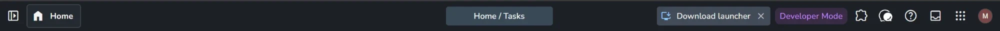
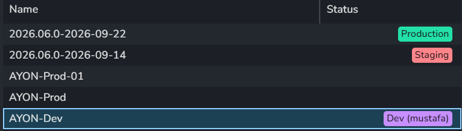
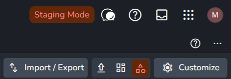
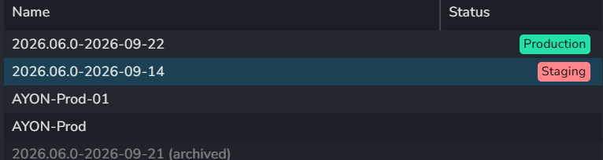
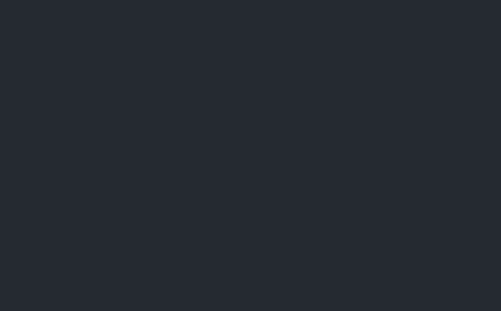

The AYON theme is based on [Material Design 3](https://m3.material.io/).

Every color has a theme variable that starts with `--md-sys-color-`. A variable has a value for each theme, so a component that uses the variables works on both themes without changes. Never hard-code a color.

## Dark and light themes

Users pick **Dark**, **Light** or **System** in the user menu; dark is the default. The choice is saved in the user's `frontendPreferences.theme`, so it follows them to other browsers, and mirrored to `localStorage` under `theme`, where an early script in `index.html` applies it before the first paint, without a dark flash (`src/helpers/theme.ts`). **System** follows the operating system's appearance as it changes.

The theme is set on the root element as `data-theme="dark"` or `data-theme="light"`, which switches the tokens of ARC (`theme.dark.css`, `theme.light.css`). `data-color-mode` carries the same value for third-party widgets. A component can set `data-theme` on its own element to keep a theme: the viewer's media area and annotation tools stay dark on the light theme.

## Page levels

Pages read in levels, each one step apart:

| Level | Variable | Dark | Light |
|---|---|---|---|
| Top bar, page tabs and page areas (panels) | `--md-sys-color-surface-container-low` | `#1C2026` | `#F8F9FB` |
| Space around and between the panels | `--md-sys-color-background` | `#252A31` | `#E9ECF0` |
| Rows, inputs, raised elements | `--md-sys-color-surface-container-high` and up | `#353B46` | `#E4E8ED` |

Every page area sits on a panel, framed by the background. One selected color, `--md-sys-color-primary-container`, marks the selection in trees, tables, lists and cards.

## Colors

Each card shows the dark value on the left and the light value on the right.

### Surface Containers

Surfaces go highest to lowest, elements with a higher z level should use higher surface levels.

<Swatches colors={[
    { name: "--md-sys-color-background", hex: "#252A31", light: "#E9ECF0", note: "Space around the panels" },
    { name: "--md-sys-color-surface-container-highest", hex: "#424A57", light: "#D8DDE4", note: "Highest: buttons" },
    { name: "--md-sys-color-surface-container-high", hex: "#353B46", light: "#E4E8ED", note: "High: cards, rows, inputs" },
    { name: "--md-sys-color-surface-container", hex: "#272D35", light: "#EEF1F4", note: "Neutral: cards" },
    { name: "--md-sys-color-surface-container-low", hex: "#1C2026", light: "#F8F9FB", note: "Low: top bar, tabs and panels" },
    { name: "--md-sys-color-surface-container-lowest", hex: "#16191D", light: "#FFFFFF", note: "Lowest: backgrounds" },
]} />

### Primary Color

The primary color is a bright blue and is used in areas to draw attention, like save buttons. When using a color, ensure any content on top uses the inverse to ensure sufficient contrast ratios.

There are other colors like secondary and tertiary, but they are rarely used.

<Swatches colors={[
    { name: "--md-sys-color-primary", hex: "#8FCEFF", light: "#0B76BA", note: "Important actions, the open page tab" },
    { name: "--md-sys-color-on-primary", hex: "#00344F", light: "#FFFFFF", note: "Content on primary" },
    { name: "--md-sys-color-primary-container", hex: "#1C4154", light: "#D5EAFA", note: "Selections" },
    { name: "--md-sys-color-on-primary-container", hex: "#EBF5FF", light: "#08304D", note: "Content on primary container" },
    { name: "--md-sys-color-secondary", hex: "#B7C9D9", light: "#50606E" },
    { name: "--md-sys-color-tertiary", hex: "#23E0A9", light: "#00845E" },
    { name: "--md-sys-color-error", hex: "#FFB6AD", source: "hsl(6, 100%, 84%)", light: "#C5281C" },
    { name: "--md-sys-color-error-container", hex: "#940F00", source: "hsl(6, 100%, 29%)", light: "#FBDDD8" },
    { name: "--md-sys-color-warning", hex: "#FFCFAD", source: "hsl(25, 100%, 84%)", light: "#B45309" },
    { name: "--md-sys-color-warning-container", hex: "#943E00", source: "hsl(25, 100%, 29%)", light: "#FDE6CC" },
]} />

**Primary - important stuff **

```CSS
background-color: var(--md-sys-color-primary);
color: var(--md-sys-color-on-primary);
```

**Primary container - less important selections**

```CSS
background-color: var(--md-sys-color-primary-container);
color: var(--md-sys-color-on-primary-container);
```

### Brand fills

The brand colors are the same on both themes, as the fixed roles of Material Design. Filled buttons and switches rest on `--md-sys-color-primary-fixed` and brighten on hover; the production color is `--md-sys-color-tertiary-fixed`. Content on them uses the matching `on-` variable.

<Swatches colors={[
    { name: "--md-sys-color-primary-fixed", hex: "#8FCEFF", note: "Filled buttons, switches" },
    { name: "--md-sys-color-on-primary-fixed", hex: "#00344F" },
    { name: "--md-sys-color-tertiary-fixed", hex: "#23E0A9", note: "Production" },
    { name: "--md-sys-color-on-tertiary-fixed", hex: "#003827" },
]} />

### Hover and active

Each color that reacts to the pointer has `-hover` and `-active` variants, such as `--md-sys-color-primary-hover`, `--md-sys-color-surface-container-high-hover` or `--md-sys-color-primary-fixed-active` (`states.css` in ARC). Use them instead of lightening a color by hand.

### Text and border colors

Mostly uses `--md-sys-color-on-surface` but can use the inverse of a color like `--md-sys-color-on-primary` .

For a more fade text use `--md-sys-color-outline` or even more faded `--md-sys-color-outline-variant`.

These are also used for borders (try to avoid outlines).

<Swatches colors={[
    { name: "--md-sys-color-on-surface", hex: "#F4F5F5", light: "#1A1E23", note: "Text" },
    { name: "--md-sys-color-outline", hex: "#9AA0A7", light: "#545D68", note: "Faded text, borders" },
    { name: "--md-sys-color-outline-variant", hex: "#41474D", light: "#CCD3DB", note: "More faded text, borders" },
    { name: "--md-sys-color-surface", hex: "#252B32", light: "#F8F9FB", note: "Base surface" },
]} />

### Studio colors

Colors that a studio picks, for statuses, tags or types, are the same on both themes and never used as text color: a status shows as a filled pill, other values as a tinted pill, and a type only colors its icon. `getPillColors(color, 'filled' | 'tinted')` in `shared/src/util/pillColors.ts` returns the background and text colors, and `ValuePill` and `StatusLabel` use it.

### Developer Mode

Developer mode actions and UI use a specific purple color to make them standout and to signal they are for developers only. Outside developer mode, the color is rarely used.

This color is a custom color outside of the theme color.

<Swatches colors={[
    { name: "--color-hl-developer", hex: "#C78FFF", light: "#7B3FC4" },
    { name: "--color-hl-developer-hover", hex: "#D6AAFD", source: "hsl(272, 96%, 83%)" },
    { name: "--color-hl-developer-container", hex: "#392B45", source: "hsl(272, 23%, 22%)", light: "#F3EBFA" },
    { name: "--color-hl-developer-surface", hex: "#B49CC9", source: "hsl(272, 30%, 70%)" },
    { name: "--color-hl-developer-surface-hover", hex: "#C1ACD2", source: "hsl(272, 30%, 75%)" },
]} />

In developer mode, the bundle mode selector at the top right reads **Developer Mode** in this color, and dev bundles carry a purple badge on the Bundles page. See [Developer mode](../developer-mode.md).

<Gallery columns={2}>





</Gallery>

```CSS
  var(--color-hl-developer);
  var(--color-hl-developer-container);
  var(--color-hl-developer-hover);
  var(--color-hl-developer-surface);
  var(--color-hl-developer-surface-hover)
```

:::note Addon slot colours
The [slot inspector](../addon-development/web-app-slots.md#finding-slots-in-the-web-app) of developer mode outlines each addon's contributions in a colour of its own. These colours only tell the addons apart and are not theme colours: AYON's own slots use the tertiary colour, and the other addons that contribute to the web app take the colours below by their alphabetical position, starting again after the eighth, so an addon can change colour when another one is added to or removed from the bundle. The colours were chosen to stay distinct on both themes (`shared/src/components/AddonLayout/slotInspector.ts`).

<Swatches colors={[
    { name: "AYON's own slots", hex: "#23E0A9", light: "#00845E", note: "--md-sys-color-tertiary" },
    { name: "1st addon by name", hex: "#4FC3F7", note: "Also the 9th, 17th, …" },
    { name: "2nd addon by name", hex: "#FFB74D" },
    { name: "3rd addon by name", hex: "#81C784" },
    { name: "4th addon by name", hex: "#F06292" },
    { name: "5th addon by name", hex: "#BA68C8" },
    { name: "6th addon by name", hex: "#FFF176" },
    { name: "7th addon by name", hex: "#4DB6AC" },
    { name: "8th addon by name", hex: "#FF8A65" },
]} />
:::

### Production and Staging

Two specific colors are used to specify the difference between "production" and "staging". These color are outside of the theme color.

<Swatches colors={[
    { name: "--color-hl-production", hex: "#23E0A9", note: "The brand mint (tertiary-fixed), on both themes" },
    { name: "--color-hl-staging", hex: "#FF858B", source: "hsl(357, 100%, 76%)" },
    { name: "--color-hl-staging-hover", hex: "#FF757C", source: "hsl(357, 100%, 73%)" },
    { name: "--color-hl-staging-active", hex: "#FF666E", source: "hsl(357, 100%, 70%)" },
    { name: "--color-hl-staging-container", hex: "#622809", source: "hsl(21, 83%, 21%)", light: "#FDECE3" },
]} />

Production and staging bundles carry badges in these colors on the Bundles page. Besides developer mode, there is a staging mode: a user with staging access can pick **Staging** in the bundle mode selector at the top right, which then reads **Staging Mode** in the staging color. See [App header](../../ayon/web-ui/app-header.md).

<Gallery columns={2}>





</Gallery>

```CSS
  var(--color-hl-production)
  var(--color-hl-production-hover)
  var(--color-hl-production-active)

  var(--color-hl-staging)
  var(--color-hl-staging-hover)
  var(--color-hl-staging-active)
```

:::note
Text on the production and staging fills is dark on both themes: use `--color-on-hl-production` and `--color-on-hl-staging`. As text or an icon on a pale container, staging uses `--color-hl-staging-text`, darker on the light theme.
:::

## Useful Variables

-   **Padding**: `--padding-s` (4px) `--padding-m` (8px) `--padding-l` (16px)
-   **Border radius**: `--border-radius-m` (4px) `--border-radius-l` (8px)

## Typography

Font sizes come from a set of classes in `src/theme/typography.module.css`, instead of a fixed `font-size`:

```jsx
import Type from "@/theme/typography.module.css";

<span className={Type.titleSmall}>Hello</span>;
```

The font is [Nunito Sans](https://fonts.google.com/specimen/Nunito+Sans), bundled with ARC. The page tabs below the App header use `titleSmall`, at weight 500, and 600 for the open tab, which is also underlined in `--md-sys-color-primary`. Each tab keeps the width of its semibold name, so the tabs don't move when the open one changes. The classes and their values:

<TypeScale styles={[
    { name: "displayLarge", size: 57, lineHeight: 64, weight: 400 },
    { name: "displayMedium", size: 45, lineHeight: 52, weight: 400 },
    { name: "displaySmall", size: 36, lineHeight: 44, weight: 400 },
    { name: "headlineLarge", size: 32, lineHeight: 40, weight: 400 },
    { name: "headlineMedium", size: 28, lineHeight: 36, weight: 400 },
    { name: "headlineSmall", size: 24, lineHeight: 32, weight: 400 },
    { name: "titleLarge", size: 22, lineHeight: 28, weight: 400 },
    { name: "titleMedium", size: 16, lineHeight: 24, weight: 600 },
    { name: "titleSmall", size: 14, lineHeight: 20, weight: 600 },
    { name: "bodyLarge", size: 16, lineHeight: 24, weight: 400 },
    { name: "bodyMedium", size: 14, lineHeight: 20, weight: 400 },
    { name: "bodySmall", size: 12, lineHeight: 16, weight: 400 },
    { name: "labelLarge", size: 14, lineHeight: 20, weight: 500 },
    { name: "labelMedium", size: 12, lineHeight: 16, weight: 500 },
    { name: "labelSmall", size: 11, lineHeight: 16, weight: 500 },
]} />

## Loading state

-   Avoid spinners
-   Avoid layout shifts when the data loads in.
-   Use skeleton shimmer placeholders.
-   Add the `loading` class to an element to give it the shimmer effect (`src/styles/loadingShimmer.scss`). In ARC, the `getShimmerStyles()` helper does the same in styled components.


