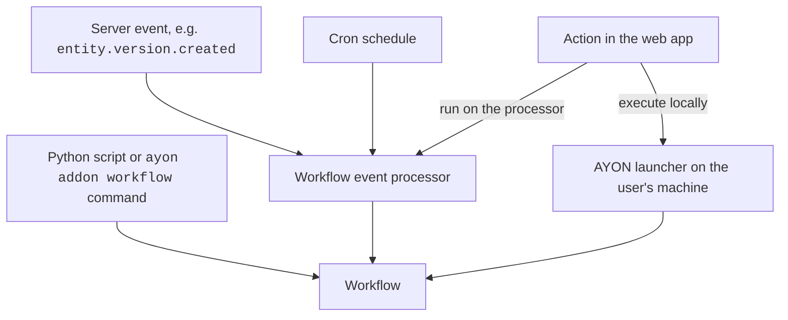

# Automations

Much of the work around a production is routine: reacting when a version is published, keeping watchers and statuses in step, rendering or converting media, preparing the same set of tasks for every new shot. AYON records every change on the server as an event, and exposes all of its data through APIs, so this routine work can be handed to automations. There are three routes:

- **Workflows** built with the [Workflow addon](../addons/automation/workflow/index.md), assembled from nodes and run by the addon itself.
- **Custom automations** written against the AYON APIs, as standalone scripts or as an addon.
- **An [AI assistant](ai-assistants.md)** connected to AYON through MCP, for work done once or on request.

The first two react to the same events, with topics such as `entity.version.created` or `entity.task.status_changed`. Events are browsed in the [Event Viewer](../ayon/web-ui/event-viewer.md), and the topics are listed in [Well known event topics](../developer/server/event-system.md#well-known-event-topics). Both can also put the same kind of buttons in front of users.

## Workflows with the Workflow addon

The [Workflow addon](../addons/automation/workflow/index.md) automates work with node graphs instead of code. Each node does one step, such as finding the task of a version, setting a status, rendering with Blender or Nuke, or publishing a version, and the graph is built in a browser editor. Once a workflow is registered on the AYON server, it starts by itself, and its first node decides when:

| Trigger | Starts the workflow when |
|---|---|
| An event | An [event](../developer/server/event-system.md#well-known-event-topics) of a given topic is raised on the server. Out of the box: a version is created, or the assignees of a task change. |
| A schedule | A cron expression is due, for example every night. |
| An action | A user runs it from the actions menu of folders or versions in the web app, on one or several selected entities. |

Workflows suit work that repeats in the same steps, for example:

- **When a version is published:** move its task to a review status, with the built-in nodes `OnVersionCreated`, `GetVersionTask` and `SetStatus`.
- **When task assignees change:** add the artists as watchers of the parent folder, so its activity reaches their [Inbox](../ayon/web-ui/inbox/index.md). The addon ships this one as a demo.
- **On a schedule:** nightly renders, conversions or reports.
- **From an action:** let a user start a farm render and publish for the selected folders or versions.

A workflow is also a file that a script or the `ayon addon workflow` command runs, so a [custom automation](#custom-automations) can hand its work to a workflow. When the built-in nodes miss a step, TDs add their own in Python, including triggers for other event topics. See [Workflow nodes](../addons/automation/workflow/nodes.md), [Scripting and custom nodes](../developer/addons/workflow-scripting.md) and [Event-triggered workflows](../developer/addons/workflow-events.md).

<!-- screenshot: the Workflow editor with the demo workflow that adds task assignees as watchers of the parent folder (the help center image of this demo can be reused if it matches 0.4.6) -->

## Custom automations

Everything the web app and the pipeline tools do goes through the public APIs of the AYON server, so an automation can do the same. This route needs code, but has no limits beyond the API itself and needs no Studio license.

### REST, GraphQL and the Python API

- The **REST API** reads and changes everything on the server: entities, settings, users, events. Its reference is generated from the running server on the [REST API](../ayon/web-ui/rest-api.md) page; authentication and first calls are in the developer guide [REST API](../developer/api/rest.md).
- The **GraphQL API** reads entities and their relations in one query, for example all shots of a sequence with their tasks and latest versions. Queries are tried out in the [GraphQL Explorer](../ayon/web-ui/graphql-explorer.md); the developer guide is [GraphQL API](../developer/api/graphql.md).
- **ayon-python-api** (`ayon_api`) wraps both for Python, including events and actions. It is the base of most scripts, services and addons. See [Python API](../developer/api/python.md).

### Standalone scripts vs addon

A **standalone script** on these APIs fits one-off or on-demand jobs, such as a bulk rename, a report or an import from a spreadsheet. A TD runs it from a terminal with an API key, or with `ayon run <script>` in the AYON context of the signed-in user; see [Launcher command line](launcher-command-line.md#commands).

An automation the whole studio relies on is better packaged as an **addon**. The addon is installed and versioned with the bundles like any other, brings its own settings per studio and project, and can easily add:

- **Commands** under `ayon addon <addon name>`, for TDs and farm jobs. See [Command line](../developer/addon-development/client.md#command-line).
- **Actions:** web actions for the selected entities in the web app and the [launcher window](tray-and-launcher-window.md#actions-pane), which can answer with a message, a form, a page to open or work for the launcher on the workstation, and launcher actions that run on the workstation. See [Web actions](../developer/addon-development/server.md#web-actions) and [Plugin paths](../developer/addon-development/client.md#plugin-paths).
- **Event handlers** in its server code, which run inside the AYON server when an event of a subscribed topic is dispatched. They suit quick reactions that only touch AYON data. See [Events](../developer/addon-development/server.md#events).
- **Services**, long-running processes started from a Docker image on the Services page, which take events as jobs, like the tracker integrations and the Workflow event processor. See [Addon services](../ayon/how-ayon-works/services.md) and [Enroll: taking jobs](../developer/server/event-system.md#enroll-taking-jobs).

## Automations through an AI assistant

An AI assistant connected through the [AYON MCP server addon](../addons/production-tracking/mcp/index.md) automates on request rather than on events. A TD describes the change in plain language, such as setting the frame range of every shot of a sequence or fixing a misspelled tag on all assets, and the assistant prepares it, shows what it will change and runs it after the TD confirms, with the TD's permissions. The changes go through the AYON API, so they raise the usual events, which workflows and services can react to. The assistant also helps to write the other two routes: it reads the API of the actual server and drafts a script, a service, an addon or a custom Workflow node. See [AI assistants](ai-assistants.md#for-tds).

## Related

- [Workflow addon](../addons/automation/workflow/index.md)
- [Workflow nodes](../addons/automation/workflow/nodes.md)
- [Event-triggered workflows](../developer/addons/workflow-events.md)
- [Scripting and custom nodes](../developer/addons/workflow-scripting.md)
- [Event system](../developer/server/event-system.md)
- [Addon services](../ayon/how-ayon-works/services.md)
- [Addon overview and packaging](../developer/addon-development/overview.md)
- [Addon server side](../developer/addon-development/server.md)
- [Python API](../developer/api/python.md)
- [AI assistants](ai-assistants.md)
