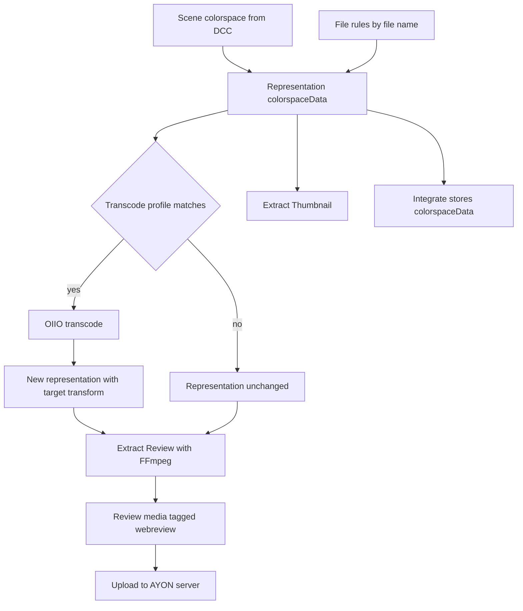

import trace from "@site/src/data/flows/color-data-flow.json";

# Color management in publishing

Publishing carries color information with the images it produces. The colorspace of every image representation is recorded in a `colorspaceData` entry. Optional extraction plugins convert images with OpenImageIO (`oiiotool`) using the OCIO config of the context, and the review plugins turn the result into playable media (image or movie) with FFmpeg. This page describes how the colorspace is detected, which plugins read and write it, in which order the plugins run, and where the limits are. The OCIO config used here is the one resolved at launch, see [Color management on launch](color-management-on-launch.md). The settings of the plugins are listed in [Core addon settings](../addons/essentials/core/settings.md).

## Overview

Plain-text equivalent:

1. The host integration reads the colorspace of the rendered or exported images from the scene (render settings, write nodes, render products, document profile) and sets it on the representation. Where the host cannot tell, file rules assign a colorspace by file name.
2. The result is stored on each image representation as `colorspaceData`: the colorspace name and the OCIO config (path and template).
3. If an OIIO transcode profile matches the instance, **Extract OIIO Transcode** converts the representation to a target colorspace or display and view, and creates one new representation per output definition. Otherwise the representation is not changed.
4. **Extract Review** encodes representations that carry the `review` tag into review media with FFmpeg. It does not apply an OCIO transform itself; the transform comes from the transcode step or from the DCC.
5. **Extract Thumbnail** converts one image to a JPEG with `oiiotool` when the representation has `colorspaceData`, and otherwise with FFmpeg.
6. Representations tagged `webreview` are uploaded to the AYON server so the web player and review sessions can show them.
7. At integration, `colorspaceData` is stored in the data of the published representation, and the colorspace name is available as the `{colorspace}` key of publish templates.

## colorspaceData

`colorspaceData` is a dictionary on a representation.

| Key | Meaning |
|---|---|
| `colorspace` | Name of the colorspace of the files, as it exists in the config. |
| `config` | The OCIO config that defines the colorspace: `path` (absolute path on the publishing machine) and `template` (path with anatomy root tokens such as `{root[work]}`, or `{BUILTIN_OCIO_ROOT}` for built-in configs, which another machine can resolve). |
| `display`, `view` | Optional. Present when the images are display-referred, set by the host or by a transcode into a display and view. |

Rules for setting it:

- Only representations whose extension is a known image or video extension get `colorspaceData`.
- Nothing is set when color management is disabled for the context (no OCIO config resolved at the time of publishing; this is the same resolution as at launch, using the host, task and application of the publish context).
- A representation that already has `colorspaceData` is not changed by the generic plugin.
- The colorspace is not validated against the config at this point.
- The stored config path is used by later steps. When the path does not exist on another machine (for example on a farm worker), the template is filled with the project roots to find the local equivalent. If neither resolves, steps that need the config skip the representation.

### Where the colorspace comes from

The colorspace is chosen in this order:

| Order | Source | Example |
|---|---|---|
| 1 | The host's own plugin sets it explicitly when it creates the representation. | Nuke reads it from the write node; Houdini ROP outputs are `scene_linear`; Maya, Blender, 3ds Max and Cinema 4D collect it from the render settings and render products; Photoshop converts the document color profile through the remapping rules; TrayPublisher offers an **Override Colorspace** attribute with the colorspaces of the config. |
| 2 | Farm jobs: the render products of the scene (colorspace per AOV), together with the scene's config path, display and view that were collected before the job was submitted. | Houdini, Maya, Blender, 3ds Max render instances. |
| 3 | The instance value `colorspace`, when the host collected one. | Applied by the plugin **Extract Colorspace data** to every representation that has no `colorspaceData`. |
| 4 | File rules. | Used by the same plugin when no instance colorspace exists. |

The plugin **Extract Colorspace data** works on all instances and fills the gaps left by hosts. It does not touch representations that already have `colorspaceData`.

### File rules

File rules map files to colorspaces. They are the fallback for representations that no host plugin colorspace-tagged. The rule set comes from the host (if **Activate host rules** is on) or from the core settings (**Activate global file rules**), as described in [Color management on launch](color-management-on-launch.md#file-rules).

| Detail | Behavior |
|---|---|
| What is matched | The file name of the first file of the representation (without a directory). The extension is compared case-insensitively. |
| Pattern | Regular expression, searched anywhere in the name. |
| Extension | A rule with an empty extension matches every file. |
| Several matches | The last matching rule in the list wins. |
| No match | The representation gets no `colorspaceData`. |

The rule colorspace must exist in the OCIO config; it is not validated when the data is written.

### Where `colorspaceData` is read

| Consumer | Use |
|---|---|
| Extract OIIO Transcode | Source colorspace, optional source display and view, config path. |
| Extract Thumbnail | Source colorspace and the target display and view. |
| Integration | Stored in the published representation. |
| Loaders | Several loaders (for example for Houdini, 3ds Max, Resolve) read the stored colorspace to set the colorspace of the loaded file; representations without stored data fall back to file rules. Hosts with remapped colorspace names convert the stored OCIO name to the native name. |

## Plugin order

Plugins sort by their order number. Extractors start at 2.0 (`ExtractorOrder`); the offsets below are added to it.

| Offset | Plugin (label) | Color handling |
|---|---|---|
| -0.45 | Extract OTIO review | Sets `colorspaceData` from the instance value `reviewColorspace` when it exists. |
| -0.00001 | Extract Thumbnail from source | Resizes a given source file. No color transform. |
| 0 | Host extractors | Render, export and bake. Set `colorspaceData` explicitly. |
| 0.019 | Transcode color spaces (Extract OIIO Transcode) | OCIO conversion with `oiiotool`. |
| 0.0195 | OIIO Post Process | Free `oiiotool` arguments. No automatic color handling. |
| 0.02 | Extract Review | FFmpeg encode. No OCIO transform. |
| 0.03 | Extract burnins | Overlays text. No color transform. |
| 0.031 | Review with Slate frame | Adds a slate. Encodes with BT.709 flags. Only for Nuke and shell publishing. |
| 0.49 | Extract Colorspace data | Fills missing `colorspaceData`. |
| 0.49 | Extract Thumbnail | JPEG thumbnail. Uses `colorspaceData` when present at that time. |
| Integrator + 0.15 | Integrate AYON Review | Uploads `webreview` representations to the server. |

Because the transcode runs early, it only converts representations whose `colorspaceData` was set by the host plugin; it runs before the generic **Extract Colorspace data** plugin.

## OIIO transcode

**Extract OIIO Transcode** (label **Transcode color spaces**) converts image representations to another colorspace, or to a display and view, with `oiiotool`. It is optional (the artist can switch it off in the Publisher) and enabled in the core settings, but without profiles it does nothing (default: no profiles).

### When it runs

| Condition | Detail |
|---|---|
| Profile | A profile in **Extract OIIO Transcode** matches the instance by **Product base types**, **Host names**, **Task types**, **Task names** and **Product names** (the most specific matching profile is used). |
| Representation | Its name matches one of the profile's **Representation names** (regular expressions; empty matches all), its extension is `exr`, `jpg`, `jpeg`, `png`, `dpx`, `tif` or `tiff`, it has files, and it has `colorspaceData`. |
| Config | The config of the representation can be located on the machine. |
| Tool | `oiiotool` is available (the `ayon_third_party` addon or a path in `AYON_OIIO_PATHS`). Otherwise the plugin logs a warning and skips. |
| Place | Not on instances flagged for farm processing. The farm job runs the plugins later. |

### Output definitions

Each profile has **Delete Original Representation** (on by default in the model) and a list of output definitions. Every definition produces a new representation.

| Field | Effect |
|---|---|
| **Name** | Name of the new representation. The special name `passthrough` keeps the name of the source. |
| **Extension** | Target extension. Empty keeps the source extension. |
| **Transcoding type** | **Use Colorspace** or **Use Display&View**; only one per definition. |
| **Target Colorspace** | Target for **Use Colorspace**. |
| **Target Display**, **Target View** | Target for **Use Display&View**. Empty values fall back to the display and view of the scene (instance values `sceneDisplay` and `sceneView`, or the older `colorspaceDisplay` and `colorspaceView`). |
| **OIIOtool arguments** | Extra `oiiotool` arguments, for example the bit depth of a DPX. |
| **Tags** | Added to the new representation. `review` makes the review be built from this converted file instead of the original. |
| **Custom Tags** | Added as custom tags, which review output definitions can filter by. |

How the conversion is built:

| Source | Target | `oiiotool` operation |
|---|---|---|
| Colorspace | Colorspace | Colorspace-to-colorspace conversion. |
| Colorspace | Display and view | Display and view transform. |
| Display and view | Colorspace | The display and view is inverted into `scene_linear`, then converted to the target colorspace. |
| Display and view | Another display and view | Inverted, then re-applied with the target pair. Identical source and target pairs need no conversion. |

After conversion, the new representation's `colorspaceData` is updated with the target colorspace, display and view.

### Effects on other representations

- With **Delete Original Representation** on, the source representation gets the `delete` tag and is dropped before integration (unless it is needed for thumbnails). When a new representation carries the `review` tag, the `review` tag is removed from the source.
- When a definition adds the `review` tag and the instance is not a review instance, the family `review` is added so that **Extract Review** processes the new representation.
- Only the RGBA channels (or the reviewable layer chosen by **Default reviewable layers**) are converted and written. Other channels are not carried to the transcoded file.

### Limits

| Limit | Detail |
|---|---|
| Missing RGBA channels | The representation is skipped with an error when the channels to convert cannot be found. |
| Empty targets | The conversion needs either a target colorspace or both a display and a view. When a definition leaves them empty and the scene provides no display and view, the conversion fails. |
| One sequence per representation | A representation that contains more than one frame collection fails. |
| Formats | Only the extensions listed above. |

### OIIO post process

**Extract OIIO Post Process** runs `oiiotool` with arguments typed in the profile: for conversion to scanline EXR, resizing or flattening. It has the same representation tags and `review` behavior as the transcode but no color logic. **Input arguments** and **Output arguments** are inserted before the input file and before the output option. Its profiles also filter by **Representation extensions**.

## Review media

Review media is made by **Extract Review** from representations that have the tag `review`.

| Aspect | Behavior |
|---|---|
| Input representations | Tag `review` present; not tagged `thumbnail` or `passing`; extension in `exr`, `jpg`, `jpeg`, `png`, `dpx`, `tga`, `tiff`, `tif`, `psd`, `mov`, `mp4`. |
| Profile | Matched by host name, product base type and task type. |
| Outputs | One new representation per output definition that passes its filters (families, product names, custom tags of the representation, single-frame or multi-frame input). |
| Encoding | FFmpeg, driven by the output definition: filters, input and output arguments, size, overscan, letter box, background, missing-frame handling. |
| Color | No OCIO transform. With the default definitions, the movie output uses the FFmpeg input argument `-apply_trc gamma22` and BT.709 flags (`-color_range tv`, `-colorspace bt709`, `-color_primaries bt709`, `-color_trc bt709`); the single-image output (`png`) does no color conversion. |
| EXR pre-conversion | EXR inputs that FFmpeg cannot read as they are (several subimages, DWAA or DWAB compression, unsupported or too long attributes) are first rewritten with `oiiotool` in a temporary folder. This keeps the colors and only selects the reviewable channels. |
| Outputs inherit | The new representations are copies of the input, so `colorspaceData` is the input's, and tags of the output definition are added. The `delete` tag of the source is not copied. |
| Burnins | Output definitions tagged `burnin` are passed on to **Extract burnins**. |
| LUT baking | With the instance value `lutPath` and the representation tag `bake-lut`, a `lut3d` filter is added. Farm submitters pass `lutPath` on for review instances. |

### How the review gets its color transform

Review output is intended to be display-referred. There are three ways that the transform is applied before encoding:

| Route | Where the transform happens |
|---|---|
| OIIO transcode with the `review` tag | A transcode output definition converts the scene-referred render to a display and view (or an output colorspace such as Rec.709). The `review` tag moves the review to the converted files. |
| The DCC bakes it | The host writes display-referred images or a movie. Nuke bakes a movie with an `OCIODisplay` or `OCIOColorSpace` node, using **Baking Target Colorspace** of the Nuke ImageIO settings (default colorspace `Output - Rec.709`) or an override of the review plugin. Houdini OpenGL review uses **Review colorspace** of its ImageIO settings. |
| Approximation | The default FFmpeg input argument `-apply_trc gamma22` applies a 2.2 gamma to linear input. It does not use the OCIO config. |

An image encoded without one of these routes shows the scene-referred values as they are.

## Thumbnails

**Extract Thumbnail** creates a JPEG thumbnail from one image of the instance. Settings: **Extract Thumbnail** profiles.

| Aspect | Behavior |
|---|---|
| Hosts | Shell, Fusion, Resolve, TrayPublisher, Substance 3D Painter, Substance 3D Designer, Nuke, After Effects, Photoshop, Unreal, Houdini, batch delivery and workflow. |
| Families | Image sequence, render, render2d, prerender, source, clip, take, online, image, editorial package. |
| Source | Representations tagged `need_thumbnail`, else representations tagged `review`, else other image or video representations. A movie is converted into a frame first. For a sequence the frame at **Duration split** (default 0.5) is used. Crypto passes are skipped. |
| Skipped | Instances with the instance value `review` set to `False`; instances that already have a thumbnail. |
| Color, with `colorspaceData` and `oiiotool` | Converts from the representation colorspace (or display and view) to the target. If the representation has display and view, they are used as target. Otherwise the profile's **OIIOtool defaults** apply: **Use Colorspace** (default `color_picking`) or **Use Display&View** (default display `default`, view `sRGB`). |
| Color, otherwise | FFmpeg is used with the profile's FFmpeg arguments (default input argument `-apply_trc gamma22`); if FFmpeg fails and `oiiotool` exists, `oiiotool` converts without color management. |
| Result | A representation named `thumbnail` (tag `thumbnail`). With **Integrate Thumbnail Representation** off it is tagged `delete` and not integrated as a representation, but is still used for the version thumbnail. |

**Extract Thumbnail from source** creates a thumbnail from the file in the instance value `thumbnailSource` (default size 300 by 170). It does not apply color management.

## Display and view

Display and view appear in three places.

| Place | Meaning |
|---|---|
| Scene display and view | The display and view that the DCC is set to (for example Maya's view transform, Houdini's default display and view, Blender and 3ds Max render settings). Collected into instance values and used as the default target when a transcode output leaves its display and view empty. |
| `colorspaceData.display` and `.view` | Marks a representation as display-referred. Written by hosts and by transcodes into a display and view. Used as the source of an inverse transform, and as the thumbnail target. |
| Output definitions | **Target Display** and **Target View** of a transcode, **Display&View** defaults of the thumbnail. |

When a host expresses display and view as one colorspace, the colorspace of a display and view pair is looked up in the config (`<USE_DISPLAY_NAME>` in a shared view resolves to the display name).

## Uploading and storing

| Step | Detail |
|---|---|
| Storage | Every representation, including review files, is written to the publish root of the project anatomy. |
| Server upload | **Integrate AYON Review** uploads each representation tagged `webreview` (not thumbnails, not farm-published ones) to the AYON server for the version and the hero version. The output name is the label shown in the player. |
| Default tags | The default review outputs of the core settings carry `webreview` (and `ftrackreview`, `kitsureview`). |
| Not uploaded | A review representation without the `webreview` tag, or whose upload failed, exists on storage but is not playable in the web player. A failed upload stops the publish with an error. |
| Direct uploads | A file uploaded directly to the server as a reviewable does not pass the publish plugins: no transcode, no burnin, no color conversion. |

## Tools and dependencies

| Tool | Used for |
|---|---|
| `oiiotool` (OpenImageIO) | Color conversion, post processing, thumbnails, EXR pre-conversion. Delivered by the `ayon_third_party` addon. Produces images and sequences, not movies. |
| FFmpeg | Movie and image encoding of review output, thumbnails from movies, burnins. |
| OpenColorIO (`PyOpenColorIO`) | Config queries (colorspaces, roles, views). A launcher subprocess answers when the running Python has no compatible package. |
| Other addons | Other addons can add steps. For example, a slate addon identifies a review representation and prepends a slate frame before encoding. |

## Limits

- Color handling needs color management on for the context. Without a resolved OCIO config, representations get no `colorspaceData` and the transcode and colorspace-aware thumbnails are skipped.
- Only image and video extensions carry `colorspaceData`. File rules assign a colorspace from the file name and extension alone and do not inspect pixel data.
- Extract Review does not convert colors. The `colorspaceData` of review files describes the source of the review, not the display transform that was baked into it.
- The transcode needs `colorspaceData` already present when it runs, which is the case when the host plugin sets it.
- OIIO conversions use only the channels chosen for review; additional passes are not carried into the converted file.
- Farm publishing: the transcode is skipped on the submitting machine and runs in the farm job; the farm job depends on the `colorspaceConfig`, display and view collected at submission.
- Nuke baking (see above) and other host-specific plugins have their own settings; those are described in the host addon documentation.

## Follow the color data

Pick a case and select a step to see what happens to the color data there. The plain-text version under the chart lists every step.

<FlowTrace data={trace} />

## Related

- [Color management on launch](color-management-on-launch.md)
- [Publishing](publishing.md)
- [Publisher](publisher.md)
- [Loader](loader.md)
- [Core addon settings](../addons/essentials/core/settings.md): groups **Color management (ImageIO)**, **Extract Thumbnail and Thumbnail from source**, **OIIO and OTIO**, **Extract Review** and **Extract Burnin**
- [OCIO configs addon](../addons/essentials/ocio/index.md)
- [TrayPublisher addon](../addons/essentials/traypublisher/index.md)
