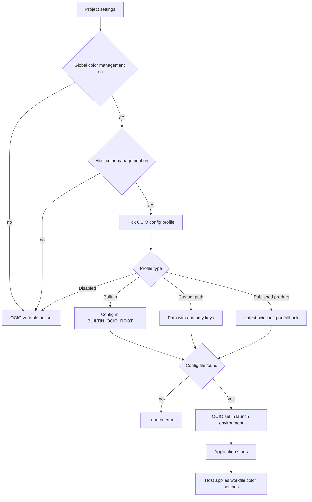

# Color management on launch

When an artist starts an application from AYON, the pipeline decides which OpenColorIO (OCIO) config the application uses and passes it through the `OCIO` environment variable. Applications that read `OCIO` (nearly all DCCs with OCIO support) then run on that config. The AYON integration of each host additionally applies the host's own color settings (working space, display, view, viewer process and similar) to the scene, and reads the same config again when it publishes and loads. This page describes the settings, the order in which they are evaluated, the launch hook and what each host does with the result. For what happens to color data when publishing, see [Color management in publishing](color-management-in-publishing.md).

## Overview

Plain-text equivalent:

1. The launch hook reads the project settings of the launch context (project, folder, task, application).
2. If **Enable Color Management** in the core ImageIO settings is off, no `OCIO` variable is set and the process ends here.
3. If **Enable Color Management** in the host's own ImageIO settings is off, no `OCIO` variable is set.
4. The **OCIO config profiles** list is filtered by host name, task type, task name and application name. The most specific matching profile is used. If no profile matches, color management is treated as disabled.
5. The profile type decides the config source: a built-in config of the OCIO configs addon, a custom path, the latest `ocioconfig` representation of a published product (with a fallback config), or disabled (no `OCIO` variable).
6. The path is formatted with the context data and must exist as a file. If it does not, the launch fails with an error that no OCIO config was found.
7. The hook sets `OCIO` in the launch environment.
8. The application starts and reads `OCIO`.
9. The host integration applies the host's workfile color settings to the scene.

## Settings that take part

| Settings group | Where | Role |
|---|---|---|
| Core ImageIO (**Color management (ImageIO)**) | Core addon, [project settings](../addons/essentials/core/settings.md#color-management-imageio) | Global switch, config profiles and global file rules. |
| Host ImageIO | Settings of each host addon (`maya`, `nuke`, `houdini`, and so on), group `imageio` | Host switch, host file rules and host-specific color settings. |
| Application and task context | Launch context | Provides host name, application name (`group/variant`), task type, task name and the anatomy data used to format paths. |

The core defaults: **Enable Color Management** is off; **OCIO config profiles** has one profile without filters of type **AYON built-in OCIO config** that points to `ACES 1.2` (`{BUILTIN_OCIO_ROOT}/aces_1.2/config.ocio`); **Activate global file rules** is off. Color management is therefore inactive until it is switched on. When it is switched on at the studio level, every project that does not override it inherits it.

## Evaluation order

Three switches and one profile list are evaluated in this order:

| Step | Setting | Result when the check fails |
|---|---|---|
| 1 | Core **Enable Color Management** | No config. Host settings are not consulted. |
| 2 | Host **Enable Color Management** (`activate_host_color_management`; hosts without this key are treated as enabled) | No config for this host. |
| 3 | Core **OCIO config profiles** matched against the context | No matching profile means no config. |
| 4 | Profile **Profile type** | `Disable OCIO management` means no config. |

A host cannot set its own config path. Host ImageIO settings carry the activation switch and file rules, not a separate config. The only place where the config is chosen is the core profile list.

## OCIO config profiles

A profile has filters and a source.

| Filter | Matches |
|---|---|
| **Host names** | The host of the application (`maya`, `nuke`, `houdini`, ...). |
| **Task types** | The task type of the launch context. |
| **Task names** | The task name of the launch context. |
| **Application names** | The full application name as `group/variant`, for example `maya/2026`. |

Filter values are regular expressions that must match the whole value, and `*` matches everything. An empty filter matches everything. A profile whose filter does not match is excluded. Among the remaining profiles, the one with the most matching filters is used; profiles with equal scores are resolved in the order task names, task types, host names, application names, then by list order. A profile without any filters is the default for everything that no more specific profile matches.

### Profile types

| Profile type | Fields | Resolution |
|---|---|---|
| **AYON built-in OCIO config** | **Built-in OCIO config**: ACES 2.0 Studio (OCIO v2.4), ACES 1.3 Studio (OCIO v2.1), ACES 1.3 Studio (OCIO v2), ACES 1.2, Nuke default | The value is a template of the form `{BUILTIN_OCIO_ROOT}/<folder>/<file>`. `BUILTIN_OCIO_ROOT` is set by the [OCIO configs addon](../addons/essentials/ocio/index.md). Without that addon in the bundle, the template cannot be solved. |
| **Path to OCIO config** | **OCIO config path** | A path template. Anatomy keys (for example `{root[work]}`), environment variables of the launch environment, `{platform}` and the context keys (project, folder, task) can be used. The formatted path must exist. |
| **Published product** | **Product name** and a fallback (**Fallback config type**: built-in config or custom path) | Looks for products of the launch folder whose name matches **Product name** (a regular expression; an exact match is preferred, otherwise the first product found). Takes the latest version of that product and its representation named `ocioconfig`. Its published path is the config. If no matching product exists, the fallback config is used. If the product has no version or no `ocioconfig` representation, there is no config and the launch fails with an error. An empty **Product name** is an error. |
| **Disable OCIO management** | None | The context runs without a config set by AYON. |

Paths in project-level profiles should be built on an anatomy root so that they stay valid on every platform and workstation. Keeping a copy of the studio config inside the project storage protects old projects from later changes of the studio config. A published config product gives the same protection through versioning: the path that was used is stored with every published representation (see [Color management in publishing](color-management-in-publishing.md)), so the folder that holds all versions of a config file must keep a stable path.

An OCIO config file is YAML. Its `description` field can hold a multi-line text when written with a trailing `|`, which suits change notes.

## Launch hook

The `OCIOEnvHook` pre-launch hook of the core addon sets the environment variable. It runs at order 0 (before other hooks of the launch), for local and farm launches.

| Property | Value |
|---|---|
| Applies to hosts | `substancepainter`, `substancedesigner`, `fusion`, `blender`, `aftereffects`, `max`, `houdini`, `maya`, `nuke`, `hiero`, `flame`, `photoshop`, `resolve`, `openrv`, `cinema4d`, `silhouette`, `gaffer`, `loki` |
| Requires | A task in the launch context. Without a task entity the hook is skipped. |
| Inputs | Project, folder path, task name, host name, application name, anatomy, project settings and the launch environment (used to format the path). |
| Output | `OCIO` in the launch environment, set to the config path. For `nuke` and `hiero`, backslashes in the path are replaced with forward slashes. |
| Nothing resolved | When color management is off or disabled for the context, the variable is left untouched and the application keeps whatever `OCIO` value the environment already has. |

Hosts that are not in the hook list (for example TV Paint, Harmony, TrayPublisher, Unreal) get no `OCIO` variable from this hook. The configuration functions of the core addon still resolve the same config from the project settings when they publish or load for those hosts.

A second hook of the Houdini addon runs after `OCIOEnvHook`. When `OCIO` is set and the Houdini workfile color settings are enabled, it sets `OCIO_ACTIVE_DISPLAYS` and `OCIO_ACTIVE_VIEWS` from the settings, prepended to any values that already exist in the environment (colon-separated). It runs for local launches only.

The Flame launch hook passes the resolved `OCIO` path and the project color settings to the project creation script.

## Host ImageIO settings

Every host addon that supports color management has an `imageio` group.

| Setting | Meaning | Default |
|---|---|---|
| **Enable Color Management** | Applies the global color management to this host. Only effective when the global switch is on. | On |
| **File Rules** | Host file rules. **Activate host rules** (off by default) switches the host to its own list of rules, which replaces the global rules for that host. | Off, empty list |
| Host-specific groups | Scene color settings of the host (see the table below). | Per host |

### File rules

A file rule assigns a colorspace to a file by its name. Each rule has **Rule name**, **Regex pattern**, **Colorspace name** and **File extension**. A rule applies when the extension matches (an empty extension matches any file) and the pattern is found in the file. When several rules match, the last one in the list wins. The core default has one example rule (`.*(beauty).*`, extension `exr`, colorspace `ACES - ACEScg`) and global rules are off.

The rule set in force for a host is chosen like this:

1. If the host's **Activate host rules** is on, the host rules are used (even when global rules are off).
2. Otherwise, if **Activate global file rules** is on, the global rules are used.
3. Otherwise there are no rules.

File rules are used when a colorspace is not otherwise known: when publishing, to assign a colorspace to a representation (see [Color management in publishing](color-management-in-publishing.md)), and in loaders to pick a colorspace for a loaded file that has no stored colorspace data.

### Host-specific color settings

| Host | Settings in the `imageio` group besides the switch and file rules | Applied when |
|---|---|---|
| Maya | **Workfile**: **Enabled** (on), **Rendering Space** (`ACES - ACEScg`), **Display** (`ACES`), **View** (`sRGB`) | New scene, and the **Colorspace** entry of the **Set workfile attributes** submenu in the AYON menu. Also switches color management and OCIO rules on. If `OCIO` is not set, the Maya default OCIO v2 config is set. |
| Nuke | **Viewer** and **Monitor OUT** (display and view, with `;` fallbacks and anatomy keys; defaults `ACES` / `sRGB` and `ACES` / `Rec.709`), **Baking Target Colorspace**, **Workfile** (**Color Management Workflow**, **Native OpenColorIO Config**, **Working Space**, **Thumbnails**, **Monitor Out**, **8-bit Files**, **16-bit Files**, **Log Files**, **Float Files**), **Nodes** (knob defaults for write nodes), **Assign colorspace to read nodes via rules** (regex to colorspace) | Script creation and script open, each switchable with **Colorspace from Context** in the host's workfile callbacks (on by default). When an `OCIO` config is set, the root color management becomes `OCIO`; the workflow and native config entries are used only when there is no config. |
| Hiero | **Workfile** (**OpenColorIO Config**, **Working Space**, **Viewer**, **Thumbnails**, **Monitor Out**, 8-bit, 16-bit, log and floating point files), **Assign colorspace to clips via rules** | Project settings of the Hiero project. |
| Houdini | **Workfile**: **Enabled** (off), **Default active displays** (`ACES`), **Default active views** (`sRGB`), **Review colorspace** (empty) | Launch (`OCIO_ACTIVE_DISPLAYS`, `OCIO_ACTIVE_VIEWS`). The review colorspace is used for new review instances. |
| Cinema 4D | **Workfile Color Management**: **Enabled** (off), **Default render space**, **Default active displays**, **Default active views** and **Thumbnails** | Document setup. The document is switched to OCIO using `$OCIO`. |
| 3ds Max | Switch and file rules only | Max 2024 and later: the scene is switched to the OCIO environment variable mode, or to the custom config path from the settings when `OCIO` is missing. A warning dialog offers to fix a scene with the wrong mode. |
| Flame | **Project** (SyncColor policy, default OCIO config, image depth, field dominance), **Profile names mapping**, **Remapping colorspace names** | Project creation at launch. |
| Photoshop, Resolve | **Remapping colorspace names**: list of application-native colorspace name and OCIO colorspace name | Publishing and loading. The native name is converted to and from an OCIO name. |
| Blender, Fusion, After Effects, Silhouette, Substance 3D Painter, Substance 3D Designer, OpenRV, TrayPublisher, TV Paint, Harmony | Switch and file rules only | The host works with the `OCIO` config; AYON adds no scene settings. |

## Host groups by level of control

The way a host takes part depends on how much of its color management AYON can control.

| Group | What AYON controls | Hosts (examples) |
|---|---|---|
| OCIO managed | The config used by the application (`OCIO`), file rules, and scene settings where the host has them. | Maya, Nuke, Hiero, Houdini, Blender, Fusion, After Effects, 3ds Max, Cinema 4D |
| Remapped internal colorspace | The host has its own color management. AYON converts between the host's names and OCIO names with remapping rules, when publishing and loading. | Photoshop, Flame, Resolve |
| Derived colorspace | The host has no color management of its own. The colorspace is derived from the file path by file rules, when publishing. | TrayPublisher |

Loading is not uniformly supported: a loader reads the stored colorspace of a representation when the host's loader implements it, and falls back to file rules for representations without stored colorspace data.

## Data the host integration reads

| Data | Source | Used for |
|---|---|---|
| `OCIO` environment variable | Launch hook | The config of the running application. |
| Config path and template of the current context | `get_current_context_imageio_config_preset` of the core addon, which repeats the profile resolution for the current project, folder, task, host and application (`AYON_APP_NAME`) | Hosts that need the path themselves (for example Nuke root settings, 3ds Max, Cinema 4D) and creators that list the colorspaces of the config. |
| File rules | `get_imageio_file_rules` (host rules or global rules) | Assigning colorspaces to files in publishing and loading. |
| Remapping rules | Host `imageio.remapping.rules` | Converting between native names and OCIO names. |
| Host workfile color settings | Host `imageio` group | Applying working space, display, view and related values to the scene. |
| Config contents (colorspaces, roles, displays, views, looks) | `PyOpenColorIO` through the core addon; when the running Python has no compatible `PyOpenColorIO` (version 2 or newer), a launcher subprocess answers the query | Validating and listing colorspaces, resolving the colorspace of a display and view pair. |

## Related

- [Color management in publishing](color-management-in-publishing.md)
- [Core addon settings](../addons/essentials/core/settings.md), group **Color management (ImageIO)**
- [OCIO configs addon](../addons/essentials/ocio/index.md)
- [Applications addon](../addons/essentials/applications/index.md)
- [Core addon](../addons/essentials/core/index.md)
- [Launcher](launcher.md)
- [Publishing](publishing.md)
