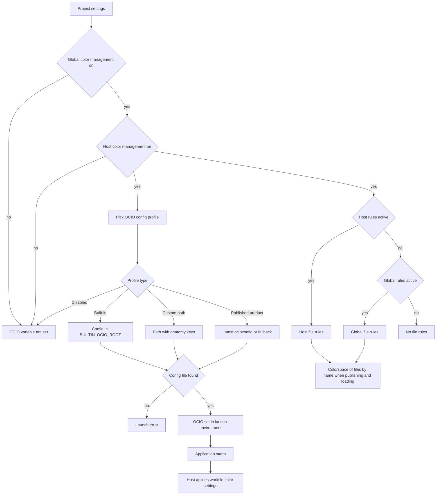

# Color management on launch

When an artist starts an application from AYON, the color management settings of the context decide two things: which OpenColorIO (OCIO) config the application uses, and which file rules assign a colorspace to a file by its name. The config is passed to the application through the `OCIO` environment variable. Applications that read `OCIO` (nearly all DCCs with OCIO support) then run on that config, so every artist of a project, task or application works in the same color pipeline without setting anything by hand. The AYON integration of each host can additionally apply the host's own color settings (working space, display, view and similar) to the scene, and reads the same config again when it publishes and loads.

This page describes how the config and the file rules are chosen, and how the config is delivered. What happens to color data while publishing and loading is described in [Color management in publishing](color-management-in-publishing.md). The settings themselves, with their defaults, are listed in the [Core addon settings](../addons/essentials/core/settings.md#color-management-imageio) and on the settings page of each host addon.

## Overview

Plain-text equivalent:

1. The launch hook reads the project settings of the launch context (project, folder, task, application).
2. If **Enable Color Management** in the Core addon color management settings is off, no `OCIO` variable is set and the process ends here.
3. If **Enable Color Management** in the host addon's color management settings is off, no `OCIO` variable is set.
4. The **OCIO config profiles** list is filtered by host name, task type, task name and application name. The most specific matching profile is used. If no profile matches, color management is treated as disabled.
5. The profile type decides the config source: a built-in config of the OCIO configs addon, a custom path, the latest `ocioconfig` representation of a published product (with a fallback config), or disabled.
6. The path is formatted with the context data and must exist as a file. If it does not, the launch fails with an error that no OCIO config was found.
7. The hook sets `OCIO` in the launch environment.
8. The application starts and reads `OCIO`.
9. The host integration applies the host's workfile color settings to the scene, where it has them.
10. For the same context, the file rules are chosen: the host rules when **Activate host rules** is on in the host addon, otherwise the global rules when **Activate global file rules** is on in the Core addon, otherwise none. The integration uses them to assign a colorspace to a file by its name when publishing and loading, see [File rules](#file-rules).

## Where the settings are

Color management is configured in two places, both set in the studio settings and overridable per project:

- **Core addon**, **Color Management (ImageIO)** group: the global switch, the OCIO config profiles and the global file rules.
- **Each host addon**, its color management group: the host switch, the host file rules and the scene settings of that host. A host whose settings have no switch gets no config.

The config is chosen only in the Core profiles; a host addon has no config setting of its own. The one exception is the Unreal addon, whose settings still carry an older **OCIO config** override: when it is enabled, its list of config paths replaces the profile, and the first path that exists is used.

:::caution Off by default
The global **Enable Color Management** is off by default, so color management is inactive until it is switched on. Switching it on in the studio settings applies to every project that does not override it, which can change the behavior of running projects.
:::

## OCIO config profiles

A profile has filters and a source. The filters are **Host names**, **Task types**, **Task names** and **Application names** (the full application name as `group/variant`, for example `maya/2026`). Filter values are regular expressions that must match the whole value; an empty filter or `*` matches everything. A profile whose filter does not match is excluded. Among the remaining profiles, the one with the most matching filters is used; ties are resolved in the order task names, task types, host names, application names, then by list order. A profile without filters is the default for everything that no more specific profile matches. The shipped default is one such profile pointing to the built-in **ACES 1.2** config.

| Profile type | How the config is found |
|---|---|
| **AYON built-in OCIO config** | A config shipped by the [OCIO configs addon](../addons/essentials/ocio/index.md): ACES 2.0 Studio (OCIO v2.4), ACES 1.3 Studio (OCIO v2.1 or v2), ACES 1.2 or Nuke default. The value is a path template of the form `{BUILTIN_OCIO_ROOT}/<folder>/<file>`; the addon sets `BUILTIN_OCIO_ROOT` to its configs folder. Without that addon in the bundle, the path cannot be solved and the launch fails. |
| **Path to OCIO config** | A path template. Anatomy roots (for example `{root[work]}`), the context keys (project, folder, task), `{platform}` and the environment variables of the launch can be used. The formatted path must exist. |
| **Published product** | Looks for products of the launch folder whose name matches **Product name** (a regular expression; an exact match is preferred, otherwise the first product found), takes the latest version and its representation named `ocioconfig`, and uses its published path. If no matching product exists, the fallback (a built-in config or a custom path) is used. If the product has no version or no `ocioconfig` representation, there is no config and the launch fails. An empty **Product name** is an error. |
| **Disable OCIO management** | The context runs without a config set by AYON. |

### Choosing a source

- **Use anatomy roots in custom paths.** A path built on `{root[work]}` stays valid on every platform and workstation, while an absolute path only works where it exists.
- **Keep a project copy of the studio config.** A config inside the project storage protects running and finished projects from later changes to the studio config. Host- or task-specific variants are best derived from the project config so the color pipeline stays continuous.
- **Version configs.** The config path used at publish time is stored with every published representation (see [Color management in publishing](color-management-in-publishing.md#colorspacedata)). A published config product gives versioning for free; for configs kept as files, the folder that holds all versions of a config must keep a stable path so that the stored paths stay valid.
- **Document changes in the config.** An OCIO config file is YAML. Its `description` field can hold a multi-line text when written with a trailing `|`, which suits change notes.

## Launch hook

The `OCIOEnvHook` pre-launch hook of the Core addon sets the environment variable. It runs at order 0, before most other hooks of the launch, for local and farm launches.

| Property | Value |
|---|---|
| Applies to hosts | `substancepainter`, `substancedesigner`, `fusion`, `blender`, `aftereffects`, `max`, `houdini`, `maya`, `nuke`, `hiero`, `flame`, `photoshop`, `resolve`, `openrv`, `cinema4d`, `silhouette`, `gaffer`, `loki` |
| Requires | A task in the launch context. Without a task the hook is skipped. |
| Output | `OCIO` in the launch environment, set to the config path. For `nuke` and `hiero`, backslashes in the path are replaced with forward slashes. |
| Nothing resolved | When color management is off or disabled for the context, the variable is left untouched and the application keeps whatever `OCIO` value the environment already has. |

Hosts that are not in the hook list (for example TV Paint, Harmony, TrayPublisher, Unreal) get no `OCIO` variable from this hook. The Core addon still resolves the same config from the project settings when those hosts publish or load.

Host addons can add their own hooks on top. For example, the Houdini addon sets `OCIO_ACTIVE_DISPLAYS` and `OCIO_ACTIVE_VIEWS` from its settings after `OCIOEnvHook` (local launches only), and the Flame addon passes the config path and the project color settings to its project creation script.

## File rules

A file rule assigns a colorspace to a file by its name: a rule has a name, a regular expression, a colorspace name and an optional file extension. A rule applies when the extension matches (an empty extension matches any file) and the pattern is found in the file name. When several rules match, the last one in the list wins. Global file rules are off by default.

Like the config, the rule set is chosen for the context of the application: the project settings and the host. The launch hook passes only the config; the integration reads the rule set from the same settings whenever it needs the colorspace of a file. The rule set in force for a host is chosen like this:

1. If the host's **Activate host rules** is on, the host rules are used, even when global rules are off.
2. Otherwise, if **Activate global file rules** is on in the Core addon, the global rules are used.
3. Otherwise there are no rules.

Host rules are useful when the same file name means different colorspaces in different applications, for example renders from Nuke and from Maya. File rules are used when a colorspace is not otherwise known: when publishing, to assign a colorspace to a representation (see [Color management in publishing](color-management-in-publishing.md#file-rules)), and by loaders for a loaded file that has no stored colorspace data.

## Host color settings

Besides the switch and the file rules, many host addons have settings that the integration applies to the scene once the config is known. They are described on the host settings pages; the mechanism is common:

| What the host settings do | When they apply | Examples |
|---|---|---|
| Set the working or rendering space, display and view of the scene | New scene, opening a workfile, or a menu action that sets workfile attributes | [Maya](../addons/3d-applications/maya/settings.md#color-management), [Nuke](../addons/compositing-editorial-applications/nuke/settings.md#color-management-imageio), [Hiero](../addons/compositing-editorial-applications/hiero/settings.md#color-management-imageio), [Cinema 4D](../addons/3d-applications/cinema4d/settings.md#color-management-imageio), [3ds Max](../addons/3d-applications/3dsmax/settings.md#color-management-imageio) |
| Set default displays and views, or a review colorspace | Launch, or creation of review instances | [Houdini](../addons/3d-applications/houdini/settings.md#color-management-imageio) |
| Configure the project color policy of the application | Project creation at launch | [Flame](../addons/compositing-editorial-applications/flame/settings.md#color-management-imageio) |
| Map the application's own colorspace names to OCIO names | Publishing and loading | [Photoshop](../addons/2d-drawing-applications/photoshop/index.md#color-management), [Resolve](../addons/compositing-editorial-applications/resolve/settings.md#color-management-imageio), [Flame](../addons/compositing-editorial-applications/flame/settings.md#color-management-imageio) |
| Nothing beyond the switch and file rules | Launch (`OCIO` for applications that read it); publishing and loading (file rules) | [Blender](../addons/3d-applications/blender/settings.md#color-management-imageio), [Fusion](../addons/compositing-editorial-applications/fusion/settings.md#color-management-imageio), [After Effects](../addons/compositing-editorial-applications/after-effects/settings.md#ocio-config), [Substance 3D Painter](../addons/3d-applications/substance-painter/settings.md#color-management-imageio), [Silhouette](../addons/compositing-editorial-applications/silhouette/settings.md#color-management-imageio), [OpenRV](../addons/review-and-media-players/open-rv/settings.md#color-management-imageio), [TVPaint](../addons/2d-drawing-applications/tvpaint/settings.md#color-management-imageio), [CelAction](../addons/2d-drawing-applications/celaction/settings.md#color-management-imageio), [Harmony](../addons/2d-drawing-applications/harmony/settings.md#ocio-config) |
| No color management settings: no switch, no file rules, so no config and no colorspace data when publishing | Never | [Wrap](../addons/3d-applications/wrap/index.md), [ZBrush](../addons/3d-applications/zbrush/index.md), [MotionBuilder](../addons/3d-applications/motionbuilder/index.md), [Marvelous Designer](../addons/3d-applications/marvelous-designer/index.md), [SpeedTree](../addons/3d-applications/speedtree/index.md), [Mocha Pro](../addons/compositing-editorial-applications/mocha-pro/index.md) |

<!-- screenshot: Maya addon project settings, Color Management (ImageIO) group expanded with Enable Color Management, File Rules and Workfile -->

## Host groups by level of control

How a host takes part depends on how much of its color management AYON can control.

| Group | What AYON controls | Hosts (examples) |
|---|---|---|
| OCIO managed | The config used by the application (`OCIO`), file rules, and scene settings where the host has them. | Maya, Nuke, Hiero, Houdini, Blender, Fusion, After Effects, 3ds Max, Cinema 4D |
| Remapped internal colorspace | The application has its own color management that AYON cannot set. AYON converts between the application's names and OCIO names with remapping rules when publishing and loading. | Photoshop, Flame, Resolve |
| Derived colorspace | The application has no color management of its own. The config is still resolved for the context, from the same profiles, when publishing. The colorspace comes from the file name by file rules, or the artist picks it from the colorspaces of that config with the **Override Colorspace** attribute, see [Color management in publishing](color-management-in-publishing.md#where-the-colorspace-comes-from). | TrayPublisher |

Loading is not uniform: a loader uses the stored colorspace of a representation when the host's loader implements it, falls back to file rules for representations without stored colorspace data, and in remapping hosts converts the OCIO name to the native name.

## Data the host integration reads

| Data | Source | Used for |
|---|---|---|
| `OCIO` environment variable | Launch hook | The config of the running application. |
| Config path and template of the current context | `get_current_context_imageio_config_preset` of the Core addon, which repeats the profile resolution for the current project, folder, task, host and application (`AYON_APP_NAME`) | Hosts that need the path themselves and creators that list the colorspaces of the config. |
| File rules | `get_imageio_file_rules` (host rules or global rules) | Assigning colorspaces to files in publishing and loading. |
| Remapping rules | Host `imageio.remapping.rules` | Converting between native names and OCIO names. |
| Host workfile color settings | Host `imageio` group | Applying working space, display, view and related values to the scene. |
| Config contents (colorspaces, roles, displays, views, looks) | `PyOpenColorIO` through the Core addon; when the running Python has no compatible `PyOpenColorIO` (version 2 or newer), a launcher subprocess answers the query | Validating and listing colorspaces, resolving the colorspace of a display and view pair. |

Code-level details for host integrations are in [Host integration](../developer/addon-development/host-integration.md).

## Related

- [Color management in publishing](color-management-in-publishing.md)
- [Core addon settings](../addons/essentials/core/settings.md#color-management-imageio)
- [OCIO configs addon](../addons/essentials/ocio/index.md)
- [Applications addon](../addons/essentials/applications/index.md)
- [AYON launcher](launcher.md)
- [Publishing](publishing.md)
