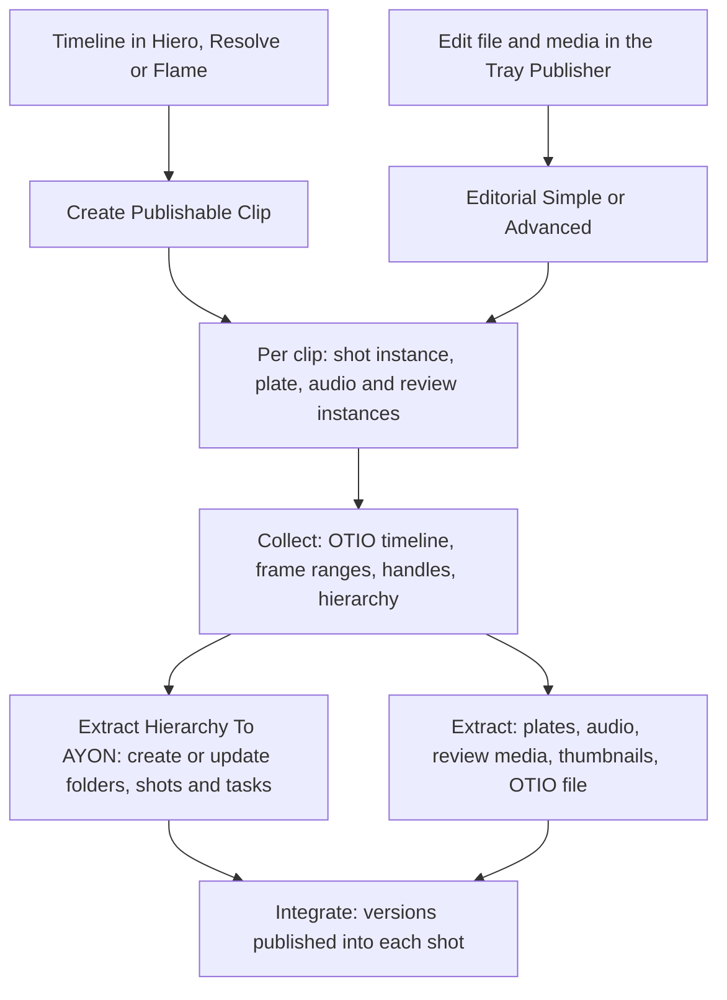

# Editorial publishing

Editorial publishing turns an edit into a project. From a timeline in an editing application, or from an edit file, AYON creates a shot folder for each clip, under a parent hierarchy such as an episode and a sequence, and sets the shot's frame range, handles, frame rate and resolution from the cut. In the same publish it publishes the plates, audio and review media of each clip into its new shot. Compositors, matchmove artists and animators then start from shots whose numbers come from the edit and whose source material is already published and loadable, instead of from a shot list typed by hand.

When the edit changes, publishing the updated cut updates the existing shots and adds new versions of their plates. The producer's view of this workflow is in [Build the project from the edit](../production-tracking/pipeline.md#build-the-project-from-the-edit).

## Where it is supported

| Starting point | Addon | Creator |
|---|---|---|
| A timeline in an editing application | [Hiero](../addons/compositing-editorial-applications/hiero/index.md) (also Nuke Studio), [DaVinci Resolve](../addons/compositing-editorial-applications/resolve/index.md) (Studio), [Flame](../addons/compositing-editorial-applications/flame/index.md) | **Create Publishable Clip** |
| An edit file (`.edl`, `.xml`, `.aaf`, `.fcpxml`) with media, no editing application | [Tray Publisher](../addons/essentials/traypublisher/index.md#editorial-workflows) | **Editorial Simple** and **Editorial Advanced** |
| A timeline as one package, an OpenTimelineIO file with its media | Hiero, Resolve, Tray Publisher | **Editorial Package** |
| Clips in the Flame Media Panel | [Flame](../addons/compositing-editorial-applications/flame/index.md) | **Plate Reel Clip** |
| Movie files for shots that already exist | [Tray Publisher](../addons/essentials/traypublisher/index.md) | **Batch Movies** |
| A spreadsheet that lists files and the shots they belong to, no edit | [Tray Publisher](../addons/essentials/traypublisher/index.md) | **CSV Ingest** |
| Folders of files whose names or paths tell the shot, no edit | [Batch Ingest](../addons/pipeline-features/batch-ingest/index.md) | **Batch Ingest** |

All of them build on the same editorial plugins of the Core addon, which work on [OpenTimelineIO](https://opentimeline.io/) (OTIO) data: the host converts its timeline, or the Tray Publisher reads the edit file, into an OTIO timeline, and the shared plugins compute ranges, create the hierarchy and cut the media from it.

## How it works

1. **Create.** The artist selects clips in the timeline, or adds the edit file and media in the Tray Publisher, and runs the creator. For each clip it makes an **Editorial Shot** instance (product base type `shot`) and the per-clip product instances chosen in its options: **Editorial Plate** (`plate`), **Editorial Audio** (`audio`) and, in the Tray Publisher, **Editorial Review** (`review`) and further product presets. The product instances are children of the shot instance: switching the shot off switches them off too. In the timeline hosts the data is stored in a tag (Hiero) or marker (Resolve, Flame) on each clip, so the clips can be republished later.
2. **Collect.** The OTIO timeline is read, and each instance gets its OTIO clip, frame ranges, handles, resolution and the review and audio sources.
3. **Extract Hierarchy To AYON** creates the missing folders, shots and tasks on the AYON server before any product is integrated, and updates the attributes of existing shots.
4. **Extract** writes the plate files, the review media, the audio and the thumbnails.
5. **Integrate** publishes each product as a new version of its shot.

## Publishing from a timeline: Hiero, Resolve and Flame

The three timeline hosts share one way of working. The artist selects the clips of the cut and runs **Create Publishable Clip** from the Publisher. The creator stores its data on each clip, in a tag in Hiero and a marker in Resolve and Flame, so the same clips can be republished after the edit changes. Its options are the same in all three hosts, and their defaults come from the addon settings ([Hiero](../addons/compositing-editorial-applications/hiero/settings.md#create-shot-clip), [Resolve](../addons/compositing-editorial-applications/resolve/settings.md#create-shot-clip), [Flame](../addons/compositing-editorial-applications/flame/settings.md#create-shot-clip)).

### Shot hierarchy and naming

The shot name and its parents are built from templates and keywords:

- The keywords `{folder}`, `{episode}`, `{sequence}`, `{track}` and `{shot}` have values set in the creator, for example `shots`, `ep01`, `sq01`. The values can use tokens from the timeline: `{_sequence_}` (the timeline name), `{_track_}` (the track name) and `{_clip_}` (the clip name).
- **Shot Parent Hierarchy** (default `{folder}/{sequence}`) gives the parent folders of each shot. Each keyword becomes a folder of the matching folder type, so `shots/sq01` is a `Folder` with a `Sequence` inside, and the shot is created below it.
- With **Rename clips**, the **Clip Name Template** (for example `{sequence}{shot}`) names the shot. Hashes in the `{shot}` value become a running number that starts at **Count sequence from** and grows by **Stepping number**, so the defaults produce `sh010`, `sh020`, `sh030` and so on, in the order of the clips on the timeline. Without renaming, the clip name is the shot name.

The product names follow the [product name profiles](naming-conventions.md#product-naming). The plate variant can be taken from the track name, so a timeline with tracks `main` and `bg` publishes `plateMain` and `plateBg` into each shot.

### Vertical sync

With **vertical sync**, one shot gets several plates: the clip on the **hero track** defines the shot (name, range, resolution), and the clips stacked above or below it on other tracks publish as further plates of the same shot, with their track name as variant. A stacked clip must fall completely within the frame range of the hero clip: it can be shorter, but not start earlier or end later. Only clips selected when the creator runs are published, each as its own plate product, and only the hero clip makes a review. It suits a background plate, a clean plate or reference footage cut in under the main plate.

### Review track

The review movie of a shot is made from the media chosen as **Reviewable Source**: the clip's own media, or another track of the timeline, such as an offline edit. A long review clip is cut to each shot's range, and gaps are filled with black frames.

### Differences between the hosts

| | Hiero / Nuke Studio | DaVinci Resolve Studio | Flame |
|---|---|---|---|
| Data stored on the clip as | Tag | Marker | Marker |
| Tasks of the new shots | Task tags on the clips (default tags are created at startup) | None: the shots are created without tasks | **Add tasks** in the [Collect Shot instances](../addons/compositing-editorial-applications/flame/settings.md#collect-shot-instances) settings (default `compositing`), optionally with a batch group per task |
| Plate media | Published from the source media | Can be rendered as intermediates by the render queue, by profiles in the addon settings | Transcoded with export presets, by profiles in the addon settings |
| Host extras | Soft effects of a clip published as `effect` products, loadable in Nuke to recreate the look | | **Plate Reel Clip** for clips in the Media Panel |

## Publishing from an edit file: Tray Publisher

Without an editing application, the [Tray Publisher](../addons/essentials/traypublisher/index.md#editorial-workflows) reads an edit file (`.edl`, `.xml`, `.aaf`, `.fcpxml`) with its media. Its creator defaults are in the [Tray Publisher settings](../addons/essentials/traypublisher/settings.md#editorial-creators).

### Editorial Simple

**Editorial Simple** cuts the plates and reviews of each shot out of the media of the edit. The clip names of the edit file are parsed instead of being renamed:

- **Clip Name Tokenizer** extracts tokens such as `_sequence_` and `_shot_` from each clip name with regular expressions.
- **Shot Rename** builds the shot name from a template that uses these tokens and anatomy keys.
- **Shot Hierarchy** builds the parent path from a folder path template whose tokens each become a folder of a set folder type. When it is off, the shots are created under the folder selected in the Publisher.

Review is its own product preset, next to the plate and audio presets.

### Editorial Advanced

The Tray Publisher's **Editorial Advanced** creator does not cut media out of one long file. It reads a **media source folder** with a sub folder per shot named like the clip in the edit, and finds the files of each product there with the filters of its product presets (extensions and regular expressions). The name of a sub folder that holds a sequence is used as the product name. The version of each product can be incremental, read from the file name, or locked to a number, which suits ingesting vendor or client deliveries that already carry version numbers.

### Batch Movies

**Batch Movies** publishes a set of movie files into shots that already exist, for example the movies of a vendor delivery. Each file is matched to a folder by its name: a name equal to the folder name (`sh010.mov`), the folder name followed by a version (`sh010_v003.mov`, published as version 3), or a name that contains the folder name. A file that matches several folders is published into the first one, with a warning. The task is taken from the creator's default task names, and each movie can also be made the reviewable of its version.

## Ingesting shot media without an edit

Media often arrives per shot rather than as a cut, for example a vendor delivery or a turnover with one folder per shot. Two creators publish such media into shots, and create the shots when needed, without reading a timeline: there are no cuts, no vertical sync and no review track.

### CSV Ingest

**CSV Ingest** in the Tray Publisher publishes the files listed in a `.csv` file. Each row is one file with its target: folder path, task, product type, variant, version, frame range, handles, FPS, representation name and colorspace. Several rows can add representations to the same version, for example an EXR sequence and a movie of one shot. A preset of the [Tray Publisher settings](../addons/essentials/traypublisher/index.md#csv-ingest) sets the columns, and can create missing folders and tasks.

### Batch Ingest

The [Batch Ingest](../addons/pipeline-features/batch-ingest/index.md) addon adds a creator to the Tray Publisher that scans dropped folders and groups the files into products by rules of a preset. From version 0.3.1 a preset can also find the shot of each file in its path and name: regular expressions capture tokens such as the sequence and shot number, and a template builds the folder name and its parents from them. Missing folders are created as shots, with attributes such as the frame range, FPS and resolution set by the preset. This suits deliveries where files are named and placed in a consistent way.

## Shot attributes

The shot instance carries the attributes that are written to the shot folder. They are computed from the edit and shown, read only, on the shot instance in the Publisher:

| Attribute | Where it comes from |
|---|---|
| Frame start, frame end | **Workfile start frame** (default `1001`) is the first frame of the cut. The end frame is the start frame plus the clip's duration on the timeline, minus one. |
| Handle start, handle end | Set in the creator, and editable per shot instance afterwards. The plates are cut with the handles added to the clip's range, as far as the source media allows. |
| Clip in, clip out | The clip's position on the timeline. The Tray Publisher adds the **Timeline offset** set in the creator. |
| FPS | From the timeline or the selected context, or a value picked in the creator. An EDL file has no frame rate, so the Tray Publisher reads it with the creator's value. |
| Resolution, pixel aspect | From the timeline, or from the source clip when **Source resolution** (or **Set shot resolution from plate**) is on. |
| Tasks | In the timeline hosts, see [Differences between the hosts](#differences-between-the-hosts). Tray Publisher: from **Add tasks to shot**. |

Retimes on a clip are taken into account: the plate covers the source frames the retime needs, and the retime is recorded on the version.

**Republishing an edit** updates the attributes of shots that already exist, so a changed cut corrects the frame ranges. A studio can turn this off, or protect single attributes from being changed, with the Core settings of **Collect Hierarchy** ([Core addon settings](../addons/essentials/core/settings.md#collectors)); the artist can also switch it off per publish in the Publisher.

## What gets published

| Product | Content |
|---|---|
| `shot` | No files. Creates or updates the shot folder, its parents and tasks. |
| `plate` | The clip's source media for the shot range plus handles. Image sequences are published frame by frame; movies are trimmed to the range. How each timeline host produces them is in [Differences between the hosts](#differences-between-the-hosts). |
| `review` | A movie for review, from the [review track](#review-track) or the clip's own media. The frames are encoded by the [review steps of the publish](publishing.md#review-media), and uploaded as reviewable of the shot's plate version. |
| `audio` | The audio of the timeline for the shot's range, as a `wav` file. It can also be used as the soundtrack of the review movie. |
| `workfile` | The editing project itself. Hiero, Resolve and Flame add an `otio` representation of the timeline, so the edit can be read by other tools. The Tray Publisher publishes the edit file under the `editorial` product of the context folder. |

## Editorial packages

An **Editorial Package** (`editorial_pkg`) publishes a whole timeline as one product: an OTIO file that references its media, with intermediate media rendered or converted as needed. Hiero and Resolve load such a package back as a timeline. It suits handing a cut to another department or another studio, and versioning the edit itself.

## Related

- [Build the project from the edit](../production-tracking/pipeline.md#build-the-project-from-the-edit)
- [Publishing](publishing.md)
- [Product types](product-types.md)
- [Naming conventions](naming-conventions.md)
- [Color management in publishing](color-management-in-publishing.md)
- [Hiero addon](../addons/compositing-editorial-applications/hiero/index.md)
- [DaVinci Resolve addon](../addons/compositing-editorial-applications/resolve/index.md)
- [Flame addon](../addons/compositing-editorial-applications/flame/index.md)
- [Tray Publisher addon](../addons/essentials/traypublisher/index.md)
