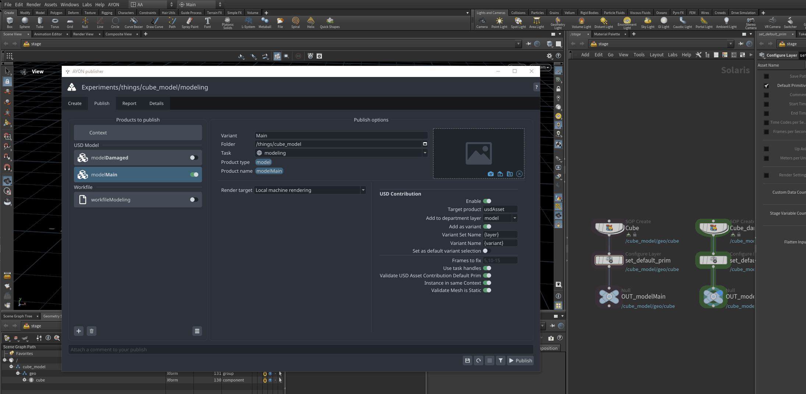

# Experimental tools

<PageInfo />

Experimental tools is a window that lists tools that are not in the standard AYON menu yet. It opens from **Experimental tools...** in the AYON menu of an integration (for example Maya, Nuke, Hiero, TVPaint or Unreal), and each tool is a button in it. Experimental tools can change or be removed between releases.

Today the window has one tool, the **Pyblish Debug Stepper**. In Flame, Hiero, Resolve, Harmony and CelAction it also shows a disabled **New publisher** button, a leftover from the time when the [Publisher](publisher.md) was new; the Publisher is the standard tool and opens from the AYON menu.

## Pyblish Debug Stepper

The stepper pauses a publish after every plugin and shows the data of the publish at that point. Publishing runs dozens of plugins that each read and write the shared context and instance data; when a product comes out with a wrong frame range or a missing representation, the stepper shows which plugin set or changed the value. It targets pipeline developers, technical directors and administrators who need to see what each collector, validator or extractor changed. It requires Pyblish 1.8.12 or newer.

The stepper window (`Pyblish Debug Stepper`, 700 by 500 pixels, always on top) registers a Pyblish `pluginProcessed` callback while it is visible and removes it when it is hidden. Every time a plugin finishes the callback pauses the publish and updates the window; the **Step** button continues until the next plugin finishes. The stepper reacts to validation and publish started from the [Publisher](publisher.md) or from code. Closing the window resumes the publish and unregisters the callback.

| Element | Content |
|---|---|
| Title | `Pyblish Debug Stepper`, followed by the label of the last processed plugin. |
| Info box | Plugin order, plugin class name, the instance it processed (when it is an instance plugin) and its duration in milliseconds. |
| **Filter keys...** | Filters the data tree by key, recursively. |
| Data tree | Columns **Key**, **Type**, **Value**. The first top-level entry is `context` (the context data); each instance follows under its name with its instance data. Nested dictionaries expand. Hovering a changed value shows its full JSON. |
| **Step** | Resumes the publish until the next plugin has finished. Disabled while no plugin is waiting. |

Changes since the previous step are color coded:

| Color | Meaning |
|---|---|
| Green key | Key added since the previous step. |
| Light value | Value changed or added since the previous step. |
| Dim value | Value unchanged. |
| Red type | The type of the value changed. |

Values longer than 100 characters are shortened in the cell; the tooltip holds the full value.

The community forum thread [Pyblish Plugins Debugging](https://community.ynput.io/t/pyblish-plugins-debugging/1447) shows the stepper in use and discusses other ways to debug publish plugins.

## Related

- [Publisher](publisher.md): the window the stepper pauses.
- [Publishing](publishing.md): the plugin stages and order the stepper walks through.
- [Process Monitor](process-monitor.md): another developer-facing tool that shows the output of launched applications.
