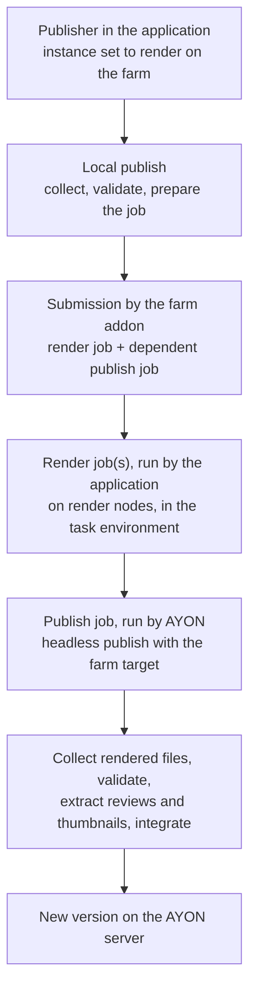
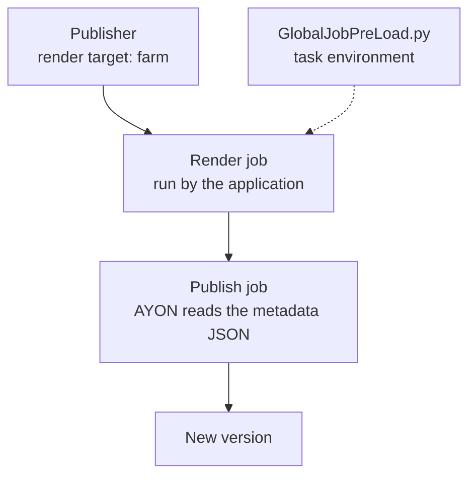
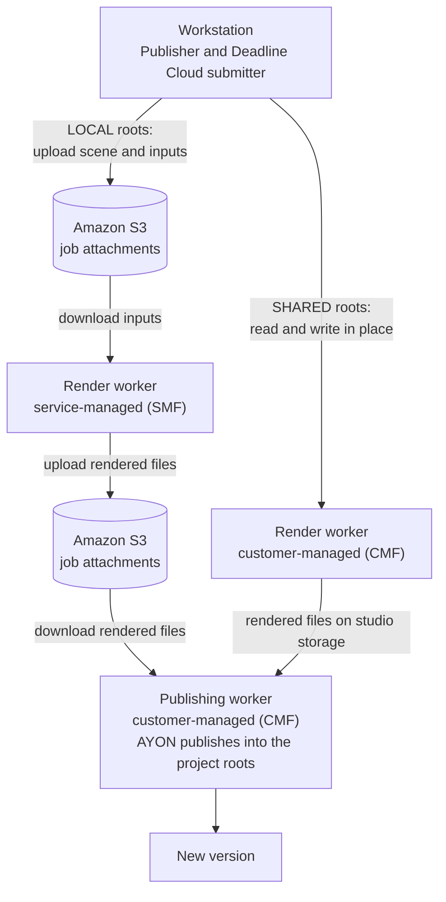
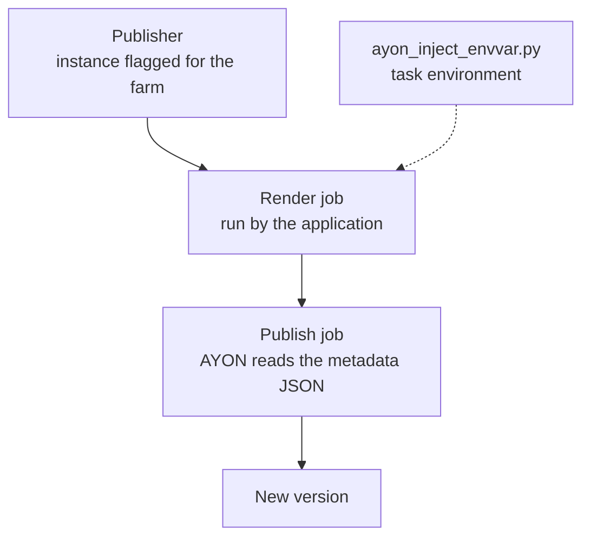

import Tabs from '@theme/Tabs';
import TabItem from '@theme/TabItem';

# Farm

AYON can hand rendering and part of publishing to a render farm. The artist publishes from the application as usual, but instead of rendering on the workstation, the Publisher submits jobs to the farm manager: render jobs that produce the frames, and a publish job that registers the rendered files as a new version once the render is done. The workstation is free again within seconds, the render runs in the same task environment the artist had, and the result arrives in AYON with reviews and thumbnails like any local publish.

This flow is the same for every farm manager. Each farm manager has its own addon, which adds the submission for the applications it supports and its own options. The first part of this page describes the common flow; [Supported farm managers](#supported-farm-managers) at the end describes what each addon adds.

## How a farm publish works



1. **The artist sends the instance to the farm.** In the Publisher, the artist picks farm rendering for the instance and sets the job parameters (see [Job parameters](#job-parameters-settings-and-publisher)).
2. **The local publish runs.** Collectors and validators run in the application as usual. Instances that render on the farm are not integrated locally.
3. **The farm addon submits the jobs.** Its submit plugin for the application sends the render job and a publish job that depends on it, so the publish starts only after the render has finished.
4. **The render job renders** on the render nodes, in the environment of the task (see [How render nodes get the task environment](#how-render-nodes-get-the-task-environment)).
5. **The publish job publishes.** It runs the AYON launcher headless in the `shell` host with the target `farm`. It finds the rendered files, then the usual validation, extraction and integration run, as described in [Publishing](publishing.md).

## Job parameters: settings and Publisher

The parameters of a farm job, such as priority, pools, frames per task or the farm and queue, are set in two places:

- **The settings of the farm addon** hold the studio and project defaults: which farm server or root a project uses, and default job parameters.
- **The Publisher** shows the job parameters on the instance, where the artist changes them for one submission.

Which parameters exist, and which of them the artist can change, depends on the farm addon. They are listed in [Supported farm managers](#supported-farm-managers) and on the addon pages.

## Render job and publish job

A farm publish is two dependent jobs:

| Job | Run by | What it does |
|---|---|---|
| Render job | The application (or its renderer) on the render nodes | Renders the frames of the instance into the render output folder. |
| Publish job | AYON on a render node, after the render job | Collects the rendered files, makes the reviews and thumbnails and registers the files as a new version. |

The render job can be split into more than one job, but they are all still run by the application: for example Houdini can export intermediate scene files in one job and render them in the next, and Maya can render tiles that are assembled afterwards. The publish job still comes last and waits for all of them.

The publish job runs as the artist who submitted it: the submitter's user name is passed to the job, and when the farm connects with the API key of a service user, the publish is recorded under that user name. The publish job uses the bundle of the submitting session, so it runs the same addon versions as the workstation.

:::caution No dependencies between instances

AYON only makes the jobs of one instance wait for each other: the publish job waits for the render job. Jobs of different instances run independently, even when they come from the same scene. For example, when one instance exports a cache on the farm and another renders with that cache, the render does not wait for the cache. Set such dependencies in the farm manager.
:::

### Reviews made on the farm

Reviewable media of a farm render is made in the publish job, not on the workstation. In the publish job, the review, thumbnail and burn-in extractors of Core run on the rendered files, and **Integrate AYON Review** uploads the reviewables to the AYON server, where they show in the web app's review player. The local publish skips representations that are left for the farm. The farm addon decides which rendered files get a review, and the artist can turn review off for the instance. Color handling of farm renders is described in [Color management in publishing](color-management-in-publishing.md).

<!-- screenshot: a Deadline Monitor job list showing a render job and its dependent AYON publish job -->

## How render nodes get the task environment

A render must see the same environment as the artist's application: the root paths, the color configuration, the tools and plugins of the task, and the variables that the integrations set. A render node renders for many projects and tasks, so it has no fixed environment of its own. Instead, with Deadline and Royal Render, the render node asks AYON for the environment of the job's task each time a job starts, before the render begins.

At submission, Core's **AYON core Farm Environment Variables** collector adds the context to the job environment: project, folder path, task, user name, host name and the bundle names in use (`AYON_BUNDLE_NAME`, `AYON_STUDIO_BUNDLE_NAME`, and `AYON_USE_STAGING` when set). The Applications addon adds `AYON_APP_NAME`, the application variant, and the farm addons add their own variables.

On the render node, the farm manager runs the AYON launcher before the render with the Applications command:

<Tabs groupId="os">
<TabItem value="windows" label="Windows" default>

```powershell
ayon_console.exe --headless addon applications extractenvironments <output.json> --envgroup farm --project <project> --folder <folder path> --task <task> --app <application variant>
```

</TabItem>
<TabItem value="unix" label="Linux & macOS">

```bash
ayon --headless addon applications extractenvironments <output.json> --envgroup farm --project <project> --folder <folder path> --task <task> --app <application variant>
```

</TabItem>
</Tabs>

The launcher starts with the bundle named in the job, so the render node uses the same addon versions as the submitting workstation, and computes the environment of that context with the launch hooks for farm launches. The farm manager then injects the variables from the JSON file into the render process. How each farm manager does that is described in its section below.

The publish job builds its environment itself: the `publish` command asks the Applications addon for the farm publish environment of the job's context before it starts publishing.

Two settings shape the farm environment:

- Environment values in the [Applications settings](../addons/essentials/applications/settings.md) can be split into groups instead of a single value. Render jobs on the farm request the group `farm`, while launches on workstations, and the publish job on the farm, use the group `standard`, so a variable can point to a different path on the farm, or exist only there. A variable that is split into groups and has no value for the requested group is left out.
- **Filter farm environment** in the [Core settings](../addons/essentials/core/settings.md#filter-farm-environment) removes or rewrites variables for farm publish launches, per host, task type, task or folder.

## What a studio needs on the farm

- **The AYON launcher on every render node** that runs AYON: render nodes run the launcher for the publish jobs (and, with Deadline and Royal Render, for environment extraction) and download the bundle's addons like any workstation, see [Render nodes](../ayon/workstation-setup.md#render-nodes). Dedicated render nodes of one operating system can share one site ID to reduce the load on the server.
- **A connection to the AYON server.** The farm needs the server URL and an API key, normally of a service user.
- **The farm addon in the bundle**, configured with the farm manager's address or root paths, see [Bundles](../ayon/how-ayon-works/bundles.md), and the farm addon's own files or packages in the farm manager.
- **The applications and storage on the render nodes.** The rendering software has to be installed, with its executables defined in the [Applications settings](../addons/essentials/applications/settings.md) for the render nodes' operating system, and the project roots have to be reachable from the nodes.

## Supported farm managers

| Farm manager | Addon | Submits from |
|---|---|---|
| AWS Thinkbox Deadline | [Deadline](../addons/farm-managers/deadline/index.md) | After Effects, Blender, CelAction, Cinema 4D, Fusion, Harmony, Houdini, 3ds Max, Maya, Nuke, Unreal |
| AWS Deadline Cloud | [AWS Deadline Cloud](../addons/farm-managers/deadline-cloud/index.md) (unreleased) | Maya, Houdini, Nuke, Blender |
| Royal Render | [Royal Render](../addons/farm-managers/royal-render/index.md) | Render jobs from Maya and Nuke, cache jobs from Maya |

When the instance is flagged for the farm, **Collect Farm Target** (Core) records which farm addon renders it: the first enabled one of Deadline and Royal Render, in that order. The publish fails when the instance is flagged for the farm and none of them is enabled. AWS Deadline Cloud does not use this flag: it has its own product type.

The addon pages are the reference for the job types, the plugins, the job options in the Publisher and the settings.

### Deadline



- **Sending to the farm:** render creators offer a render target, for example local or farm rendering.
- **Jobs:** the submit plugin writes a metadata JSON file into the render output folder that lists the instances, the expected files, the context and the publish options. The publish job runs the launcher's `publish` command on it with the targets `farm` and `deadline` (see [Launcher command line](launcher-command-line.md#commands)); **Collect rendered frames** reads the metadata files named in `AYON_PUBLISH_DATA` and recreates the instances, and **Validate rendered files from Deadline** checks that all expected files were rendered.
- **More job layouts:** Houdini can split a render into an export job that writes intermediate scene files (for example `.ass` or `.ifd`) and a render job that renders them with the renderer's own Deadline plugin, which saves Houdini licenses. Maya and Houdini can send the whole publish of a scene to the farm, for example to export caches there. Maya can render tiles, assembled after the render.
- **Job parameters:** profiles in **Render Job Settings** hold the defaults per host, task and product base type; their **Exposed Overrides** decide which of them the artist can change in the Publisher, see [Job parameters in the Publisher](../addons/farm-managers/deadline/index.md#job-parameters-in-the-publisher). **Publish Job Settings** hold the publish job's parameters and the filters per application that select the AOVs to make reviews from.
- **Task environment:** `GlobalJobPreLoad.py`, part of the repository overlay of the addon, runs for every job marked as an AYON render job. It takes the launcher executable, the AYON server URL and the API key from the Deadline `AYON` plug-in configuration, runs the extraction and sets the result on the render process. When the render nodes share an `AYON_SITE_ID`, one worker extracts the environment per job and the others reuse it from a cache file next to the render output, which cuts the requests to the server when many workers start at once.
- **On the farm:** the repository overlay of the addon (the `AYON` plug-in, with the server URL and API key, and `GlobalJobPreLoad.py`) and a Deadline web service reachable from the workstations. See [Deadline settings](../addons/farm-managers/deadline/settings.md).

#### Rendering only some frames

With Core 1.10.0 or newer and a Deadline addon newer than 0.7.4 in the bundle, render instances offer **Use Custom Frames**, with three modes:

| Mode | What is rendered |
|---|---|
| Task Frame Range | The frame range of the scene, usually the frame range of the task. |
| Custom Frames Only | Only the frames or ranges typed in **Custom Frames**, in the Deadline frame list format (`1001,1004`, `1002-1006`, `1001-1100x5`). |
| Reuse from Last Version | The frame range of the last published version, with the typed frames re-rendered and the other frames copied from that version. It cannot extend the range beyond the last version. |

When the resulting sequence has gaps, the review follows the **Handle missing frames** option of [Extract Review](../addons/essentials/core/settings.md#extract-review).

### AWS Deadline Cloud

AWS Deadline Cloud is the managed render service of Amazon Web Services, a different product from Thinkbox Deadline.



The storage profile of the workstation decides the path. Roots marked LOCAL go through S3, which render workers of a service-managed fleet (SMF), run by AWS, need because they cannot reach the studio storage. Roots marked SHARED stay on the studio storage, which workers of a customer-managed fleet (CMF), run by the studio, read and write in place when they mount it.

- **Sending to the farm:** the artist creates a **Deadline Cloud Render Job** instance (product base type `deadline_cloud`) instead of picking a render target. Publishing it submits the job.
- **Jobs:** one Deadline Cloud job with steps instead of separate jobs. The addon reuses the Deadline Cloud submitter of the application to build the job: the submitter supplies the job template, the parameters, the files the scene needs and the render steps. The addon appends a `publish to AYON` step that depends on all of them, runs `ayon addon deadline_cloud publish` and creates the instances from the files in the output folder. Only image output is supported.
- **Job parameters:** the Publisher fields are built from the parameters of the submitter's job template. The settings override the farm and queue, set Conda packages and channels, and set the worker roles that separate render workers from publishing workers.
- **Files:** service-managed workers cannot reach the studio storage, so the scene and the files it references are uploaded to Amazon S3 as job attachments, and the render output comes back through S3 to the publishing worker. Storage that the storage profiles mark as shared is used in place instead. Files that the submitter does not detect are missing on the workers.
- **Task environment:** the render steps do not run the environment extraction above. Their software comes from Conda packages that the queue installs for each job, which on AWS-managed workers come from the `deadline-cloud` channel of AWS; the addon detects the packages from the scene. The publishing step passes the bundle names of the submitting session.
- **On the farm:** a Deadline Cloud farm and queue with storage profiles matching the project roots; render workers, which can be managed by AWS; a publishing worker of a customer-managed fleet with the AYON launcher, a connection to the AYON server and access to the project roots; the Deadline Cloud submitter and credentials on each workstation; and the addon in the production bundle.

The steps, the worker roles, the queue environment change and the Conda packages are described in [Setting up](../addons/farm-managers/deadline-cloud/index.md#setting-up) and [Conda packages](../addons/farm-managers/deadline-cloud/index.md#conda-packages) on the addon page.

### Royal Render



- **Sending to the farm:** for Maya render and cache instances and Nuke render instances flagged for the farm, the addon's publish plugins create the Royal Render jobs.
- **Jobs:** like Deadline, a render job and a publish job with a metadata JSON file. The publish job runs `publish` headless with the targets `royalrender` and `farm`; each job waits for the previous one.
- **Job parameters:** the Publisher offers priority, frames per task, concurrency, GPU use and a few more. Their defaults are fixed in the plugins; the settings only select the RR root paths of a project. See [Job attributes in the Publisher](../addons/farm-managers/royal-render/index.md#job-attributes-in-the-publisher).
- **Task environment:** the preprocessing script `ayon_inject_envvar.py` from the `RR_ROOT` overlay runs the extraction and writes the result as an `.rrEnv` file for the job, because the environment list of a Royal Render job is limited to 2000 characters.
- **On the farm:** the addon's files in `RR_ROOT`, and `AYON_EXECUTABLE`, `AYON_SERVER_URL` and `AYON_API_KEY` in the render nodes' environment. See [Royal Render settings](../addons/farm-managers/royal-render/settings.md).

## Related

- [Publishing](publishing.md): the publish stages, also run by the publish job
- [Publisher](publisher.md): where artists set the render target and job options
- [Launcher command line](launcher-command-line.md): the `publish` command and headless use of the launcher
- [Artist workstation setup: render nodes](../ayon/workstation-setup.md#render-nodes)
- [Deadline addon](../addons/farm-managers/deadline/index.md), [AWS Deadline Cloud addon](../addons/farm-managers/deadline-cloud/index.md), [Royal Render addon](../addons/farm-managers/royal-render/index.md)
- [Applications addon](../addons/essentials/applications/index.md): the `extractenvironments` command
- [Deadline setup guide](https://community.ynput.io/t/ayon-openpype-deadline-setup/468) on the community forum
