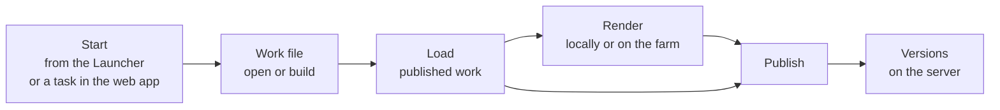

# Pipeline

The AYON pipeline connects the applications artists work in to the AYON server. It starts an application in the context of a task, gives artists tools inside it to open, load and publish work, and registers every publish on the server as a named, versioned product that the rest of the production can find and use right away. It runs where the work is made: on artist workstations, on render nodes and in services next to the server.

This section shows what the pipeline features are useful for and how they work, for technical directors and artists. The screens of the web app are described in the [AYON section](../ayon/introduction.md), and the settings of each addon in the [Addons section](../addons/index.md).

## The parts of the pipeline

- **The launcher** is the desktop application that connects a machine to the server. Everything else, the launcher version included, comes from the server. See [AYON launcher](launcher.md).
- **Addons** provide the pipeline, see [The addons of the pipeline](#the-addons-of-the-pipeline) below.
- **Dependency packages** hold the Python libraries that the addons need on top of what the launcher ships, one package per platform. See [Dependency packages](../ayon/web-ui/studio/bundles.md#dependency-packages).

A **bundle** on the server pins the three together: one launcher version, one version of each addon and one dependency package per platform. See [Bundles](../ayon/how-ayon-works/bundles.md).

### The addons of the pipeline

The pipeline is not a single program: a bundle combines addons that each do one part of it. Knowing which addon does what tells where a feature comes from, which settings drive it, and what a bundle needs for a working pipeline.

| Part | Addon | Role in the pipeline |
|---|---|---|
| Core | [Core](../addons/essentials/core/index.md) | The base: the publish framework, the [pipeline tools](pipeline-tools.md) (Workfiles, Loader, Publisher, Scene Inventory and others), the launch hooks and color management that apply to every application, and the studio-wide settings. It also handles the launcher's command line. Almost every other addon requires it. |
| Applications | [Applications](../addons/essentials/applications/index.md) | The software AYON can start: versions, executables, environment and tools. It decides which applications a task offers and starts them in the task context. |
| Host integrations | One per application, for example [Maya](../addons/3d-applications/maya/index.md) or [Nuke](../addons/compositing-editorial-applications/nuke/index.md) | The pipeline inside one application, see [What a host integration provides](#what-a-host-integration-provides). |
| Farm managers | [Deadline](../addons/farm-managers/deadline/index.md), [AWS Deadline Cloud](../addons/farm-managers/deadline-cloud/index.md), [Royal Render](../addons/farm-managers/royal-render/index.md) | Send render and publish jobs to a render farm, with their own submit plugins for the applications they support. See [Farm](farm.md). |
| 3rd party binaries | [3rd party binaries](../addons/essentials/3rd-party-binaries/index.md) | FFmpeg and OpenImageIO for reviews, thumbnails, burn-ins, slates and transcoding. |
| OCIO configs | [OCIO configs](../addons/essentials/ocio/index.md) | The built-in OpenColorIO configs that the default color management settings point to. See [Color management on launch](color-management-on-launch.md). |

Core lists 3rd party binaries and OCIO configs only as compatible addons, so a bundle without them is accepted, but publishing then fails where FFmpeg, OpenImageIO or a built-in config is needed (see [Core](../addons/essentials/core/index.md#dependencies-that-are-not-declared)). Features such as USD, Site Sync, burn-ins or slates come from further addons, listed in the [Addons section](../addons/index.md#pipeline-addons).

### What a host integration provides

A host integration brings the pipeline into one application. Built on Core, it typically provides:

- **The AYON menu** inside the application, which opens the tools in the task context: [Workfiles](workfiles.md), [Loader](loader.md), [Publisher](publisher.md), [Scene Inventory](scene-inventory.md) and application-specific entries.
- **Creators**: the [product types](product-types.md) that can be published from the application, and how a publish instance is kept in the scene (a set, a node, a marker).
- **Publish plugins**: the collectors, validators and extractors of the application, on top of the Core plugins that run everywhere, see [Publishing](publishing.md).
- **Loaders**: how each representation comes into the scene (reference, import, read node) and is tracked for updates in the Scene Inventory.
- **Workfile support**: opening and saving workfiles with names from the [project templates](naming-conventions.md).
- **Launch hooks**: preparation of the application's environment and startup, see [Launching in context](launcher.md#launching-in-context).

Any addon can add creators, loaders and publish plugins to an application, not only its host integration: the farm addons add their submit plugins this way. What each integration supports is on its page in the [Addons section](../addons/index.md); the code side is in [Host integration and pipeline plugins](../developer/addon-development/host-integration.md).

## The pipeline, step by step

| Step | Pages |
|---|---|
| **Start work** from the Launcher window or from the application actions of a task in the web app | [AYON launcher](launcher.md) · [Color management on launch](color-management-on-launch.md) |
| **Open or create a work file** | [Workfiles](workfiles.md) · [Naming conventions](naming-conventions.md) · [Templated workfile builder](template-builder.md) |
| **Bring in published work** | [Loader](loader.md) · [Scene Inventory](scene-inventory.md) · [Look Assigner](look-assigner.md) |
| **Render** locally in the application, or on the farm: the render creators offer both targets | [Farm](farm.md#how-a-farm-publish-works) |
| **Publish**, with review media and colorspace conversions | [Publishing](publishing.md) · [Publisher](publisher.md) · [Product types](product-types.md) · [Review media](publishing.md#review-media) · [Color management in publishing](color-management-in-publishing.md) |

## Workflows

Workflows here are ways of working that run through several pipeline tools. The node graphs of the [Workflow addon](../addons/automation/workflow/index.md), also called workflows, are a different thing.

- [Templated workfile builder](template-builder.md): new work files built from a template, with the right published work already loaded.
- [Editorial publishing](editorial-publishing.md): from an edit to shots, plates and review media.
- [OpenUSD](openusd.md): department contributions layered into asset and shot USD files, and the AYON USD resolver.

## Beyond the workstation

- [Automations](automations.md): automating production work with the Workflow addon, with custom scripts and services on the AYON APIs, or by asking an AI assistant connected through MCP.
- [AI assistants](ai-assistants.md): what AI assistants connected to AYON are useful for to artists and TDs.

:::tip For producers
The pipeline also feeds production tracking: it can build the project from the edit, back every status with published work, generate review media and package deliveries. See [What the pipeline brings to production tracking](../production-tracking/pipeline.md).
:::

## Related sections

| Topic | Where |
|---|---|
| The addons of the pipeline, one page per addon with its settings | [Addons](../addons/index.md) |
| The settings that drive the pipeline | [Core addon settings](../addons/essentials/core/settings.md) |
| Bundles, addons and dependency packages on the server | [Bundles](../ayon/how-ayon-works/bundles.md) |
| Installing the launcher on workstations and render nodes | [Artist workstation setup](../ayon/workstation-setup.md) |
| Tracking the production in the web app | [Production tracking](../production-tracking/index.md) |
| Writing pipeline plugins, addons and integrations | [Developer](../developer/index.md) |
