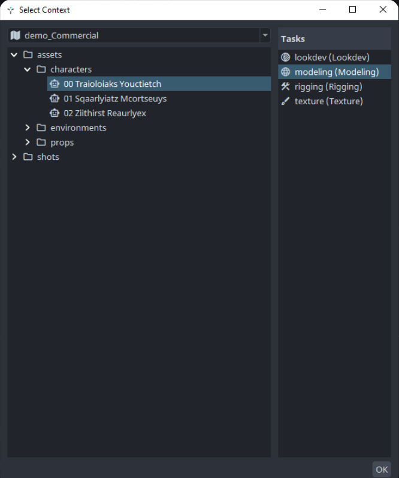

# Launcher administration

This page is for technical directors and administrators who run the AYON launcher from a terminal, in scripts or on a render farm. Its use by artists is described in [Launcher](launcher.md), and its development in [AYON launcher development](../developer/launcher/index.md).

## Executables

| Platform | Executable |
|---|---|
| Windows | `ayon.exe`, and `ayon_console.exe`, which opens a console with the output. `ayon.exe` has no console and no `stdout` or `stderr` output, so `ayon_console.exe` is the one for terminals and debugging. |
| Linux | `ayon` |
| macOS | `ayon` inside the app: `/Applications/AYON.app/Contents/MacOS/ayon` for the shim, which also waits for the launcher to finish. |

The commands on this page are run from the launcher's installation folder, or with the full path of the executable.

## Command line

```bash
ayon_console.exe [arguments] [command] [options]
```

The launcher reads its own **arguments** first. Everything else goes to the command line of the Core addon, which provides the **commands**. Without a command, the launcher starts the tray. A path to a Python script in place of a command runs that script in the AYON context, with the arguments after it:

```bash
ayon_console.exe /path/to/script.py arg1 arg2
```

### Arguments

| Argument | Effect |
|---|---|
| `--use-staging` | Staging mode: the staging bundle and settings. |
| `--use-dev` | Development mode: the dev bundle of the logged-in user. See [Developer mode](../developer/developer-mode.md). |
| `--bundle <name>` | Uses the named bundle instead of the one of the current mode, for example to test a bundle before release. See [How to use different bundles with different projects?](https://community.ynput.io/t/how-to-use-different-bundles-with-different-projects/1096) on the forum. |
| `--project-bundle <name>` | Uses the named bundle as the project bundle. |
| `--project <name>` | Sets the project of the session. |
| `--ayon-login` | Shows the login dialog, to change the server or the user. Cannot be combined with `--headless`. |
| `--headless` | Shows no UI while the launcher starts. |
| `--verbose <level>` | Log level: `NOTSET`, `DEBUG`, `INFO`, `WARNING`, `ERROR`, `CRITICAL`, or a number. |
| `--debug` | Debug mode, with the `DEBUG` log level unless another level is set. |
| `--skip-headers` | Leaves out the headers in the console output. |
| `--skip-bootstrap` | Skips the bootstrap (updates and addon preparation). |
| `init-ayon-launcher` | Deploys the shim and registers the `ayon-launcher://` protocol scheme, then exits. The installer runs it. |

The launcher sets environment variables from these arguments, such as `AYON_USE_STAGING`, `AYON_USE_DEV` and `AYON_LOG_LEVEL`. The full list is in [Environment variables](../developer/launcher/index.md#environment-variables).

### Commands

The commands of the Core addon. `--help` after a command lists its options.

| Command | Options | What it does |
|---|---|---|
| `tray` | `--force` closes a running tray first | Starts the tray. This is also what happens without a command. |
| `publish <JSON_PATH>` | `-t`, `--targets` | Publishes from a JSON file, as publish jobs on a render farm do. |
| `publish-report-viewer` | | Opens the [Publish report viewer](launcher.md#publish-report-viewer). |
| `browser` | | Opens the [Browser](browser.md). |
| `contextselection <OUTPUT_PATH>` | `--project`, `--folder` (needs `--project`), `--strict` (the dialog can only be closed with a full context) | Opens the **Select Context** dialog and writes the chosen context to a JSON file. |
| `run <SCRIPT_PATH>` | Arguments for the script | Runs a Python script in the AYON context, like passing the script path directly. |
| `interactive` | | Opens an interactive Python console in the AYON context. Does not work with `ayon.exe` on Windows. |
| `create-project-structure` | `--project` (required) | Creates the project folders set in the Core addon setting **Project folder structure**. |
| `deliver` | `--project` (required), and `--event_id` or `--version_ids` | Opens the delivery dialog for versions. |
| `version` | `--build` | Prints the launcher version. Deprecated. |

<Columns widths="60 40">
<Column>

For example, a script can ask the user for a context and read it from the JSON file:

```bash
ayon_console.exe contextselection --project demo_Commercial --strict /tmp/context.json
```

</Column>
<Column>



</Column>
</Columns>

### Addon commands

Addons can add commands of their own, reached with the `addon` command and the name of the addon:

```bash
ayon_console.exe addon <addon name> <command> [options]
```

`ayon_console.exe addon --help` lists the addons of the bundle that have commands, and `ayon_console.exe addon <addon name> --help` lists their commands. The commands of an addon are described on its page. These addons add commands:

| Addon | Name on the command line |
|---|---|
| [Applications](../addons/essentials/applications/index.md) | `applications` |
| [ArchivalTool](../addons/pipeline-features/archival-tool/index.md) | `archival_tool` |
| [Batch delivery](../addons/pipeline-features/batch-delivery/index.md) | `batchdelivery` |
| [BatchIngest](../addons/pipeline-features/batch-ingest/index.md) | `batchingest` |
| [Deadline Cloud](../addons/farm-managers/deadline-cloud/index.md) | `deadline_cloud` |
| [Open RV](../addons/review-and-media-players/open-rv/index.md) | `openrv` |
| [Review Desktop](../addons/production-tracking/review-desktop/index.md) | `review_desktop` |
| [SiteSync](../addons/pipeline-features/sitesync/index.md) | `sitesync` |
| [Slater](../addons/pipeline-features/slater/index.md) | `slater` |
| [TrayPublisher](../addons/essentials/traypublisher/index.md) | `traypublisher` |
| [Web Publisher](../addons/pipeline-features/web-publisher/index.md) | `webpublisher` |
| [Workflow](../addons/automation/workflow/index.md) | `workflow` |
| [ZBrush](../addons/3d-applications/zbrush/index.md) | `zbrush` |

For example, the Applications addon starts an application in a context:

```bash
ayon_console.exe addon applications launch --project <project> --folder <folder path> --task <task> --app <application>
```

## Shared launcher storage

The launcher storage, with the downloaded addons and dependency packages, can be shared between machines of the same operating system with the `AYON_LAUNCHER_STORAGE_DIR` environment variable. See [Artist workstation setup](../ayon/workstation-setup.md) and the forum guide [Use a shared location for the launcher and addons](https://community.ynput.io/t/use-shared-location-for-ayon-launcher-and-addons/1175).

## Version numbers of custom builds

AYON uses [semantic versioning](https://semver.org/) for the launcher and the addons. A studio that changes the source code adds its own name and number after the version instead of reusing it, for example `1.0.0+yourstudio.1` for a change to `1.0.0`.

## Related

- [Launcher](launcher.md)
- [AYON launcher development](../developer/launcher/index.md)
- [Artist workstation setup](../ayon/workstation-setup.md)
- [Bundles](../ayon/how-ayon-works/bundles.md)
