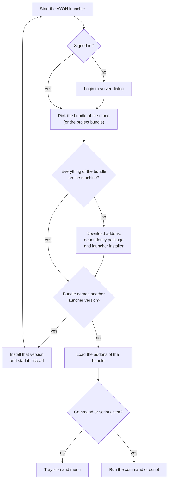

# AYON launcher

The AYON launcher is the desktop application that connects a workstation, or a render node, to the AYON server. It is the only part of the pipeline that has to be put on a machine, whether by its installer, by the studio's software deployment or as a shared installation: the addons, their dependencies and even newer launcher versions come from the server, as defined by the active bundle. For artists, the launcher is where work starts: it opens an application in the context of a task, with the environment, the folder and the scene already prepared. The tray menu and the Launcher window are described in [Tray and Launcher window](tray-and-launcher-window.md).

## One install, everything else from the server

A workstation gets the launcher once, usually downloaded from the AYON server (see [Artist workstation setup](../ayon/workstation-setup.md#ayon-launcher) for installation and shared storage). From then on, the [bundle](../ayon/how-ayon-works/bundles.md) of the launcher's mode decides what runs on the machine:

- the launcher version;
- the addons and their versions;
- the dependency package with the Python libraries the addons need;
- third-party binaries such as FFmpeg and OpenImageIO, delivered by the [3rd party binaries addon](../addons/essentials/3rd-party-binaries/index.md).

Changing a bundle on the server therefore changes every workstation that uses it, without anyone installing anything on the machines. Missing pieces are downloaded into the launcher storage when the launcher starts; versions already on the machine are reused. The details of how a bundle is picked and installed are in [How a workstation picks and installs its bundle](../ayon/how-ayon-works/bundles.md#how-a-workstation-picks-and-installs-its-bundle). Administrators upload the launcher installers to the server on the [Bundles](../ayon/web-ui/studio/bundles.md#launchers-and-dependency-package-uploads) page; the official builds are published on the [ayon-launcher releases](https://github.com/ynput/ayon-launcher/releases) page on GitHub.

### Start-up

The launcher stops with a message when no bundle is set for its mode on the server. The **Disk mapping** setting of the [Core addon](../addons/essentials/core/settings.md#general) is applied during start-up as well, so a share can be made available under a drive letter before any addon runs.

### Updates while the tray runs

The launcher updates itself on every start: when the bundle names another launcher version, it starts that version, and downloads and installs it first if it is missing. A tray that keeps running for days still learns about a new bundle:

- it checks the bundle of its mode on start, on the interval set by **Update check interval (minutes)** in the [Core addon settings](../addons/essentials/core/settings.md#general) (default 5; `0` switches the periodic check off), and right away when the server reports that a bundle was created, changed or got another status;
- when the bundle assigned to the mode is no longer the one running, the tray shows the **AYON update** dialog and the **Restart & Update** menu entry, which restart the launcher with the new bundle (see [Tray menu](tray-and-launcher-window.md#tray-menu)).

Launcher in development mode is not checked, since developers change their bundle on purpose.

## Launching in context

The main job of the launcher for an artist is to start an application for a project, folder and task. Artists pick the task in the [Launcher window](tray-and-launcher-window.md#launcher-window), or in the web app, and click the application. Before the application starts, AYON prepares:

- **The environment**, from the [Applications addon](../addons/essentials/applications/index.md): the global and project environment of the Core addon, the application group and variant, and the tools selected for the folder, task type or task. Which application variants are offered at all depends on the task type, so an animator and a compositor see different applications. The color management environment is set here too, see [Color management on launch](color-management-on-launch.md).
- **The work directory** of the task, resolved from the work template of the [project anatomy](naming-conventions.md) and created if needed.
- **The scene to open**: the last workfile of the task, by default (Core setting **Open last workfile on launch**), or a workfile selected in the Launcher window. When the task has no workfile yet, a new scene can be built from a workfile template, see [Templated workfile builder](template-builder.md#when-a-build-happens).

The launch hooks that prepare this come from Core, Applications, the host integration and any other addon in the bundle. The application group carries a host name, the integration to install: an application defined as an additional application has none, so it starts in the task environment but without AYON tools inside. Inside the application, the integration then reads the same context, so the pipeline tools know which project, folder and task they work in. This is why artists don't set paths or environment variables by hand, and why every artist on a task gets the same setup.

The same launch is available without the window: as an action in the web app (see below), and on the command line through the Applications addon commands (see [Launcher command line](launcher-command-line.md#addon-commands)).

## Production, staging and development modes

The launcher runs in one of three modes. The mode decides which bundle it uses and which settings variant it reads, and it is shown by the tray icon.

| Mode | What it is for | Started with | Tray icon |
|---|---|---|---|
| Production | Everyday work. Every workstation and farm machine uses it unless told otherwise. | Default |  Green triangle |
| Staging | Testing a new bundle, for example new addon versions or settings, on a few machines before it becomes the production bundle. | `--use-staging` or `AYON_USE_STAGING=1` |  Orange triangle |
| Development | Addon development: each developer runs their own dev bundle, which can load addon code from a local folder. | `--use-dev`, `AYON_USE_DEV=1`, or the name of a dev bundle |  White triangle |

Staging is never derived from a bundle name; it must be requested on each machine, for example with a separate desktop shortcut. The usual roll-out of a change through staging is described in [Adding an addon to production](../ayon/how-ayon-works/bundles.md#adding-an-addon-to-production), the bundle that each mode uses in [Bundle modes](../ayon/how-ayon-works/bundles.md#bundle-modes), and dev bundles in [Developer mode](../developer/developer-mode.md). The arguments are listed in [Launcher command line](launcher-command-line.md#arguments), the environment variables in [AYON launcher development](../developer/launcher/index.md#environment-variables).

## Web app actions run on the workstation

The web app shows actions for a selected entity, for example the application actions of a task in the [details panel](../ayon/web-ui/details-panel.md). Starting an application needs the workstation, so the web app hands such actions to the launcher through the `ayon-launcher://` protocol, which the launcher registers on the machine when it is installed (see [The shim](../developer/launcher/index.md#the-shim)).

The launcher then:

1. takes the action from the server, including the user who started it and the bundle mode of the web app;
2. signs in as that user, asking for the login if the machine has no stored sign-in for that server;
3. starts a new launcher process with the action's arguments, in the mode that matches the web app's bundle mode (production, staging, or the user's dev bundle);
4. reports back to the server whether the action finished or failed.

The tray does not have to be running for this. The Launcher window lists the same server actions, see [Actions pane](tray-and-launcher-window.md#actions-pane).

:::note The launcher has to run once
The shim and the `ayon-launcher://` protocol are set up by the launcher itself: the installer does it at the end of the installation, and the launcher repeats it on every start. On a machine where the launcher was not installed with its installer, for example a shared installation, web actions work only after the launcher has been started there at least once.
:::

## Scripts and the farm

The launcher also runs without a user interface, which makes it the entry point for automation and render farms:

- **Headless runs**: the `--headless` argument keeps the start-up from showing any window.
- **Publishing from JSON**: farm jobs publish their output with the `publish` command, which reads the publish data from a JSON file. How farm jobs use the launcher is described in [Farm](farm.md).
- **Scripts in the AYON context**: a Python script passed to the launcher, or run with the `run` command, runs with the addons of the bundle loaded and the connection to the server ready.
- **Addon commands**: addons add their own commands, for example to launch an application or to write the environment of a context to a file for a farm job (see [How render nodes get the task environment](farm.md#how-render-nodes-get-the-task-environment)).

The commands, arguments and addon commands are listed in [Launcher command line](launcher-command-line.md).

## Related

- [Tray and Launcher window](tray-and-launcher-window.md): the tray menu and the Launcher window.
- [Launcher command line](launcher-command-line.md): the executables, arguments, commands and addon commands.
- [Artist workstation setup](../ayon/workstation-setup.md): installing the launcher, its folders and shared storage.
- [Bundles](../ayon/how-ayon-works/bundles.md) and [Site IDs](../ayon/how-ayon-works/site-ids.md).
- [Applications addon](../addons/essentials/applications/index.md).
- [Farm](farm.md): how farm jobs run the launcher on render nodes.
- [AYON launcher development](../developer/launcher/index.md): building the launcher, the shim and the environment variables.
