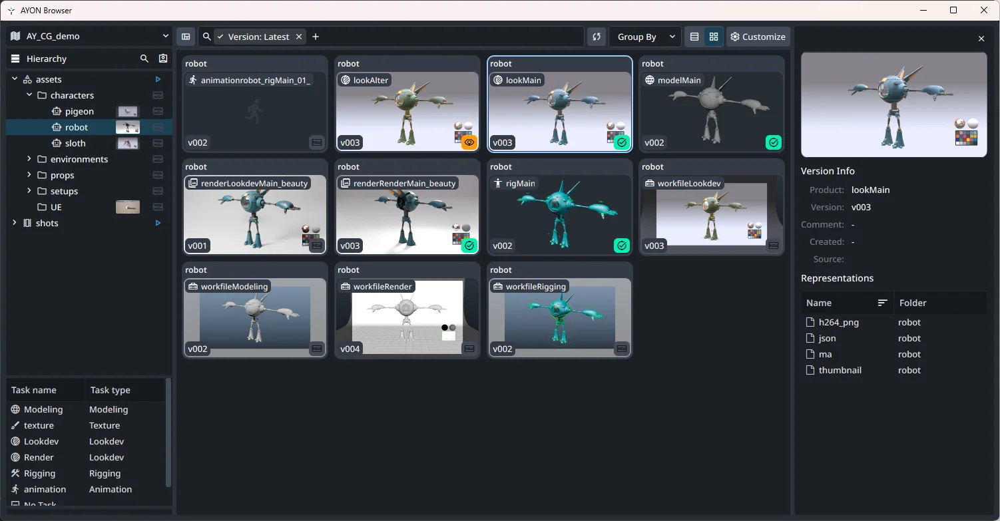

import FeaturedVersionRules from '../_shared/featured-version-rules.md';

# Loader

<PageInfo />

Loading is how work moves between departments. A lighter does not open the animator's scene; the lighter loads the published animation cache, and the scene keeps a record of exactly which product, version and representation it came from. That record is what lets AYON tell an artist that a newer version exists, swap a proxy for the full asset, or rebuild a scene from a template. The Loader is where this starts: it lists what a project has published and runs actions on it.

The Loader is one tool that works in two places:

- **Inside an application**, from **Load...** in the AYON menu, it is the loader: it adds the load actions of the integration (load, reference, import and so on) and shows which versions are already in the scene. The result of a load is a container in the scene, which the [Scene Inventory](scene-inventory.md) manages afterwards.
- **From the tray**, as **Browser**, it runs without an application. The load actions of an integration don't apply there, and the filters already cover most of the browsing, so the Browser adds its own actions instead: delivering files, creating hero versions, deleting old versions and opening the workfile a version came from.

Everything else, the table, the filters, the views and the general actions such as copying a file path, is the same in both. The table, filters and saved views are shared with the web app's [Products page](../ayon/web-ui/production-tracking/products.md), so a view built once can be used on both sides.

## Where it opens

| Item | Value |
|---|---|
| Inside an application | **Load...** in the AYON menu (and **Library...** in integrations that have it). The window title is **AYON Browser**, followed by the host name. |
| Tray menu | **Browser**. See [Tray and Launcher window](tray-and-launcher-window.md). The window title is **AYON Browser**. |
| Command line | `ayon browser` (`ayon_console.exe browser` on Windows). |

| | Inside an application | From the tray |
|---|---|---|
| Projects | The project of the current context and library projects | All active projects |
| Load actions of the integration | Yes | No |
| **In Scene** column and filter | Yes | No |
| **Go to current context** button | Yes | No |
| Tray-only actions (delivery, hero versions, deleting versions, opening the source workfile) | No | Yes |

A project becomes available for loading in other projects by being marked as a library project in the project settings of the web app.

## Layout

The window has three resizable panels: the slicer on the left, the version table in the middle and the inspector on the right.

### Slicer

| Control | What it does |
|---|---|
| Project selector | Chooses the project. |
| Category selector | Chooses what the tree shows: **Hierarchy** (`HIE`), **Reviews** (`REV`) or **Lists** (`LIS`). |
| Search toggle | Replaces the category selector with an input **Search** that filters the tree by words. Closing it clears the text. `Esc` closes it. |
| My tasks toggle | Hierarchy only. Shows only folders that have a task assigned to the signed in user. Tooltip: "Only show folders that have a task assigned to you." |
| Go to current context | Hierarchy only, inside an application with a project and folder context. Selects the current folder. Tooltip: "Select the current context in the hierarchy". |
| Tree | Folders of the project with a status column and thumbnails, or the entity lists. Several rows can be selected. |
| Task list | Hierarchy only. Columns **Task name** and **Task type** for the selected folders. Selecting tasks sets the **Task** filter of the table. |
| Progress indicator | Shows the background fetches that are running. |

| Category | Tree content | Versions shown |
|---|---|---|
| **Hierarchy** | The folder hierarchy | The versions published in the selected folders. |
| **Reviews** | Entity lists of the type review session | The versions in the selected review sessions. |
| **Lists** | All entity lists of the project, nested in their list folders, newest first | The versions of the selected lists. |

The data of **Reviews** and **Lists** is always shown as a flat version list, without grouping.

### Table toolbar

| Control | What it does |
|---|---|
| **Views** selector | Applies, saves and manages views (see below). |
| Filter bar | Filters rows by criteria. |
| **Refresh** | Reloads the table with the active filters. |
| **Group By** | Groups rows by a field. |
| Table and card toggle | Switches between **Table** and **Cards**. |
| **Customize** | Menu with display options. |

When nothing can be shown, an empty state explains why:

| Message | Meaning |
|---|---|
| **Select a project** | No project is selected. |
| **Select a folder to show versions or products** | A project is selected but no folder or list. |
| **No versions or products found** | The selection has no published versions. |
| **No versions or products match the active filters** | Rows exist, but the filters hide them. |

### Table

The table lists versions, one row each, in the form `<product> - <version>`. A hero version is written `★ (v003)`, with the number of the version it was made from. The initial filter is **Version** = **Latest**, so one version per product is listed. Rows load page by page while scrolling. With a grouping active, the table shows group header rows, and the versions of a group load when it expands.

The visible columns can be changed with the **+** button that appears at the right of the header on hover, or with **Customize** > **Columns**. The menu lists the built-in columns and, in a submenu **Attributes**, the attributes of versions, products, folders and tasks. A right click on a column header offers **Hide column**.

| Column | Visible by default | Content |
|---|---|---|
| **Thumbnail** | Yes | Thumbnail of the version. |
| **Product/Version** | Yes | Product name and version. |
| **Status** | Yes | Version status with color and icon. |
| **Product Base Type** | No | Product base type. |
| **Product Type** | Yes | Product type. |
| **Folder** | No | Folder of the product. |
| **Author** | Yes | The user who published the version. |
| **Time** | Yes | Publish time. |
| **Version** | Yes | Version label. |
| **Product Name** | No | Product name. |
| **Task Type** | No | Task type of the version task. |
| **Task** | No | Task of the version. |
| **Tags** | No | Version tags. |
| **Frame Start**, **Frame End**, **Handle Start**, **Handle End**, **Step** | Yes | Frame range attributes of the version. |
| Attribute columns | No | Other attributes of versions, products, folders and tasks, for example fps or resolution. |
| **In Scene** | No. Inside an application only | **Yes** (green) when the version is loaded in the open scene, **No** (grey) otherwise. For group rows of the **Product** grouping it says whether any version of the product is loaded. |
| **Active Site**, **Remote Site** | Optional | With Site Sync, see [Site Sync](#site-sync). |

The **Reviews** and **Lists** categories have the same columns without **Folder** and **Task**.

### Filter bar

The filter bar combines criteria. A criterion has a field, values, and can exclude instead of include; text fields can match substrings. Fields are grouped by entity.

| Entity | Fields |
|---|---|
| Product | **Name**, **Type**, **Base Type**, **Status** |
| Version | **Status**, **Version** (`Latest`, `Latest Done`, `Hero`, see [Featured version](#featured-version)), **Author**, **Has Reviewables** (**Yes**, **No**), **Tags**, and **In Scene** (**Yes**, **No**) inside an application |
| Folder | **Name**, **Status**. Only offered when the server can filter versions by folder. |
| Task | **Task**, **Type**, **Status**, **Tags** |
| Representation | **Name**, **Extension**, **Status**, **Tags**. Only offered when the server can filter versions by representation. |
| Attributes | Attributes of each entity, except date attributes. Boolean attributes offer **Yes** and **No**. |
| Site Sync | **Active Site** and **Remote Site**, see [Site Sync](#site-sync). |

Tags and some text fields offer "has value" and "no value" choices where a field can be empty.

### Group By

The menu lists built-in fields and attributes. A search field at the top finds options by name. Selecting the active option again removes the grouping.

| Option | Groups by |
|---|---|
| **None** | No grouping. |
| **Product** | Product. The group row shows the [featured version](#featured-version). |
| **Status** | Version status. |
| **Tags** | Version tags. |
| **Task type** | Task type. |
| **Product type** | Product type. |
| Attributes | Version attributes and product attributes of the types boolean, date and time, float, integer and string, in submenus. |

### Featured version

When the versions are grouped by **Product**, each product row and card shows its featured version: the version that stands for the product, as on the [Products page](../ayon/web-ui/production-tracking/products.md#featured-version) of the web app. **Customize** > **Featured Version** sets the order of the rules that choose it, Latest Done, Latest, Hero by default; the first rule a product matches wins. Actions on a selected product row run on its featured version. The same three values are offered by the **Version** filter.

<FeaturedVersionRules />

### Customize

| Option | Applies to | What it does |
|---|---|---|
| **Featured Version** | **Group By** > **Product** | Order of the rules that choose the [featured version](#featured-version) of a product: **Latest Done**, **Latest**, **Hero**. Default order: Latest Done, Latest, Hero. |
| **Columns** | Table | Opens the column menu. |
| **Card size** | Cards | Card width, 150 to 500. Default 200. |
| **Row height** | Table | Row height, 24 to 160. Default 34. |
| **Show empty groups** | Grouping | Lists groups without any version. Off by default. |
| **Leave blank values ungrouped** | Table | Versions that have no value for the grouped field stay below the groups instead of forming a group. On by default. The cards view always uses a group of their own. |
| **Latest per folder** | Table and cards | Shows one version per folder: the latest published one. Disabled while grouped by product. |
| **Show versions from child folders** | Hierarchy and Lists | Includes versions from folders below the selected folders. |
| **Group loaders** | Context menu | How the context menu lists loaders that load per representation: **Ungrouped** (an entry per loader and representation), **Grouped** (a submenu per loader listing its representations) or **Group if multiple** (a submenu only for loaders that can load more than one representation). |

### Cards

The cards view shows one card per version. A card has the folder name as header, the product name with the icon and color of its product type, the status icon, the version and the thumbnail.

### Views

A view stores the column set and order, sort, row height, grouping, filters, display type, card size, featured version order, latest per folder, child folders and the my tasks filter. Views are stored on the AYON server per project (view type `desktop.browser`). The selector lists:

| Section | Content |
|---|---|
| **Working view** | The current working state of the user, with a reset control (**Reset to default**). |
| **My views** | Views of the signed in user. |
| **Shared views** | Views shared with the user. Sharing is a Power feature of the [Power Pack](../addons/production-tracking/power-pack/index.md). |
| **Default view** | Control that saves the current view as the default view of the project, or removes it. |
| **Create new view...** | Creates a view from the current state. |

Without a stored view, the defaults are the columns marked above, no grouping, sort by **Product/Version** ascending, the **Version** = **Latest** filter and the table display.

### Inspector

The inspector on the right shows the selection and can be closed with its close button. It reopens when a row is activated.

| Element | Content |
|---|---|
| Path | Path of the selected version (copyable). |
| Thumbnail | Thumbnail of the version, or a composite of several. |
| **Version Info** | **Product:**, **Version:**, **Comment:**, **Created:** (relative, with the exact time as tooltip) and **Source:**. With several versions selected, each field reads "N items selected". |
| **Representations** | Table with **Name** and **Folder** of the representations of the selected versions. Shared representation names of several versions form a tree. A context menu offers the representation actions. |

## Actions

A context menu on one or more selected version rows (and on representations in the inspector) lists the compatible actions, grouped in submenus by their group label and sorted by order. Entries with options show an options button that opens a dialog. When no loader fits, the menu says "No compatible loaders for this version." or "...your selection.". Results appear as messages, and some actions open a form.

A selected group header stands for all versions of the group, except a **Product** group header, which stands for its featured version. When the selected groups hold more than 500 versions, the dialog **Many versions selected** asks before the actions are collected.

| Action | Available | What it does |
|---|---|---|
| Loaders of the integration | Inside an application | Loads, references or imports the version in the scene. A failed load shows the **Loading failed** box with the product, representation, version and error of each failed item. |
| **Open file** | Both | Opens a representation file with the application associated with its extension. One entry per representation name. |
| **Copy file path**, **Copy file** | Both | Copies the path or the file of the representation to the clipboard. |
| **Push to project** | Both | Starts the push-to-project tool for versions of a single folder. |
| **Download**, **Upload**, **Remove from local** | Both, with Site Sync | See [Site Sync](#site-sync). |
| **Open Source Workfile** | From the tray | Offers the applications that can open the workfile that the version was published from (the `source` attribute of the version), and starts the chosen one with that workfile, in the task of the version. Needs a version with a task and a source file on disk. Provided by the Applications addon. |
| **Deliver Versions** | From the tray | Opens the delivery dialog (see below). |
| **Export OTIO** | From the tray | Exports an OpenTimelineIO file for the selected versions. |
| **Create Hero Version** | From the tray | Creates the hero version of the selected version (one version at a time). |
| **Delete Versions** > **Old versions** | From the tray | Deletes older versions of the selected products. |
| **Delete Versions** > **Selected versions** | From the tray | Deletes the selected versions. |
| **Calculate Versions size** | From the tray | Shows the total file size of the versions beyond the number of versions to keep. |

### Product groups

`Ctrl+G` opens the dialog **Grouping products** with **Group Name**, an option list of existing groups and **Apply**. An empty name removes the group. The group is the `productGroup` attribute of the product, so it is shared by all users of the project. If the access groups of the user restrict writing of attributes in the project and exclude `productGroup`, the dialog is replaced by the message "You don't have permissions to set the product group attribute". Admins, managers and services can always change it.

### Delivery

**Deliver Versions** opens the dialog titled **Deliver N versions**. It copies the files of the selected versions, or of the versions of the selected representations, to a folder structure that a delivery template defines.

| Control | What it does |
|---|---|
| **Selected representations** | Count and size of the files that will be delivered. |
| **Delivery template** | Template from the `delivery` templates of the project anatomy. Only templates whose directory pattern starts with `{root` are offered. The patterns are shown as **Directory template** and **File template**. |
| **Representations** | Checkable list of representation names. **Select All** checks all. |
| **Advanced options** | Collapsed by default. **Renumber Frame** with **Renumber start frame** renumbers frame sequences. **Root** is the root path that fills the `{root` part of the template. **List label** fills the `list[label]` key of the template. |
| **Deliver** | Copies the files and shows a report. Representations that fail are skipped and the report lists the reason. |

How delivery templates are written is described in [Naming conventions](naming-conventions.md#delivery).

### Delete versions

| Step | Content |
|---|---|
| **Versions to keep** | For **Old versions**: how many of the latest versions per product stay (default 2, minimum 0). Hero versions are kept unless the number is 0. |
| **Remove publish folder** | Removes the whole publish folder of each version instead of only the files of its representations. |
| Confirmation | The form lists the number of versions and the total file size and requires typing `delete`. |

The action deletes the files, the representation entities and the version entities, and then the products that are left without versions. **Selected versions** refuses hero versions with the message "Hero versions cannot be deleted.".

## Site Sync

With the [Site Sync addon](../addons/pipeline-features/sitesync/index.md) enabled for the project, files of a representation can exist on some sites and not on others, for example on the studio storage but not yet on a freelancer's local drive. The Loader then shows where each representation is available and can move it.

The **active site** is the site of this machine, the one the files are used from. The **remote site** is the other side of the synchronization, for example the studio server or a cloud storage.

| Element | What it shows or does |
|---|---|
| **Active Site**, **Remote Site** columns | Representations of the version available on each site as `available/total`, with the icon of the site. |
| **Active Site**, **Remote Site** filters | **Available**, **Partial** or **Unavailable** on that site. Applied to the rows already loaded. |
| **Download** | On representations that are on the remote site: marks them for download to the active site. |
| **Upload** | On representations that are on the active site: marks them for upload to the remote site. |
| **Remove from local** | On representations that are on the active site: removes them from the active site, files included. |

The actions appear on representations, in the inspector, and work on several selected representations at once. For a published workfile, **Download** and **Upload** also mark the representations that the workfile references (its input links), so the scene opens with its content on the other site too. A representation that is only on the remote site has to be downloaded before it can be loaded. The transfer itself is done by the sync server in the AYON tray, not by the Loader. The actions come from the Site Sync addon from Site Sync 1.4.1 with Core 1.10.7.

## Legacy loader interface

Before the current interface, **Load...** opened an older window with three panels: folders and tasks, a products tree with a version drop-down per product, and the version info with the representations. It is still available, and it is used when:

1. the AYON server is older than 1.15.0, which the current interface needs;
2. the environment variable `AYON_USE_LEGACY_LOADER` is `1` (`0` forces the current interface);
3. the core setting [Use legacy loader](../addons/essentials/core/settings.md#loader) is on (off by default).

The loader plugins of the integrations, the containers and the actions work the same way in both interfaces. Only the legacy interface reads the core setting **Product type filtering**, which presets its product type filter per host and task type.

## Server requirements

The current interface needs AYON server 1.15.0 or newer; older servers get the legacy interface. Some parts need newer servers and are left out on older ones:

| Feature | Server |
|---|---|
| Group header counts that follow the active filters (older servers show the counts of the grouping metadata) | 1.15.5 |
| **Folder** filters and **Latest per folder** (disabled with the tooltip "Requires AYON server 1.16.1 or newer") | 1.16.1 |
| **Representation** filters | 1.16.7 |

## Tool settings

Tool settings are set in the studio settings and can be overridden per project. The Loader is set up in the Core addon settings under [Tools > Loader](../addons/essentials/core/settings.md#loader):

- **Use legacy loader** switches to the legacy interface.
- **Actions** hides individual core actions (open file, copy file path, copy file, delete old and selected versions, calculate versions size, create hero version), see [Loader actions](../addons/essentials/core/index.md#loader-actions).
- **Product type filtering** applies to the legacy interface only.

Other settings that change what the Loader offers:

- The loader plugins of an integration are enabled, disabled and configured in the settings of its addon. Disabled loaders are not listed.
- The `delivery` templates of the project anatomy are the choices of the delivery dialog.
- Access groups can restrict the attributes a user may write, which includes the product group.

## Related

- [Scene Inventory](scene-inventory.md): manages what was loaded.
- [Workfiles](workfiles.md), [Publisher](publisher.md): other tools of the AYON menu.
- [Product types](product-types.md): the kinds of products that are listed.
- [Site Sync addon](../addons/pipeline-features/sitesync/index.md).
- [Tray and Launcher window](tray-and-launcher-window.md): the tray menu entry **Browser**.
- [Pipeline tools](pipeline-tools.md): overview of all desktop tools.
- [Products page](../ayon/web-ui/production-tracking/products.md) of the web app, which uses the same kind of table.
