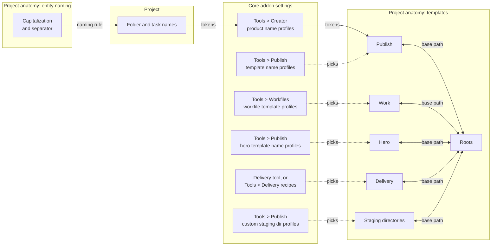

import naming from "@site/src/data/templates/naming.json";

# Naming conventions

In an AYON pipeline nobody types a file name or a path. Names are calculated from settings and from the context of the work, so every tool can find a file again from its context alone. Two groups of settings decide them, and both can differ per project:

- **The [project anatomy](../ayon/web-ui/project/anatomy.md)** names things and holds the templates: how folders and tasks are named, the roots, and named path templates for workfiles, publishes, hero versions, deliveries and staging directories.
- **The [Core addon settings](../addons/essentials/core/settings.md)** decide how products are named, and which anatomy template is used where.

The graph shows how they connect. Solid arrows show where a name or a value goes; dashed arrows show which template a setting picks.

The same links, part by part:

| Project anatomy | Core addon tool settings | How they connect |
|---|---|---|
| [Entity naming](../ayon/web-ui/project/anatomy.md#entity-naming) | None | Shapes the names of folders and tasks from the labels typed in the web app. |
| None | [**Tools > Creator**: product name profiles](#product-naming) | Builds the product name from tokens such as the folder and task names. |
| [Publish templates](#publish) | **Tools > Publish**: template name profiles | The profiles pick the template. The product name, the version, the folder path and the other tokens fill it. |
| [Work templates](#workfiles) | **Tools > Workfiles**: workfile template profiles | The profiles pick the template. |
| [Hero templates](#hero-versions) | **Tools > Publish**: hero template name profiles | The profiles pick the template. |
| [Delivery templates](#delivery) | The Delivery tool, or **Tools > Delivery** recipes | The artist or the recipe picks the template. |
| [Staging directory templates](#staging-directories) | **Tools > Publish**: custom staging dir profiles | The profiles pick the template. |
| [Others](#others) | None | Addons and studio tools read these templates by name. |
| [Roots](../ayon/web-ui/project/anatomy.md#roots) | None | The base path at the start of every template. |

## Folder and task names

:::tip Entity naming
The web app suggests each name from the label typed when a folder or task is created, following **Entity Naming** in the project anatomy: the capitalization and the separator between words. See [Entity Naming](../ayon/web-ui/project/anatomy.md#entity-naming) and the [rules every name follows](../ayon/how-ayon-works/entities.md#names-labels-and-paths).
:::

The pipeline uses the names of folders and tasks, never their labels. Together with the folder path, they are tokens of product names and file paths:

| Token | Value | Example |
|---|---|---|
| `{project[name]}`, `{project[code]}` | Project name and code | `my_project`, `mp` |
| `{folder[name]}` | Folder name | `sh010` |
| `{folder[type]}` | Folder type | `Shot` |
| `{hierarchy}` | Folder path without the folder name | `shots/sq01` |
| `{task[name]}` | Task name | `lighting` |
| `{task[type]}`, `{task[short]}` | Task type and its [short name](../ayon/web-ui/project/anatomy.md#task-types) | `Lighting`, `lgt` |

A folder or task renamed during production gets the new name in new files. Files saved or published before keep the old one, and the Workfiles tool looks for workfiles in the directory of the new name.

## Product naming

<SettingLocation uri="ayon+settings://core/tools/creator/product_name_profiles" scope="Studio, with project overrides" />

A product is named when an artist creates it in the [Publisher](publisher.md): the creator fills a template with the variant the artist typed (`Main` by default) and the context. The template comes from **Product name profiles** in the Core addon settings, under [Tools > Creator](../addons/essentials/core/settings.md#creator). Each profile has filters (**Product base types**, **Product types**, **Host names**, **Task types**, **Task names**) and a **Template**; the profile that matches the most filters wins, and an empty filter matches anything. Without a matching profile the name is `{family}{Variant}`. The **product base type** is the generic kind a creator defines, such as `model` or `render`; the **product type** equals it unless the creator sets another, and profiles can filter on either.

| Token | Value | Example |
|---|---|---|
| `{product[type]}`, `{product[basetype]}` | Product type and base type of the creator | `model` |
| `{variant}` | The variant typed in the Publisher | `Main` |
| `{folder[name]}`, `{task[name]}`, `{task[short]}` | From the [folder and task names](#folder-and-task-names) | `sh010`, `lighting`, `lgt` |
| `{host[name]}` | Application | `maya` |
| Creator tokens | Extra values of some creators, such as `{aov}` or `{renderlayer}` | `beauty` |

Each token has three spellings that set the capitalization of its value: `{task[name]}` keeps it, `{Task[name]}` capitalizes the first letter, `{TASK[NAME]}` capitalizes all of it. A part in angle brackets is optional and is left out when a token in it has no value: `<_{Aov}>` adds `_Beauty` only for an AOV.

| Context (default settings, task `lighting`) | Template | Product name |
|---|---|---|
| Model in Maya, variant `Main` | `{product[type]}{variant}` | `modelMain` |
| Workfile in Maya | `{product[type]}{Task[name]}` | `workfileLighting` |
| Render in Nuke, AOV `beauty` | `{product[type]}{Task[name]}{Variant}<_{Aov}>` | `renderLightingMain_Beauty` |
| Static mesh of the asset `chair` | `S_{folder[name]}{variant}` | `S_chairMain` |

A render is published as one product per AOV, all in one product group named without the AOV (`renderLightingMain`). An AOV with an empty name drops the optional part, so that product is named like the group; whether the beauty pass comes with an empty AOV name depends on the host and the renderer. **Use legacy product names for renders**, in the same settings group and on by default, builds render names from the legacy logic instead of the profiles. The catalog of product types is in [Product types](product-types.md).

## How the anatomy and the Core settings work together

The project anatomy holds the path templates, grouped by what they are for, each with a **name**, a directory template and a file name template. The anatomy only defines them: a profile in the Core addon settings matches the context (host, task, product) and names the template to use. A template added to the anatomy is used only once a profile names it, and a profile that names a template the project's anatomy lacks makes saving or publishing fail.

Each section below pairs an anatomy group with the setting that picks from it. Every template starts with a [root](../ayon/web-ui/project/anatomy.md#roots), such as `{root[work]}`, so the same template resolves on every platform.

### Workfiles

| | |
|---|---|
| Template | [Work](../ayon/web-ui/project/anatomy.md#work) templates of the anatomy |
| Setting | **Workfile template profiles** in [Tools > Workfiles](../addons/essentials/core/settings.md#workfiles), by task type and host `ayon+settings://core/tools/Workfiles/workfile_template_profiles` |
| Default | `default` for every host, `unreal` for Unreal |

<!-- screenshot: Core addon settings, Tools > Workfiles > Workfile template profiles -->

<!-- screenshot: Anatomy tab, Templates > Work expanded with the default entry -->

The directory template gives the work directory of a task, the file name template the name of each workfile. The [Workfiles](workfiles.md) tool fills them when an artist saves:

| Token | Value |
|---|---|
| `{@version}` | The next free version in the work directory, `v001` for the first. **Version start** in the Core settings can start at another number. |
| `<_{comment}>` | The **Subversion** typed in the Workfiles tool, optional. |
| `{ext}` | The extension of the application. |

<!-- screenshot: Workfiles tool, Save As dialog with "fix" typed in the Subversion field and the resulting file name preview ending in _v012_fix.ma, showing that the Subversion fills {comment} -->

The default template gives `C:/projects/my_project/shots/sq01/sh010/work/lighting/mp_sh010_lighting_v012.ma`, or `..._v012_fix.ma` with the comment `fix`. The version of a workfile is independent of product versions, and the comment keeps snapshots of a version without moving the version on: saving again without a comment continues with `v013`. Each task needs its own work directory (the default ends with `{task[name]}`), otherwise two tasks share their files and version numbers. **Extra work folders**, in the same settings group, creates subfolders in the work directory.

### Publish

| | |
|---|---|
| Template | [Publish](../ayon/web-ui/project/anatomy.md#publish) templates of the anatomy |
| Setting | **Template name profiles** in [Tools > Publish](../addons/essentials/core/settings.md#publish-tool), by product base type, host, task type and task `ayon+settings://core/tools/publish/template_name_profiles` |
| Default | `default`; `render` for renders and reviews; `online` for the Tray Publisher's online files; a few application-specific ones, such as `maya2unreal` |

<!-- screenshot: Core addon settings, Tools > Publish > Template name profiles -->

<!-- screenshot: Anatomy tab, Templates > Publish expanded with the default entry -->

The directory template gives the folder of a version, the file name template the name of each file of its representations. The [product name](#product-naming) is the `{product[name]}` token:

| Token | Value |
|---|---|
| `{@version}` | The version number, chosen in this order: the version of the workfile when **Follow workfile version** is on (see [Publishing](publishing.md#version-numbers)), a version set on the instance, the latest version of the product plus one, or the first number from **Version start** (default 1). |
| `{representation}`, `{ext}` | The representation and its extension. |
| `{@frame}`, `{udim}` | The frame of a sequence and the UDIM tile. Sequences are renumbered to the frame padding. |
| `<_{output}>` | The output name of a review, optional. |
| `{originalBasename}`, `{originalDirname}` | The source file name and folder, for templates that keep them. |

The default template gives `C:/projects/my_project/shots/sq01/sh010/publish/model/modelMain/v003/mp_sh010_modelMain_v003.ma`. The `source` template publishes files in place, where they already are inside a project root, see [Publishing](publishing.md#publish-directory-or-in-place).

### Hero versions

| | |
|---|---|
| Template | [Hero](../ayon/web-ui/project/anatomy.md#hero) templates of the anatomy |
| Setting | **Hero template name profiles** in [Tools > Publish](../addons/essentials/core/settings.md#publish-tool) `ayon+settings://core/tools/publish/hero_template_name_profiles` |
| Default | `default` |

<!-- screenshot: Core addon settings, Tools > Publish > Hero template name profiles -->

<!-- screenshot: Anatomy tab, Templates > Hero expanded with the default entry -->

A hero version is a copy of the latest version in a folder without a version number, so scenes can reference one stable path: `.../publish/model/modelMain/hero/mp_sh010_modelMain_hero.ma`. It is made by **Integrate Hero Version** for the product types listed in its settings.

### Delivery

| | |
|---|---|
| Template | [Delivery](../ayon/web-ui/project/anatomy.md#delivery) templates of the anatomy |
| Setting | None by default: the person delivering picks the template in the delivery dialog of the [Loader](loader.md#delivery). From Core 1.10.9, **Delivery recipes** in Tools > Delivery give some representations their own template, for example EXRs and CCCs in a folder of their own, and can hide templates from the dialog. `ayon+settings://core/tools/delivery` |
| Default | No delivery templates |

<!-- screenshot: Delivery dialog of the Browser with the template list, or Core addon settings, Tools > Delivery recipes -->

<!-- screenshot: Anatomy tab, Templates > Delivery with an example entry -->

Delivery templates fill the same tokens as publish templates, plus the date and time of the delivery (for example `{yyyy}{mm}{dd}`) and the root picked in the dialog. A sequence needs `{frame}` in the file name template.

### Staging directories

:::caution Not supported by every host
Custom staging directories are not yet supported by every host integration addon. A host that does not support them keeps writing to its default staging directory, whatever the profiles say.
:::

| | |
|---|---|
| Template | [Staging directories](../ayon/web-ui/project/anatomy.md#staging-directories) templates of the anatomy |
| Setting | **Custom Staging Dir Profiles** in [Tools > Publish](../addons/essentials/core/settings.md#publish-tool), by host, task and product, each optionally persistent `ayon+settings://core/tools/publish/custom_staging_dir_profiles` |
| Default | No profile: a temporary folder that is removed after the publish |

<!-- screenshot: Core addon settings, Tools > Publish > Custom Staging Dir Profiles -->

<!-- screenshot: Anatomy tab, Templates > Staging directories with an example entry -->

The staging directory is where a publish writes its files before they are copied to the publish folder. A profile points chosen products to a template, for example to keep renders on the project storage, and a persistent one keeps the files after the publish.

### Others

| | |
|---|---|
| Template | [Others](../ayon/web-ui/project/anatomy.md#others) templates of the anatomy |
| Setting | None in the Core addon: an addon or a custom tool reads the template by its name |
| Default | No other templates |

Each entry of the Others group is a single template string rather than a directory and a file name. It is meant for addons and studio tools that need a path of their own, for example a cache or an export location, built from the same tokens as the other templates. Which names an addon expects is described on the page of that addon.

<!-- screenshot: Anatomy tab, Templates > Others with an example entry -->

## Try it

The name resolver holds the default product name templates of the Core addon and the default work, publish and hero templates of the project anatomy. Change the project, the context, the product or the file values, and each template shows its result, colored by the input each part comes from. A part in angle brackets drops out when its key is empty, and a missing key is listed in the Notes column.

<TemplateExplorer data={naming} />

## Unique paths

Work and publish templates have to give every context a path of its own. When two contexts share a path, their files overwrite each other and their version numbers mix.

- **Work templates** are unique with the project, the folder path and the task: `{project[name]}`, `{folder[path]}` (or `{hierarchy}/{folder[name]}`) and `{task[name]}`. A work directory shared by two tasks mixes their workfiles and version numbers, lets artists open another task's files in the wrong context, and makes it harder to limit who can access which files.
- **Publish templates** are unique with the project, the folder path, the product name and the version: `{project[name]}`, `{folder[path]}`, `{product[name]}` and `{@version}`. Without the version, files of different versions land in the same folder. `{product[type]}` is not needed for uniqueness, but it groups the products by type, which makes the folders easier to browse.

| Template | Directory template |
|---|---|
| Work, one folder per task | `{root[work]}/{project[name]}{folder[path]}/work/{task[name]}` |
| Work, the default | `{root[work]}/{project[name]}/{hierarchy}/{folder[name]}/work/{task[name]}` |
| Work, several applications per task | `{root[work]}/{project[name]}{folder[path]}/work/{task[name]}/{app}` |
| Publish, the default | `{root[work]}/{project[name]}/{hierarchy}/{folder[name]}/publish/{product[type]}/{product[name]}/{@version}` |

`{folder[path]}` starts with a slash, so it follows `{project[name]}` without one. `{app}` in a work directory gives each application its own folder, so when a task is worked on in Maya and in Blender the Workfiles tool of each lists only its own files.

:::caution Representations in a publish directory
The pipeline expects all files of a version in one directory, so a `{representation}` folder in the publish directory is not recommended: it breaks the resources folder of the version and can make linking or integration fail. If a studio still adds one, it has to be optional, `</{representation}>`. A farm render resolves the publish path when the job is submitted, before the representations exist, and resolves it again in the publish job on the farm.
:::

## Template syntax

| Syntax | Meaning |
|---|---|
| `{key}` | A value of the context. Nested keys use brackets, `{project[name]}`. Keys are case-sensitive in path templates. |
| `<...>` | An optional part, printed only when every key in it has a value, with the characters around the keys: `<_{udim}>` adds `_1001` or nothing. Optional parts can be nested, `<{key1}<.{key2}>>`, and the inner part is left out with the outer one. |
| `{@version}`, `{@frame}` | The version and frame number, formatted by the **Version template** and **Frame template** of the anatomy with their padding: `v003` and `1001` by default. |

Keys that only exist for some files, such as `{output}`, `{frame}`, `{udim}` or `{comment}`, belong in optional parts. A key without a value outside an optional part makes the template fail. Angle brackets without a key in them, such as `<draft>`, are not an optional part: they stay in the path as they are, and Windows does not allow `<` and `>` in file names. Changing the roots, the work template or the padding during production can leave the pipeline unable to find existing files.

## Token reference

Besides the tokens of the sections above, templates can use:

| Token | Value | Example |
|---|---|---|
| `{root[name]}` | The path of the named root on this platform | `C:/projects` |
| `{studio[name]}`, `{studio[code]}` | Studio name and code from the Core addon settings | `Acme Studio`, `acme` |
| `{folder[path]}`, `{parent}` | The full folder path, and the name of the parent folder (the project for top-level folders) | `/shots/sq01/sh010`, `sq01` |
| `{app}` | The application, the same as `{host[name]}` | `maya` |
| `{user[name]}`, `{user[attrib][...]}`, `{user[data][...]}` | Login name of the user, one of their attributes such as `{user[attrib][email]}`, or a value of their custom data set through the REST API | `jane` |
| `{product[name]}`, `{product[type]}`, `{product[basetype]}` | The product | `modelMain`, `model` |
| `{version}`, `{frame}` | The plain numbers behind `{@version}` and `{@frame}` | `3`, `1001` |
| `{colorspace}` | Colorspace of the representation, spaces replaced by `_` | `ACEScg` |
| `{renderlayer}`, `{aov}` | Render layer and AOV, for hosts that provide them | `lighting`, `beauty` |
| `{resolution_width}`, `{resolution_height}`, `{fps}` | Values of the representation or instance, when set | `1920`, `1080`, `24.0` |
| `{d}`, `{dd}`, `{ddd}`, `{dddd}` | Day: `1`, `01`, `Mon`, `Monday` | |
| `{m}`, `{mm}`, `{mmm}`, `{mmmm}` | Month: `1`, `01`, `Jan`, `January` | |
| `{yy}`, `{yyyy}` | Year: `26`, `2026` | |
| `{H}`, `{HH}`, `{h}`, `{hh}`, `{ht}` | Hour: 24-hour, 24-hour padded, 12-hour, 12-hour padded, `AM` or `PM` | |
| `{M}`, `{MM}`, `{S}`, `{SS}` | Minute and second, plain and padded | |

The date and time tokens are filled at publish and delivery time and are case-sensitive.

## Related

- [Anatomy](../ayon/web-ui/project/anatomy.md): entity naming, roots and the default templates of each group
- [Core addon settings](../addons/essentials/core/settings.md): the Creator, Workfiles, Publish and Delivery tools
- [Workfiles](workfiles.md)
- [Publishing](publishing.md)
- [Product types](product-types.md)
- [Storage](../ayon/how-ayon-works/storage.md)
