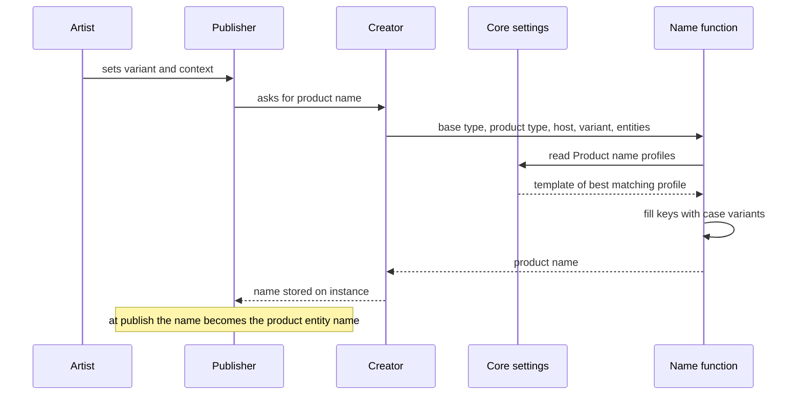
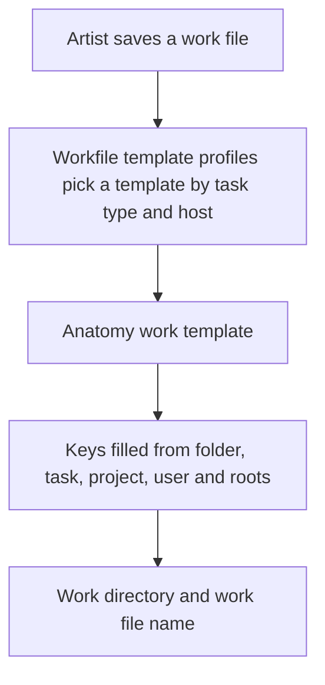
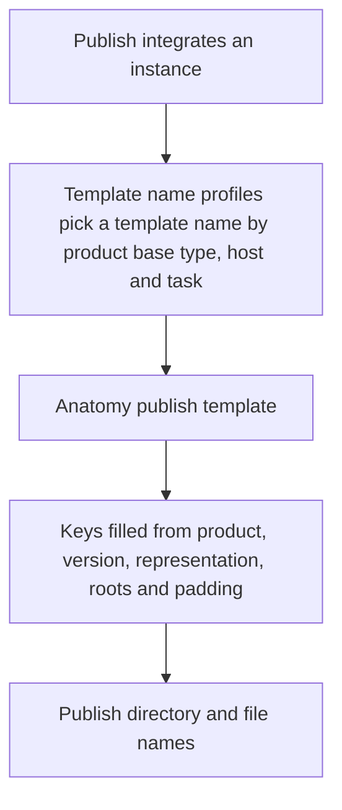
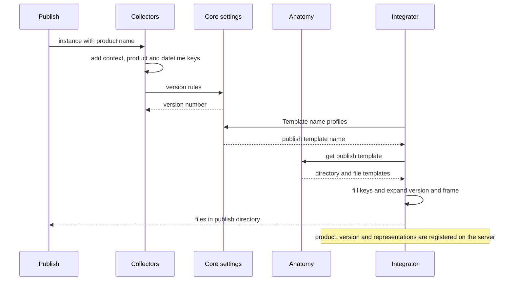

import naming from "@site/src/data/templates/naming.json";

# Naming conventions

AYON names things in two steps. The first step names the **product** and its **versions**: the creator in a host application fills a product name template with the variant, task, folder and product type. The second step names the **files and folders** on disk: anatomy templates turn the same context data into work directories, work file names, publish directories, publish file names, hero paths, delivery paths and staging directories. No name is typed by hand in the pipeline except the variant (and an optional comment); everything else is calculated from settings and context.

| Step | What is named | Configured in | Result |
|---|---|---|---|
| 1 | Product and version | Core addon settings, **Tools / Creator / Product name profiles**; version start and version-follow settings | Product name such as `modelMain`, version number such as `3` (shown as `v003`) |
| 2 | Work files, publish files, folders | Project anatomy (**Roots**, **Templates**); Core addon settings profiles that pick a template | Absolute paths such as `C:/projects/my_project/shots/sq01/sh010/publish/model/modelMain/v003/mp_sh010_modelMain_v003.ma` |

The two steps are linked: the product name produced in step 1 is the `{product[name]}` key that step 2 uses in publish paths. Both steps use the same template syntax (see [Template syntax](#template-syntax)).

## Step 1: product and version names

### Context data and the creator

A creator plugin is the code in a host integration (Maya, Nuke, Houdini, and so on) that defines one kind of product. When an instance is created, or when its variant, folder or task changes in the Publisher, the creator calls the product name function with:

- the project, the folder entity and the task entity of the target context,
- the **product base type** and **product type** of the creator,
- the host name (for example `maya`),
- the **variant** (user input, default `Main`),
- optional dynamic data supplied by the creator (for example `aov`, `renderlayer`, `Composition`).

The function picks a template from the **Product name profiles** and fills it. The result is stored on the instance as `productName` and later becomes the name of the product entity on the AYON server.

### Product base type and product type

| Term | Meaning |
|---|---|
| Product base type | The generic kind of a product, defined by the creator (for example `model`, `render`, `workfile`). Product name profiles, template name profiles, staging profiles and version start profiles filter on it. |
| Product type | The product type stored on the product entity. When the creator does not define a separate value it equals the product base type. |

Where a creator defines no product base type (older creator plugins), the product type is used in its place. The AYON server stores both values on the product; when the server does not store a base type, the base type is used as the product type. The server fills a missing base type with the product type. A **Product types** (appearance) group in the project anatomy only sets color and icon of base types in the web UI and does not influence names or paths; its default entries are `image`, `render`, `review`, `plate`, `camera`, `model`, `texture`, `look`, `rig`, `animation`, `cache`, `layout`, `setdress`, `groom`, `matchmove`, `vdbcache`, `lightrig`, `lut` and `workfile`.

See [Product types](product-types.md) for the catalog of product types.

### Product name profiles

Location: Core addon settings, **Tools / Creator / Product name profiles** (studio or project scope). Each profile has filters and a template.

| Field | Meaning |
|---|---|
| **Product base types** | Base types the profile applies to. Empty matches all. |
| **Product types** | Product types the profile applies to. Empty matches all. |
| **Host names** | Host names, for example `maya`, `nuke`. Empty matches all. |
| **Task types** | Task types of the project. Empty matches all. |
| **Task names** | Task names. Empty matches all. |
| **Template** | Product name template. Only letters, digits, `_`, `.`, `{`, `}`, `[`, `]`, `<`, `>` are allowed. |

Matching rules:

- Filter values are regular expressions that must match the whole value; `*` or an empty list means "any".
- A profile whose filter does not match is dropped. Among the remaining profiles the one matching the most filters wins; on a tie the earlier profile in the list wins (ties are compared in the order base type, product type, host, task name, task type).
- If no profile matches, or the matched template is empty, the fallback `{family}{Variant}` is used.
- The legacy keys `{family}`, `{task}` and `{asset}` in a template are converted to `{product[type]}`, `{task[name]}` and `{folder[name]}` before filling. (Note that when the fallback template is used directly, `{family}` resolves to the product base type.)

The profiles shipped as defaults:

| Filters | Template | Example for variant `Main`, task `lighting` |
|---|---|---|
| none | `{product[type]}{variant}` | `modelMain` |
| base type `workfile` | `{product[type]}{Task[name]}` | `workfileLighting` |
| base type `render` | `{product[type]}{Task[name]}{Variant}<_{Aov}>` | `renderLightingMain` or `renderLightingMain_Beauty` |
| base types `renderLayer`, `renderPass`, host `tvpaint` | `{product[type]}{Task[name]}_{Renderlayer}_{Renderpass}` | depends on dynamic data |
| base types `review`, `workfile`, hosts `aftereffects`, `tvpaint` | `{product[type]}{Task[name]}` | `reviewLighting` |
| base type `render`, host `aftereffects` | `{product[type]}{Task[name]}{Composition}{Variant}` | depends on dynamic data |
| base type `staticMesh`, host `maya` | `S_{folder[name]}{variant}` | `S_chairMain` |
| base type `skeletalMesh`, host `maya` | `SK_{folder[name]}{variant}` | `SK_heroMain` |
| base type `hda`, host `houdini` | `{folder[name]}_{variant}` | `rock_Main` |
| base type `textureSet`, host `substancedesigner` | `T_{folder[name]}{variant}` | `T_chairMain` |

Related settings in the same group:

| Setting | Meaning |
|---|---|
| **Use legacy product names for renders** | Default on. When on, product names of render products processed by the farm publishing logic are built as product base type + capitalized task + capitalized source name, and render templates in the profiles are ignored. Marked for removal. |
| **Create Smart Select** | Maps a product type to task names so the Publisher preselects that creator for those tasks. Does not affect names. |
| **Filter creator profiles** | Restricts which creators appear, per host, task type and task name, by creator label (regex supported). Does not affect names. |

### Product name keys

| Key | Meaning | Example |
|---|---|---|
| `product[type]` | Product type of the creator | `model` |
| `product[basetype]` | Product base type of the creator | `model` |
| `family` | Legacy; the product base type | `model` |
| `variant` | The variant typed or chosen in the Publisher (default `Main`; allowed characters `a-zA-Z0-9_.`) | `Main`, `High` |
| `task[name]` | Task name; filling fails with "Missing task" if the template uses it and no task is set | `lighting` |
| `task[type]` | Task type | `Lighting` |
| `task[short]` | Short name of the task type from the project anatomy | `lgt` |
| `folder[name]` | Folder name (not the path) | `sh010` |
| `folder[type]` | Folder type | `Shot` |
| `folder[label]` | Folder label, when available | `Shot 010` |
| `host[name]` | Host name | `maya` |
| creator keys | Extra keys supplied by a creator as dynamic data; they may override the keys above | `aov`, `renderlayer`, `camera`, `Composition` |

Each key exists in three spellings that control capitalization of the value: `{task[name]}` keeps the value, `{Task[name]}` upper-cases its first letter, `{TASK[NAME]}` upper-cases all of it. For the task `bgAnim`: `bgAnim`, `BgAnim`, `BGANIM`. A key whose value is missing breaks the template unless it is inside an optional part (angle brackets).

### Version numbers

Versions are integers on the product. The server displays them as `v` plus three digits (`v003`); version `0` is `v000`; a negative number is the hero version, displayed as `HERO`.

The version number of a new publish is chosen in this order:

1. The version number of the workfile, when the instance follows the workfile version. This is on for an instance when `followWorkfileVersion` is set on it, otherwise it takes the **Follow workfile version** value of **Publish plugins / Collect Anatomy Instance Data** (default off). It applies only to hosts listed in **Collect Version from Workfile** (default list: `aftereffects`, `blender`, `celaction`, `fusion`, `harmony`, `hiero`, `houdini`, `maya`, `nuke`, `photoshop`, `resolve`, `tvpaint`, `substancepainter`), which read the version from the saved file name; publishing fails when the file name has no version.
2. A version already set on the instance.
3. The latest existing version of the same product in the same folder plus 1.
4. The start version of the first matching profile of **Version start** (Core addon settings, filters host, task type, task name, product base type, product name; value `0` or higher). Without a matching profile the first version is `1`.

The same **Version start** profiles are used for the first version of a work file (with product base type `workfile`).

### Diagram: product name

Plain-text equivalent:

| Order | Who or what | Action | Data used | Result |
|---|---|---|---|---|
| 1 | Artist | Sets variant, folder and task in the Publisher | Variant text, selected context | Context of the instance |
| 2 | Publisher | Asks the creator for the product name | Variant, folder, task | Request |
| 3 | Creator | Calls the product name function | Product base type, product type, host name, entities, dynamic data | Function call |
| 4 | Name function | Reads **Product name profiles** and filters them | Base type, product type, host, task name, task type | Template of the best matching profile, or `{family}{Variant}` |
| 5 | Name function | Fills the template | `variant`, `task`, `folder`, `product`, `host`, dynamic data | Product name, for example `renderLightingMain_Beauty` |
| 6 | Publisher | Stores the name on the instance and recalculates it when variant, folder or task change | Product name | `productName` on the instance; the product entity name after publish |

### Worked examples: product names

Context for all rows: project `my_project`, folder `/shots/sq01/sh010`, task `lighting` of type `Lighting`, default settings.

| Host | Product base type | Variant | Dynamic data | Matching template | Product name |
|---|---|---|---|---|---|
| maya | `model` | `Main` | none | `{product[type]}{variant}` | `modelMain` |
| maya | `model` | `High` | none | `{product[type]}{variant}` | `modelHigh` |
| maya | `workfile` | `Main` | none | `{product[type]}{Task[name]}` | `workfileLighting` |
| nuke | `render` | `Main` | `aov` = `beauty` | `{product[type]}{Task[name]}{Variant}<_{Aov}>` | `renderLightingMain_Beauty` |
| nuke | `render` | `Main` | no `aov` | same; the optional part is dropped | `renderLightingMain` |
| maya | `staticMesh`, folder `/assets/chair` | `Main` | none | `S_{folder[name]}{variant}` | `S_chairMain` |
| houdini | `hda`, folder `/assets/rock` | `Main` | none | `{folder[name]}_{variant}` | `rock_Main` |
| maya | `camera` with task cleared | `Main` | none | `{product[type]}{variant}` | `cameraMain` (no task needed) |
| maya | `model` with a studio template `{product[type]}_{task[short]}_{variant}` and task type short name `lgt` | `Main` | none | custom | `model_lgt_Main` |

## Step 2: file and folder names

### Project anatomy

The project anatomy holds the storage definition of a project. Anatomy presets are defined in **Studio Settings / Anatomy Presets**; one is the primary preset. A new project copies the chosen preset; later preset changes do not reach existing projects. Studio-scope settings reference the primary preset, project-scope settings reference the project's own anatomy, so a template name defined in only one of them is not selectable in the other scope.

| Anatomy group | Content |
|---|---|
| **Entity Naming** | Capitalization and separator used to suggest folder and task names from labels |
| **Roots** | Named storage locations, one path per platform |
| **Templates** | Directory and file name templates, plus version and frame formats |
| Folder types, task types, statuses, tags, link types, product types | Entity vocabularies (the task type short name feeds `task[short]`) |

Changing roots, the default work template or version and frame formats during production can leave the pipeline unable to find existing work files and publishes.

### Entity naming

Entity naming suggests a folder or task name when a label is typed in the web app; the suggestion can be overwritten as long as the name stays valid (letters, digits, `_`, `.`, `-`).

| Option | Values | Default |
|---|---|---|
| **Capitalization** | All lowercase (`lower`), All UPPERCASE (`upper`), Keep original capitalization (`keep`), Capitalize Every Word (`pascal`), capitalize Every Word Except First (`camel`) | `lower` |
| **Separator** | None, Underscore (`_`), Dash (`-`), Dot (`.`) | `_` |

### Roots

A root is a named base path with a value for Windows, Linux and Darwin. Root names allow letters, digits and `_`. A template references a root as `{root[name]}`; at run time the value of the current platform is used. The default anatomy defines one root:

| Root name | Windows | Linux | Darwin |
|---|---|---|---|
| `work` | `C:/projects` | `/mnt/share/projects` | `/Volumes/projects` |

Roots can be overridden per site (site sync) or by local settings of a studio machine. Published file records store paths with the root replaced by the root key, so the same record resolves on any platform.

### Template groups

Templates are stored in groups. Each entry has a unique name; the `work`, `publish` and `hero` groups must contain an entry named `default`.

| Group | Entry fields | Used for | Selected by |
|---|---|---|---|
| **Work** | **Name**, **Directory template**, **File name template** | Work area of a task and the work file name | **Workfile template profiles** |
| **Publish** | **Name**, **Directory template**, **File name template** | Directory and file names of published versions | **Template name profiles** |
| **Hero** | **Name**, **Directory template**, **File name template** | Hero version (latest-copy) of a product | **Hero template name profiles** |
| **Delivery** | **Name**, **Directory template**, **File name template** | Output location of the delivery action in the Browser tool | Chosen in the delivery dialog; empty by default |
| **Staging directories** | **Name**, directory | Temporary extraction folders of the publish process | **Custom Staging Dir Profiles** (not supported by every host integration) |
| **Others** | **Name**, value | Extra templates for custom addons | by addon |

A full path of an entry is its directory template, a slash and its file name template.

Default entries of the shipped anatomy (all use `{root[work]}`):

| Group | Name | Directory template | File name template |
|---|---|---|---|
| Work | `default` | `{root[work]}/{project[name]}/{hierarchy}/{folder[name]}/work/{task[name]}` | `{project[code]}_{folder[name]}_{task[name]}_{@version}<_{comment}>.{ext}` |
| Work | `unreal` | `{root[work]}/{project[name]}/unreal/{task[name]}` | `{project[code]}_{folder[name]}.{ext}` |
| Publish | `default` | `{root[work]}/{project[name]}/{hierarchy}/{folder[name]}/publish/{product[type]}/{product[name]}/{@version}` | `{project[code]}_{folder[name]}_{product[name]}_{@version}<_{output}><.{@frame}><_{udim}>.{ext}` |
| Publish | `render` | same directory as `default` | `{project[code]}_{folder[name]}_{product[name]}_{@version}<_{output}><.{@frame}>.{ext}` |
| Publish | `online` | same directory as `default` | `{originalBasename}<.{@frame}><_{udim}>.{ext}` |
| Publish | `source` | `{root[work]}/{originalDirname}` | `{originalBasename}.{ext}` |
| Publish | `maya2unreal` | `{root[work]}/{project[name]}/{hierarchy}/{folder[name]}/publish/{product[type]}` | `{product[name]}_{@version}<_{output}><.{@frame}>.{ext}` |
| Publish | `simpleUnrealTexture` | `{root[work]}/{project[name]}/{hierarchy}/{folder[name]}/publish/{product[type]}/{@version}` | `{originalBasename}_{@version}.{ext}` |
| Publish | `simpleUnrealTextureHero` | `{root[work]}/{project[name]}/{hierarchy}/{folder[name]}/publish/{product[type]}/hero` | `{originalBasename}.{ext}` |
| Publish | `unrealuasset` | same directory as `default` | `{originalBasename}.{ext}` |
| Hero | `default` | `{root[work]}/{project[name]}/{hierarchy}/{folder[name]}/publish/{product[type]}/{product[name]}/hero` | `{project[code]}_{folder[name]}_{product[name]}_hero<_{output}><.{@frame}><_{udim}>.{ext}` |
| Delivery, Staging, Others | none by default | | |

### Template syntax

| Syntax | Meaning |
|---|---|
| `{key}` | A value from the context data. Nested keys use brackets, `{project[name]}`. The key is case-sensitive in anatomy templates. |
| `{root[name]}` | Path of the named root for the current platform. |
| `<...>` | Optional part. It is printed only if every key inside has a value, including its literal text: `<_{udim}>` adds `_1001` only when `udim` exists. Optional parts may be nested. An angle-bracket part with no key is printed literally, which is invalid in Windows paths. |
| `{@version}` | Inner link: replaced when the anatomy loads by the **Version template** (default `v{version:0>{@version_padding}}`), which gives `v003`. |
| `{@frame}` | Inner link: replaced by the **Frame template** (default `{frame:0>{@frame_padding}}`), which gives `1001`. |
| `{@version_padding}`, `{@frame_padding}` | Inner links to the padding numbers. |

Inner links must resolve to a text or number value and cannot refer to themselves.

### Padding and number formats

| Key | Default | Meaning | Example |
|---|---|---|---|
| **Version padding** (`version_padding`) | `3` | Digits of the version number | version 3 gives `v003`; version 1234 gives `v1234` |
| **Version template** (`version`) | `v{version:0>{@version_padding}}` | Format of `{@version}`. Keep the `v` prefix: parts of the pipeline expect it. | `v003` |
| **Frame padding** (`frame_padding`) | `4` | Digits of the frame number in published sequences | frame 7 gives `0007`; frame 1001 gives `1001` |
| **Frame template** (`frame`) | `{frame:0>{@frame_padding}}` | Format of `{@frame}` | `1001` |

The publish integrator renumbers sequence files to the frame padding; UDIM numbers always use four digits. Changing padding values is safe; changing the `v` prefix is not recommended.

### Template keys

Context keys (collected from the session or the target context):

| Key | Meaning | Example |
|---|---|---|
| `root[name]` | Root path for the platform | `C:/projects` |
| `studio[name]`, `studio[code]` | Studio name and code from Core settings | `Acme Studio`, `acme` |
| `project[name]` | Project name | `my_project` |
| `project[code]` | Project code | `mp` |
| `folder[name]` | Folder name | `sh010` |
| `folder[type]` | Folder type | `Shot` |
| `folder[path]` | Full folder path | `/shots/sq01/sh010` |
| `hierarchy` | Folder path without the folder name and the leading slash | `shots/sq01` |
| `parent` | Name of the parent folder, or the project name for top-level folders | `sq01` |
| `task[name]`, `task[type]`, `task[short]` | Task name, type and short name of the type | `lighting`, `Lighting`, `lgt` |
| `app`, `host[name]` | Host name | `maya` |
| `user`, `user[name]` | Login name of the user | `jane` |
| `user[attrib][...]`, `user[data][...]` | User attribute or data value | `user[attrib][email]` |
| `username` | Backward-compatible login name | `jane` |

Publish keys (collected per instance and representation):

| Key | Meaning | Example |
|---|---|---|
| `product[name]` | Product name from step 1 | `modelMain` |
| `product[type]` | Product type | `model` |
| `product[basetype]` | Product base type | `model` |
| `version` | Version number (use `{@version}` for the formatted form) | `3` |
| `representation` | Representation name | `ma` |
| `ext` | File extension without the dot | `ma` |
| `frame` | Frame number of a sequence (use `{@frame}`) | `1001` |
| `udim` | UDIM tile number | `1001` |
| `output` | Output name of the representation (for example the review output profile name) | `review` |
| `originalBasename` | Source file name without extension | `chair_diffuse` |
| `originalDirname` | Source directory relative to the root | `projects/my_project/in` |
| `colorspace` | Colorspace name of the representation, spaces replaced by `_` | `ACEScg` |
| `renderlayer`, `aov` | Render layer and AOV for hosts that provide them (set only for instances with these values) | `lighting`, `beauty` |
| `resolution_width`, `resolution_height`, `fps` | Values from the representation or instance, when set | `1920`, `1080`, `24.0` |
| `comment` | Work file comment (work file templates only) | `fix` |

Datetime keys, filled when the datetime collector runs at publish time (case-sensitive):

| Key | Example | Key | Example |
|---|---|---|---|
| `d` | `1`, `30` | `H` | `4`, `17` |
| `dd` | `01`, `30` | `HH` | `04`, `17` |
| `ddd` | `Mon` | `h` | `5` |
| `dddd` | `Monday` | `hh` | `05` |
| `m` | `1`, `12` | `ht` | `AM`, `PM` |
| `mm` | `01`, `12` | `M` | `0` |
| `mmm` | `Jan` | `MM` | `00` |
| `mmmm` | `January` | `S` | `0` |
| `yy` | `20` | `SS` | `00` |
| `yyyy` | `2020` | | |

Reference keys that can be unavailable (use them inside optional parts): `output`, `frame`, `udim`, `renderlayer`, `aov`, `comment`, `originalBasename`, `originalDirname`, `colorspace`.

### Profiles that pick a template

All profile lists use the filter rules described for product name profiles (regular expressions, empty means any, most specific match wins, earlier profile wins ties).

| Setting (Core addon) | Filters | Result | Default |
|---|---|---|---|
| **Tools / Workfiles / Workfile template profiles** | Task types, Host names | Name of the **Work** entry in **Workfile template** | `default` for all, `unreal` for host `unreal`. With no profile or no task type: `default` entry |
| **Tools / Publish / Template name profiles** | Product base types, Host names, Task types, Task names | Name of the **Publish** entry in **Template name** | `default` for all; `render` for `review`, `render`, `prerender`; `simpleUnrealTexture` for `image`, `textures` in `substancedesigner`; `maya2unreal` for `staticMesh`, `skeletalMesh` in `maya`; `online` for `online` in `traypublisher`; `tycache` for `tycache` in `max`; `unrealuasset` for `uasset`, `umap` in `unreal` |
| **Tools / Publish / Hero template name profiles** | Product base types, Host names, Task types, Task names | Name of the **Hero** entry | `simpleUnrealTextureHero` for `image`, `textures` in `substancedesigner`; otherwise `default` |
| **Tools / Publish / Custom Staging Dir Profiles** | Host names, Task types, Task names, Product base types, Product names | Name of a **Staging directories** entry; **Is active**; **Custom Staging Folder Persistent** | none; temporary directories are used |
| **Version start** | Host names, Task types, Task names, Product base types, Product names | **Version Start** number | none; versions start at 1 |

A profile that names a template which does not exist in the anatomy of the project makes the publish fail for those products (the shipped `tycache` name is not part of the shipped templates, so a studio using that profile must define it).

### Work files

The work directory is the **Directory template** of the selected **Work** entry. The work file name is its **File name template**; the file is saved inside the work directory.

| Part | Rule |
|---|---|
| Template selection | **Workfile template profiles** with task type and host name |
| Directory | Directory template filled with the context keys |
| `version` | Latest existing version in the directory plus 1; if there is none, the **Version start** result for product base type `workfile` (default `1`). The version is parsed from existing file names using the template. |
| `comment` | The comment entered in the Workfiles tool; the comment of the current work file is reused when none is given. Usually an optional part, `<_{comment}>`. |
| `ext` | Extension of the current file, otherwise of the last work file, otherwise the first extension of the host |
| Extra folders | **Tools / Workfiles / Extra work folders** profiles (host, task type, task name) create listed subfolders inside the work directory |

See [Workfiles](workfiles.md) for the tool.

### Publish paths

At integration the publish template of each instance is chosen with **Template name profiles** (product base type, host, task name, task type). The directory template gives the **publish directory**; the file name template names each file.

- For a single file: the template is filled once with `ext` and `representation`.
- For a sequence: the template is filled per frame; frames are renumbered to the frame padding, starting at the representation's `frameStart` when set. `udim` replaces the frame for UDIM files.
- Templates with `originalBasename` keep the source file names; for sequences each source file name is used.
- Templates with `originalDirname` publish in place and require the source to be inside a project root.
- The folder `resources` below the publish directory holds auxiliary files of the version.
- The product, the version and each representation are created or updated on the AYON server. The representation keeps its context (project, folder, task, product, version, representation, user, output, and the keys used by the template) and the template and path used, with the root replaced by the root key.
- All files of one product version are expected to be in one directory; a `representation` key in the directory template is not recommended (if used, mark it optional).

### Hero versions

The hero version is an unversioned copy of the latest published version. It is created after the normal publish by **Integrate Hero Version** (**Publish plugins**; default on, optional for the artist; **Families** default `model`, `rig`, `look`, `pointcache`, `animation`, `setdress`, `layout`, `mayaScene`, `simpleUnrealTexture`; **Use Hardlinks** default off). The **Hero** entry chosen with **Hero template name profiles** gives the path. The hero version entity has the negative of the source version number (`-3` for `v003`); only one exists per product, and version `0` has no hero.

### Staging and delivery

| Item | Rule |
|---|---|
| Staging directory | With no matching **Custom Staging Dir Profiles** profile, a temporary directory is used. A matching profile fills the directory template of its **Staging directories** entry with the context keys and the product keys; the directory may be marked persistent. |
| Delivery | The delivery action fills the directory and file name template of a **Delivery** entry with the context of the representation being delivered, the datetime keys and the chosen root. A sequence needs the `frame` key in the template. |

### Diagram: work file and publish paths

Work file path:

Publish path:

Plain-text equivalent:

| Path | Trigger | Data used | Profile and template chosen | Resulting name |
|---|---|---|---|---|
| Work file | Artist saves a work file in the Workfiles tool | Task type, host, folder, task, project, user, version, comment, extension, roots, padding | **Workfile template profiles** select a **Work** entry (`default` unless a profile says otherwise) | Work directory and work file name, for example `C:/projects/my_project/shots/sq01/sh010/work/lighting/mp_sh010_lighting_v012_fix.ma` |
| Publish | The integrate plugin runs for each instance | Product base type, host, task, product name, version, representation, extension, frame, output, roots, padding | **Template name profiles** select a **Publish** entry (`default`, `render`, and so on) | Publish directory and file names, for example `C:/projects/my_project/shots/sq01/sh010/publish/model/modelMain/v003/mp_sh010_modelMain_v003.ma` |
| Hero | Integrate Hero Version runs after the publish | Same as publish; version is replaced by the hero path | **Hero template name profiles** select a **Hero** entry | `.../publish/model/modelMain/hero/mp_sh010_modelMain_hero.ma` |

### Diagram: from product name to published file

Plain-text equivalent:

| Order | Who | Action | Data | Result |
|---|---|---|---|---|
| 1 | Publish | Starts with instances that already have a product name from step 1 | `productName`, `productBaseType`, `productType` | Instances |
| 2 | Collectors | Add context keys, product keys and datetime keys to the anatomy data of each instance | Project, folder, task, user, host, date | Anatomy data |
| 3 | Collectors | Choose the version: workfile version, instance version, latest plus 1, or version start | Settings **Follow workfile version**, **Collect Version from Workfile**, **Version start** | `version` |
| 4 | Integrator | Picks the publish template name | **Template name profiles** | For example `default` |
| 5 | Integrator | Reads the directory and file templates from the project anatomy | **Anatomy / Templates / Publish** | Template strings |
| 6 | Integrator | Fills the templates per representation and file; `{@version}` and `{@frame}` expand with the padding settings | Representation name, extension, frames, output, roots | Destination paths |
| 7 | Integrator | Copies the files, registers product, version and representations on the server | Destination paths | Published files |

### Worked examples: paths

Context for all rows: project `my_project`, code `mp`, root `work` = `C:/projects`, folder `/shots/sq01/sh010` (`hierarchy` = `shots/sq01`, `folder[name]` = `sh010`), task `lighting`, host `maya`, default anatomy (version padding 3, frame padding 4).

| Case | Inputs | Template used | Result |
|---|---|---|---|
| Work file, first save | Version `1`, no comment, ext `ma` | Work `default` | Directory `C:/projects/my_project/shots/sq01/sh010/work/lighting`, file `mp_sh010_lighting_v001.ma` |
| Work file with comment | Version `12`, comment `fix`, ext `ma` | Work `default` | `C:/projects/my_project/shots/sq01/sh010/work/lighting/mp_sh010_lighting_v012_fix.ma` |
| Work file, version start profile `0` | No file yet | Work `default` | `mp_sh010_lighting_v000.ma` |
| Model publish | Product `modelMain`, type `model`, version `3`, representation `ma` | Publish `default` | `C:/projects/my_project/shots/sq01/sh010/publish/model/modelMain/v003/mp_sh010_modelMain_v003.ma` |
| Render sequence | Product `renderLightingMain`, type `render`, version `1`, representation `exr`, frames 1001 to 1003 | Publish `render` | `.../publish/render/renderLightingMain/v001/mp_sh010_renderLightingMain_v001.1001.exr` and `.1002.exr`, `.1003.exr` |
| Review movie | Same product, output name `review`, ext `mp4` | Publish `render` | `.../v001/mp_sh010_renderLightingMain_v001_review.mp4` |
| Frame 7 of a sequence | Frame padding 4 | Publish `render` | `...v001.0007.exr` |
| Version padding 4 | Version `3` | Publish `default` | `v0003` in directory and file name |
| Texture with UDIM | Product `texturesMain`, version `2`, udim `1002`, ext `png` | Publish `default` | `mp_sh010_texturesMain_v002_1002.png` |
| Hero version | Product `modelMain`, ext `ma` | Hero `default` | `C:/projects/my_project/shots/sq01/sh010/publish/model/modelMain/hero/mp_sh010_modelMain_hero.ma` (hero version number `-3` after `v003`) |
| Unreal work file | Host `unreal`, ext `uproject` | Work `unreal` | `C:/projects/my_project/unreal/lighting/mp_sh010.uproject` |
| Static mesh to Unreal | Product `S_chairMain`, folder `/assets/chair`, version `2`, ext `fbx` | Publish `maya2unreal` | `C:/projects/my_project/assets/chair/publish/staticMesh/S_chairMain_v002.fbx` |
| Source in place | Original dir `my_project/in`, original basename `plate01`, ext `exr` | Publish `source` | `C:/projects/my_project/in/plate01.exr` |

## Try it

The name resolver holds the default product name templates of the Core addon and the default work, publish and hero templates of the project anatomy. Its inputs are the project values (name, code, root), the context (folder path, task, host), the product values (base type, variant, dynamic data such as `aov`) and the file values (version, extension, comment, output name, frame, UDIM tile, original file name, paddings). The table lists each template string and its result for the current inputs; the defaults are the values of the worked examples above.

| Part of the resolver | Behavior |
|---|---|
| Colors | Each part of a result has the color of the input it came from. The product name used in path templates takes its own color. |
| Product name group | The profile that the current base type and host select is marked. Its result is the `{product[name]}` key of the path templates. |
| Optional parts | A part in angle brackets is dropped when a key inside it has no value, for example `<_{Aov}>` while the `aov` input is empty. |
| Missing keys | A key without a value outside an optional part is shown as `{key}` and listed in the Notes column. |
| Full paths | Directory template, a slash and file name template of the same entry. |

<TemplateExplorer data={naming} />

## Related

- [Publishing](publishing.md)
- [Product types](product-types.md)
- [Workfiles](workfiles.md)
- [Publisher](publisher.md)
- [Core addon settings](../addons/essentials/core/settings.md)
- [Core addon](../addons/essentials/core/index.md)
